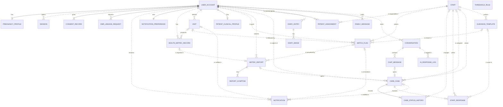

# Data Model and Mockup Data: Mother & Baby 360

| Field | Value |
|---|---|
| MODULE-ID | `MB360` — one integrated model for the 7 modules ACC, HLT, ALR, TML, BOT, APT, CLI (every entity has one owner module, §2) |
| Source specs | `specs/spec-ACC.md` v1.7.1, `spec-HLT.md` v1.7.3, `spec-ALR.md` v1.7.3, `spec-TML.md` v1.5.4, `spec-BOT.md` v1.7.2, `spec-APT.md` v1.5.1, `spec-CLI.md` v1.6.3 |
| Schema | `data/schema/schema-MB360.sql` (SQLite 3) |
| Mockup data | `data/seed/` — 26 CSV files, generator `generate_seed.py`, `README.md`, `seed-report.md` |
| Status | Logical model reviewed at gates S1 – S6 (29/09/2026); physical model = **draft** until the freeze decisions in `docs/data-model-freeze-worksheet.md` are taken |
| Date | 30/09/2026 |

Method: the spec-to-data-model steps S0 – S6 (Session 5): input map (S0), entity dictionary (S1), CRUD matrix (S2), conceptual ERD (S3), logical model (S4), mockup data (S5), review (S6), then the physical model and schema. Every claim cites its source as `{MODULE} §{section} {ID}` (e.g. `ALR §5.1 FR-020`), a decision `D-xx`, a screen `S-{ID} #{element}` or an open question `DM-xx`.

## 1. Scope and inputs

Input map used for S1 – S6 (slots not listed are absent):

```
FUNCTIONS = §5 FR tables of the 7 specs in specs/ + docs/function-list.md (122 FRs, Won't rows included)
FIELDS    = §5.1 Input / Output contract of the same specs
ENTITIES  = §6 Key entities — every attribute written name (TYPE; Required/Optional) (D-66)
RULES     = §5.2 Business rules + docs/decisions.md (D-01 – D-69)
SCENARIOS = §3 user scenarios and edge cases
FLOWS     = §4 flows + docs/architecture/
SCREENS   = §7 + screens/screen-spec-{ID}.md + screens/img/
BOUNDARY  = §1 of the specs + docs/architecture/system-configuration.md; external: TCI app (identity,
            appointments — APT BR-002), hospital EMR (simulated with seed data — ACC-01, D-59), chatbot AI service
```

Out of the model on purpose: data owned by the TCI app (appointments, slots — DM-04), two-way EMR integration (Won't), payment and device sync (Won't, MVP §5).

## 2. Entity catalogue

26 stored entities, all declared in spec §6 (none is "discovered here"); 4 more are declared in §6 but not stored. Definitions are one sentence each (gate S1).

| Entity | Definition | THING / EVENT | Owner module | Origin | Aliases | Citation |
|---|---|---|---|---|---|---|
| USER_ACCOUNT | The mother's account in the sub-app: a copy of the identity of the signed-in TCI account (full name, phone, medical record number). | THING | ACC | spec §6 | Patient, Mom, Mother, User | ACC §6 User Account; D-01 |
| SESSION | A sub-app session created from the TCI identity when the mother opens the sub-app. | EVENT | ACC | spec §6 | Sub-app session | ACC §6 Session; ACC §5.1 FR-015, FR-019 |
| PREGNANCY_PROFILE | The mother's pregnancy profile: due date, first day of last period, due-date source and height. | THING | ACC | spec §6 | Profile | ACC §6 Profile; ACC §5.1 FR-004, FR-005 |
| CONSENT_RECORD | The mother's acceptance of the terms and permission to use her TCI account information. | EVENT | ACC | spec §6 | Consent | ACC §6 Consent Record; ACC §5.1 FR-011 |
| EMR_LINKAGE_REQUEST | A request to link the mother's account to her hospital record, with its Pending / Linked status (seed data in the MVP). | EVENT | ACC | spec §6 | Hospital record link | ACC §6 EMR Linkage Request; ACC §5.1 FR-002; DM-23 |
| NOTIFICATION | A notification to the mother (Report / Visit result / Appointment / Instruction reminder) with a read state. | EVENT | ACC | spec §6 | Notifications | ACC §6 Notification; D-48 |
| NOTIFICATION_PREFERENCE | The mother's on / off switch for each notification type. | THING | ACC | spec §6 | Notification settings | ACC §6 Notification Preference; ACC §5.1 FR-027 |
| HEALTH_METRIC_RECORD | One health value measured at one time, from one of three sources (From visit / Self-entered / Doctor-assigned). | EVENT | HLT | spec §6 | metric record | HLT §6 Health Metric Record; D-41 |
| VISIT | One antenatal visit at the hospital with its conclusion, doctor's note and ultrasound results (seed data in the MVP). | EVENT | HLT | spec §6 | Visit history | HLT §6 Visit; TML §6 Visit (shared entity); D-42; D-59 |
| PATIENT_CLINICAL_PROFILE | The mother's clinical history recorded by the hospital (PARA, blood type, allergies). | THING | HLT | spec §6 | Medical history | HLT §6 Patient Clinical Profile; D-42 |
| WATCH_FLAG | A doctor's instruction to monitor one Group 2 metric, with a note and above-threshold guidance. | THING | HLT | spec §6 | Doctor's instructions, watch-flag | HLT §6 Watch-Flag; CLI §5.1 FR-025; D-24 |
| METRIC_REPORT | One report the mother submits on S-025A for a Group 2 metric or for symptoms. | EVENT | ALR | spec §6 | Report | ALR §6 Metric Report; ALR §5.1 FR-020 |
| REPORT_SYMPTOM | One symptom selected in one report. | EVENT | ALR | spec §6 | symptoms[] | ALR §6 Report Symptom; D-23; D-45 |
| CARE_CASE | A case clinical staff must look at, opened by an above-threshold report, a report with symptoms, or a chatbot question the mother agreed to send. | EVENT | ALR | spec §6 | Case, report status, Alert (S-028 only) | ALR §6 Case; ALR §5.1 FR-021; D-41 |
| CASE_STATUS_HISTORY | One status change of a case: status, time, changed by, role. | EVENT | CLI | spec §6 | status_history | CLI §6 Case Status History; ALR §6 Case; D-43 |
| STAFF_RESPONSE | One piece of guidance a nurse or doctor sends to the mother in a case. | EVENT | ALR | spec §6 | Response | ALR §6 Staff Response; CLI §5.1 FR-024 |
| GUIDANCE_TEMPLATE | A ready-made guidance text of the hospital; one is the default. | THING | ALR | spec §6 | Guidance template | ALR §6 Guidance Template; D-24 |
| THRESHOLD_RULE | One configured threshold (or display-only reference range) for one metric, with its confirmation status. | THING | ALR | spec §6 | Threshold | ALR §6 Threshold Rule; ALR §5.2 BR-004; D-52 |
| STAFF | A nurse or doctor who uses the clinical web. | THING | CLI | spec §6 | Clinical staff, Nurse, Doctor | CLI §6 Staff; D-49 |
| PATIENT_ASSIGNMENT | A doctor being responsible for a mother over a period. | EVENT | CLI | spec §6 | Responsible doctor | CLI §6 Patient Assignment; ALR §5.1 FR-009 |
| DIARY_ENTRY | One pregnancy diary entry, linked to the gestational week at saving time. | EVENT | TML | spec §6 | Diary | TML §6 Diary Entry; TML §5.1 FR-008 – FR-010 |
| DIARY_IMAGE | One photo attached to a diary entry (at most 5). | THING | TML | spec §6 | Photo | TML §6 Diary Image; D-46 |
| FAMILY_MESSAGE | One "Message to Baby" written by the mother or the father on the mother's device for a gestational week. | EVENT | TML | spec §6 | Messages to Baby | TML §6 Family Message; TML §5.1 FR-011; D-03 |
| CONVERSATION | One chatbot conversation of the mother, with its context (earlier questions / answers, gestational week). | THING | BOT | spec §6 | Chat session | BOT §6 Conversation; D-67 |
| CHAT_MESSAGE | One message in a conversation, from the mother or the chatbot, with the risk flag and the hand-off choice. | EVENT | BOT | spec §6 | Question, answer | BOT §6 Chat Message; BOT §5.1 FR-006 – FR-009 |
| AI_RESPONSE_LOG | An audit record of one AI response. | EVENT | BOT | spec §6 | Audit log | BOT §6 AI Response Log; BOT §5.1 FR-004 |
| APPOINTMENT_RECORD *(not stored — external)* | The TCI app's appointment, read only; the sub-app keeps only `appointment_ref`. | EVENT | APT (TCI app) | spec §6 — not stored | Appointment | APT §6 Appointment Record; APT §5.2 BR-002; DM-04 |
| REMINDER *(not stored)* | A scheduled trigger that produces an Appointment notification. | EVENT | APT | spec §6 — not stored | Appointment reminder | APT §6 Reminder |
| DASHBOARD_SUMMARY *(not stored — derived)* | The S-023 summary derived from VISIT, HEALTH_METRIC_RECORD, WATCH_FLAG and CARE_CASE. | EVENT | HLT | spec §6 — not stored | — | HLT §6 Dashboard Summary |
| PREGNANCY_WEEK_CONTENT *(not stored — derived)* | The week view of S-048, derived when the week is loaded. | EVENT | TML | spec §6 — not stored | Week Info, Milestone | TML §6 Pregnancy Week Content |

### 2.1 Implied items (found in FIELDS or relationships, not declared as entities)

| Item | Source | Outcome |
|---|---|---|
| reference from FAMILY_MESSAGE to the mother | TML §6 Family Message (Relationships: "belongs to Patient") | Declared in TML §6 on 30/09/2026 as `patient_id` (UUID; Required) — DM-33 |
| Notification to clinical staff ("Notification to Doctor", "Notifications (2)") | ALR §5.1 FR-009; CLI §5.2 BR-003; S-061 #4 | Output of an FR with no place to store it; NOTIFICATION holds only the mother (DM-32) |
| Clinical web sign-in / staff session | CLI §10 Q11; ACC §5.1 FR-015 ("the sub-app has no Nurse / Doctor session") | SESSION allows role Mother only; staff sessions have no entity |
| Terms document (`terms_version`) | ACC §6 Consent Record; ACC §10 Q17 | If terms versions are managed, a TERMS entity is needed |
| Facility | ACC §6 EMR Linkage Request; HLT §6 Visit; APT §6 Appointment Record | The same free text in 3 entities; if Thu Cuc has several facilities it is an entity |
| Audit log of staff actions | CLI §4.2; DM-06 | Only AI_RESPONSE_LOG and CASE_STATUS_HISTORY record actions |
| Metric catalogue (metric → group, unit) | HLT §6 `metric`, `metric_group`, `unit`; ALR §6 Threshold Rule | The metric value set is repeated in 5 entities with different subsets (DM-40) |

### 2.2 Naming and ownership conflicts (gate S1)

| Type | Items | Sources | Question | Decision |
|---|---|---|---|---|
| synonym | "Patient" (HLT, ALR, TML, BOT, APT, CLI §6 Relationships) and USER_ACCOUNT (ACC §6) | HLT §6; ALR §6; ACC §6 | Is "Patient" the mother's USER_ACCOUNT? (DM-01) | **Decided:** USER_ACCOUNT is the mother in the sub-app; every "Patient" reference points to it (DM-01) — Tâm, 29/09/2026 |
| synonym | Foreign-key column `user_id` (ACC §6, BOT §6 Conversation) and `patient_id` (HLT, ALR, TML, CLI §6) | ACC §6; BOT §6; HLT §6; ALR §6; TML §6; CLI §6 | One name for the mother's key? (DM-31) | **Decided:** keep the name declared in each spec; the physical DDL will use one name, `user_id` (DM-31) — Tâm, 29/09/2026 |
| shared ownership / collision | STAFF (CLI §6, role Nurse / Doctor) and USER_ACCOUNT.`role` (ACC §6, ENUM Mother / Nurse / Doctor, "always Mother") | CLI §6 Staff; ACC §6 User Account; D-49 | Is a staff member a USER_ACCOUNT row or a STAFF row? (DM-02) | **Decided:** separate STAFF table for Nurse and Doctor; USER_ACCOUNT holds mothers only (DM-02) — Tâm, 29/09/2026 |
| collision (technical) | "Case" is an SQL keyword | ALR §6 Case | Table name (DM-03) | **Decided:** table name is CARE_CASE (DM-03) — Tâm, 29/09/2026 |
| type mismatch | NOTIFICATION recipient: ACC §6 declares only `user_id` (Required); §10 DM-05 is recorded as Resolved with an extra `staff_id`; ALR FR-009 sends a notification to the doctor | ACC §6 Notification; ALR §10 DM-05; ALR §5.1 FR-009 | Which one is authoritative? (DM-32) | **Decided:** NOTIFICATION is sent to the mother only (`user_id`); no `staff_id` (DM-32) — Tâm, 29/09/2026 |
| type mismatch | Metric value: HLT §6 `value` VARCHAR(20) provisional; ACC §5.1 FR-004 weight DECIMAL(4,1); HLT §5.1 FR-001 and ALR §5.1 FR-014 NUMBER / ENUM | HLT §6; ACC §5.1; HLT §5.1; ALR §5.1 | How is the value stored? (DM-22) | **Decided:** one VARCHAR(20) column holding the formatted string for the MVP (DM-22) — Tâm, 29/09/2026 |
| type mismatch | Setup profile: ACC §5.1 FR-005 saves "gestational week / weight" to the profile; ACC §6 says the week is not stored and weight is a Health Metric Record | ACC §5 FR-005; ACC §6 Profile; D-42 | Which text is authoritative? (DM-42) | **Decided:** PREGNANCY_PROFILE holds EDD / LMP / height only; weight is a HEALTH_METRIC_RECORD (DM-42) — Tâm, 29/09/2026 |
| type mismatch | Hand-off choice: `handoff_choice` "No thanks" (BOT §6, FR-009) vs the button text "No, thanks" (BOT §5.2 BR-002, README UI label reference) | BOT §6; BOT §5.2 BR-002 | Stored spelling (DM-40) | **Decided:** stored value is "No thanks"; the screen shows "Không, cảm ơn" (DM-40) — Tâm, 29/09/2026 |

## 3. CRUD matrix

One row per (function, entity) pair, decided from the FR text, its §5.1 fields and the screens it serves. Not in the matrix — the Won't FRs: ACC FR-006 – FR-010, FR-012 – FR-014 (D-01); HLT FR-006 (HLT-01); ALR FR-017 (ALR-01); TML FR-001, FR-007 (D-02); APT FR-002 – FR-004, FR-006 – FR-008, FR-010 (APT-01); CLI FR-011 (CLI-03), FR-012 (D-49), FR-018, FR-022, FR-023 (CLI-05). Also not in the matrix — the Must / Should FRs that touch no entity (navigation, form display, validation, device storage): ACC FR-003, FR-004, FR-020, FR-021; ALR FR-001, FR-006, FR-010, FR-012 – FR-014; TML FR-002; BOT FR-005, FR-007; APT FR-001; CLI FR-006 — accepted in §3.2, kind 4.

| Function | Entity | Ops | Citation |
|---|---|---|---|
| ACC FR-001 | USER_ACCOUNT | R | ACC §5 FR-001 (validate identifiers); ACC §6 User Account `record_code` |
| ACC FR-001 | EMR_LINKAGE_REQUEST | R | ACC §5 FR-001 ("the link status set by the seed is shown on S-103") |
| ACC FR-002 | EMR_LINKAGE_REQUEST | C | ACC §5.1 FR-002 (Output "Linkage Request") |
| ACC FR-005 | PREGNANCY_PROFILE | C, U | ACC §5 FR-005 ("update validated clinical information") |
| ACC FR-005 | HEALTH_METRIC_RECORD | C | ACC §6 Profile (weight entered on S-007 is a Health Metric Record); D-42 |
| ACC FR-011 | CONSENT_RECORD | C | ACC §5.1 FR-011 (Output "Consent Record in DB") |
| ACC FR-011 | USER_ACCOUNT | C | ACC §5 FR-011 ("creates the User Account"); DM-08 |
| ACC FR-011 | NOTIFICATION_PREFERENCE | C | ACC §5 FR-011 ("the Notification Preference row with default values"); DM-41 |
| ACC FR-015 | SESSION | C | ACC §5.1 FR-015 (Output "Session Cookie/Token") |
| ACC FR-015 | USER_ACCOUNT | R | ACC §5.1 FR-015 (Input UUID) |
| ACC FR-016 | PREGNANCY_PROFILE | R | S-008 #5 (gestational-week card) |
| ACC FR-016 | HEALTH_METRIC_RECORD | R | S-008 #7, #12 – #15 |
| ACC FR-016 | VISIT | R | S-008 #7 (new visit results) |
| ACC FR-016 | WATCH_FLAG | R | S-008 #9 (Doctor's instructions card) |
| ACC FR-016 | CARE_CASE | R | S-008 #8 ("My reports" card) |
| ACC FR-017 | USER_ACCOUNT | R | ACC §5.1 FR-017 (User Profile Object); S-008 #4 |
| ACC FR-017 | PREGNANCY_PROFILE | R | ACC §5.1 FR-017 ("whether an EDD exists") |
| ACC FR-018 | PREGNANCY_PROFILE | R | ACC §5.1 FR-018 (Extended Profile Data) |
| ACC FR-019 | SESSION | U | ACC §5.1 FR-019 ("Sub-app Session Invalidated"); DM-19 |
| ACC FR-022 | PREGNANCY_PROFILE | U | ACC §5 FR-022; S-011 §7 |
| ACC FR-023 | USER_ACCOUNT | R | ACC §5 FR-023; S-103 |
| ACC FR-023 | PREGNANCY_PROFILE | R | S-103 |
| ACC FR-023 | EMR_LINKAGE_REQUEST | R | S-103 ("Hospital record link" bottom sheet) |
| ACC FR-024 | USER_ACCOUNT | R | ACC §5 FR-024; S-011 |
| ACC FR-024 | PREGNANCY_PROFILE | R | S-011 |
| ACC FR-025 | NOTIFICATION | R | ACC §5.1 FR-025 (Notification List; Unread Count) |
| ACC FR-026 | NOTIFICATION | U | ACC §5.1 FR-026 (Read status updated) |
| ACC FR-027 | NOTIFICATION_PREFERENCE | U | ACC §5.1 FR-027 (Preference saved) |
| HLT FR-001 | HEALTH_METRIC_RECORD | R | HLT §5 FR-001 |
| HLT FR-001 | THRESHOLD_RULE | R | HLT §5 FR-001 (threshold label computed by ALR); D-52 |
| HLT FR-002 | HEALTH_METRIC_RECORD | R | HLT §3 US-1; S-023 |
| HLT FR-002 | VISIT | R | S-023 section 1 (Latest visit results) |
| HLT FR-002 | WATCH_FLAG | R | S-023 (Doctor's instructions card) |
| HLT FR-002 | CARE_CASE | R | S-023 #13 ("My reports" card) |
| HLT FR-003 | HEALTH_METRIC_RECORD | R | HLT §5 FR-003 (refresh) |
| HLT FR-004 | HEALTH_METRIC_RECORD | R | HLT §5 FR-004 |
| HLT FR-004 | CARE_CASE | R | HLT §5 FR-004 ("also updates the My reports card") |
| HLT FR-005 | HEALTH_METRIC_RECORD | R | HLT §5 FR-005 |
| HLT FR-007 | HEALTH_METRIC_RECORD | C | HLT §5.1 FR-007 (Output "DB Insert ID") |
| HLT FR-008 | HEALTH_METRIC_RECORD | R | HLT §5.1 FR-008 (Aggregated Data Result) |
| HLT FR-009 | HEALTH_METRIC_RECORD | R | HLT §5 FR-009; S-025 |
| HLT FR-009 | THRESHOLD_RULE | R | S-025 (threshold line); ALR §6 Threshold Rule (Relationships) |
| HLT FR-010 | HEALTH_METRIC_RECORD | R | HLT §5 FR-010 |
| HLT FR-011 | HEALTH_METRIC_RECORD | R | HLT §5.1 FR-011 (Average, Lowest, Highest) |
| HLT FR-012 | HEALTH_METRIC_RECORD | R | HLT §5 FR-012 |
| ALR FR-002 | CARE_CASE | R | ALR §5 FR-002 ("her reports and chatbot cases on S-029") |
| ALR FR-002 | METRIC_REPORT | R | ALR §5 FR-002; S-029 |
| ALR FR-002 | HEALTH_METRIC_RECORD | R | S-029 (value shown on each report card) |
| ALR FR-002 | CHAT_MESSAGE | R | S-029 (chatbot case card shows the question) |
| ALR FR-003 | CARE_CASE | R | ALR §5.1 FR-003 (filter by status) |
| ALR FR-003 | METRIC_REPORT | R | ALR §5.1 FR-003 (filter by type) |
| ALR FR-004 | CARE_CASE | U | ALR §5.1 FR-004 (DB Updated + Timestamp) |
| ALR FR-004 | CASE_STATUS_HISTORY | C | ALR §5 FR-004; D-43 |
| ALR FR-005 | METRIC_REPORT | R | ALR §5 FR-005 (report code, metric, note) |
| ALR FR-005 | REPORT_SYMPTOM | R | ALR §5 FR-005 (symptoms) |
| ALR FR-005 | HEALTH_METRIC_RECORD | R | ALR §5 FR-005 (value, measurement time) |
| ALR FR-005 | THRESHOLD_RULE | R | ALR §5 FR-005 (threshold label, computed — D-17) |
| ALR FR-005 | CARE_CASE | R | ALR §5 FR-005 (progress) |
| ALR FR-005 | CASE_STATUS_HISTORY | R | ALR §5 FR-005 (progress stepper, S-026) |
| ALR FR-005 | STAFF_RESPONSE | R | ALR §5 FR-005 (response) |
| ALR FR-005 | CHAT_MESSAGE | R | S-026 chatbot-case variant (not drawn) |
| ALR FR-007 | WATCH_FLAG | R | ALR §5 FR-007 ("Doctor's guidance" on S-028); ALR §5.2 BR-013 |
| ALR FR-007 | GUIDANCE_TEMPLATE | R | ALR §5.2 BR-013 (default template) |
| ALR FR-007 | STAFF_RESPONSE | R | ALR §5 FR-007 (S-026 clinical staff response) |
| ALR FR-008 | CARE_CASE | R | ALR §5 FR-008 ("Not viewed" queue) |
| ALR FR-009 | CARE_CASE | U | ALR §5.1 FR-009 (Status = "Escalated to doctor") |
| ALR FR-009 | CASE_STATUS_HISTORY | C | ALR §5.2 BR-016 |
| ALR FR-009 | PATIENT_ASSIGNMENT | R | CLI §6 Patient Assignment ("used by ALR FR-009") |
| ALR FR-011 | WATCH_FLAG | R | ALR §5.1 FR-011 (LIST of Watch-Flag) |
| ALR FR-015 | PREGNANCY_PROFILE | R | ALR §5.1 FR-015 (gestational week from the EDD) |
| ALR FR-016 | WATCH_FLAG | U | ALR §5.1 FR-016 (Output "Guidance stored"); HLT §6 `over_threshold_guidance` |
| ALR FR-016 | GUIDANCE_TEMPLATE | R | ALR §5.1 FR-016 (template_id) |
| ALR FR-018 | NOTIFICATION | C | ALR §5.1 FR-018 (Notification created) |
| ALR FR-018 | NOTIFICATION_PREFERENCE | R | ALR §5 FR-018 ("respecting her notification settings") |
| ALR FR-018 | CARE_CASE | R | ALR §5.1 FR-018 (UUID) |
| ALR FR-019 | NOTIFICATION | C | ALR §5.1 FR-019 |
| ALR FR-019 | NOTIFICATION_PREFERENCE | R | ALR §5 FR-019 |
| ALR FR-019 | VISIT | R | ALR §5 FR-019 ("when a new Visit record becomes available") |
| ALR FR-020 | METRIC_REPORT | C | ALR §5.1 FR-020 (Report ID) |
| ALR FR-020 | REPORT_SYMPTOM | C | ALR §5 FR-020 (symptoms) |
| ALR FR-020 | HEALTH_METRIC_RECORD | C | ALR §5.1 FR-020 (Health Metric Record ID) |
| ALR FR-020 | WATCH_FLAG | R | ALR §5 FR-020 ("the Watch-Flag it answers") |
| ALR FR-021 | CARE_CASE | C | ALR §5.1 FR-021 (Case ID) |
| ALR FR-021 | CASE_STATUS_HISTORY | C | ALR §5 FR-021 ("first status-history row, changed by System") |
| ALR FR-021 | METRIC_REPORT | R | ALR §5.1 FR-021 (UUID) |
| ALR FR-021 | THRESHOLD_RULE | R | ALR §5.1 FR-021 (threshold label) |
| ALR FR-021 | CHAT_MESSAGE | R | ALR §5.1 FR-021 ("— or — UUID"); BOT §5 FR-008 |
| ALR FR-022 | NOTIFICATION | C | ALR §5.1 FR-022 (Notification created) |
| ALR FR-022 | WATCH_FLAG | R | ALR §5.1 FR-022 (Watch-Flag ID) |
| ALR FR-022 | NOTIFICATION_PREFERENCE | R | ALR §5 FR-022 ("only when the switch is on") |
| TML FR-003 | VISIT | R | TML §5 FR-003 ("the week's visit data") |
| TML FR-003 | DIARY_ENTRY | R | TML §5 FR-003 |
| TML FR-003 | DIARY_IMAGE | R | TML §5 FR-003; S-048 |
| TML FR-003 | FAMILY_MESSAGE | R | TML §5 FR-003 ("Messages to Baby of that week") |
| TML FR-003 | PREGNANCY_PROFILE | R | TML §6 Pregnancy Week Content (Week Info) |
| TML FR-004 | VISIT | R | TML §5 FR-004 (adjacent weeks) |
| TML FR-004 | DIARY_ENTRY | R | TML §5 FR-004 |
| TML FR-004 | FAMILY_MESSAGE | R | TML §5 FR-004 |
| TML FR-005 | VISIT | R | TML §5 FR-005 (milestone card = visit card) |
| TML FR-006 | PREGNANCY_PROFILE | R | TML §5 FR-006 ("according to her gestational week") |
| TML FR-008 | DIARY_ENTRY | C | TML §5 FR-008 |
| TML FR-008 | PREGNANCY_PROFILE | R | TML §5.2 BR-005 (current week) |
| TML FR-009 | DIARY_ENTRY | C | TML §5 FR-009 (content, mood) |
| TML FR-009 | DIARY_IMAGE | C | TML §5 FR-009 (photos) |
| TML FR-010 | DIARY_ENTRY | C | TML §5 FR-010 (save) |
| TML FR-011 | FAMILY_MESSAGE | C, R | TML §5 FR-011 ("save and display") |
| BOT FR-001 | CHAT_MESSAGE | C | BOT §5 FR-001; BOT §6 Chat Message |
| BOT FR-002 | CHAT_MESSAGE | C | BOT §5 FR-002 (AI response) |
| BOT FR-002 | CONVERSATION | R | BOT §5.2 BR-001 (earlier questions / answers) |
| BOT FR-003 | CONVERSATION | C, U | BOT §5 FR-003 (store conversation context); D-67 |
| BOT FR-004 | AI_RESPONSE_LOG | C | BOT §5 FR-004 |
| BOT FR-006 | CHAT_MESSAGE | U | BOT §5 FR-006 ("record the result in `is_risk`") |
| BOT FR-008 | CHAT_MESSAGE | U | BOT §5 FR-008 (`handoff_choice`) |
| BOT FR-008 | CARE_CASE | C | BOT §5 FR-008 ("create a Case … through ALR FR-021") |
| BOT FR-009 | CHAT_MESSAGE | U | BOT §5 FR-009 (`handoff_choice` = No thanks) |
| APT FR-005 | APPOINTMENT_RECORD | R | APT §5 FR-005 (read-only card on S-008) — external |
| APT FR-009 | NOTIFICATION | C | APT §5 FR-009 ("creates the mother's Appointment notification") |
| APT FR-009 | NOTIFICATION_PREFERENCE | R | APT §5 FR-009 ("when the Appointment reminders switch is on") |
| APT FR-009 | APPOINTMENT_RECORD | R | APT §6 Reminder — external |
| CLI FR-001 | STAFF | R | CLI §5 FR-001 ("the header shows role + name"); D-28 |
| CLI FR-002 | CARE_CASE | R | CLI §5 FR-002 ("Cases to handle" table) |
| CLI FR-002 | USER_ACCOUNT | R | S-061 #8 (Mother) |
| CLI FR-002 | PREGNANCY_PROFILE | R | S-061 #9 (gestational age from the EDD) |
| CLI FR-002 | METRIC_REPORT | R | S-061 #11 (Content) |
| CLI FR-002 | REPORT_SYMPTOM | R | S-061 #11 (symptoms) |
| CLI FR-002 | HEALTH_METRIC_RECORD | R | S-061 #12 (Value) |
| CLI FR-002 | THRESHOLD_RULE | R | S-061 #12 (threshold label) |
| CLI FR-002 | CHAT_MESSAGE | R | S-061 #11 (chatbot case: the mother's question) |
| CLI FR-003 | CARE_CASE | R | CLI §5 FR-003 (Report block, status) |
| CLI FR-003 | METRIC_REPORT | R | CLI §5 FR-003 |
| CLI FR-003 | REPORT_SYMPTOM | R | CLI §5 FR-003 (symptoms) |
| CLI FR-003 | HEALTH_METRIC_RECORD | R | CLI §5 FR-003 (value, measurement time, source) |
| CLI FR-003 | CHAT_MESSAGE | R | CLI §5 FR-003 (chatbot case) |
| CLI FR-004 | CARE_CASE | U | CLI §5 FR-004 ("Mark as viewed") |
| CLI FR-004 | CASE_STATUS_HISTORY | C | CLI §5.2 BR-002 |
| CLI FR-005 | CARE_CASE | U | CLI §5 FR-005 |
| CLI FR-005 | CASE_STATUS_HISTORY | C | CLI §5 FR-005 ("recorded in status_history") |
| CLI FR-005 | NOTIFICATION | C | CLI §5 FR-005 (notifies the mother through ALR FR-018) |
| CLI FR-007 | USER_ACCOUNT | R | CLI §5 FR-007 (name, medical record number) |
| CLI FR-007 | PREGNANCY_PROFILE | R | CLI §5 FR-007 (gestational week, due date) |
| CLI FR-007 | VISIT | R | CLI §5 FR-007 (latest visit) |
| CLI FR-007 | PATIENT_CLINICAL_PROFILE | R | CLI §5 FR-007 (PARA, blood type, allergies) |
| CLI FR-008 | HEALTH_METRIC_RECORD | R | CLI §5 FR-008 (Metric history) |
| CLI FR-008 | THRESHOLD_RULE | R | CLI §5 FR-008 (threshold line) |
| CLI FR-009 | CARE_CASE | R | CLI §5 FR-009 |
| CLI FR-010 | VISIT | R | CLI §5 FR-010 (Visit, Visit history) |
| CLI FR-010 | HEALTH_METRIC_RECORD | R | CLI §5 FR-010 (visit values) |
| CLI FR-013 | CARE_CASE | R | CLI §5 FR-013 |
| CLI FR-014 | CARE_CASE | R | CLI §5 FR-014 (Case + Metric Report + Health Metric Record — D-41) |
| CLI FR-014 | METRIC_REPORT | R | CLI §5 FR-014 |
| CLI FR-014 | HEALTH_METRIC_RECORD | R | CLI §5 FR-014 |
| CLI FR-015 | CARE_CASE | R | CLI §5 FR-015 (Report block) |
| CLI FR-015 | HEALTH_METRIC_RECORD | R | CLI §5 FR-015 (Metric history for that metric) |
| CLI FR-016 | CARE_CASE | U | CLI §5 FR-016 ("Close case" → Resolved) |
| CLI FR-016 | CASE_STATUS_HISTORY | C | CLI §5.2 BR-002 |
| CLI FR-017 | CARE_CASE | U | CLI §5 FR-017 ("Close case") |
| CLI FR-017 | CASE_STATUS_HISTORY | C | CLI §5.2 BR-002 |
| CLI FR-019 | CARE_CASE | U | CLI §5 FR-019 ("Escalate to doctor") |
| CLI FR-019 | CASE_STATUS_HISTORY | C | CLI §5.2 BR-002 |
| CLI FR-019 | PATIENT_ASSIGNMENT | R | CLI §5.2 BR-003 ("responsible doctor's account") |
| CLI FR-020 | CARE_CASE | R | CLI §5 FR-020 ("Not viewed" filter) |
| CLI FR-021 | CARE_CASE | U | CLI §5 FR-021 (as FR-016) |
| CLI FR-021 | CASE_STATUS_HISTORY | C | CLI §5.2 BR-002 |
| CLI FR-024 | STAFF_RESPONSE | C | CLI §5 FR-024 |
| CLI FR-024 | GUIDANCE_TEMPLATE | R | CLI §5 FR-024 ("choosing a guidance template") |
| CLI FR-024 | STAFF | R | S-026 ("Response from …" shows the responder) |
| CLI FR-025 | WATCH_FLAG | C, U | CLI §5 FR-025 ("add or edit") |
| CLI FR-025 | GUIDANCE_TEMPLATE | R | CLI §5 FR-025 (Above-threshold guidance template) |
| CLI FR-025 | VISIT | R | CLI §5 FR-025 (Visit ID); HLT §10 Q19 |

### 3.1 Coverage per entity

| Entity | Created by | Read by | Updated by | Deleted by |
|---|---|---|---|---|
| USER_ACCOUNT | ACC FR-011 | ACC FR-001, FR-015, FR-017, FR-023, FR-024; CLI FR-002, FR-007 | — | — |
| SESSION | ACC FR-015 | — | ACC FR-019 | — |
| PREGNANCY_PROFILE | ACC FR-005 | ACC FR-016, FR-017, FR-018, FR-023, FR-024; ALR FR-015; TML FR-003, FR-006, FR-008; CLI FR-002, FR-007 | ACC FR-005, FR-022 | — |
| CONSENT_RECORD | ACC FR-011 | — | — | — |
| EMR_LINKAGE_REQUEST | ACC FR-002 | ACC FR-001, FR-023 | — | — |
| NOTIFICATION | ALR FR-018, FR-019, FR-022; APT FR-009; CLI FR-005 | ACC FR-025 | ACC FR-026 | — |
| NOTIFICATION_PREFERENCE | ACC FR-011 | ALR FR-018, FR-019, FR-022; APT FR-009 | ACC FR-027 | — |
| HEALTH_METRIC_RECORD | ACC FR-005; HLT FR-007; ALR FR-020 | ACC FR-016; HLT FR-001, FR-002, FR-003, FR-004, FR-005, FR-008, FR-009, FR-010, FR-011, FR-012; ALR FR-002, FR-005; CLI FR-002, FR-003, FR-008, FR-010, FR-014, FR-015 | — | — |
| VISIT | — (seed data — D-59) | ACC FR-016; HLT FR-002; ALR FR-019; TML FR-003, FR-004, FR-005; CLI FR-007, FR-010, FR-025 | — | — |
| PATIENT_CLINICAL_PROFILE | — (seed data — D-59) | CLI FR-007 | — | — |
| WATCH_FLAG | CLI FR-025 | ACC FR-016; HLT FR-002; ALR FR-007, FR-011, FR-020, FR-022 | ALR FR-016; CLI FR-025 | — |
| METRIC_REPORT | ALR FR-020 | ALR FR-002, FR-003, FR-005, FR-021; CLI FR-002, FR-003, FR-014 | — | — |
| REPORT_SYMPTOM | ALR FR-020 | ALR FR-005; CLI FR-002, FR-003 | — | — |
| CARE_CASE | ALR FR-021; BOT FR-008 | ACC FR-016; HLT FR-002, FR-004; ALR FR-002, FR-003, FR-005, FR-008, FR-018; CLI FR-002, FR-003, FR-009, FR-013, FR-014, FR-015, FR-020 | ALR FR-004, FR-009; CLI FR-004, FR-005, FR-016, FR-017, FR-019, FR-021 | — |
| CASE_STATUS_HISTORY | ALR FR-004, FR-009, FR-021; CLI FR-004, FR-005, FR-016, FR-017, FR-019, FR-021 | ALR FR-005 | — | — |
| STAFF_RESPONSE | CLI FR-024 | ALR FR-005, FR-007 | — | — |
| GUIDANCE_TEMPLATE | — (seed data — DM-10) | ALR FR-007, FR-016; CLI FR-024, FR-025 | — | — |
| THRESHOLD_RULE | — (configuration — D-52) | HLT FR-001, FR-009; ALR FR-005, FR-021; CLI FR-002, FR-008 | — | — |
| STAFF | — (seed data — DM-10) | CLI FR-001, FR-024 | — | — |
| PATIENT_ASSIGNMENT | — (seed data — DM-10, D-68) | ALR FR-009; CLI FR-019 | — | — |
| DIARY_ENTRY | TML FR-008, FR-009, FR-010 | TML FR-003, FR-004 | — | — |
| DIARY_IMAGE | TML FR-009 | TML FR-003 | — | — |
| FAMILY_MESSAGE | TML FR-011 | TML FR-003, FR-004, FR-011 | — | — |
| CONVERSATION | BOT FR-003 | BOT FR-002 | BOT FR-003 | — |
| CHAT_MESSAGE | BOT FR-001, FR-002 | ALR FR-002, FR-005, FR-021; CLI FR-002, FR-003 | BOT FR-006, FR-008, FR-009 | — |
| AI_RESPONSE_LOG | BOT FR-004 | — | — | — |
| APPOINTMENT_RECORD | — (TCI app) | APT FR-005, FR-009 | — | — |

No function deletes anything (DM-13); delete behaviour is in §9.

### 3.2 Anomalies (gate S2)

Kinds: 1 — no function creates the entity; 2 — created but never read; 3 — several creators; 4 — function touching no entity; 5 — entity no function touches.

| Kind | Entity or function | Finding | Question | Resolution |
|---|---|---|---|---|
| 1 — no C | USER_ACCOUNT | **Missing function.** ACC FR-012 (create account) is Won't (D-01); FR-011 records consent and FR-015 only reads the User ID. No FR writes the copy of the TCI account. | DM-08 | **Accepted:** created together with the consent record in ACC FR-011 (DM-08) — Tâm, 29/09/2026 |
| 1 — no C | NOTIFICATION_PREFERENCE | **Missing function.** ACC FR-027 only saves a changed toggle; nothing creates the row the first time. | DM-41 | **Accepted:** created with default values together with USER_ACCOUNT in ACC FR-011 (DM-41) — Tâm, 29/09/2026 |
| 1 — no C | VISIT, PATIENT_CLINICAL_PROFILE | **Seed data, not a defect** (D-59): no entry screen and no EMR in the MVP. | — | **Accepted:** seed data for the MVP (D-59); not a defect — Tâm, 29/09/2026 |
| 1 — no C | STAFF, PATIENT_ASSIGNMENT, GUIDANCE_TEMPLATE | **Missing function or seed data** — how staff accounts, the responsible doctor and templates come into being is not settled. | DM-10 | **Accepted:** seed data for the MVP; no entry screen is built (DM-10) — Tâm, 29/09/2026 |
| 1 — no C | THRESHOLD_RULE | **Configuration data, not a defect** (D-52): loaded from ALR BR-004; moving a rule to Confirmed has no FR. | DM-27 | **Accepted:** configuration data loaded from ALR BR-004; not a defect — Tâm, 29/09/2026 |
| 1 — no C | APPOINTMENT_RECORD | **External** (APT BR-002): created in the TCI app. | — | **Accepted:** external data owned by the TCI app (APT BR-002) — Tâm, 29/09/2026 |
| 2 — C, no R | SESSION | Read by the authentication layer, not by a business FR. | — | **Accepted:** read by the authentication middleware; no business FR needed — Tâm, 29/09/2026 |
| 2 — C, no R | CONSENT_RECORD | **Missing function (read).** ACC BR-004 must read it to decide whether S-001 state 2 is shown. | DM-11 | **Accepted:** the read is part of ACC FR-015 (DM-11) — Tâm, 29/09/2026 |
| 2 — C, no R | AI_RESPONSE_LOG | Audit log; no reading screen in the MVP. | DM-06 | **Accepted:** audit log; no reading screen in the MVP — Tâm, 29/09/2026 |
| 3 — several creators | HEALTH_METRIC_RECORD | ACC FR-005 (setup weight), HLT FR-007 (Group 1), ALR FR-020 (reports) and seed (From visit). §6 says it is the single value table (D-41). | — | **Accepted:** single value table (D-41); every writer goes through it — Tâm, 29/09/2026 |
| 3 — several creators | NOTIFICATION | ALR FR-018, FR-019, FR-022; APT FR-009; CLI FR-005 (through ALR FR-018). | — | **Accepted:** several modules create notifications for the mother; ACC reads them — Tâm, 29/09/2026 |
| 3 — several creators | CASE_STATUS_HISTORY | ALR FR-004, FR-009, FR-021; CLI FR-004, FR-005, FR-016, FR-017, FR-019, FR-021 — the same actions in two modules (X-02). | DM-12 | **Accepted:** status changes are written through the shared path ALR FR-021 / ALR FR-004 (DM-12) — Tâm, 29/09/2026 |
| 3 — several creators | CARE_CASE | ALR FR-021 and BOT FR-008 (which calls ALR FR-021). | — | **Accepted:** BOT FR-008 calls ALR FR-021; one creating function — Tâm, 29/09/2026 |
| 4 — function touching no entity | ACC FR-003, FR-004, FR-020, FR-021 | Navigation, validation only, device storage. | — | **Accepted:** interface, validation and device-storage functions; they write no table — Tâm, 29/09/2026 |
| 4 — function touching no entity | ALR FR-001, FR-006, FR-010, FR-012, FR-013, FR-014 | Navigation, form display, validation. | — | **Accepted:** interface, form-display and validation functions; they write no table — Tâm, 29/09/2026 |
| 4 — function touching no entity | TML FR-002; BOT FR-005, FR-007; APT FR-001; CLI FR-006 | Navigation, typing indicator, hand-off offer display, link to the TCI app. | — | **Accepted:** interface and hand-off-display functions; they write no table — Tâm, 29/09/2026 |
| 4 — function output with no entity | ALR FR-009 ("Notification to Doctor"); CLI §5.2 BR-003 | The high-priority notification to the responsible doctor has nowhere to be stored. | DM-32 | **Accepted:** shown in real time on the clinical web screen; not stored in NOTIFICATION (DM-32) — Tâm, 29/09/2026 |
| 5 — entity no function touches | (none) | Every stored entity in 01 is touched by at least one function. | — | **Accepted:** no surplus entity — Tâm, 29/09/2026 |

## 4. Entity-relationship diagram

Conceptual ERD: the 26 stored entities and 40 relationships; no types or keys (those are in §6 and the schema). `--` = identifying (the child's key contains the parent's key), `..` = non-identifying. THRESHOLD_RULE has no relationship: it is configuration read by the threshold check. Each relationship is read both ways in §4.1.



### 4.1 Relationships read both ways (gate S3)

| # | Left — right | Marker | Forward | Reverse | Side that may be zero | Citation |
|---|---|---|---|---|---|---|
| R01 | USER_ACCOUNT — PREGNANCY_PROFILE | `\|\|--o\|` | Each USER_ACCOUNT has zero or one PREGNANCY_PROFILE | Each PREGNANCY_PROFILE belongs to exactly one USER_ACCOUNT | profile side: consented, no due date yet (ACC BR-006) | ACC §6 User Account "has one Profile" |
| R02 | USER_ACCOUNT — SESSION | `\|\|..o{` | Each USER_ACCOUNT opens zero or many SESSIONs | Each SESSION belongs to exactly one USER_ACCOUNT | session side: account never opened | ACC §6 Session |
| R03 | USER_ACCOUNT — CONSENT_RECORD | `\|\|--\|{` | Each USER_ACCOUNT gives one or many CONSENT_RECORDs | Each CONSENT_RECORD belongs to exactly one USER_ACCOUNT | none: the account is created together with the first accepted consent (ACC FR-011, DM-08); "Later" saves nothing (ACC BR-004) | ACC §6 Consent Record; ACC §5 FR-011; ACC §5.2 BR-004 |
| R04 | USER_ACCOUNT — EMR_LINKAGE_REQUEST | `\|\|--o{` | Each USER_ACCOUNT sends zero or many EMR_LINKAGE_REQUESTs | Each EMR_LINKAGE_REQUEST belongs to exactly one USER_ACCOUNT | request side: no record link | ACC §6 EMR Linkage Request |
| R05 | USER_ACCOUNT — NOTIFICATION | `\|\|..o{` | Each USER_ACCOUNT receives zero or many NOTIFICATIONs | Each NOTIFICATION is sent to exactly one USER_ACCOUNT | notification side: nothing sent yet | ACC §6 Notification (`user_id` Required) |
| R06 | USER_ACCOUNT — NOTIFICATION_PREFERENCE | `\|\|--\|\|` | Each USER_ACCOUNT has exactly one NOTIFICATION_PREFERENCE | Each NOTIFICATION_PREFERENCE belongs to exactly one USER_ACCOUNT | none: created with default values together with the account (ACC FR-011, DM-41) | ACC §6 Notification Preference "1 / User Account"; ACC §5 FR-011 |
| R07 | USER_ACCOUNT — HEALTH_METRIC_RECORD | `\|\|..o{` | Each USER_ACCOUNT has zero or many HEALTH_METRIC_RECORDs | Each HEALTH_METRIC_RECORD belongs to exactly one USER_ACCOUNT | record side: nothing measured, no visit | HLT §6 Health Metric Record "many records per mother" |
| R08 | USER_ACCOUNT — VISIT | `\|\|..o{` | Each USER_ACCOUNT attends zero or many VISITs | Each VISIT belongs to exactly one USER_ACCOUNT | visit side: no visit yet | HLT §6 Visit "belongs to Patient" |
| R09 | USER_ACCOUNT — PATIENT_CLINICAL_PROFILE | `\|\|--o\|` | Each USER_ACCOUNT has zero or one PATIENT_CLINICAL_PROFILE | Each PATIENT_CLINICAL_PROFILE belongs to exactly one USER_ACCOUNT | profile side: no hospital data yet | HLT §6 Patient Clinical Profile "1 per mother" |
| R10 | USER_ACCOUNT — WATCH_FLAG | `\|\|..o{` | Each USER_ACCOUNT is given zero or many WATCH_FLAGs | Each WATCH_FLAG belongs to exactly one USER_ACCOUNT | flag side: no instruction yet (S-027 empty state) | HLT §6 Watch-Flag "belongs to Patient" |
| R11 | USER_ACCOUNT — METRIC_REPORT | `\|\|..o{` | Each USER_ACCOUNT submits zero or many METRIC_REPORTs | Each METRIC_REPORT is submitted by exactly one USER_ACCOUNT | report side: no report yet (S-029 empty state) | ALR §6 Metric Report "submitted by Mom" |
| R12 | USER_ACCOUNT — CARE_CASE | `\|\|..o{` | Each USER_ACCOUNT is the subject of zero or many CARE_CASEs | Each CARE_CASE belongs to exactly one USER_ACCOUNT | case side: no report opened a case (ALR BR-009) | ALR §6 Case "belongs to Patient" |
| R13 | USER_ACCOUNT — PATIENT_ASSIGNMENT | `\|\|--o{` | Each USER_ACCOUNT is covered by zero or many PATIENT_ASSIGNMENTs | Each PATIENT_ASSIGNMENT belongs to exactly one USER_ACCOUNT | assignment side: no responsible doctor yet (CLI §10 Q10) | CLI §6 Patient Assignment |
| R14 | STAFF — PATIENT_ASSIGNMENT | `\|\|..o{` | Each STAFF is responsible in zero or many PATIENT_ASSIGNMENTs | Each PATIENT_ASSIGNMENT names exactly one STAFF | assignment side: a nurse, or a doctor with no mother | CLI §6 Patient Assignment (`doctor_id` Required) |
| R15 | USER_ACCOUNT — DIARY_ENTRY | `\|\|..o{` | Each USER_ACCOUNT writes zero or many DIARY_ENTRYs | Each DIARY_ENTRY belongs to exactly one USER_ACCOUNT | entry side: no diary yet | TML §6 Diary Entry "many per patient" |
| R16 | USER_ACCOUNT — FAMILY_MESSAGE | `\|\|--o{` | Each USER_ACCOUNT holds zero or many FAMILY_MESSAGEs | Each FAMILY_MESSAGE belongs to exactly one USER_ACCOUNT | message side: no message; the father has no account | TML §6 Family Message "belongs to Patient"; DM-33 |
| R17 | USER_ACCOUNT — CONVERSATION | `\|\|..o{` | Each USER_ACCOUNT starts zero or many CONVERSATIONs | Each CONVERSATION belongs to exactly one USER_ACCOUNT | conversation side: chatbot never used | BOT §6 Conversation "belongs to Patient" |
| R18 | VISIT — HEALTH_METRIC_RECORD | `\|o..o{` | Each VISIT produces zero or many HEALTH_METRIC_RECORDs | Each HEALTH_METRIC_RECORD comes from zero or one VISIT | visit side: source Self-entered / Doctor-assigned | HLT §6 Health Metric Record (`visit_id` Required when source = From visit) |
| R19 | VISIT — WATCH_FLAG | `\|o..o{` | Each VISIT is followed by zero or many WATCH_FLAGs | Each WATCH_FLAG follows zero or one VISIT | visit side: `visit_id` Optional (HLT §10 Q19) | HLT §6 Watch-Flag "0..1 Visit" |
| R20 | STAFF — WATCH_FLAG | `\|\|..o{` | Each STAFF places zero or many WATCH_FLAGs | Each WATCH_FLAG is placed by exactly one STAFF | flag side: nurses never place one (D-29) | HLT §6 Watch-Flag `flagged_by`; CLI §6 Staff |
| R21 | GUIDANCE_TEMPLATE — WATCH_FLAG | `\|o..o{` | Each GUIDANCE_TEMPLATE is chosen in zero or many WATCH_FLAGs | Each WATCH_FLAG uses zero or one GUIDANCE_TEMPLATE | template side: custom text only, or none (default template used — BR-013) | HLT §6 Watch-Flag `over_threshold_guidance`; ALR §6 Guidance Template |
| R22 | WATCH_FLAG — METRIC_REPORT | `\|o..o{` | Each WATCH_FLAG is answered by zero or many METRIC_REPORTs | Each METRIC_REPORT answers zero or one WATCH_FLAG | flag side: symptom report | ALR §6 Metric Report `watch_flag_id` |
| R23 | HEALTH_METRIC_RECORD — METRIC_REPORT | `\|o..o\|` | Each HEALTH_METRIC_RECORD is reported in zero or one METRIC_REPORT | Each METRIC_REPORT reports zero or one HEALTH_METRIC_RECORD | report side: Group 1 and visit values; record side: symptom report | ALR §6 Metric Report "points to 0..1 Health Metric Record"; HLT §6 "referenced by 0..1 Metric Report" |
| R24 | METRIC_REPORT — REPORT_SYMPTOM | `\|\|--\|{` | Each METRIC_REPORT lists one or many REPORT_SYMPTOMs | Each REPORT_SYMPTOM belongs to exactly one METRIC_REPORT | none: every report has ≥ 1 item (BR-017) | ALR §6 Metric Report "has 1..n Report Symptom" |
| R25 | METRIC_REPORT — CARE_CASE | `\|o..o\|` | Each METRIC_REPORT opens zero or one CARE_CASE | Each CARE_CASE is opened by zero or one METRIC_REPORT | case side: Normal with no symptoms (BR-008); report side: chatbot case | ALR §6 Case "0..1 Case per Metric Report" |
| R26 | CHAT_MESSAGE — CARE_CASE | `\|o..o\|` | Each CHAT_MESSAGE opens zero or one CARE_CASE | Each CARE_CASE is opened by zero or one CHAT_MESSAGE | case side: no hand-off; message side: report case | ALR §6 Case "0..1 Case per Chat Message"; BOT §6 |
| R27 | CONVERSATION — CHAT_MESSAGE | `\|\|..o{` | Each CONVERSATION contains zero or many CHAT_MESSAGEs | Each CHAT_MESSAGE belongs to exactly one CONVERSATION | message side: chatbot opened, nothing sent | BOT §6 Conversation "has many Chat Messages" |
| R28 | CONVERSATION — AI_RESPONSE_LOG | `\|\|..o{` | Each CONVERSATION is logged in zero or many AI_RESPONSE_LOGs | Each AI_RESPONSE_LOG belongs to exactly one CONVERSATION | log side: no answer yet | BOT §6 AI Response Log |
| R29 | CARE_CASE — CASE_STATUS_HISTORY | `\|\|--\|{` | Each CARE_CASE records one or many CASE_STATUS_HISTORYs | Each CASE_STATUS_HISTORY belongs to exactly one CARE_CASE | none: FR-021 writes the first "Not viewed" row | CLI §6 Case Status History; ALR §5.1 FR-021 |
| R30 | STAFF — CASE_STATUS_HISTORY | `\|o..o{` | Each STAFF changes zero or many CASE_STATUS_HISTORYs | Each CASE_STATUS_HISTORY is changed by zero or one STAFF | staff side: role = System | CLI §6 Case Status History `changed_by` |
| R31 | CARE_CASE — STAFF_RESPONSE | `\|\|..o{` | Each CARE_CASE receives zero or many STAFF_RESPONSEs | Each STAFF_RESPONSE belongs to exactly one CARE_CASE | response side: no guidance sent yet (Safety note shown — BR-011) | ALR §6 Staff Response "belongs to 1 Case" |
| R32 | STAFF — STAFF_RESPONSE | `\|\|..o{` | Each STAFF writes zero or many STAFF_RESPONSEs | Each STAFF_RESPONSE is written by exactly one STAFF | response side: staff who never sent guidance | ALR §6 Staff Response `responder_id`; CLI §6 Staff |
| R33 | GUIDANCE_TEMPLATE — STAFF_RESPONSE | `\|o..o{` | Each GUIDANCE_TEMPLATE is used in zero or many STAFF_RESPONSEs | Each STAFF_RESPONSE uses zero or one GUIDANCE_TEMPLATE | template side: custom text only | ALR §6 Staff Response `template_id` |
| R34 | STAFF — CARE_CASE | `\|o..o{` | Each STAFF is assigned zero or many CARE_CASEs | Each CARE_CASE is assigned to zero or one STAFF | staff side: not escalated | ALR §6 Case `assigned_doctor_id` |
| R35 | STAFF — CARE_CASE | `\|o..o{` | Each STAFF closes zero or many CARE_CASEs | Each CARE_CASE is closed by zero or one STAFF | staff side: case still open | ALR §6 Case `closed_by` |
| R36 | STAFF — GUIDANCE_TEMPLATE | `\|o..o{` | Each STAFF authors zero or many GUIDANCE_TEMPLATEs | Each GUIDANCE_TEMPLATE is authored by zero or one STAFF | staff side: template loaded from seed | ALR §6 Guidance Template `created_by` |
| R37 | CARE_CASE — NOTIFICATION | `\|o..o{` | Each CARE_CASE is notified in zero or many NOTIFICATIONs | Each NOTIFICATION targets zero or one CARE_CASE | case side: other notification types | ACC §6 Notification (target `case_id`) |
| R38 | VISIT — NOTIFICATION | `\|o..o{` | Each VISIT is notified in zero or many NOTIFICATIONs | Each NOTIFICATION targets zero or one VISIT | visit side: other notification types | ACC §6 Notification (target `visit_id`); ALR FR-019 |
| R39 | WATCH_FLAG — NOTIFICATION | `\|o..o{` | Each WATCH_FLAG is reminded in zero or many NOTIFICATIONs | Each NOTIFICATION targets zero or one WATCH_FLAG | flag side: other notification types | ACC §6 Notification (target `watch_flag_id`); ALR FR-022 |
| R40 | DIARY_ENTRY — DIARY_IMAGE | `\|\|..o{` | Each DIARY_ENTRY has zero or many DIARY_IMAGEs | Each DIARY_IMAGE belongs to exactly one DIARY_ENTRY | image side: no photo (at most 5 — D-46) | TML §6 Diary Entry "has 0..5 Diary Image" |

No many-to-many relationship is left: the only one, mother ↔ responsible doctor over time, is resolved by PATIENT_ASSIGNMENT (R13, R14).

## 5. Diagram check

Checked by `tools/check_data_model.py` (run from the repository root). The numbers must agree before the tag is pushed.

| Check | Catalogue (§2 / §6) | ERD (§4) | Schema (`schema-MB360.sql`) | Agree? |
|---|---|---|---|---|
| Stored entities / tables | 26 | 26 | 26 | Yes |
| Attributes / columns | 175 | — (conceptual) | 175 | Yes |
| Relationships / foreign keys | 40 (foreign-key columns) | 40 | 40 | Yes |
| Relationships read both ways (§4.1) | — | 40 of 40 | — | Yes |
| Marker agrees with its forward and reverse sentence | — | 40 of 40 | — | Yes |
| Seed files / tables | — | — | 26 tables, 26 files, 272 rows | Yes |

## 6. Logical data model

One table per stored entity. **Column** and **Type (as declared)** are exactly as spec §6 declares them; **Physical** is the column in the schema. The only renaming is `patient_id` → `user_id` (DM-31: the physical model uses one name for the mother's key). The column order is the order of the schema and of the seed CSV header.

### USER_ACCOUNT

Owner: ACC.

| Column | Physical | Type (as declared) | Physical type | Required | Key | Citation |
|---|---|---|---|---|---|---|
| `user_id` | `user_id` | UUID | TEXT | Yes | PK | ACC §6 User Account |
| `tci_account_ref` | `tci_account_ref` | VARCHAR(64) | VARCHAR(64) | Yes | UK | ACC §6 User Account; D-01; type decided in S4 (identity mechanism still open — ACC §10 Q9) |
| `full_name` | `full_name` | VARCHAR(100) | VARCHAR(100) | Yes |  | ACC §6 User Account (copy of the TCI account) |
| `phone` | `phone` | VARCHAR(20) | VARCHAR(20) | Yes |  | ACC §6 User Account (copy of the TCI account) |
| `date_of_birth` | `date_of_birth` | DATE | TEXT | Yes |  | ACC §6 User Account (copy of the TCI account; age is calculated, not stored); D-71 |
| `sex` | `sex` | ENUM (Female) | TEXT | Yes |  | ACC §6 User Account (copy of the TCI account); ACC BR-007, D-71 — only a female TCI account opens the sub-app |
| `record_code` | `record_code` | VARCHAR(20) | VARCHAR(20) | No | UK | ACC §6 User Account (medical record number, e.g. TC-00123) |
| `role` | `role` | ENUM (Mother) | TEXT | Yes |  | ACC §6 User Account; D-49; DM-02 (staff roles are in STAFF) |

Natural key: `tci_account_ref` (one TCI account = one row); `record_code` is a second candidate key when present.

### SESSION

Owner: ACC.

| Column | Physical | Type (as declared) | Physical type | Required | Key | Citation |
|---|---|---|---|---|---|---|
| `session_token` | `session_token` | VARCHAR(255) | VARCHAR(255) | Yes | PK | ACC §6 Session; ACC §5.1 FR-015 (Output) |
| `user_id` | `user_id` | UUID | TEXT | Yes | FK → USER_ACCOUNT | ACC §6 Session |
| `role` | `role` | ENUM (Mother) | TEXT | Yes |  | ACC §6 Session; ACC §5.1 FR-015 ("the sub-app has no Nurse / Doctor session") |
| `created_at` | `created_at` | DATETIME | TEXT | Yes |  | ACC §6 Session |
| `expires_at` | `expires_at` | DATETIME — lifetime open (ACC §10 Q9) | TEXT | Yes |  | ACC §6 Session |

Natural key: `session_token`.

### PREGNANCY_PROFILE

Owner: ACC. Gestational week is calculated from the EDD and not stored (ACC §6). Weight entered on S-007 is a HEALTH_METRIC_RECORD (D-42).

| Column | Physical | Type (as declared) | Physical type | Required | Key | Citation |
|---|---|---|---|---|---|---|
| `user_id` | `user_id` | UUID | TEXT | Yes | PK, FK → USER_ACCOUNT | ACC §6 Profile |
| `edd` | `edd` | DATE | TEXT | Yes |  | ACC §6 Profile (Due date) |
| `lmp` | `lmp` | DATE | TEXT | No |  | ACC §6 Profile (First day of last menstrual period) |
| `edd_source` | `edd_source` | ENUM (Self-entered / Hospital record) | TEXT | Yes |  | ACC §6 Profile; ACC §5.2 BR-003 |
| `height_cm` | `height_cm` | DECIMAL(4,1) | NUMERIC | No |  | ACC §6 Profile; D-13 |
| `first_visit_date` | `first_visit_date` | DATE | TEXT | No |  | ACC §6 Profile (first antenatal check-up date entered at setup); D-72 — later visits stay hospital seed data (D-59) |

Natural key: `user_id` (one pregnancy profile per mother).

### CONSENT_RECORD

Owner: ACC. Created by ACC FR-011 together with the USER_ACCOUNT (DM-08); "Later" saves nothing (ACC BR-004), so every stored row has `accepted` = true.

| Column | Physical | Type (as declared) | Physical type | Required | Key | Citation |
|---|---|---|---|---|---|---|
| `user_id` | `user_id` | UUID | TEXT | Yes | PK, FK → USER_ACCOUNT | ACC §6 Consent Record |
| `accepted_at` | `accepted_at` | DATETIME | TEXT | Yes | PK | ACC §6 Consent Record |
| `accepted` | `accepted` | BOOLEAN | INTEGER | Yes |  | ACC §6 Consent Record |
| `terms_version` | `terms_version` | VARCHAR(20) — provisional (ACC §10 Q17) | VARCHAR(20) | No |  | ACC §6 Consent Record |
| `tci_data_permission` | `tci_data_permission` | BOOLEAN | INTEGER | Yes |  | ACC §6 Consent Record; ACC §5.1 FR-011 |

Natural key: (`user_id`, `accepted_at`) — §6 declares no identifier, so the natural key is the primary key (DM-34).

### EMR_LINKAGE_REQUEST

Owner: ACC. MVP: every row is seed data (ACC §6, DM-23); no error state.

| Column | Physical | Type (as declared) | Physical type | Required | Key | Citation |
|---|---|---|---|---|---|---|
| `user_id` | `user_id` | UUID | TEXT | Yes | PK, FK → USER_ACCOUNT | ACC §6 EMR Linkage Request |
| `record_code` | `record_code` | VARCHAR(20) | VARCHAR(20) | Yes |  | ACC §6 EMR Linkage Request (EMR record ID = medical record number) |
| `facility` | `facility` | VARCHAR(100) | VARCHAR(100) | Yes |  | ACC §6 EMR Linkage Request |
| `status` | `status` | ENUM (Pending / Linked) | TEXT | Yes |  | ACC §6 EMR Linkage Request; S-103 |
| `requested_at` | `requested_at` | DATETIME | TEXT | Yes | PK | ACC §6 EMR Linkage Request |
| `linked_at` | `linked_at` | DATETIME | TEXT | No |  | ACC §6 EMR Linkage Request ("empty while Pending") |

Natural key: (`user_id`, `requested_at`) — §6 declares no identifier (DM-34).

### NOTIFICATION

Owner: ACC. The mother is the only recipient (DM-32 resolved, DM-05 superseded): the ALR FR-009 notification to the doctor is not stored; the clinical web derives it from CARE_CASE (status "Escalated to doctor", `assigned_doctor_id`). At most one target column is set (seed check).

| Column | Physical | Type (as declared) | Physical type | Required | Key | Citation |
|---|---|---|---|---|---|---|
| `notification_id` | `notification_id` | UUID | TEXT | Yes | PK | ACC §6 Notification |
| `user_id` | `user_id` | UUID | TEXT | Yes | FK → USER_ACCOUNT | ACC §6 Notification |
| `type` | `type` | ENUM (Report / Visit result / Appointment / Instruction reminder) | TEXT | Yes |  | ACC §6 Notification; D-48 |
| `title` | `title` | VARCHAR(100) | VARCHAR(100) | Yes |  | ACC §6 Notification |
| `subtitle` | `subtitle` | VARCHAR(200) | VARCHAR(200) | No |  | ACC §6 Notification |
| `created_at` | `created_at` | DATETIME | TEXT | Yes |  | ACC §6 Notification |
| `read_at` | `read_at` | DATETIME | TEXT | No |  | ACC §6 Notification ("empty = unread") |
| `case_id` | `case_id` | UUID | TEXT | No | FK → CARE_CASE | ACC §6 Notification (target) |
| `visit_id` | `visit_id` | UUID | TEXT | No | FK → VISIT | ACC §6 Notification (target) |
| `watch_flag_id` | `watch_flag_id` | UUID | TEXT | No | FK → WATCH_FLAG | ACC §6 Notification (target — Instruction reminder) |
| `appointment_ref` | `appointment_ref` | VARCHAR(64) | VARCHAR(64) | No |  | ACC §6 Notification (target — reference in the TCI app); DM-04 |

Natural key: none — (`user_id`, `type`, target, `created_at`) is a candidate; `notification_id` is used.

### NOTIFICATION_PREFERENCE

Owner: ACC. Created with default values by ACC FR-011 together with the USER_ACCOUNT (DM-41); exactly one row per mother.

| Column | Physical | Type (as declared) | Physical type | Required | Key | Citation |
|---|---|---|---|---|---|---|
| `user_id` | `user_id` | UUID | TEXT | Yes | PK, FK → USER_ACCOUNT | ACC §6 Notification Preference |
| `report_response` | `report_response` | BOOLEAN | INTEGER | Yes |  | ACC §6 Notification Preference ("always on, proposal" — ACC §10 Q13) |
| `new_visit_result` | `new_visit_result` | BOOLEAN | INTEGER | Yes |  | ACC §6 Notification Preference |
| `appointment_reminder` | `appointment_reminder` | BOOLEAN | INTEGER | Yes |  | ACC §6 Notification Preference |
| `watch_flag_reminder` | `watch_flag_reminder` | BOOLEAN | INTEGER | Yes |  | ACC §6 Notification Preference |
| `updated_at` | `updated_at` | DATETIME | TEXT | Yes |  | ACC §6 Notification Preference |

Natural key: `user_id` (one settings row per mother).

### HEALTH_METRIC_RECORD

Owner: HLT. `threshold_label` is not stored: it is computed from THRESHOLD_RULE for Group 2 only (HLT §6, D-52).

| Column | Physical | Type (as declared) | Physical type | Required | Key | Citation |
|---|---|---|---|---|---|---|
| `record_id` | `record_id` | UUID | TEXT | Yes | PK | HLT §6 Health Metric Record |
| `patient_id` | `user_id` | UUID | TEXT | Yes | FK → USER_ACCOUNT | HLT §6 Health Metric Record |
| `metric` | `metric` | ENUM (Weight / Temperature / Heart rate / Sleep / Blood pressure / Blood glucose / Urine protein / Fetal heart rate) | TEXT | Yes |  | HLT §6 Health Metric Record |
| `metric_group` | `metric_group` | ENUM (Group 1 / Group 2 / Visit) | TEXT | Yes |  | HLT §6 Health Metric Record; D-11, D-51 |
| `value` | `value` | VARCHAR(20) (DM-22: one formatted string) | VARCHAR(20) | Yes |  | HLT §6 Health Metric Record |
| `unit` | `unit` | VARCHAR(10) | VARCHAR(10) | No |  | HLT §6 Health Metric Record |
| `glucose_context` | `glucose_context` | ENUM (fasting / post_1h / post_2h) | TEXT | No |  | HLT §6 Health Metric Record ("blood glucose only") |
| `measured_at` | `measured_at` | DATETIME | TEXT | Yes |  | HLT §6 Health Metric Record |
| `source` | `source` | ENUM (From visit / Self-entered / Doctor-assigned) | TEXT | Yes |  | HLT §6 Health Metric Record; D-10; D-33 |
| `visit_id` | `visit_id` | UUID | TEXT | Required when source = From visit | FK → VISIT | HLT §6 Health Metric Record |
| `gestational_week` | `gestational_week` | INTEGER 0–42 | INTEGER | Yes |  | HLT §6 Health Metric Record; ALR §5.1 FR-015 |
| `created_at` | `created_at` | DATETIME | TEXT | Yes |  | HLT §6 Health Metric Record |

Natural key: none — (`patient_id`, `metric`, `measured_at`) is a candidate if DM-20 forbids duplicates; `record_id` is used.

### VISIT

Owner: HLT. Seed data prepared by the clinical role; no entry screen and no EMR integration in the MVP (D-59).

| Column | Physical | Type (as declared) | Physical type | Required | Key | Citation |
|---|---|---|---|---|---|---|
| `visit_id` | `visit_id` | UUID | TEXT | Yes | PK | HLT §6 Visit |
| `patient_id` | `user_id` | UUID | TEXT | Yes | FK → USER_ACCOUNT | HLT §6 Visit |
| `visit_date` | `visit_date` | DATE | TEXT | Yes |  | HLT §6 Visit |
| `facility` | `facility` | VARCHAR(100) | VARCHAR(100) | Yes |  | HLT §6 Visit |
| `visit_type` | `visit_type` | VARCHAR(100) | VARCHAR(100) | Yes |  | HLT §6 Visit |
| `conclusion` | `conclusion` | TEXT | TEXT | No |  | HLT §6 Visit |
| `doctor_note` | `doctor_note` | TEXT | TEXT | No |  | HLT §6 Visit |
| `ultrasound_image` | `ultrasound_image` | VARCHAR(255) (file path) | VARCHAR(255) | No |  | HLT §6 Visit |
| `fetal_length` | `fetal_length` | DECIMAL(5,1) (cm) | NUMERIC | No |  | HLT §6 Visit |
| `estimated_fetal_weight` | `estimated_fetal_weight` | DECIMAL(6,1) (gram) | NUMERIC | No |  | HLT §6 Visit |
| `ultrasound_report_date` | `ultrasound_report_date` | DATE | TEXT | No |  | HLT §6 Visit; TML §5.2 BR-003 |
| `gestational_week` | `gestational_week` | INTEGER 0–42 | INTEGER | Yes |  | HLT §6 Visit |

Natural key: none — (`patient_id`, `visit_date`, `visit_type`) is a candidate; `visit_id` is used.

### PATIENT_CLINICAL_PROFILE

Owner: HLT.

| Column | Physical | Type (as declared) | Physical type | Required | Key | Citation |
|---|---|---|---|---|---|---|
| `patient_id` | `user_id` | UUID | TEXT | Yes | PK, FK → USER_ACCOUNT | HLT §6 Patient Clinical Profile |
| `obstetric_history` | `obstetric_history` | VARCHAR(10) (PARA, e.g. "1001") | VARCHAR(10) | No |  | HLT §6 Patient Clinical Profile |
| `blood_type` | `blood_type` | ENUM (A+ / A− / B+ / B− / AB+ / AB− / O+ / O−) | TEXT | No |  | HLT §6 Patient Clinical Profile |
| `allergies` | `allergies` | TEXT | TEXT | No |  | HLT §6 Patient Clinical Profile |
| `updated_at` | `updated_at` | DATETIME | TEXT | Yes |  | HLT §6 Patient Clinical Profile |

Natural key: `patient_id` (one per mother).

### WATCH_FLAG

Owner: HLT. `over_threshold_guidance` is a nested object in §6; it is flattened to `template_id` + `custom_text` (DM-35). UI name: "Doctor's instructions".

| Column | Physical | Type (as declared) | Physical type | Required | Key | Citation |
|---|---|---|---|---|---|---|
| `flag_id` | `flag_id` | UUID | TEXT | Yes | PK | HLT §6 Watch-Flag |
| `patient_id` | `user_id` | UUID | TEXT | Yes | FK → USER_ACCOUNT | HLT §6 Watch-Flag |
| `visit_id` | `visit_id` | UUID | TEXT | No | FK → VISIT | HLT §6 Watch-Flag (how the visit is chosen: HLT §10 Q19) |
| `metric` | `metric` | ENUM (Blood pressure / Blood glucose / Urine protein) | TEXT | Yes |  | HLT §6 Watch-Flag ("group 2 only") |
| `flagged_by` | `flagged_by` | UUID | TEXT | Yes | FK → STAFF | HLT §6 Watch-Flag ("Doctor, Staff") |
| `flagged_at` | `flagged_at` | DATE | TEXT | Yes |  | HLT §6 Watch-Flag |
| `note` | `note` | TEXT — maximum length open (S-064 #9) | TEXT | No |  | HLT §6 Watch-Flag |
| `template_id` | `template_id` | UUID | TEXT | No | FK → GUIDANCE_TEMPLATE | HLT §6 Watch-Flag `over_threshold_guidance.template_id`; D-24 |
| `custom_text` | `custom_text` | TEXT, ≤ 1000 characters | TEXT | No |  | HLT §6 Watch-Flag `over_threshold_guidance.custom_text`; D-46 |
| `active` | `active` | BOOLEAN | INTEGER | Yes |  | HLT §6 Watch-Flag |

Natural key: none — (`patient_id`, `metric`) among active rows if DM-21 holds; `flag_id` is used.

### METRIC_REPORT

Owner: ALR. `threshold_label` is computed from the record + THRESHOLD_RULE, not stored (ALR §6, D-17; DM-14).

| Column | Physical | Type (as declared) | Physical type | Required | Key | Citation |
|---|---|---|---|---|---|---|
| `report_id` | `report_id` | UUID | TEXT | Yes | PK | ALR §6 Metric Report |
| `report_code` | `report_code` | VARCHAR(20) — provisional (ALR §10 Q16) | VARCHAR(20) | Yes | UK | ALR §6 Metric Report (e.g. BC-0926-015) |
| `patient_id` | `user_id` | UUID | TEXT | Yes | FK → USER_ACCOUNT | ALR §6 Metric Report |
| `metric` | `metric` | ENUM (Blood pressure / Blood glucose / Urine protein / Symptom) | TEXT | Yes |  | ALR §6 Metric Report |
| `health_metric_record_id` | `health_metric_record_id` | UUID | TEXT | Required when metric ≠ Symptom | FK → HEALTH_METRIC_RECORD, UK | ALR §6 Metric Report; D-41 |
| `other_symptom_text` | `other_symptom_text` | VARCHAR(100) | VARCHAR(100) | No |  | ALR §6 Metric Report ("only when Other is selected") |
| `note` | `note` | TEXT — maximum length open (ALR §10 Q14) | TEXT | No |  | ALR §6 Metric Report |
| `submitted_at` | `submitted_at` | DATETIME | TEXT | Yes |  | ALR §6 Metric Report |
| `watch_flag_id` | `watch_flag_id` | UUID | TEXT | No | FK → WATCH_FLAG | ALR §6 Metric Report ("the instruction the report answers") |

Natural key: `report_code`.

### REPORT_SYMPTOM

Owner: ALR. ≥ 1 row per report; "No symptoms" excludes the others (ALR §5.2 BR-017, D-45).

| Column | Physical | Type (as declared) | Physical type | Required | Key | Citation |
|---|---|---|---|---|---|---|
| `report_id` | `report_id` | UUID | TEXT | Yes | PK, FK → METRIC_REPORT | ALR §6 Report Symptom |
| `symptom` | `symptom` | ENUM (No symptoms / Vaginal bleeding / Severe abdominal pain / Waters breaking or fluid leakage / Severe headache, dizziness or blurred vision / Absence of fetal movement / Palpitations / Other) | TEXT | Yes | PK | ALR §6 Report Symptom; D-73 (replaces the D-23 list) |

Natural key: (`report_id`, `symptom`) — §6 declares no identifier (DM-34).

### CARE_CASE

Owner: ALR. Table name CARE_CASE because CASE is an SQL keyword (DM-03); the UI says "case". No `severity` or `trigger` column (D-17, D-41).

| Column | Physical | Type (as declared) | Physical type | Required | Key | Citation |
|---|---|---|---|---|---|---|
| `case_id` | `case_id` | UUID | TEXT | Yes | PK | ALR §6 Case |
| `patient_id` | `user_id` | UUID | TEXT | Yes | FK → USER_ACCOUNT | ALR §6 Case |
| `case_source` | `case_source` | ENUM (Metric report / Symptom / Chatbot) | TEXT | Yes |  | ALR §6 Case; D-41 |
| `status` | `status` | ENUM (Not viewed / Viewed / Escalated to doctor / Resolved) | TEXT | Yes |  | ALR §6 Case; D-18 |
| `metric_report_id` | `metric_report_id` | UUID | TEXT | Required when case_source ≠ Chatbot | FK → METRIC_REPORT, UK | ALR §6 Case |
| `chat_message_id` | `chat_message_id` | UUID | TEXT | Required when case_source = Chatbot | FK → CHAT_MESSAGE, UK | ALR §6 Case; BOT §6 Chat Message |
| `assigned_doctor_id` | `assigned_doctor_id` | UUID | TEXT | No | FK → STAFF | ALR §6 Case (= the mother's active PATIENT_ASSIGNMENT when escalated — spec D-68, ALR §10 Q19 resolved) |
| `created_at` | `created_at` | DATETIME | TEXT | Yes |  | ALR §6 Case |
| `closed_at` | `closed_at` | DATETIME | TEXT | No |  | ALR §6 Case |
| `closed_by` | `closed_by` | UUID | TEXT | No | FK → STAFF | ALR §6 Case |

Natural key: none — `metric_report_id` or `chat_message_id` identifies the origin; `case_id` is used.

### CASE_STATUS_HISTORY

Owner: CLI.

| Column | Physical | Type (as declared) | Physical type | Required | Key | Citation |
|---|---|---|---|---|---|---|
| `case_id` | `case_id` | UUID | TEXT | Yes | PK, FK → CARE_CASE | CLI §6 Case Status History |
| `status` | `status` | ENUM (Not viewed / Viewed / Escalated to doctor / Resolved) | TEXT | Yes | PK | CLI §6 Case Status History; D-43 |
| `changed_at` | `changed_at` | DATETIME | TEXT | Yes |  | CLI §6 Case Status History |
| `changed_by` | `changed_by` | UUID | TEXT | No ("empty when role = System") | FK → STAFF | CLI §6 Case Status History |
| `role` | `role` | ENUM (System / Nurse / Doctor) | TEXT | Yes |  | CLI §6 Case Status History; ALR §5.1 FR-021 |

Natural key: (`case_id`, `status`) — §6 declares no identifier; status only moves forward and each status appears once per case (ALR §5.2 BR-016), so the pair is unique (DM-34).

### STAFF_RESPONSE

Owner: ALR. At least one of `template_id` / `custom_text` (ALR §6).

| Column | Physical | Type (as declared) | Physical type | Required | Key | Citation |
|---|---|---|---|---|---|---|
| `response_id` | `response_id` | UUID | TEXT | Yes | PK | ALR §6 Staff Response |
| `case_id` | `case_id` | UUID | TEXT | Yes | FK → CARE_CASE | ALR §6 Staff Response |
| `responder_id` | `responder_id` | UUID | TEXT | Yes | FK → STAFF | ALR §6 Staff Response |
| `responder_role` | `responder_role` | ENUM (Nurse / Doctor) | TEXT | Yes |  | ALR §6 Staff Response |
| `template_id` | `template_id` | UUID | TEXT | No | FK → GUIDANCE_TEMPLATE | ALR §6 Staff Response |
| `custom_text` | `custom_text` | TEXT, ≤ 1000 characters | TEXT | No |  | ALR §6 Staff Response; D-46 |
| `sent_at` | `sent_at` | DATETIME | TEXT | Yes |  | ALR §6 Staff Response |

Natural key: none — `response_id` is used.

### GUIDANCE_TEMPLATE

Owner: ALR.

| Column | Physical | Type (as declared) | Physical type | Required | Key | Citation |
|---|---|---|---|---|---|---|
| `template_id` | `template_id` | UUID | TEXT | Yes | PK | ALR §6 Guidance Template |
| `title` | `title` | VARCHAR(100) | VARCHAR(100) | Yes |  | ALR §6 Guidance Template |
| `content` | `content` | TEXT, ≤ 1000 characters | TEXT | Yes |  | ALR §6 Guidance Template; D-46 |
| `is_default` | `is_default` | BOOLEAN | INTEGER | Yes |  | ALR §6 Guidance Template; ALR §5.2 BR-013 |
| `metric` | `metric` | ENUM (Blood pressure / Blood glucose / Urine protein) | TEXT | No |  | ALR §6 Guidance Template |
| `created_by` | `created_by` | UUID | TEXT | No ("templates loaded from seed have none") | FK → STAFF | ALR §6 Guidance Template |

Natural key: none — `title` is a candidate; `template_id` is used.

### THRESHOLD_RULE

Owner: ALR. Values come only from ALR §5.2 BR-004 (D-14; D-15 Pending SME). Blood pressure = 2 rows, `combine` = any.

| Column | Physical | Type (as declared) | Physical type | Required | Key | Citation |
|---|---|---|---|---|---|---|
| `rule_id` | `rule_id` | UUID | TEXT | Yes | PK | ALR §6 Threshold Rule; D-52 |
| `metric` | `metric` | ENUM (Blood pressure / Blood glucose / Urine protein / Fetal heart rate) | TEXT | Yes |  | ALR §6 Threshold Rule |
| `glucose_context` | `glucose_context` | ENUM (fasting / post_1h / post_2h) | TEXT | No |  | ALR §6 Threshold Rule ("blood glucose only") |
| `component` | `component` | ENUM (systolic / diastolic) | TEXT | No |  | ALR §6 Threshold Rule ("blood pressure only") |
| `combine` | `combine` | ENUM (any / all) | TEXT | No |  | ALR §6 Threshold Rule |
| `operator` | `operator` | ENUM (≥ / outside range) | TEXT | Yes |  | ALR §6 Threshold Rule |
| `threshold_values` | `threshold_values` | VARCHAR(20) | VARCHAR(20) | Yes |  | ALR §6 Threshold Rule ("must hold both 140 and 1+") |
| `unit` | `unit` | VARCHAR(10) | VARCHAR(10) | Yes |  | ALR §6 Threshold Rule |
| `purpose` | `purpose` | ENUM (Report check / Display only) | TEXT | Yes |  | ALR §6 Threshold Rule; D-12 |
| `source` | `source` | VARCHAR(100) | VARCHAR(100) | Yes |  | ALR §6 Threshold Rule |
| `confirmation_status` | `confirmation_status` | ENUM (Confirmed / Pending SME) | TEXT | Yes |  | ALR §6 Threshold Rule; D-15 |
| `effective_from` | `effective_from` | DATE | TEXT | Yes |  | ALR §6 Threshold Rule |

Natural key: (`metric`, `glucose_context`, `component`, `effective_from`).

### STAFF

Owner: CLI. Separate from USER_ACCOUNT (DM-02 resolved).

| Column | Physical | Type (as declared) | Physical type | Required | Key | Citation |
|---|---|---|---|---|---|---|
| `staff_id` | `staff_id` | UUID | TEXT | Yes | PK | CLI §6 Staff |
| `full_name` | `full_name` | VARCHAR(100) | VARCHAR(100) | Yes |  | CLI §6 Staff |
| `role` | `role` | ENUM (Nurse / Doctor) | TEXT | Yes |  | CLI §6 Staff; D-49 |
| `login_account` | `login_account` | VARCHAR(100) — provisional (CLI §10 Q11) | VARCHAR(100) | Yes | UK | CLI §6 Staff |

Natural key: `login_account`.

### PATIENT_ASSIGNMENT

Owner: CLI. At most 1 active responsible doctor per mother (CLI §6). Kept: the responsible doctor is assigned by the hospital (spec D-68, CLI §10 Q10 option (b)); seed data in the MVP (DM-10).

| Column | Physical | Type (as declared) | Physical type | Required | Key | Citation |
|---|---|---|---|---|---|---|
| `patient_id` | `user_id` | UUID | TEXT | Yes | PK, FK → USER_ACCOUNT | CLI §6 Patient Assignment |
| `doctor_id` | `doctor_id` | UUID | TEXT | Yes | FK → STAFF | CLI §6 Patient Assignment ("Staff with role Doctor") |
| `valid_from` | `valid_from` | DATE | TEXT | Yes | PK | CLI §6 Patient Assignment |
| `valid_to` | `valid_to` | DATE | TEXT | No |  | CLI §6 Patient Assignment ("empty = still active") |

Natural key: (`patient_id`, `valid_from`) — §6 declares no identifier (DM-34).

### DIARY_ENTRY

Owner: TML. Read-only after saving (D-60).

| Column | Physical | Type (as declared) | Physical type | Required | Key | Citation |
|---|---|---|---|---|---|---|
| `diary_id` | `diary_id` | UUID | TEXT | Yes | PK | TML §6 Diary Entry |
| `patient_id` | `user_id` | UUID | TEXT | Yes | FK → USER_ACCOUNT | TML §6 Diary Entry |
| `text` | `text` | TEXT — maximum length open (TML §10 Q9) | TEXT | Yes |  | TML §6 Diary Entry |
| `mood` | `mood` | ENUM (Happy / Calm / Nervous / Tired / Worried) | TEXT | No |  | TML §6 Diary Entry |
| `gestational_week` | `gestational_week` | INTEGER 0–42 | INTEGER | Yes |  | TML §6 Diary Entry; TML §5.2 BR-005 |
| `entry_date` | `entry_date` | DATE | TEXT | Yes |  | TML §6 Diary Entry; TML §5.2 BR-002 |

Natural key: none — several entries per day are possible; `diary_id` is used.

### DIARY_IMAGE

Owner: TML. At most 5 per diary entry (D-46; TML-01 pending).

| Column | Physical | Type (as declared) | Physical type | Required | Key | Citation |
|---|---|---|---|---|---|---|
| `image_id` | `image_id` | UUID | TEXT | Yes | PK | TML §6 Diary Image |
| `diary_id` | `diary_id` | UUID | TEXT | Yes | FK → DIARY_ENTRY | TML §6 Diary Image |
| `file` | `file` | VARCHAR(255) (path of a JPG / PNG ≤ 10 MB) | VARCHAR(255) | Yes |  | TML §6 Diary Image |
| `sort_order` | `sort_order` | INTEGER 1–5 | INTEGER | Yes |  | TML §6 Diary Image; D-46 |

Natural key: (`diary_id`, `sort_order`).

### FAMILY_MESSAGE

Owner: TML. Must item pending Client approval (D-03).

| Column | Physical | Type (as declared) | Physical type | Required | Key | Citation |
|---|---|---|---|---|---|---|
| `patient_id` | `user_id` | UUID | TEXT | Yes | PK, FK → USER_ACCOUNT | TML §6 Family Message; DM-33 |
| `week` | `week` | INTEGER 0–42 | INTEGER | Yes |  | TML §6 Family Message (gestational week) |
| `author` | `author` | ENUM (Mother / Father) | TEXT | Yes |  | TML §6 Family Message; D-03 |
| `text` | `text` | VARCHAR(200) | VARCHAR(200) | Yes |  | TML §6 Family Message; TML §5.2 BR-004 |
| `created_at` | `created_at` | DATETIME | TEXT | Yes | PK | TML §6 Family Message |

Natural key: (`patient_id`, `created_at`) — §6 declares no identifier (DM-34).

### CONVERSATION

Owner: BOT.

| Column | Physical | Type (as declared) | Physical type | Required | Key | Citation |
|---|---|---|---|---|---|---|
| `conversation_id` | `conversation_id` | UUID | TEXT | Yes | PK | BOT §6 Conversation |
| `user_id` | `user_id` | UUID | TEXT | Yes | FK → USER_ACCOUNT | BOT §6 Conversation |
| `current_session_data` | `current_session_data` | JSON | TEXT | No |  | BOT §6 Conversation (earlier questions / answers + gestational week — D-67) |

Natural key: none — `conversation_id` is used.

### CHAT_MESSAGE

Owner: BOT. No rating column (BOT-02).

| Column | Physical | Type (as declared) | Physical type | Required | Key | Citation |
|---|---|---|---|---|---|---|
| `message_id` | `message_id` | UUID | TEXT | Yes | PK | BOT §6 Chat Message |
| `conversation_id` | `conversation_id` | UUID | TEXT | Yes | FK → CONVERSATION | BOT §6 Chat Message |
| `sender` | `sender` | ENUM (Mother / Chatbot) | TEXT | Yes |  | BOT §6 Chat Message |
| `text` | `text` | TEXT (the mother's question ≤ 500 characters — D-46) | TEXT | Yes |  | BOT §6 Chat Message |
| `parsed_intent` | `parsed_intent` | JSON | TEXT | No |  | BOT §6 Chat Message ("the mother's questions only") |
| `is_risk` | `is_risk` | BOOLEAN, default false | INTEGER | Yes |  | BOT §6 Chat Message; BOT §5.1 FR-006 |
| `handoff_choice` | `handoff_choice` | ENUM (Connect to nurse / No thanks) | TEXT | No |  | BOT §6 Chat Message; BOT §5.1 FR-008, FR-009 |
| `sent_at` | `sent_at` | DATETIME | TEXT | Yes |  | BOT §6 Chat Message |

Natural key: none — `message_id` is used.

### AI_RESPONSE_LOG

Owner: BOT.

| Column | Physical | Type (as declared) | Physical type | Required | Key | Citation |
|---|---|---|---|---|---|---|
| `log_id` | `log_id` | UUID | TEXT | Yes | PK | BOT §6 AI Response Log |
| `conversation_id` | `conversation_id` | UUID | TEXT | Yes | FK → CONVERSATION | BOT §6 AI Response Log |
| `ai_response_data` | `ai_response_data` | TEXT | TEXT | Yes |  | BOT §6 AI Response Log |
| `audit_log_entry` | `audit_log_entry` | JSON | TEXT | No |  | BOT §6 AI Response Log |

Natural key: none — `log_id` is used.

### 6.1 Type conflicts (gate S4)

| Field | Source A | Source B | Question | Decision |
|---|---|---|---|---|
| `HEALTH_METRIC_RECORD.value` | VARCHAR(20), provisional / Yes — HLT §6 | DECIMAL(4,1) kg — ACC §5.1 FR-004 (weight); NUMBER / ENUM — HLT §5.1 FR-001, ALR §5.1 FR-014 | DM-22 | **Decided:** VARCHAR(20), formatted string (DM-22) — Trung, 29/09/2026 |
| `NOTIFICATION` recipient | `user_id` UUID / Required, no `staff_id` — ACC §6 | extra `staff_id`, exactly one recipient — ALR §10 DM-05 (Resolved) | DM-32 | **Decided:** `user_id` only; the mother is the only recipient (DM-32) — Trung, 29/09/2026 |
| `USER_ACCOUNT.role` / `SESSION.role` | ENUM (Mother / Nurse / Doctor) — ACC §6 User Account | ENUM (Mother) — ACC §6 Session, ACC §5.1 FR-015; staff role in STAFF — CLI §6 | DM-02 | **Decided:** always "Mother"; staff roles live in STAFF (DM-02) — Trung, 29/09/2026 |
| `WATCH_FLAG.flagged_at` | DATE — HLT §6 | every other `…_at` column is DATETIME (e.g. `submitted_at`, `sent_at`, `changed_at`) | DM-38 | **Decided:** keep DATE as declared in HLT §6 (DM-38) — Trung, 29/09/2026 |
| `CHAT_MESSAGE.text` | TEXT, the mother's question ≤ 500 — BOT §6, D-46 | the same column holds chatbot answers (`sender` = Chatbot) with no stated limit | DM-36 | **Decided:** TEXT; the mother's question ≤ 500, a chatbot answer has no limit (DM-36) — Trung, 29/09/2026 |
| `CHAT_MESSAGE.handoff_choice` | ENUM (Connect to nurse / No thanks) — BOT §6 | button "No, thanks" — BOT §5.2 BR-002; S-034 | DM-40 | **Decided:** stored ENUM value "No thanks" (DM-40) — Trung, 29/09/2026 |
| `gestational_week` | INTEGER 0–42 — HLT §6 Visit | INTEGER (no range) — HLT §6 Health Metric Record, TML §6 Diary Entry | — | **Decided:** INTEGER 0–42 in every table — Trung, 29/09/2026 |
| `VISIT.fetal_length` | DECIMAL(5,1), cm — HLT §6 | unit cm or mm to be confirmed against S-048 — HLT §6 | HLT §6 `[NEEDS CLARIFICATION]` | **Decided:** DECIMAL(5,1) in cm — Trung, 29/09/2026 |
| `USER_ACCOUNT.tci_account_ref` | VARCHAR(64), provisional — ACC §6 | TCI token format `[NEEDS CLARIFICATION]` — ACC §5.1 FR-015 | ACC §10 Q9 | **Decided:** VARCHAR(64) — Trung, 29/09/2026 |
| free-text lengths | `METRIC_REPORT.note`, `WATCH_FLAG.note`, `DIARY_ENTRY.text`: TEXT, maximum length open | D-46 sets limits only for guidance (1000), chatbot questions (500), messages to baby (200) | ALR §10 Q14; S-064 #9; TML §10 Q9 | **Decided:** TEXT; the length limit is validated in the application — Trung, 29/09/2026 |

### 6.2 Structural checks — (i) freeze, (ii) delete, (iii) enum transitions

| Check | Entity / column | What the spec does not settle | Raised as |
|---|---|---|---|
| (i) freeze | HEALTH_METRIC_RECORD.`gestational_week`, DIARY_ENTRY.`gestational_week` | Stored at saving time (TML BR-005, ALR FR-015). When the hospital EDD replaces the mother's (ACC BR-003) the stored week and a week computed from the new EDD disagree; the spec does not say which one the timeline and charts show | DM-17 |
| (i) freeze | METRIC_REPORT → THRESHOLD_RULE | The label is computed, not stored (ALR §6); a later threshold change relabels past reports | DM-14 |
| (i) freeze | METRIC_REPORT → WATCH_FLAG (guidance shown on S-028) | Only `watch_flag_id` is kept; the doctor may edit the instruction later (CLI FR-025) | DM-15 |
| (i) freeze | STAFF_RESPONSE → GUIDANCE_TEMPLATE | A response keeps only `template_id`; editing the template changes past responses on S-026 | DM-16 |
| (i) freeze | USER_ACCOUNT `full_name`, `phone`, `record_code` | Copies of the TCI account; when they are refreshed is not stated | DM-18 |
| (i) freeze — settled | DIARY_ENTRY, DIARY_IMAGE; CASE_STATUS_HISTORY; METRIC_REPORT, REPORT_SYMPTOM | Read-only after saving (D-60); append-only history (D-43); no FR edits a submitted report | — |
| (ii) delete | USER_ACCOUNT → 16 child relationships | No FR deletes anything; account deletion is Won't (D-01). No ON DELETE rule is stated | DM-13 |
| (ii) delete | STAFF → WATCH_FLAG, STAFF_RESPONSE, CASE_STATUS_HISTORY, CARE_CASE, GUIDANCE_TEMPLATE, PATIENT_ASSIGNMENT; GUIDANCE_TEMPLATE → WATCH_FLAG, STAFF_RESPONSE | No rule for a staff member who leaves or a template that is withdrawn | DM-26 |
| (ii) delete | WATCH_FLAG | "Removed" = `active` false; no FR sets it except editing in CLI FR-025 | DM-21 |
| (ii) delete | FAMILY_MESSAGE | No delete FR; the father writes on the mother's device | DM-13 |
| (iii) enum | case status | The same 4 values are declared twice (ALR §6 Case, CLI §6 Case Status History) | DM-28 |
| (iii) enum | role | 4 different value sets (after DM-02): USER_ACCOUNT and SESSION (Mother), STAFF and STAFF_RESPONSE (Nurse / Doctor), CASE_STATUS_HISTORY (System / Nurse / Doctor) | DM-02, DM-39 |
| (iii) enum | metric | 5 different subsets: HEALTH_METRIC_RECORD (8), METRIC_REPORT (3 + Symptom), THRESHOLD_RULE (3 + Fetal heart rate), WATCH_FLAG and GUIDANCE_TEMPLATE (3); `metric_group` is fixed by the metric | DM-39, DM-40 |
| (iii) enum | `handoff_choice`, `operator`, `blood_type` | "No thanks" vs button "No, thanks"; "≥" and "A−" (U+2212) are non-ASCII stored values | DM-40 |
| (iii) enum | NOTIFICATION.`type` = Instruction reminder | Reached only through ALR FR-022, which stays Should until ALR §10 Q20 (trigger / frequency) is answered | ALR §10 Q20 |
| (iii) enum | EMR_LINKAGE_REQUEST.`status` = Linked; PREGNANCY_PROFILE.`edd_source` = Hospital record | Set only in seed data (ACC-01) | DM-23 (Resolved) |
| (iii) enum | THRESHOLD_RULE.`confirmation_status` | No function moves Pending SME → Confirmed | DM-27 |

### 6.3 Attribute diagram

The same relationships as §4 with the physical column names and generic types.

```mermaid
erDiagram
    USER_ACCOUNT ||--o| PREGNANCY_PROFILE : "has"
    USER_ACCOUNT ||..o{ SESSION : "opens"
    USER_ACCOUNT ||--|{ CONSENT_RECORD : "gives"
    USER_ACCOUNT ||--o{ EMR_LINKAGE_REQUEST : "requests"
    USER_ACCOUNT ||..o{ NOTIFICATION : "receives"
    USER_ACCOUNT ||--|| NOTIFICATION_PREFERENCE : "sets"
    USER_ACCOUNT ||..o{ HEALTH_METRIC_RECORD : "has"
    USER_ACCOUNT ||..o{ VISIT : "attends"
    USER_ACCOUNT ||--o| PATIENT_CLINICAL_PROFILE : "has"
    USER_ACCOUNT ||..o{ WATCH_FLAG : "is given"
    USER_ACCOUNT ||..o{ METRIC_REPORT : "submits"
    USER_ACCOUNT ||..o{ CARE_CASE : "is subject of"
    USER_ACCOUNT ||--o{ PATIENT_ASSIGNMENT : "is covered by"
    STAFF ||..o{ PATIENT_ASSIGNMENT : "is responsible in"
    USER_ACCOUNT ||..o{ DIARY_ENTRY : "writes"
    USER_ACCOUNT ||--o{ FAMILY_MESSAGE : "holds"
    USER_ACCOUNT ||..o{ CONVERSATION : "starts"
    VISIT |o..o{ HEALTH_METRIC_RECORD : "produces"
    VISIT |o..o{ WATCH_FLAG : "is followed by"
    STAFF ||..o{ WATCH_FLAG : "places"
    GUIDANCE_TEMPLATE |o..o{ WATCH_FLAG : "is chosen in"
    WATCH_FLAG |o..o{ METRIC_REPORT : "is answered by"
    HEALTH_METRIC_RECORD |o..o| METRIC_REPORT : "is reported in"
    METRIC_REPORT ||--|{ REPORT_SYMPTOM : "lists"
    METRIC_REPORT |o..o| CARE_CASE : "opens"
    CHAT_MESSAGE |o..o| CARE_CASE : "opens"
    CONVERSATION ||..o{ CHAT_MESSAGE : "contains"
    CONVERSATION ||..o{ AI_RESPONSE_LOG : "is logged in"
    CARE_CASE ||--|{ CASE_STATUS_HISTORY : "records"
    STAFF |o..o{ CASE_STATUS_HISTORY : "changes"
    CARE_CASE ||..o{ STAFF_RESPONSE : "receives"
    STAFF ||..o{ STAFF_RESPONSE : "writes"
    GUIDANCE_TEMPLATE |o..o{ STAFF_RESPONSE : "is used in"
    STAFF |o..o{ CARE_CASE : "is assigned"
    STAFF |o..o{ CARE_CASE : "closes"
    STAFF |o..o{ GUIDANCE_TEMPLATE : "authors"
    CARE_CASE |o..o{ NOTIFICATION : "is notified in"
    VISIT |o..o{ NOTIFICATION : "is notified in"
    WATCH_FLAG |o..o{ NOTIFICATION : "is reminded in"
    DIARY_ENTRY ||..o{ DIARY_IMAGE : "has"
    USER_ACCOUNT {
        uuid user_id PK
        string tci_account_ref UK
        string full_name
        string phone
        date date_of_birth
        enum sex
        string record_code UK
        enum role
    }
    SESSION {
        string session_token PK
        uuid user_id FK
        enum role
        datetime created_at
        datetime expires_at
    }
    PREGNANCY_PROFILE {
        uuid user_id PK, FK
        date edd
        date lmp
        enum edd_source
        decimal height_cm
        date first_visit_date
    }
    CONSENT_RECORD {
        uuid user_id PK, FK
        datetime accepted_at PK
        boolean accepted
        string terms_version
        boolean tci_data_permission
    }
    EMR_LINKAGE_REQUEST {
        uuid user_id PK, FK
        string record_code
        string facility
        enum status
        datetime requested_at PK
        datetime linked_at
    }
    NOTIFICATION {
        uuid notification_id PK
        uuid user_id FK
        enum type
        string title
        string subtitle
        datetime created_at
        datetime read_at
        uuid case_id FK
        uuid visit_id FK
        uuid watch_flag_id FK
        string appointment_ref
    }
    NOTIFICATION_PREFERENCE {
        uuid user_id PK, FK
        boolean report_response
        boolean new_visit_result
        boolean appointment_reminder
        boolean watch_flag_reminder
        datetime updated_at
    }
    HEALTH_METRIC_RECORD {
        uuid record_id PK
        uuid user_id FK
        enum metric
        enum metric_group
        string value
        string unit
        enum glucose_context
        datetime measured_at
        enum source
        uuid visit_id FK
        int gestational_week
        datetime created_at
    }
    VISIT {
        uuid visit_id PK
        uuid user_id FK
        date visit_date
        string facility
        string visit_type
        text conclusion
        text doctor_note
        string ultrasound_image
        decimal fetal_length
        decimal estimated_fetal_weight
        date ultrasound_report_date
        int gestational_week
    }
    PATIENT_CLINICAL_PROFILE {
        uuid user_id PK, FK
        string obstetric_history
        enum blood_type
        text allergies
        datetime updated_at
    }
    WATCH_FLAG {
        uuid flag_id PK
        uuid user_id FK
        uuid visit_id FK
        enum metric
        uuid flagged_by FK
        date flagged_at
        text note
        uuid template_id FK
        text custom_text
        boolean active
    }
    METRIC_REPORT {
        uuid report_id PK
        string report_code UK
        uuid user_id FK
        enum metric
        uuid health_metric_record_id FK, UK
        string other_symptom_text
        text note
        datetime submitted_at
        uuid watch_flag_id FK
    }
    REPORT_SYMPTOM {
        uuid report_id PK, FK
        enum symptom PK
    }
    CARE_CASE {
        uuid case_id PK
        uuid user_id FK
        enum case_source
        enum status
        uuid metric_report_id FK, UK
        uuid chat_message_id FK, UK
        uuid assigned_doctor_id FK
        datetime created_at
        datetime closed_at
        uuid closed_by FK
    }
    CASE_STATUS_HISTORY {
        uuid case_id PK, FK
        enum status PK
        datetime changed_at
        uuid changed_by FK
        enum role
    }
    STAFF_RESPONSE {
        uuid response_id PK
        uuid case_id FK
        uuid responder_id FK
        enum responder_role
        uuid template_id FK
        text custom_text
        datetime sent_at
    }
    GUIDANCE_TEMPLATE {
        uuid template_id PK
        string title
        text content
        boolean is_default
        enum metric
        uuid created_by FK
    }
    THRESHOLD_RULE {
        uuid rule_id PK
        enum metric
        enum glucose_context
        enum component
        enum combine
        enum operator
        string threshold_values
        string unit
        enum purpose
        string source
        enum confirmation_status
        date effective_from
    }
    STAFF {
        uuid staff_id PK
        string full_name
        enum role
        string login_account UK
    }
    PATIENT_ASSIGNMENT {
        uuid user_id PK, FK
        uuid doctor_id FK
        date valid_from PK
        date valid_to
    }
    DIARY_ENTRY {
        uuid diary_id PK
        uuid user_id FK
        text text
        enum mood
        int gestational_week
        date entry_date
    }
    DIARY_IMAGE {
        uuid image_id PK
        uuid diary_id FK
        string file
        int sort_order
    }
    FAMILY_MESSAGE {
        uuid user_id PK, FK
        int week
        enum author
        string text
        datetime created_at PK
    }
    CONVERSATION {
        uuid conversation_id PK
        uuid user_id FK
        json current_session_data
    }
    CHAT_MESSAGE {
        uuid message_id PK
        uuid conversation_id FK
        enum sender
        text text
        json parsed_intent
        boolean is_risk
        enum handoff_choice
        datetime sent_at
    }
    AI_RESPONSE_LOG {
        uuid log_id PK
        uuid conversation_id FK
        text ai_response_data
        json audit_log_entry
    }
```



## 7. Normalization check

The model is in third normal form except for the deliberate exceptions below. Each one has an upkeep rule and a place where it is checked. Exceptions marked **proposed** depend on a freeze decision (`docs/data-model-freeze-worksheet.md`).

| # | Exception | Normal form | Why it is kept | Upkeep rule | Where it is checked | Status |
|---|---|---|---|---|---|---|
| N1 | `HEALTH_METRIC_RECORD.value` holds a formatted string ("150/95", "1+", "22:30-06:00") | 1NF | One value table for all sources (D-41); typed columns later | The application writes and parses one format per metric | application (ALR FR-014, HLT FR-007); seed check | Decided (DM-22) |
| N2 | `CARE_CASE.status`, `closed_at`, `closed_by` repeat the latest CASE_STATUS_HISTORY row | 3NF | The S-061 queue filters by status without reading the history | Written in the same transaction as the history row (ALR FR-004, FR-009, FR-021; CLI FR-004, FR-016, FR-019, FR-021) | schema `ck_case_closed`; seed check (DM-28) | Proposed (DM-28) |
| N3 | `CARE_CASE.user_id` can be derived from the report or the chat message | 3NF | The queue and S-029 read cases per mother directly | Set once by ALR FR-021 from the origin; never updated | seed check (DM-39) | Proposed (DM-39) |
| N4 | `STAFF_RESPONSE.responder_role`, `CASE_STATUS_HISTORY.role` copy STAFF.role | 3NF | Snapshot of the role at the time of the action | Written with the action; never updated | seed check (DM-39) | Proposed (DM-39) |
| N5 | `HEALTH_METRIC_RECORD.metric_group` is fixed by `metric` | 3NF | Declared in HLT §6; used by every screen filter | Fixed mapping metric → group (D-11, D-51) | schema `ck_hmr_metric_group` | Proposed (DM-39) |
| N6 | `gestational_week` stored on HEALTH_METRIC_RECORD, DIARY_ENTRY, VISIT | 3NF | The week at the time of saving must not move when the EDD changes (TML BR-005, ALR FR-015) | Computed once when the row is written; never recomputed | schema `BETWEEN 0 AND 42`; seed check | Decided (spec §6) |
| N7 | USER_ACCOUNT `full_name`, `phone`, `record_code` copy the TCI account; EMR_LINKAGE_REQUEST.`record_code` copies USER_ACCOUNT | 3NF | Identity comes from the TCI app (D-01) | Refreshed on every open (DM-18, default) | application (ACC FR-015) | Open (DM-18) |

First normal form elsewhere: the multi-valued `symptoms[]` is the child table REPORT_SYMPTOM; the nested `over_threshold_guidance` is two columns (DM-35, proposed).

## 8. Business rules and where they are enforced

| Rule | Enforced in the schema | Enforced in the application | Checked in the seed |
|---|---|---|---|
| ACC BR-004 / DM-08 — no use before consent; "Later" saves nothing | `ck_consent_accepted`; relationship R03 (one or many) | ACC FR-011, FR-015 | every account has an accepted consent before its first session |
| DM-41 — one preference row per account | PK = `user_id` | ACC FR-011 | exactly one row per account |
| ACC BR-007 / D-71 — only a female TCI account opens the sub-app; the pregnancy is established by PREGNANCY_PROFILE (due date) | `sex` CHECK (Female) | ACC FR-015 (identity check before S-001 state 2) | every account has `sex` = Female |
| ACC §6 EMR Linkage Request — `linked_at` empty while Pending | `ck_emr_linked_at` | seed data only (DM-23) | — |
| ALR BR-004 / D-14, D-15 — thresholds | THRESHOLD_RULE rows (configuration, D-52) | ALR FR-021 (threshold check) | label recomputed from THRESHOLD_RULE for every report |
| ALR BR-008 / BR-007 / BR-009 — which report opens a case | `ck_case_one_origin`, `ck_case_chatbot_origin` | ALR FR-021 | case exists ⇔ above threshold or a real symptom |
| ALR BR-017 / D-45 — ≥ 1 symptom, "No symptoms" alone | PK (`report_id`, `symptom`) | ALR FR-014 | ≥ 1 row; "No symptoms" exclusive |
| D-41 — metric report ⇔ health metric record | `ck_report_record`, `ck_report_symptom_no_flag`, UNIQUE `health_metric_record_id` | ALR FR-020 | same mother, same metric, measured ≤ submitted |
| ALR BR-016 / D-43 — status only moves forward; Viewed recorded automatically | PK (`case_id`, `status`): each status once; `ck_history_system_first` | ALR FR-004, FR-009; CLI FR-004, FR-016, FR-019 | order, one step at a time, Viewed before later steps |
| ALR FR-021 — first history row by the System | `ck_history_system_row`, `ck_history_system_first` | ALR FR-021 | first row role System |
| DM-28 — case status = latest history row | `ck_case_closed` | same transaction | status, closed_at, closed_by = latest row |
| ALR BR-015 / D-37 / CLI permission table — who views, escalates, closes, sends guidance | — | CLI FR-004, FR-016, FR-019, FR-024 (role check) | role of every history row and response |
| D-68 — escalated case goes to the active responsible doctor | `ck_case_escalated_doctor`; `ux_assignment_one_active` | ALR FR-009 / CLI FR-019 | assigned doctor = active assignment |
| DM-32 — the notification to the doctor is not stored | no `staff_id` on NOTIFICATION; `ix_case_doctor` | clinical web reads CARE_CASE | — |
| ACC §6 Notification — at most one target; read after created | `ck_notification_one_target`, `ck_notification_read_after` | ACC FR-025, FR-026 | target matches the type; switch on |
| ALR FR-018 / FR-019 / FR-022, APT FR-009 — respect the switches (S-010) | — | the creating FR reads NOTIFICATION_PREFERENCE | no notification of a type that is switched off |
| ALR BR-013 — one default guidance template | `ux_template_one_default` | ALR FR-007 | exactly one default |
| DM-21 — one active instruction per metric | `ux_watch_flag_one_active` | CLI FR-025 | yes |
| D-29 — only a doctor places an instruction | — | CLI FR-025 (role check) | `flagged_by` is a doctor |
| HLT BR-001 / BR-005 — visit values; fetal heart rate only from visits | `ck_hmr_visit_source`, `ck_hmr_fetal_hr_visit` | seed data only (D-59) | visit date = measured time |
| HLT BR-003 — Group 1 never checked, no report | `ck_hmr_group1_no_doctor`, `ck_hmr_metric_group` | HLT FR-007 | no report on Group 1 |
| ALR FR-013 — blood glucose needs its measurement timing | `ck_hmr_glucose_context` | ALR FR-014 | yes |
| D-46 — text limits 1000 / 500 / 200, ≤ 5 photos | length CHECKs; `ck_chat_question_length`; `sort_order BETWEEN 1 AND 5`, `uq_diary_image_order` | form validation | boundary rows |
| BOT BR-002 / D-34 — case only after "Connect to nurse" | `ck_chat_handoff_risk`, `ck_chat_answer_fields`; UNIQUE `chat_message_id` | BOT FR-006 – FR-009 | case ⇔ Connect to nurse |
| TML BR-002 / BR-005 / D-60 — diary date automatic, current week, read-only | NOT NULL `entry_date`, `gestational_week` | TML FR-008 – FR-010 (no update function) | week = week at saving |
| gestational week 0 – 42 | `BETWEEN 0 AND 42` on every week column | ACC FR-004 | yes |

## 9. Physical model and schema

**DBMS: SQLite 3 (3.38 or later).** Chosen because every member can create the database from a fresh clone with no server (Python's standard `sqlite3` is enough, the same tool chain as `uv run`), and it holds what the rules need: foreign keys, CHECK constraints, partial unique indexes and `json_valid`. If the backend of Sessions 8 – 15 uses PostgreSQL, the mapping below changes only the types; names, keys and constraints stay.

| Declared type (§6) | SQLite column | Constraint added | PostgreSQL later |
|---|---|---|---|
| UUID | TEXT | `length(x) = 36` | uuid |
| VARCHAR(n) | VARCHAR(n) | `length(x) <= n` | varchar(n) |
| ENUM (a / b / …) | TEXT | `x IN ('a', 'b', …)` | text + CHECK, or enum type |
| TEXT, ≤ n characters | TEXT | `length(x) <= n` | text + CHECK |
| DATETIME | TEXT `YYYY-MM-DD HH:MM` | GLOB pattern | timestamp |
| DATE | TEXT `YYYY-MM-DD` | GLOB pattern | date |
| BOOLEAN | INTEGER | `x IN (0, 1)` | boolean |
| INTEGER a–b | INTEGER | `BETWEEN a AND b` | integer + CHECK |
| DECIMAL(p,s) | NUMERIC | — | numeric(p,s) |
| JSON | TEXT | `json_valid(x)` | jsonb |

Physical decisions (the ones marked *draft* follow the default of an open question and change if the team decides otherwise):

| Decision | Choice | Source |
|---|---|---|
| Name of the mother's key | `user_id` in every table | DM-31 (decided) |
| Table name for "Case" | CARE_CASE | DM-03 (decided) |
| Keys where §6 declares no identifier | composite natural keys: CONSENT_RECORD (`user_id`, `accepted_at`), EMR_LINKAGE_REQUEST (`user_id`, `requested_at`), REPORT_SYMPTOM (`report_id`, `symptom`), CASE_STATUS_HISTORY (`case_id`, `status`), PATIENT_ASSIGNMENT (`user_id`, `valid_from`), FAMILY_MESSAGE (`user_id`, `created_at`) | DM-34 — *draft* |
| Delete behaviour | default NO ACTION on every foreign key: a referenced row cannot be deleted; nothing is deleted in the MVP | DM-13, DM-26 — *draft* |
| Threshold label of a report | not stored; computed from THRESHOLD_RULE | DM-14 — *draft* |
| Week shown for Symptom / Chatbot cases | computed from the EDD at `created_at`; no column | DM-17 — *draft* |
| Above-threshold guidance of an instruction | two columns `template_id`, `custom_text` on WATCH_FLAG | DM-35 — *draft* |
| Link from AI_RESPONSE_LOG to the message | none | DM-37 — *draft* |
| Derived copies (N2 – N5 in §7) | kept, with the upkeep rules of §7 | DM-28, DM-39 — *draft* |

Indexes (for the screens that read the most):

| Index | Purpose |
|---|---|
| `ux_assignment_one_active` | CLI §6 ("at most 1 active responsible doctor") |
| `ux_watch_flag_one_active` | DM-21 (default) |
| `ux_template_one_default` | ALR §5.2 BR-013 ("the hospital's default template") |
| `ix_case_queue` | S-061 queue (CLI FR-002, FR-020) |
| `ix_case_doctor` | S-061 doctor view, S-059 (D-68, DM-32) |
| `ix_case_mother` | S-029 My reports (ALR FR-002) |
| `ix_report_mother` | S-029 (ALR FR-002, FR-003) |
| `ix_hmr_history` | S-025, S-064 metric history (HLT FR-009, CLI FR-008) |
| `ix_notification_list` | S-009 (ACC FR-025) |
| `ix_chat_conversation` | S-034 (BOT FR-002) |
| `ix_diary_week` | S-048 week view (TML FR-003) |

Create the database and load the mockup data (the same test as gate G3):

```
python3 data/seed/generate_seed.py --check            # schema + seed load in memory, files unchanged
python3 data/seed/generate_seed.py --db /tmp/mb360.db  # optional: write a loaded database outside the repository
sqlite3 /tmp/empty.db < data/schema/schema-MB360.sql    # with the sqlite3 command-line tool: empty database only
```

Access control (who may read which rows) is not in the schema: the mother reads only her own rows (`user_id` = signed-in account); the clinical web reads the queue; a doctor acts only on cases assigned to him (CLI BR-004). It is enforced by the application of Sessions 8 – 15.

## 10. Mockup data

`data/seed/` holds 26 CSV files, one per table, named `NN_{TABLE}.csv` in foreign-key order, so they load in filename order. 272 rows in total. Details, the edge-case register and the scenario coverage are in `data/seed/seed-report.md`; how to run is in `data/seed/README.md`.

| Item | Value |
|---|---|
| Generator | `data/seed/generate_seed.py` (Python 3, standard library only) |
| Regenerate command | `python3 data/seed/generate_seed.py` (also `uv run data/seed/generate_seed.py`) |
| Check without writing | `python3 data/seed/generate_seed.py --check` |
| Random seed | none: no random numbers; fixed clock 2026-09-27 10:00; UUIDs = uuid5 of readable labels — a re-run writes the same bytes, so `git status` stays clean (T2) |
| What the generator asserts before writing | foreign keys and keys; business rules of §8 (column "Checked in the seed"); then it creates the schema in memory and loads every file in filename order with foreign keys on (G3) |
| Row kinds per table | ≥ 5 ordinary, ≥ 1 boundary, ≥ 1 empty, ≥ 1 exceptional, or a stated reason (`seed-report.md`) |
| Edge-case register | every ENUM value (1 value not seeded, with the reason: THRESHOLD_RULE `combine` = all), empty states, boundaries, one row set per business rule (`seed-report.md`) |

## 11. Privacy declaration

- [x] No seed value belongs to a real person: mothers, relatives and staff are invented. S01 "Trần Thị B" and S02 "Nguyễn Văn A" are the placeholder names drawn in the wireframes, not real staff.
- [x] Phone numbers follow the fictitious pattern 0900 000 1xx; TCI references (`tci-000123` …), medical record numbers (`TC-00123` …) and report codes are invented.
- [x] Health values, visits, diary texts, messages and chatbot questions are synthetic; none is copied from a real patient record.
- [x] Dates of birth (`date_of_birth`, D-71) and first visit dates (`first_visit_date`, D-72) are invented; every seed account is `sex` = Female (ACC BR-007). The PDF keepsake album (TML FR-014, D-75) is generated on the device and never stored, so it adds no column and no seed data.
- [x] Image columns hold file paths only (`us/VIS-002.jpg`, `diary/DIA-001-1.jpg`); no image of a real person is committed.
- [x] Session tokens (`sess-…`) and login accounts are invented strings; no password, key or token is in the seed or the schema.
- [x] The only real names are Thu Cuc Hospital (the client organisation) and the guideline sources named in ALR BR-004 (MVP v8; ADA – Ministry of Health).
- [x] Before the tag is pushed, every member confirms that they know of no real value in the seed files (Session 7 self-check).

## 12. Review and open questions

### 12.1 Human gates

| Gate | Part of this file | Reviewer | Status |
|---|---|---|---|
| S1 | §2 | Tâm | **Reviewed** 29/09/2026 — canonical names fixed and the 8 conflicts decided |
| S2 | §3 | Tâm | **Reviewed** 29/09/2026 — the 18 CRUD anomalies confirmed and resolved |
| S3 | §4 | Trung, Ánh, Chi | **Reviewed** 29/09/2026 — the 40 relationships read in both directions against the wireframes. **Re-read needed:** R03 (CONSENT_RECORD, now one or many) and R06 (NOTIFICATION_PREFERENCE, now exactly one) changed on 30/09/2026 after DM-08 / DM-41 |
| S4 | §6 | Trung | **Reviewed** 29/09/2026 — the 10 type conflicts decided |
| S5 | `data/seed/` | Hải Anh | **Reviewed** 29/09/2026 — the 26 seed CSV files and the generator script run and checked. **Re-check needed:** seed regenerated on 30/09/2026 (physical names, 1 / 0 booleans, numbered files, load test, fixes for DM-41 and ACC BR-004, every ENUM value) |
| S6 | §12 | Trung, Tâm | **Reviewed** 29/09/2026 — the 7 criteria self-assessed; open items carried to the specs |
| Physical | §9, `schema-MB360.sql` | — | Draft 30/09/2026 — to be reviewed with the freeze worksheet |
| PRD alignment | USER_ACCOUNT (`date_of_birth`, `sex`), PREGNANCY_PROFILE (`first_visit_date`), REPORT_SYMPTOM ENUM (D-71 – D-73) | Sang (owner); re-check S4: Trung, S5: Hải Anh | Draft 14/10/2026 — generator and check scripts OK; owners to re-check |

### 12.2 Rubric (seven criteria)

| # | Criterion | Result | Evidence | Minimum change |
|---|---|---|---|---|
| 1 | Completeness | Pass | All 26 stored §6 entities are tables and every §6 attribute is a column (172); FAMILY_MESSAGE.`patient_id` is declared in TML §6 (DM-33); the notification to the doctor is not stored by decision (DM-32). | None. |
| 2 | Correctness | Pass (structure) · Not assessed (clinical values) | `tools/check_data_model.py`: 40 markers agree with both sentences; the schema loads and the seed loads in filename order with foreign keys on; §8 lists where every rule is enforced. THRESHOLD_RULE blood glucose and urine protein values are "Pending SME" (D-15). | A Thu Cuc doctor confirms D-15. |
| 3 | Minimality | Fail until the freeze | Derived copies N2 – N5 (§7) have upkeep rules and checks, but DM-28 and DM-39 are still open. | Decide DM-28 and DM-39 in the freeze worksheet. |
| 4 | Readability | Pass | Singular UPPER_SNAKE entities; §6 names kept; one physical name for the mother's key (`user_id`, DM-31) shown next to the logical name; stored enum spellings mapped to screen text in `docs/ui-label-reference.md` (DM-40). | None. |
| 5 | Extensibility | Pass | Case A — the SME confirms another 2-hour glucose threshold from a date: one new THRESHOLD_RULE row (`effective_from`), no table change (past labels are recomputed — DM-14). Case B — the Client rejects D-03: FAMILY_MESSAGE is a leaf table. Case C — the Client asks for a doctor inbox with read / unread (reverses DM-32): one new table with a foreign key to STAFF and CARE_CASE, no other table changes. | Decide DM-14 before real thresholds are used. |
| 6 | Integration | Fail | TCI app: how the identity is passed is open (ACC §10 Q9); reading appointments is open (APT §10 Q11). EMR: simulated with seed data (a clear MVP boundary). Chatbot service: `audit_log_entry` has no schema (DM-06). | The Client / TCI team answers ACC Q9 and APT Q11. |
| 7 | Traceability | Pass | Every column cites §6; every relationship has its sentences and citation (§4.1); every non-ordinary seed row has a reason; every DM question is in §10 of its owning spec. | None. |

### 12.3 Open questions (register)

41 questions: 18 open, 0 of them blocking; the others are resolved or superseded. The same rows are in §10 of each owning spec. The 7 questions that change the structure are prepared for a decision in `docs/data-model-freeze-worksheet.md`.

| # | Question | Blocking? | Owner | Status / default applied | Consequence if the default is wrong |
|---|---|---|---|---|---|
| DM-01 | [NEEDS CLARIFICATION: is "Patient" in HLT, ALR, TML, BOT, APT and CLI the mother's USER_ACCOUNT?] | No | ACC | Resolved 29/09/2026 (gate S1, Tâm) — USER_ACCOUNT is the mother; every "Patient" reference points to it | — |
| DM-02 | [NEEDS CLARIFICATION: is clinical staff a USER_ACCOUNT with a role, or a separate STAFF table? USER_ACCOUNT.`role` still lists Nurse / Doctor although §6 says "always Mother in the sub-app"] | Yes (resolved) | ACC / CLI | Resolved 29/09/2026 (gate S1 / S4, Tâm, Trung) — separate STAFF for Nurse / Doctor; USER_ACCOUNT holds mothers only, `role` = Mother (ACC §6 updated) | — |
| DM-03 | [NEEDS CLARIFICATION: table name for "Case" (SQL keyword)] | No | ALR | Resolved 29/09/2026 (gate S1, Tâm) — table name CARE_CASE | — |
| DM-04 | Are appointments, slots and reminders stored in the sub-app database? | No | APT | Resolved (APT-01) — not stored (EXTERNAL); an Appointment notification keeps only `appointment_ref`; Slot is not used | — |
| DM-05 | Where are notifications to clinical staff stored (high-priority notification on "Escalate to doctor", the "Notifications" button on S-061)? | No | ALR / CLI | Superseded by DM-32 (resolved 29/09/2026) — notifications to clinical staff are not stored; no `staff_id` | — |
| DM-06 | [NEEDS CLARIFICATION: is the audit log a shared entity for BOT, APT and CLI?] | No | BOT / CLI | Open — default: AI_RESPONSE_LOG only; CASE_STATUS_HISTORY records case actions | Other staff actions (editing instructions, sending guidance) have no log |
| DM-07 | Where is the Yes / No rating of a chatbot answer stored? | No | BOT | Resolved (BOT-02) — not stored; no `rating` column in the MVP | — |
| DM-08 | [NEEDS CLARIFICATION: which FR creates / updates USER_ACCOUNT from the TCI identity when the mother first agrees (S-001 state 2)? ACC FR-011 records consent and FR-015 only reads the User ID] | Yes (resolved) | ACC | Resolved 29/09/2026 (gate S2, Tâm) — ACC FR-011 also creates USER_ACCOUNT (ACC §5 FR-011 updated) | — |
| DM-09 | An FR is needed to store a report and an FR to create a case. | No | ALR / BOT | Resolved (X-01) — ALR FR-020 (store the report), FR-021 (create the case, also for chatbot cases via BOT FR-008) | — |
| DM-10 | [NEEDS CLARIFICATION: how are STAFF, PATIENT_ASSIGNMENT and GUIDANCE_TEMPLATE created in the MVP — entry screen, import, or seed data? (VISIT and PATIENT_CLINICAL_PROFILE: seed data, D-59)] | Yes (resolved) | HLT / CLI | Resolved 29/09/2026 (gate S2, Tâm) — seed data for STAFF, PATIENT_ASSIGNMENT, GUIDANCE_TEMPLATE (VISIT, PATIENT_CLINICAL_PROFILE: D-59); responsible doctor = hospital assignment (spec D-68) | — |
| DM-11 | [NEEDS CLARIFICATION: FRs are needed to read CONSENT_RECORD (decides whether S-001 state 2 is shown) and the earlier CHAT_MESSAGE rows (S-034)] | No | ACC / BOT | Resolved 29/09/2026 (gate S2, Tâm) — the reads are part of ACC FR-015 / BOT FR-002 | — |
| DM-12 | ALR FR-004 duplicates CLI FR-004, ALR FR-009 duplicates CLI FR-019, ALR FR-016 duplicates CLI FR-024 — which module owns each action? | No | ALR / CLI | Resolved (X-02) — ALR defines the data and status, CLI performs the action | — |
| DM-13 | [NEEDS CLARIFICATION: no FR deletes (D) any entity — can Messages to Baby be deleted? (diary entries and photos: never, D-60)] | No | TML | Open — default: No deletion | A delete FR and a delete rule for FAMILY_MESSAGE |
| DM-14 | [NEEDS CLARIFICATION: is the threshold label of a report stored at submission time (with the rule used)?] | No — answer before real thresholds are used (D-15) | ALR | Open — default: Not stored — computed from THRESHOLD_RULE each time (ALR §6) | When a D-15 threshold changes, the label of every past report changes on S-026 / S-029 / S-061 |
| DM-15 | [NEEDS CLARIFICATION: is a copy of the above-threshold guidance shown on S-028 stored with the report?] | No | ALR / CLI | Open — default: Not stored | After the doctor edits the instruction, the mother's past report shows guidance she never saw |
| DM-16 | [NEEDS CLARIFICATION: can guidance templates be edited; if so, does a Staff Response copy the template text at sending time?] | No | ALR | Open — default: Templates are not edited in the MVP | Past responses on S-026 change when a template is edited |
| DM-17 | [NEEDS CLARIFICATION: where does the gestational week shown for Symptom / Chatbot cases (CLI FR-002) come from?] | No | ALR / CLI | Open — default: Computed from the EDD at the case's `created_at` | A `gestational_week` column on CARE_CASE or METRIC_REPORT |
| DM-18 | [NEEDS CLARIFICATION: when is the copy of full name / phone / medical record number from the TCI account refreshed?] | No | ACC | Open — default: Every time the sub-app is opened (FR-015) | Staff see an out-of-date name or phone |
| DM-19 | [NEEDS CLARIFICATION: which column records that a session was ended (ACC FR-019)?] | No | ACC | Open — default: `expires_at` = time of closing | An `ended_at` column on SESSION |
| DM-20 | [NEEDS CLARIFICATION: are two records of the same metric at the same measured time allowed?] | No | HLT | Open — default: Allowed | A unique key (`patient_id`, `metric`, `measured_at`) |
| DM-21 | [NEEDS CLARIFICATION: can one metric have several active instructions, and which function removes an instruction?] | No | HLT / CLI | Open — default: At most 1 active instruction per metric per mother; removal = editing `active` in CLI FR-025 | S-027 and the S-025A metric selector must handle duplicates |
| DM-22 | [NEEDS CLARIFICATION: how is the metric-dependent `value` stored (blood pressure pair, urine protein level, sleep times)? §6 declares VARCHAR(20) as provisional while ACC FR-004 declares weight as DECIMAL(4,1) and HLT FR-001 / ALR FR-014 declare NUMBER / ENUM] | Yes (resolved) | HLT | Resolved 29/09/2026 (gate S1 / S4, Tâm, Trung) — one VARCHAR(20) column holding the formatted string for the MVP | — |
| DM-23 | Which function sets `EMR_LINKAGE_REQUEST.status` = Linked and `edd_source` = Hospital record? | No | ACC | Resolved (ACC-01) — set directly in seed data (simulating the hospital side) | — |
| DM-24 | Which function records `handoff_choice` when the mother taps "Connect to nurse" / "No, thanks"? | No | BOT | Resolved (X-01) — FR-008 (Connect to nurse), FR-009 (No thanks) | — |
| DM-25 | Columns without a declared type. | No | ACC / HLT / ALR / TML / BOT / APT / CLI | Resolved (X-07) — §6 declares `(TYPE; Required/Optional)` for every attribute; since 30/09/2026 this includes FAMILY_MESSAGE.`patient_id` (DM-33) | — |
| DM-26 | [NEEDS CLARIFICATION: what happens to a guidance template or a staff member that is removed while instructions, responses or case history still reference it?] | No | ALR / CLI | Open — default: No hard delete; references are kept | Foreign keys need ON DELETE rules or an `active` flag on STAFF / GUIDANCE_TEMPLATE |
| DM-27 | [NEEDS CLARIFICATION: who changes a Threshold Rule from "Pending SME" to "Confirmed", and how (D-15, D-52)?] | No | ALR | Open — default: Configuration change outside the app | An admin FR and screen |
| DM-28 | [NEEDS CLARIFICATION: `CARE_CASE.status`, `closed_at` and `closed_by` repeat the latest CASE_STATUS_HISTORY row — keep them with a rule that they always equal the latest history row, or drop them and derive the current status from the history?] | No | ALR / CLI | Open — default: Keep them; `CARE_CASE.status` = status of the latest history row, `closed_at` / `closed_by` = its time and author when Resolved (the seed checks it) | Drop the three columns; the S-061 queue reads the latest history row |
| DM-29 | [NEEDS CLARIFICATION: when the chatbot service fails (S-033 Error state), is the mother's question kept as a Chat Message, and does "Retry" create a second row?] | No | BOT | Open — default: The question row is kept; "Retry" re-sends the same row; no Chatbot row exists until an answer arrives | A question can have 0 or 2 answers; the seed check "one reply per question" changes |
| DM-31 | [NEEDS CLARIFICATION: the mother's key is called `user_id` in ACC §6 and BOT §6 but `patient_id` in HLT, ALR, TML and CLI §6 — use one name?] | No | ACC | Resolved 29/09/2026 (gate S1, Tâm) — keep the declared names in the specs; the physical DDL uses `user_id` | — |
| DM-32 | [NEEDS CLARIFICATION: DM-05 is recorded as Resolved ("NOTIFICATION with an extra `staff_id`") but ACC §6 Notification still declares only `user_id` (Required) — add `staff_id` to §6 and make `user_id` optional, or reopen DM-05? ALR FR-009 ("Notification to Doctor") has no table until then] | Yes (resolved) | ACC / ALR | Resolved 29/09/2026 (gate S1 / S2 / S4, Tâm, Trung) — NOTIFICATION is for the mother only (`user_id`), no `staff_id`; the ALR FR-009 notification to the doctor is shown on the clinical web from CARE_CASE (status "Escalated to doctor", `assigned_doctor_id`) and is not stored; DM-05 superseded; ALR FR-009 updated | — |
| DM-33 | [NEEDS CLARIFICATION: TML §6 Family Message declares no identifier and no reference to the mother, only "belongs to Patient (the mother's account)"] | No | TML | Partly resolved 30/09/2026 — `patient_id` (UUID; Required) declared in TML §6; the identifier of the row is part of DM-34 (open) | A `message_id` column; the seed key changes |
| DM-34 | [NEEDS CLARIFICATION: CONSENT_RECORD, EMR_LINKAGE_REQUEST, REPORT_SYMPTOM, CASE_STATUS_HISTORY, PATIENT_ASSIGNMENT and FAMILY_MESSAGE have no declared identifier — composite natural keys, or surrogate ids?] | No | ACC / ALR / CLI / TML | Open — default: Composite natural keys: (`user_id`, `accepted_at`), (`user_id`, `requested_at`), (`report_id`, `symptom`), (`case_id`, `status`), (`patient_id`, `valid_from`), (`patient_id`, `created_at`) | One UUID column per table; the seed keys change |
| DM-35 | [NEEDS CLARIFICATION: HLT §6 Watch-Flag declares `over_threshold_guidance` as a nested object {`template_id`, `custom_text`} — two columns, or a child table?] | No | HLT | Open — default: Two columns `template_id`, `custom_text` on WATCH_FLAG | A child table WATCH_FLAG_GUIDANCE |
| DM-36 | [NEEDS CLARIFICATION: CHAT_MESSAGE.`text` is limited to 500 characters for the mother's question (D-46) — what is the limit for a chatbot answer (`sender` = Chatbot) stored in the same column?] | No | BOT | Resolved 29/09/2026 (gate S4, Trung) — TEXT; the mother's question ≤ 500, a chatbot answer has no limit | — |
| DM-37 | [NEEDS CLARIFICATION: AI_RESPONSE_LOG refers only to the Conversation — which Chat Message does a log row belong to?] | No | BOT | Open — default: No link; rows are matched by time within the conversation | A `message_id` column → CHAT_MESSAGE |
| DM-38 | [NEEDS CLARIFICATION: WATCH_FLAG.`flagged_at` is DATE, while every other `…_at` column is DATETIME — is the time of day needed (e.g. to order two instructions of the same day)?] | No | HLT | Resolved 29/09/2026 (gate S4, Trung) — keep DATE | — |
| DM-39 | [NEEDS CLARIFICATION: CARE_CASE.`patient_id`, STAFF_RESPONSE.`responder_role`, CASE_STATUS_HISTORY.`role` and HEALTH_METRIC_RECORD.`metric_group` repeat values that can be derived (the report / message owner, STAFF.`role`, the metric) — keep them with a consistency rule?] | No | ALR / CLI / HLT | Open — default: Keep them as declared; the seed checks that each equals its source | Drop the columns and derive them; queries on S-061 join more tables |
| DM-40 | [NEEDS CLARIFICATION: stored enum spellings — `handoff_choice` "No thanks" (BOT §6) vs the button "No, thanks"; `operator` "≥" and `blood_type` "A−" use non-ASCII signs; the metric value set differs in 5 tables — keep as declared or use codes?] | No | ALR / BOT / HLT | Resolved 29/09/2026 (gate S1 / S4, Tâm, Trung) — store values exactly as declared in §6 (UTF-8), e.g. "No thanks"; the UI label reference maps them to the screen text | — |
| DM-41 | [NEEDS CLARIFICATION: no FR creates the NOTIFICATION_PREFERENCE row — ACC FR-027 only saves a changed toggle] | No | ACC | Resolved 29/09/2026 (gate S2, Tâm) — created with default values together with USER_ACCOUNT in ACC FR-011 (ACC §5 FR-011 updated) | — |
| DM-42 | [NEEDS CLARIFICATION: ACC FR-005 says it saves "EDD / LMP / gestational week / height / weight" to the profile, while ACC §6 says the week is not stored and weight is a Health Metric Record (D-42)] | No | ACC | Resolved 29/09/2026 (gate S1, Tâm) — PREGNANCY_PROFILE holds EDD / LMP / height only; weight is a HEALTH_METRIC_RECORD (ACC §5 FR-005 updated) | — |

