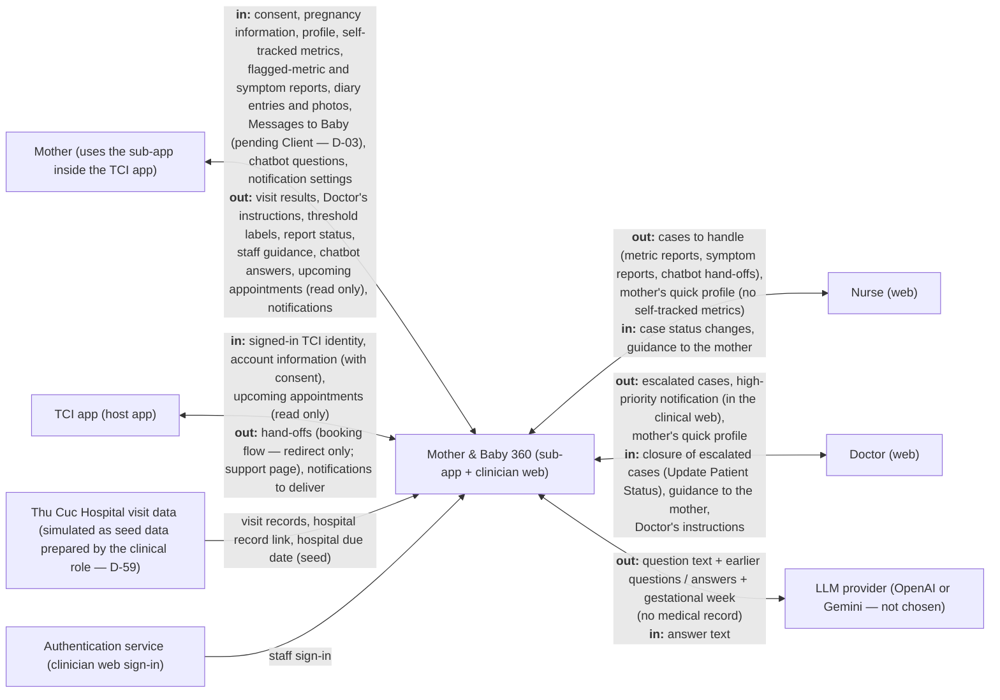
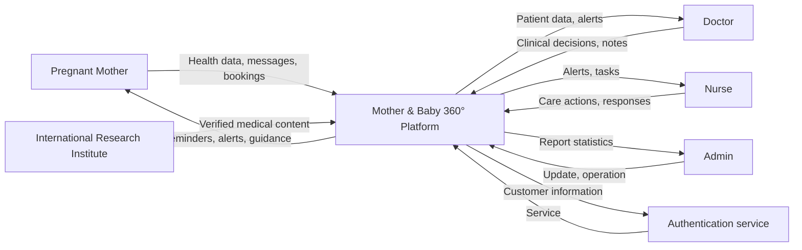

# Context Diagram

## 1. MVP context

Drawn by the team from the decisions in this package (sources in the table below) — **not a DBIZ2 diagram**. Use this one when building. On each arrow, **in** = information coming into Mother & Baby 360, **out** = information it sends.

| Element | Why it is here / why it changed from DBIZ2 | Source |
|---|---|---|
| Mother | Uses the sub-app inside the TCI app; no own account | D-01 `[PENDING CLIENT: D-01]` |
| Nurse, Doctor | The only clinical roles (Role ENUM = Mother / Nurse / Doctor) | D-29, D-49 |
| TCI app (host app) | Provides the signed-in identity (replaces the DBIZ2 "Authentication service" for the mother); receives the appointment-booking and support hand-offs — booking is a **redirect only**, the sub-app keeps no appointment data and only reads the upcoming appointments for the Home card; delivers notifications ("Notifications are sent via the TCI app", S-010) | D-01, D-39, D-62; `spec-APT.md` §1, BR-002, BR-003; S-010 |
| Thu Cuc Hospital visit data | Source of Visit records ("From visit"), the hospital record link status and the hospital's due date; no two-way EMR integration. **In the MVP, simulated as seed data prepared by the clinical role; there is no visit entry screen** (same sentence in `spec-HLT.md` §1 and `spec-TML.md` §1 — HLT-06) | D-42, D-59, D-61; `spec-HLT.md` §10 Q14 |
| Authentication service | Kept only for clinician web sign-in; how staff sign in is open | `spec-CLI.md` §10 Q11 `[NEEDS CLARIFICATION]` |
| LLM provider | Answers general maternity questions for the chatbot; receives only the question text, the earlier questions / answers of the conversation and the gestational week, never the medical record. Provider not chosen | `spec-BOT.md` BR-001, BR-003, FR-003 (D-67); MVP v8 §5 |
| **Admin — removed** | No Admin actor in the MVP | D-49 |
| **Removed 29/09/2026** | Quick notes (nurse / doctor), the mother's self-tracked metrics shown to staff, chatbot answer rating | CLI-01, CLI-03, BOT-02; D-63 |
| **International Research Institute — removed** | Appears in no spec; the Knowledge Base range (`F-145`–`F-148`) that would use its content is outside this package | `docs/decisions.md` "Module scope and key corrections" |

## 2. DBIZ2 original (reference only — not the MVP)

Source: `DBIZ2_GROUPA_FinalReport.xlsx`, sheet `Schematic1`, section 1.3a ("Context Diagram"), Figure 1. Transcribed unchanged.

