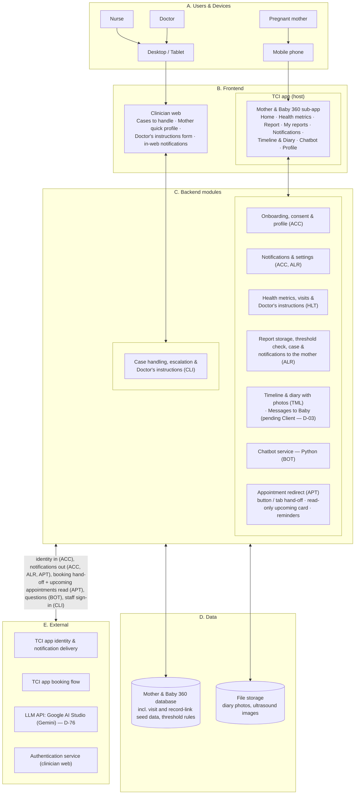
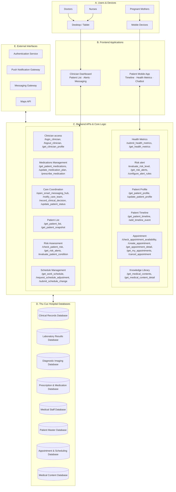

# System Configuration Diagram

## 1. MVP configuration

Drawn by the team from the decisions in this package (sources in the table below) — **not a DBIZ2 diagram**. Use this one when building. Modules are named by their spec; no endpoint or payload names are given.

| Element | Why it is here / what changed from DBIZ2 | Source |
|---|---|---|
| Sub-app inside the TCI app | Replaces the DBIZ2 "Patient Mobile App": the mother uses the signed-in TCI account, no own login | D-01 `[PENDING CLIENT: D-01]` |
| Clinician web | Nurse and doctor screens S-061, S-064 (incl. the doctor's "Add / edit instruction" form); the escalation notification is shown here; "Messaging" of DBIZ2 and Quick notes are not built | `spec-CLI.md`; D-29; ALR-03, CLI-03 |
| Backend modules | One per module spec. Removed from DBIZ2: Knowledge Library, Medications Management, Schedule Management, native appointment booking, messaging hub | `docs/decisions.md` "Module scope and key corrections"; MVP v8 §5 (Won't) |
| Report, threshold check & case | Merges DBIZ2 "Risk alert" and "Risk Assessment": stores the mother's report (FR-020), checks it against the threshold rules and opens the case (FR-021, also for chatbot cases); creates the mother's notifications (FR-018, FR-019, FR-022). No risk-summary screen for the mother (ALR-01) | `spec-ALR.md` BR-004, BR-008; D-52, D-64 |
| Chatbot service | Python backend; calls the LLM API with the question and light context only | `spec-BOT.md` BR-001, BR-003 |
| One database | Replaces the 8 DBIZ2 hospital databases; visit data and the hospital record link are seed data | D-59, D-61; MVP v8 §5 (Won't: Deep Two-Way HIS/EMR Integration) |
| File storage (team addition, not DBIZ2) | Holds diary photos (JPG/PNG ≤ 10 MB, up to 5 per entry — D-46, TML-01 pending) and the ultrasound images of the seed visits; the database keeps only the file path | `spec-TML.md` FR-009, §6 Diary Image; `spec-HLT.md` §6 Visit |
| TCI app identity & notification delivery | Provides the signed-in identity; notifications are sent via the TCI app | D-01; S-010 SR-004 |
| TCI app booking flow | "Book a visit ↗" and the "Appointments" tab open the host app's booking flow directly; the sub-app only reads the upcoming appointments for the Home card | `spec-APT.md` §1, BR-001 – BR-003; D-62 |
| Authentication service | Kept only for clinician web sign-in | `spec-CLI.md` §10 Q11 `[NEEDS CLARIFICATION]` |
| **Hospital EMR — removed from the MVP diagram** | The record-number link is simulated with seed data (no EMR call); an EMR connection is for a later version | `spec-ACC.md` FR-001, FR-002 (ACC-01); D-61; DM-23 |
| **Removed:** Maps API, Messaging Gateway, Push Notification Gateway | No feature uses them; notifications go through the TCI app | S-010 SR-004 |
| Doctor notification channel | The high-priority notification is shown inside the clinical web (S-061 "Notifications" / S-059); no push, no SMS | `spec-ALR.md` FR-009, §10 Q13 resolved (ALR-03) |

## 2. DBIZ2 original (reference only — not the MVP)

Source: `DBIZ2_GROUPA_FinalReport.xlsx`, sheet `Schematic1`, section 1.3b ("System Overall Configuration"), Figure 2. Transcribed unchanged.

