# Usage Flow

## MVP — sub-app entry flow

Same flow as `spec-ACC.md` §4.1 (from the wireframe annotations of S-001, S-007, S-008 — not a DBIZ2 diagram; `[PENDING CLIENT: D-01]`). It replaces the DBIZ2 "Login / Register → User Logged In? → Register Account / Login → Land Home Page" part of every MOM flow below. Updated 29/09/2026: the "no valid TCI identity → S-043" branch is added (D-50); the same S-043 also appears if the identity expires mid-session.

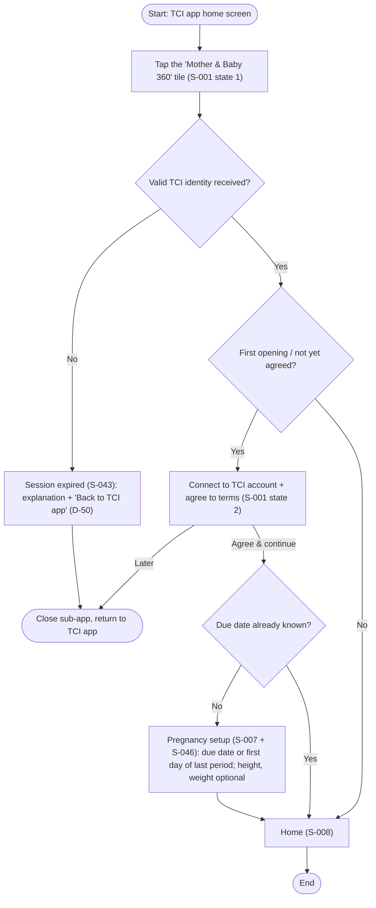

---

## MOM

### Chat box

**DBIZ2 original** (Figure 3, `Schematic2`) — reference only.

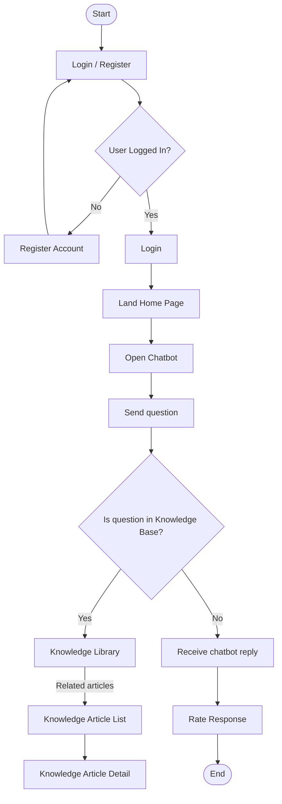

**MVP flow** — `spec-BOT.md` FR-006 – FR-009; D-34. The Knowledge Library branch is not built (Knowledge Base = Won't). "Rate Response" is not built (BOT-02).

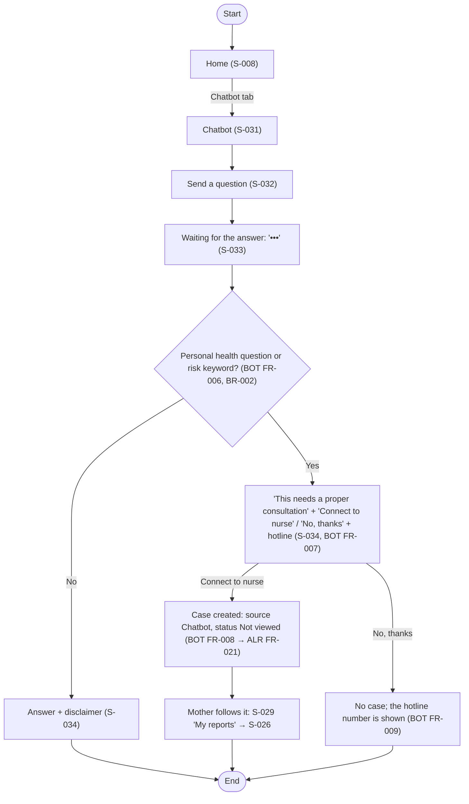

### Pregnancy timeline

**DBIZ2 original** (Figure 3) — reference only. Two sub-flows: browsing the weekly dashboard, and adding a diary entry.

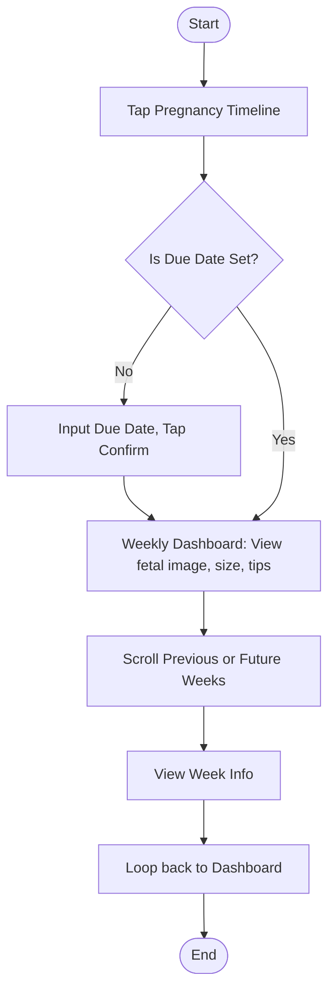

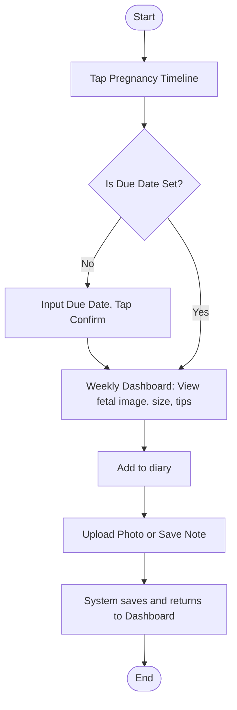

**MVP flows** — `spec-TML.md`. The week shows the real visit of that week, not generic "fetal image, size, tips" (D-02, D-04 `[PENDING CLIENT: D-02]`); the due date is set in the entry flow, so there is no "Input Due Date" step here.

Browse by week:

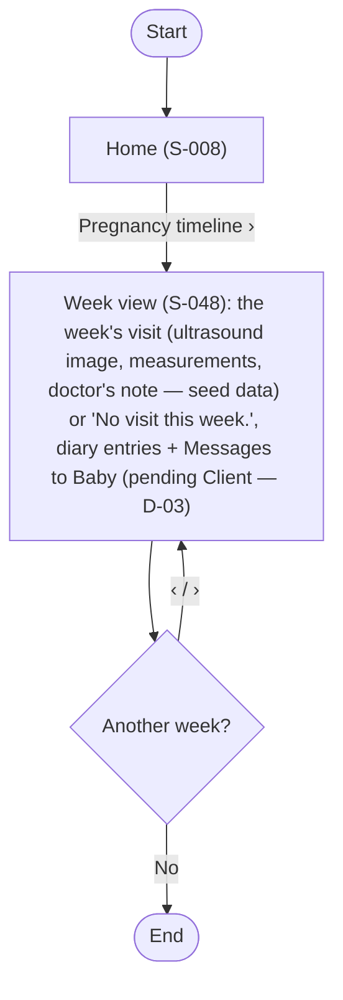

Add a diary entry:

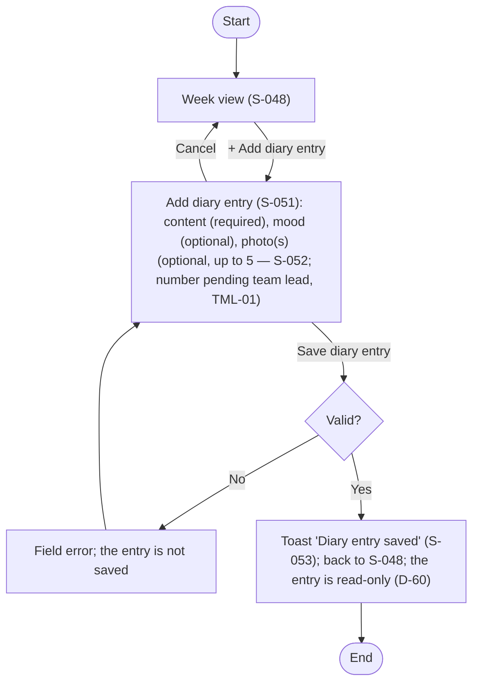

Messages to Baby — Must item in the latest MVP Scope, **pending Client approval** `[PENDING CLIENT: D-03]` (the input form is not drawn — `spec-TML.md` §10 Q12):

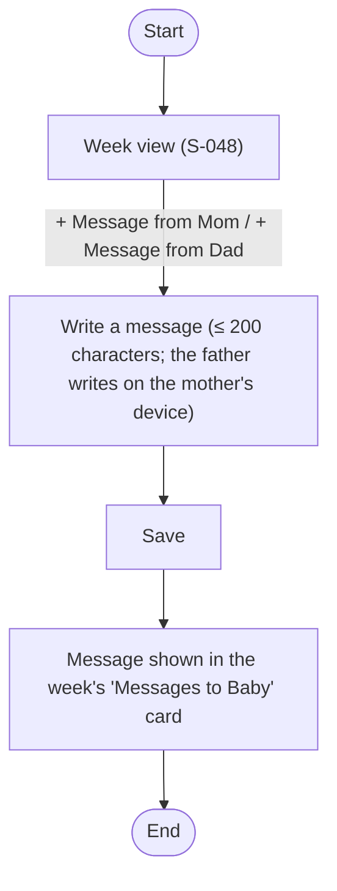

### Health metric

**DBIZ2 original** (Figure 3) — reference only.

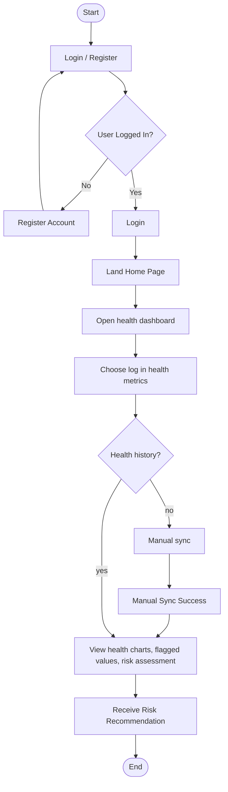

**MVP flows** — `spec-HLT.md`, `spec-ALR.md`. There is no manual or device sync (Hardware Device Auto-Sync = Won't); guidance is shown on S-028 / S-026 instead of a "Risk Recommendation" screen (D-05).

View health metrics and log self-tracked metrics:

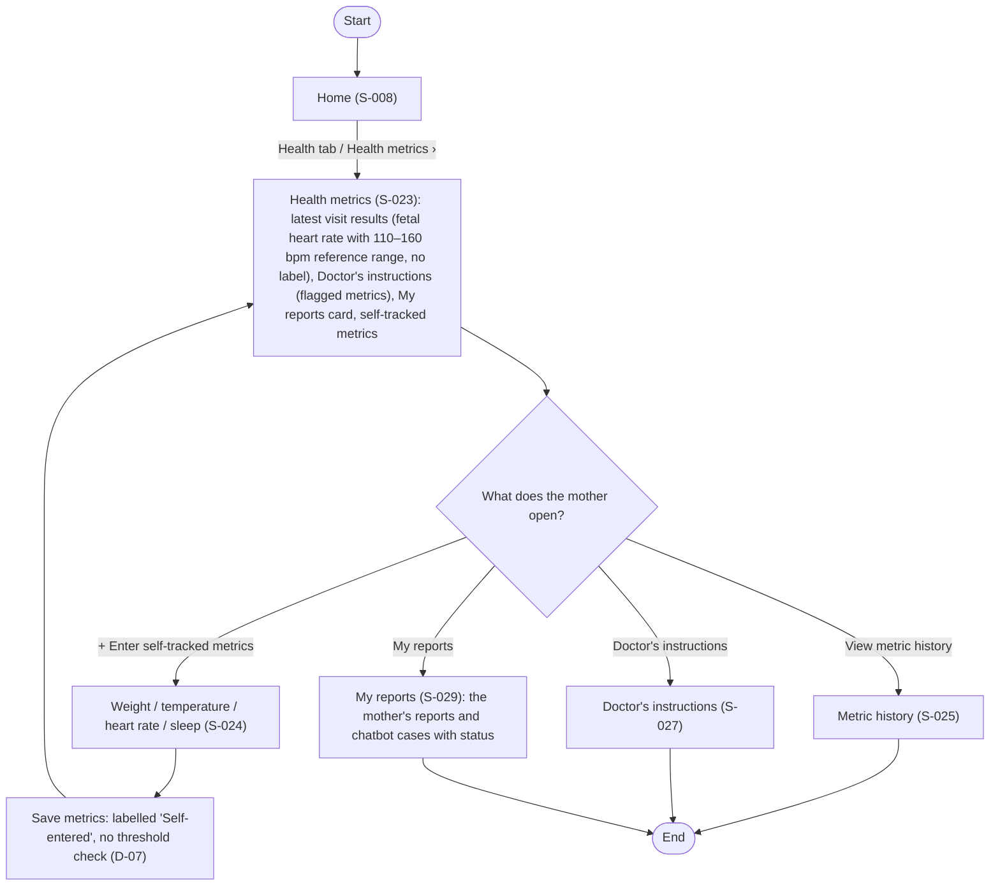

Report a metric or symptoms and follow the report (same as `spec-ALR.md` §4.1(b); the mother reports only a flagged indicator — a metric in her Doctor's instructions — or symptoms, ALR-02; thresholds per ALR BR-004 — D-14 decided, D-15 Pending SME):

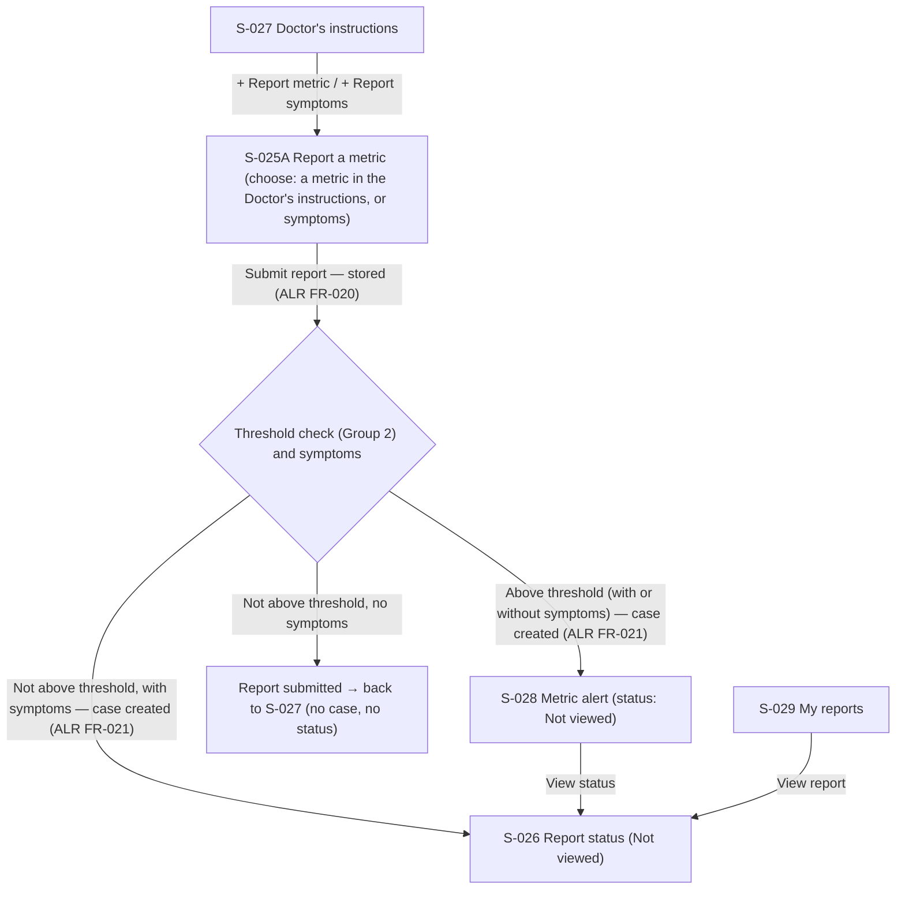

### Appointment

**DBIZ2 original** (Figure 3) — reference only. Two sub-flows: booking a new appointment, and viewing / cancelling one.

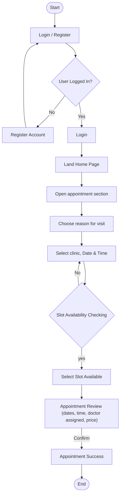

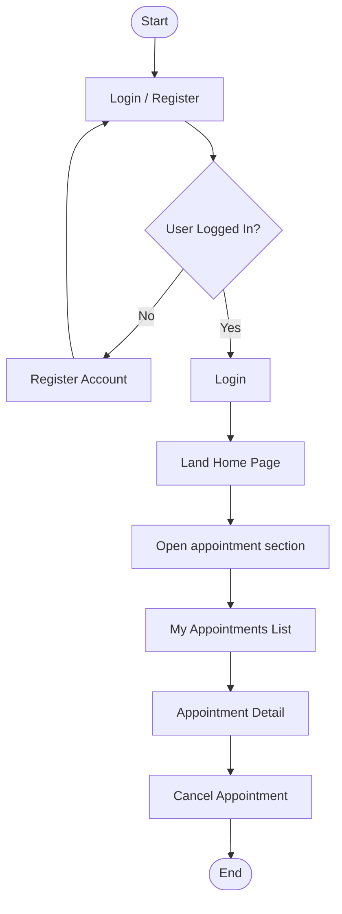

**MVP flow** — `spec-APT.md` §1: booking, the appointment list and cancelling happen in the TCI app; the sub-app has no intermediate screen.

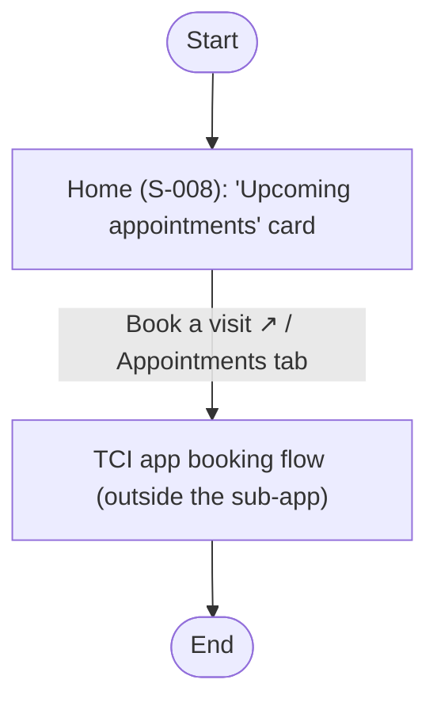

### Notifications and profile (MVP only — no DBIZ2 flow)

Notifications — `spec-ACC.md` FR-025 – FR-027; D-48:

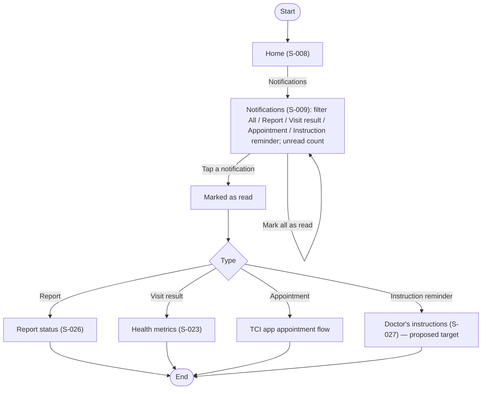

New visit result (system side) — `spec-ALR.md` FR-019; D-59:

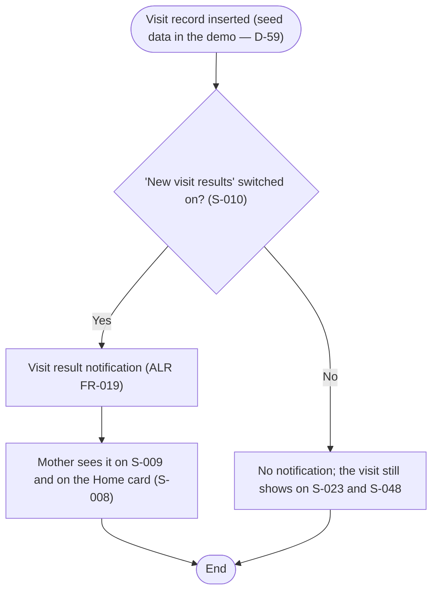

Doctor's-instruction reminder (system side) — `spec-ALR.md` FR-022; trigger / frequency open (ALR Q20):

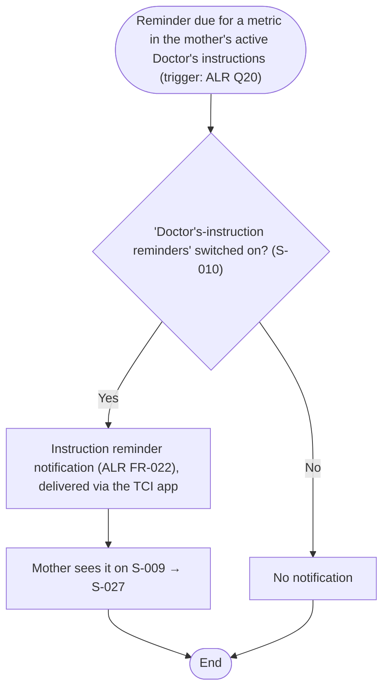

Profile — `spec-ACC.md` US-3:

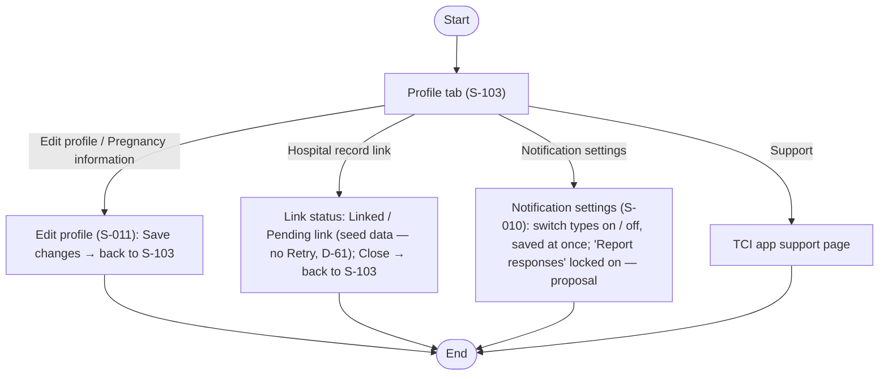

---

## NURSE

**DBIZ2 original** (Figure 3) — "Manage alert" only; the Schedule (view) and Schedule (update) sub-flows are out of MVP scope and not transcribed.

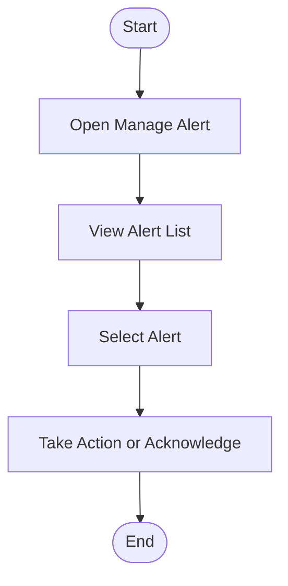

**MVP flow** — `spec-CLI.md` §4.1(b). The responsible doctor is the doctor the hospital assigned to the mother (D-68; seed data in the MVP); how staff sign in on the web is open (`spec-CLI.md` §10 Q11).

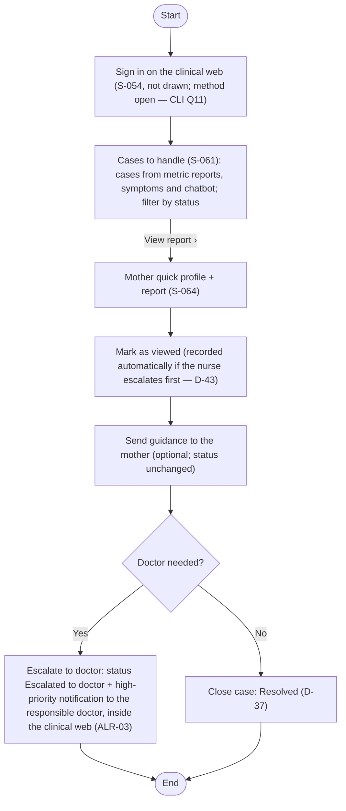

---

## DOCTOR

**DBIZ2 original** (Figure 3) — patient monitoring & escalation only; the Appointment, Schedule, Medications and Messages sub-flows are out of MVP scope and not transcribed.

```mermaid
flowchart TD
    S(["Start"]) --> LH["Land homepage"] --> VPL["View Patient List"] --> ARA{"Any Risk or Alert?"}
    ARA -- no --> VPL
    ARA -- yes --> SP["Select Patient"] --> VPS["View Patient Snapshot Panel"] --> RRA["Review Risk Alerts"]
    RRA --> SEV{"Is patients' conditions severe?"}
    SEV -- no --> CCN["Create Care Note or Recommendation"] --> E(["End"])
    SEV -- yes --> OSM["Open Smart Messaging Hub"] --> NCT["Notify Care Team, Doctors and Nurses"] --> DCI["Decide Clinical Intervention"] --> UPS["Update Patient Status"] --> E
```

**MVP flow** — `spec-CLI.md` §4.1(b). No messaging hub or care-team notification: the doctor answers the mother in writing. The doctor handles only cases "Escalated to doctor" (CLI-02).

Review an escalated case (MVP: Review Escalated Cases, Provide Consultation, Update Patient Status):

```mermaid
flowchart TD
    S(["Start"]) --> SI["Sign in on the clinical web (S-060, not drawn; method open — CLI Q11)"] --> N["In-web notification or Cases to handle (S-061), default filter 'Escalated to doctor'"] -->|"View report ›"| P["Mother quick profile + report + metric history (S-064)"]
    P --> G["Send guidance ('Provide Consultation' — D-58)"] --> CL["Close case: Resolved, red flag cleared ('Update Patient Status' — D-37, D-44)"] --> E(["End"])
```

Add / edit Doctor's instructions (watch-flag) after a visit — `spec-CLI.md` FR-025, US-3:

```mermaid
flowchart TD
    S(["Start"]) --> P["Mother quick profile (S-064), signed in as Doctor"] --> F["'Add / edit instruction' form: metric to monitor (Group 2), note for the mother (how to measure, frequency), above-threshold guidance (template and / or custom text)"]
    F --> SV["Save instruction (Watch-Flag)"] --> M["Mother sees it on S-023 / S-027; S-025A lists the metric; S-028 uses the guidance"] --> E(["End"])
    F -- "Cancel" --> P
```

---

## ADMIN

Not transcribed: Admin is not an MVP actor (D-49). DBIZ2 sub-flows: Manage accounts, Manage Medical Content, Manage Schedule, View statistics.
