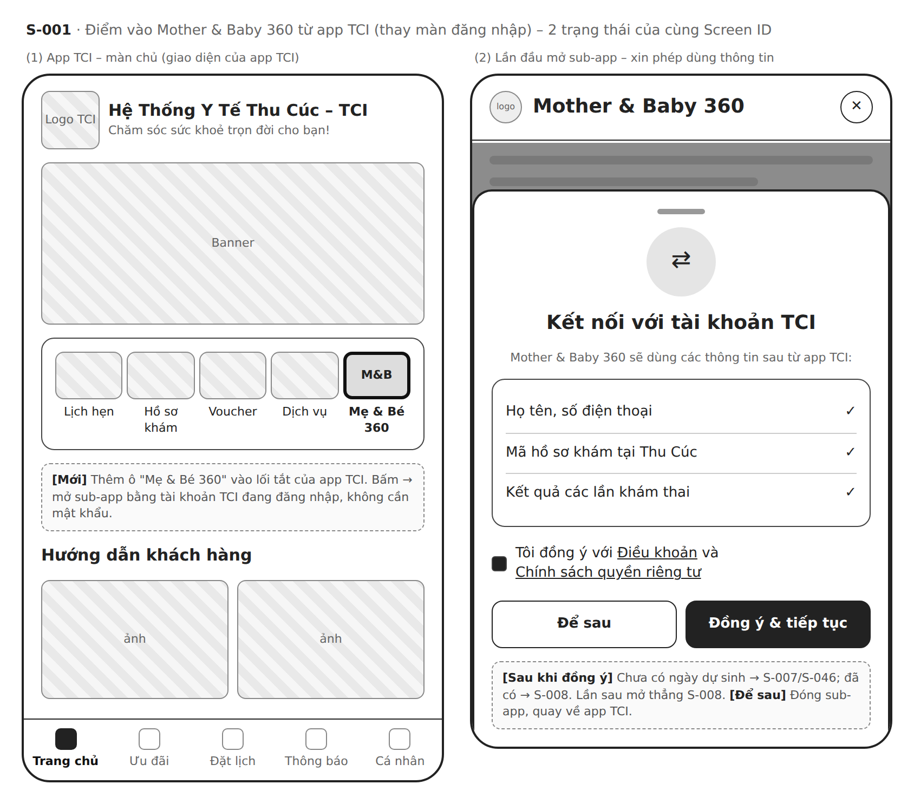

# Screen Spec: S-001 Sub-app entry point

| Field | Value |
|---|---|
| Screen ID | `S-001` |
| Screen name | Sub-app entry point (DBIZ2 name: Login Screen) |
| Actor | Mother (signed in to the TCI app) |
| Priority | Must `[PENDING CLIENT: D-01]` |
| Belongs to module | `spec-ACC.md` |
| Mockup image | `img/S-001.png` |
| Status | Draft (revised 14/10/2026 — date of birth in the permission list, non-female notice (D-71), next step S-104 (D-74); image to redraw) |

## 1. Purpose

`[PENDING CLIENT: D-01]` — Mother & Baby 360 is a sub-app that runs inside the TCI app and uses the signed-in TCI account; there is no registration, OTP, or forgotten / changed password (D-01).

**Shown when:**
- State 1: the mother is on the TCI app home screen (the interface belongs to the TCI app; the team only proposes adding the "Mother & Baby 360" shortcut tile).
- State 2: the mother taps the "Mother & Baby 360" tile **for the first time** (no consent recorded yet). From the next opening on, the sub-app opens `S-008` directly (state 2 is not shown).

**The user leaves this screen when:**
- State 1: taps the "Mother & Baby 360" tile → state 2 (first time) or `S-008` (later times).
- State 2: taps "Agree & continue" → `S-007` (combined with `S-046`) if there is no due date yet, or `S-008` if there is one; taps "Later" → the sub-app closes and returns to the TCI app; taps ✕ → `S-083`.

**Display conditions when there is no valid TCI identity (D-50 `[PENDING CLIENT: D-01]`; see `screen-spec-S-043.md`).** The sub-app has no sign-in screen (D-01), so S-001 **never** shows phone number / password fields. Instead:

| # | Condition | The sub-app shows |
|---|---|---|
| C1 | The mother taps the "Mother & Baby 360" tile while signed in to the TCI app, with a valid identity | State 2 (first time) or `S-008` (later times) — as above |
| C2 | The sub-app is opened **outside the TCI app** (no TCI identity received) | `S-043` "Session expired": explanation + "Back to TCI app" button |
| C3 | The TCI identity is **expired or invalid** when the sub-app is opened | `S-043` as in C2 |
| C4 | The TCI identity expires **mid-session** while the mother is using the sub-app | `S-043` at the next action that needs the identity; whether data being entered is kept `[NEEDS CLARIFICATION]` |

The mother signs in again in the TCI app and then reopens the sub-app from the "Mother & Baby 360" tile. Identity hand-over mechanism and lifetime: `spec-ACC.md` §10 Q9.

## 2. Mockup

## 3. Element inventory

**State 1 — TCI app, home screen (TCI app interface; outside the sub-app build scope except tile #5)**

| # | Element | Type | Content / data source | Required | Validation |
|---|---|---|---|---|---|
| 1 | "TCI logo" | Image | static — belongs to the TCI app | No | — |
| 2 | "Thu Cuc Healthcare System – TCI" + "Lifelong healthcare for you!" | Header / Text | static — belongs to the TCI app | No | — |
| 3 | Banner | Image | belongs to the TCI app | No | — |
| 4 | Shortcuts "Appointments", "Medical records", "Voucher", "Services" | Button (tile) | belongs to the TCI app | No | — |
| 5 | "Mother & Baby 360" tile ("M&B" icon) | Button (tile) | sub-app entry point; opens with the signed-in TCI account, no password needed (D-01) | Yes | — |
| 6 | "Customer guide" + 2 images | Text / Image | belongs to the TCI app | No | — |
| 7 | TCI app tab bar: Home, Offers, Booking, Notifications, Profile | Toggle (tab) | belongs to the TCI app (not the sub-app's 5 tabs) | No | — |

**State 2 — First opening of the sub-app: permission to use information (bottom sheet over the sub-app)**

| # | Element | Type | Content / data source | Required | Validation |
|---|---|---|---|---|---|
| 8 | Sub-app header: logo + "Mother & Baby 360" | Header | static | No | — |
| 9 | ✕ button | Button | closes the sub-app (D-01) | Yes | — |
| 10 | "⇄" icon | Image | static | No | — |
| 11 | Title "Connect to your TCI account" | Header | static | No | — |
| 12 | "Mother & Baby 360 will use the following information from the TCI app:" | Text | static | No | — |
| 13 | Permission list: "Full name, date of birth, phone number ✓" (the image shows "Full name, phone number ✓" — D-71), "Medical record number at Thu Cuc ✓", "Results of your prenatal visits ✓" | Text (list) | static; corresponds to the data taken from the TCI account: Profile (`FR-017`), hospital record link (`FR-001`/`FR-002` — **simulated with seed data in the MVP**, no EMR call, ACC-01), visit results (Health Metric Record, `source` = From visit — D-10) | No | — (display only; individual items cannot be deselected) |
| 14 | Checkbox "I agree to the Terms and the Privacy Policy" | Checkbox | Consent Record — `FR-011` (Checkbox=True; Timestamp) | Yes | must be ticked before "Agree & continue" takes effect — inferred from `spec-ACC.md` US-1 AC3; the wireframe only shows the ticked state and does not show a disabled button `[NEEDS CLARIFICATION]` |
| 15 | "Terms" link | Text (link) | terms content — `[NEEDS CLARIFICATION: content source / display screen]` | No | — |
| 16 | "Privacy Policy" link | Text (link) | as #15 | No | — |
| 17 | "Later" button (secondary, outlined) | Button | closes the sub-app, does not write a Consent Record | Yes | — |
| 18 | "Agree & continue" button (primary, filled) | Button | writes the Consent Record (`FR-011`), creates the session from the TCI account, navigates (`FR-003`/`FR-016`) | Yes | see #14 |

Note: the annotation boxes "[New] …", "[After agreeing] …", "[Later] …" on the wireframe are annotations, described in §4/§5, not interface elements.

## 4. States

| State | What the user sees | Trigger |
|---|---|---|
| Default — state 1 | TCI app home screen with the added "Mother & Baby 360" tile | the mother opens the TCI app |
| Default — state 2 | "Connect to your TCI account" bottom sheet with the 3 information items, the consent checkbox, "Later" / "Agree & continue" | first tap on the "Mother & Baby 360" tile |
| Empty (no data) | not applicable — the screen has no data list | — |
| Loading | shared skeleton (grey blocks that keep the layout, D-27) while the sub-app opens / receives the TCI account information | tap on the "Mother & Baby 360" tile or "Agree & continue" |
| Error | shared banner "⚠ Could not load data. Retry" (D-27) when the TCI account information cannot be retrieved; no valid TCI identity (not signed in, expired or invalid) → `S-043` (conditions C2 – C4, D-50). (The former branch "medical record not found" is removed: the hospital record link is seed data in the MVP, so this case does not occur — screen-spec fix #8, ACC-01) | network error / identity hand-over error |
| Success / confirmation | no separate confirmation screen: goes to the onboarding guide `S-104` (D-74), then `S-007`/`S-046` (no due date yet) or `S-008` | "Agree & continue" succeeds |
| Not a female account (not drawn) | notice that Mother & Baby 360 is for expectant mothers + "Back to TCI app"; no Consent Record, User Account or session (`spec-ACC.md` BR-007, D-71). Wording `[NEEDS CLARIFICATION: spec-ACC.md §10 Q21]` | tile tapped by a TCI account whose sex is not female |

## 5. Interactions and navigation

| # | Element | User action | System response | Goes to screen |
|---|---|---|---|---|
| 1 | "Mother & Baby 360" tile (#5) | tap | opens the sub-app with the signed-in TCI account, without asking for a password (D-01); checks whether a Consent Record exists | first time: `S-001` state 2; later times: `S-008` |
| 2 | Consent checkbox (#14) | tap | ticks / unticks consent | stays |
| 3 | "Terms" / "Privacy Policy" | tap | shows the content | `[NEEDS CLARIFICATION: no Screen ID yet]` |
| 4 | "Agree & continue" | tap | writes the Consent Record (`FR-011`); loads the profile (`FR-017`); creates the hospital record link (`FR-001`/`FR-002` — in the MVP the link and its status come from seed data, ACC-01) | `S-007` (combined with `S-046`) if there is no due date; `S-008` if there is one |
| 5 | "Later" | tap | closes the sub-app, does not record consent | TCI app (home screen, state 1) |
| 6 | ✕ (#9) | tap | opens the close-sub-app confirmation (D-01) | `S-083` |

## 6. Screen-level rules

| Rule ID | Rule | Source |
|---|---|---|
| SR-001 | The sub-app has no sign-in, registration, OTP, or forgotten / changed password; the identity comes from the signed-in TCI account. `[PENDING CLIENT: D-01]` | D-01 |
| SR-002 | State 2 is shown only on the first opening (no Consent Record yet); later openings go straight to `S-008`. | D-01; wireframe annotation |
| SR-003 | No Consent Record is written when the mother taps "Later" or ✕; the next opening shows state 2 again. | `FR-011`; inferred from SR-002 |
| SR-004 | After agreeing, navigation depends on the due date: none → `S-007`/`S-046`; present → `S-008`. | wireframe annotation; D-01 |
| SR-005 | The ✕ button in the sub-app header always leads to `S-083` (instead of Log out). | D-01 |
| SR-006 | Only a female TCI account goes past state 1; any other account sees the notice state and returns to the TCI app. | `spec-ACC.md` BR-007; D-71 |
| SR-007 | After the first agreement the onboarding guide `S-104` is shown once, before pregnancy setup. | `spec-ACC.md` FR-028; D-74 |

## 7. Linked requirements

| FR ID (from the module spec) | What this screen does for it |
|---|---|
| FR-011 (`spec-ACC.md`) | Records the mother's acceptance of the Terms and the Privacy Policy |
| FR-001 / FR-002 (`spec-ACC.md`) | Uses the medical record number at Thu Cuc to link the account to the hospital record — simulated with seed data in the MVP (ACC-01) |
| FR-017 (`spec-ACC.md`) | Retrieves full name, phone number and due date from the profile to decide the navigation |
| FR-003 / FR-016 (`spec-ACC.md`) | Goes to Home `S-008` / loads the dashboard after entering the sub-app |
| FR-015 (`spec-ACC.md`) | Creates the sub-app session — mechanism for receiving the identity from the TCI app `[NEEDS CLARIFICATION]` (see §9 Q3) |
| FR-014 (`spec-ACC.md`) | **Won't (D-01)** — username / password are not checked on this screen |

## 8. Responsive and accessibility notes

- Smallest supported width: `[NEEDS CLARIFICATION: not specified]`.
- State 2 is a single-column bottom sheet; the two buttons "Later" / "Agree & continue" may stack vertically on a narrow screen.
- Text that must remain readable: the list of the 3 shared information items and the consent sentence (privacy-related). The checkbox needs a large enough touch target and a label that screen readers can read.

## 9. Open questions

| # | Question | Blocking? | Status |
|---|---|---|---|
| 3 | [NEEDS CLARIFICATION: the technical mechanism by which the TCI app passes the identity to the sub-app (token, deep link…) and how the session is created (`FR-015`) are not described.] | Yes | Open |
| 4 | Behaviour when the medical record number at Thu Cuc cannot be found (`spec-ACC.md` §10 Q2). | No | Resolved — not applicable in the MVP: the link is seed data, no EMR lookup (screen-spec fix #8, ACC-01) |
| 5 | [NEEDS CLARIFICATION: the content and display screen for "Terms" / "Privacy Policy" have no Screen ID.] | No | Open |

---

## Completion checklist

- [x] The mockup is a separate cropped image file, named with the Screen ID.
- [x] Every visible element in the mockup appears in the element inventory (both states; annotations described in §4/§5).
- [x] Every input element has a validation rule or an explicit "none" — the consent checkbox has a rule; the disabled state is marked `[NEEDS CLARIFICATION]`.
- [x] All five states are filled in, or marked "not applicable"/`[NEEDS CLARIFICATION]` with a reason.
- [x] Every navigation target is a Screen ID that exists in the Screen List (`S-007`/`S-046`, `S-008`, `S-083`) or the TCI app; the Terms link is marked `[NEEDS CLARIFICATION]`.
- [x] Every element that displays data names the field it displays, matching the module spec.
