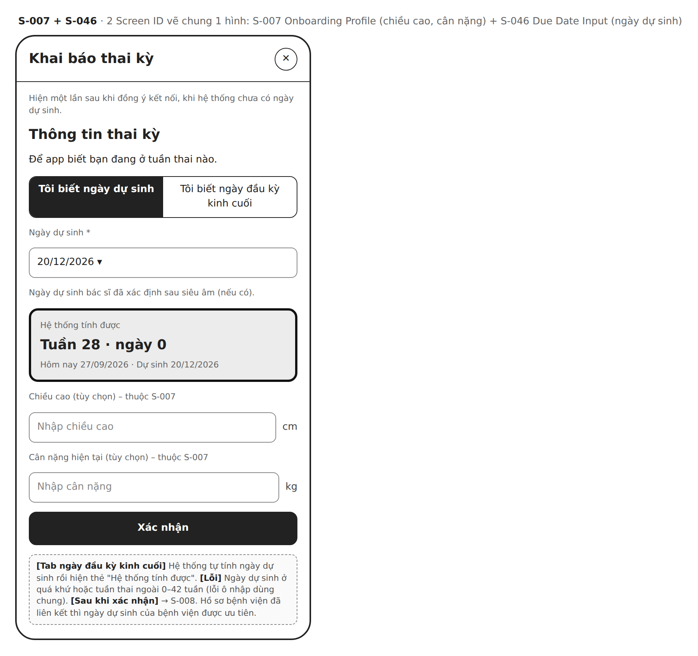

# Screen Spec: S-007 Pregnancy setup (S-007 Onboarding Profile + S-046 Due Date Input)

| Field | Value |
|---|---|
| Screen ID | `S-007` + `S-046` (2 Screen IDs drawn in 1 mockup) |
| Screen name | Pregnancy setup — S-007 Onboarding Profile Screen (height, weight) + S-046 Due Date Input Screen (due date) |
| Actor | Mom |
| Priority | Must (both `S-007` and `S-046` are Must in the DBIZ2 Screen List) |
| Belongs to module | `spec-ACC.md` (`S-007`, Profile) · `spec-TML.md` (`S-046`, EDD / gestational week) |
| Mockup image | `img/S-007.png` |
| Spec for S-046 | `screen-spec-S-046.md` + `img/S-046.png` — own full spec (D-55). S-046 belongs to `TML`: due date / LMP and the gestational-week card (#4 – #9); S-007 belongs to `ACC`: height, weight, saving the Profile (#10 – #12). |
| Status | Draft (revised 14/10/2026 — optional first visit date, D-72; image to redraw) |

> **v1.0.0 app (07/11/2026, D-80 – D-85):** Due date prefilled from the hospital record (TCI host, simulated); EDD/LMP switch clears the date; LMP error of its own; height/weight accept a decimal comma and refuse 0 or less (format check, D-16 open); placeholders "VD: 158" / "VD: 52.0".

## 1. Purpose

**Shown when:** shown **once** after the mother taps "Agree & continue" on `S-001` (state 2 — first opening of the sub-app, permission to use the TCI account information), **when the system has no due date** for the mother. If a due date already exists, `S-001` goes straight to `S-008`. `[PENDING CLIENT: D-01]` — this whole entry context (sub-app inside the TCI app, no separate registration / sign-in) depends on decision D-01, which is pending Client confirmation.

**The user leaves this screen when:** taps "Confirm" with valid data (→ `S-008`), or taps ✕ (→ `S-083` close-sub-app confirmation). This screen **has no ← button** (per the D-27 header convention: "Only Home and the first-time setup screen have no ←").

## 2. Mockup

## 3. Element inventory

| # | Element | Type | Content / data source | Required | Validation |
|---|---|---|---|---|---|
| 1 | Title "Pregnancy setup" | Header (Page title) | static | No | — |
| 2 | ✕ button | Button | navigation — opens `S-083` | Yes | — |
| 3 | Description line "Shown once after agreeing to connect, when the system has no due date yet." | Text (caption) | static — display-condition note on the wireframe; `[NEEDS CLARIFICATION: is this a design annotation or text actually shown to the mother?]` | No | — |
| 4 | Section title "Pregnancy information" + line "So the app knows which gestational week you are in." | Text | static | No | — |
| 5 | 2-tab selector: "I know my due date" / "I know the first day of my last period" | Toggle (segmented) | chooses the setup method; default tab "I know my due date" (the tab selected on the mockup) | Yes | exactly 1 tab selected |
| 6 | "Due date *" field (tab 1) | Input (date picker) | Profile — due date (EDD); mockup example `20/12/2026` | Yes (on tab 1) | format `dd/mm/yyyy`; must not be in the past; the calculated gestational week must be within 0–42 weeks (per the mockup annotation) |
| 7 | Hint "The due date your doctor set after an ultrasound (if any)." | Text (caption) | static | No | — |
| 8 | "First day of last period" field (tab 2) | Input (date picker) | Profile — first day of the last menstrual period (LMP). **Not drawn separately**; only described in the annotation "[First-day-of-last-period tab] The system calculates the due date and shows the 'Calculated by the system' card." | Yes (on tab 2) | format `dd/mm/yyyy`; the calculated gestational week must be within 0–42 weeks; formula for EDD from LMP `[NEEDS CLARIFICATION: the source does not give the formula]` |
| 9 | "Calculated by the system" card — "Week 28 · day 0", "Today 27/09/2026 · Due 20/12/2026" | Card (read-only) | calculated from the current date + EDD (tab 1) or the EDD derived from the LMP (tab 2) — corresponds to the input `Current Date; EDD` of `spec-TML.md` FR-003. Formula for EDD → week/day `[NEEDS CLARIFICATION: not given in the source; the mockup example (84 days before the EDD = Week 28 · day 0) matches taking EDD − 280 days, but this rule is not written in any document]` | No | — (display only) |
| 10 | "Height (optional) – belongs to S-007" field + unit "cm" | Input (numeric) | Profile — Height (D-13: height belongs to the Profile) | No | number; unit cm; valid range `[NEEDS CLARIFICATION]` |
| 11 | "Current weight (optional) – belongs to S-007" field + unit "kg" | Input (numeric) | Health Metric Record — weight, source "Self-entered" (`spec-HLT.md` §6, D-42) | No | number; unit kg; valid range `[NEEDS CLARIFICATION]` (related to D-16, pending SME) |
| 11a | "Date of first antenatal check-up (optional)" field (not drawn — D-72) | Input (date picker) | Profile — first_visit_date (`spec-ACC.md` §6) | No | format `dd/mm/yyyy`; not after today; not before EDD − 280 days (`spec-ACC.md` FR-004) |
| 12 | "Confirm" button | Button (primary) | saves the Profile (EDD, height, first visit date) and the weight | Yes | the date on the selected tab must be present and valid (#6 or #8); #10/#11, if entered, must be valid |
| 13 | Annotation block (dashed border) "[First-day-of-last-period tab] … [Error] … [After confirming] …" | Annotation | design annotation on the wireframe, **not UI** | — | — |

**No 5-tab navigation bar** on this mockup (first-time setup screen, full-screen).

## 4. States

Empty / loading / error states use the shared components on the UI conventions page `00-QUY-UOC` (D-27).

| State | What the user sees | Trigger |
|---|---|---|
| Default | "I know my due date" tab selected; due date field; height / weight fields empty. `[NEEDS CLARIFICATION: is the "Calculated by the system" card shown before a date is entered, or only after a valid date is entered? The mockup only shows the state with a date.]` | screen opened for the first time |
| Empty (no data) | not applicable — data-entry screen, no list | — |
| Loading | shared "Loading" component (grey blocks that keep the layout) — not drawn separately for this screen; applies while saving after "Confirm" is tapped `[NEEDS CLARIFICATION: is a saving state shown?]` | tap "Confirm" |
| Error | shared field error ("⚠ Value outside the valid range" shown directly below the field) when **the due date is in the past** or **the calculated gestational week is outside 0–42 weeks**; save error (network / system) uses the shared error component "⚠ Could not load data." + "Retry" | invalid date entered; save fails |
| Success / confirmation | no separate confirmation screen / toast is drawn; after saving, goes straight to `S-008` | save succeeds |
| "I know the first day of my last period" tab (additional) | the first-day-of-last-period field replaces the due date field; the system calculates the due date and shows the "Calculated by the system" card | tap tab 2 |
| "Calculated by the system" card shown (additional) | the card shows the gestational week + day, today's date and the due date | valid date entered on tab 1 or tab 2 |

## 5. Interactions and navigation

| # | Element | User action | System response | Goes to screen |
|---|---|---|---|---|
| 1 | Tab "I know my due date" / "I know the first day of my last period" | tap | switches to the corresponding field. `[NEEDS CLARIFICATION: is a date entered on the other tab kept when switching tabs?]` | (same screen) |
| 2 | Due date field / first-day-of-last-period field | pick a date | validates; calculates the gestational week and updates the "Calculated by the system" card (tab 2: also calculates the due date) | (same screen) |
| 3 | "Confirm" | tap | validates the data (`spec-ACC.md` FR-004), saves to the Profile (FR-005) | `S-008` (FR-003) |
| 4 | ✕ | tap | opens the close-sub-app confirmation sheet | `S-083` `[PENDING CLIENT: D-01]` — `[NEEDS CLARIFICATION: if the mother closes before completing setup, is this screen shown again at the next opening? What does `S-008` show when there is no due date?]` |

## 6. Screen-level rules

| Rule ID | Rule | Source |
|---|---|---|
| SR-001 | The screen is shown only when the system has **no** due date for the mother, after the connect-consent step on `S-001`. | Mockup annotations on `S-007` and `S-001`: "[After agreeing] No due date → S-007/S-046; has a due date → S-008"; `[PENDING CLIENT: D-01]` |
| SR-002 | A due date in the past, or a calculated gestational week outside 0–42 weeks → field error, confirmation not allowed. | "[Error]" annotation on the mockup |
| SR-003 | Once the hospital record is linked, **the hospital's due date takes priority** over the date the mother entered. **In the MVP the hospital record, its link status and the hospital's due date are seed data** (ACC-01, screen-spec fix #8). `[NEEDS CLARIFICATION: when the seeded link and the mother's date differ, is the date overwritten immediately, and is the mother informed?]` | "[After confirming]" annotation on the mockup; related to `spec-ACC.md` FR-001/FR-002 and `spec-TML.md` §10 Q3 |
| SR-004 | Height and weight are **optional**; the mother can confirm with them empty. Height is stored in the Profile, not as a health metric; no BMI is calculated. | "(optional)" label on the mockup; D-13 |
| SR-005 | On the first-day-of-last-period tab, the due date is calculated by the system; the mother does not enter it directly. | "[First-day-of-last-period tab]" annotation on the mockup |
| SR-006 | The date of the first antenatal check-up is optional; if entered it is not in the future and not before the start of the pregnancy (EDD − 280 days). | `spec-ACC.md` FR-004; D-72 |

## 7. Linked requirements

| FR ID (from the module spec) | What this screen does for it |
|---|---|
| FR-004 (`spec-ACC.md`, F-022) | Validates Height / Weight / Week Info before saving |
| FR-005 (`spec-ACC.md`, F-023) | Saves the validated information to the Profile |
| FR-003 (`spec-ACC.md`, F-018) | Goes to the main screen (`S-008`) after completion |
| FR-001 / FR-002 (`spec-ACC.md`, F-016 / F-017) | (related) source of the due date that takes priority once the hospital record is linked — SR-003 |
| FR-003 (`spec-TML.md`, F-085) | Provides the EDD used to calculate the current gestational week (input `Current Date; EDD`) — the "Calculated by the system" card and the `S-048` timeline depend on this value |

**Note:** DBIZ2 has no separate FR for "enter the first day of the last menstrual period" or "calculate the EDD from the LMP"; this function appears only on the mockup — see §9 Q2.

## 8. Responsive and accessibility notes

- Smallest supported width: `[NEEDS CLARIFICATION: not specified]`
- What collapses or stacks on a narrow screen: the tab label "I know the first day of my last period" already wraps to 2 lines on the mockup; on narrower screens the 2 tabs may need to stack vertically — `[NEEDS CLARIFICATION]`.
- Text that must remain readable: the gestational week in the "Calculated by the system" card and the due date; the units "cm", "kg" next to the fields.
- Field errors must appear below the field as text (not by colour alone) — per the shared error pattern D-27.

## 9. Open questions

| # | Question | Blocking? | Status |
|---|---|---|---|
| 1 | `[PENDING CLIENT: D-01]` The whole entry context (after `S-001` consent to connect the TCI account, no separate registration) depends on the sub-app model, which is pending Client confirmation. | Yes | Open [PENDING CLIENT: D-01] |
| 2 | [NEEDS CLARIFICATION: the formula for calculating the due date from the first day of the last menstrual period, and the formula for converting the due date → "Week X · day Y", are not given in DBIZ2, the final MVP document or the module spec.] | Yes | Open |
| 3 | [NEEDS CLARIFICATION: valid value ranges for height and weight (to block typing errors).] Related to D-16 (pending SME). | No | Open |
| 5 | [NEEDS CLARIFICATION: where does the mother later edit the due date / height / weight — does the "Pregnancy information" row on `S-103` reopen this screen in edit mode, or a different screen (`S-011`)?] | No | Open |
| 6 | [NEEDS CLARIFICATION: DBIZ2 also has `S-045` Due Date Check and `S-047` Due Date Confirmation (no mockup). In the current design, does the "Calculated by the system" card take over the role of `S-047`, and is `S-045` still a separate logical step?] | No | Open |
| 7 | [NEEDS CLARIFICATION: behaviour when the hospital record is linked after the mother has entered her own date and the two due dates differ (SR-003).] The hospital's due date is seed data in the MVP (screen-spec fix #8); the display / overwrite behaviour is still open. When the SME confirms the LMP → due date rule (`spec-ACC.md` Q10, ACC-04), update this file and `screen-spec-S-046.md` together. | No | Open |
| 8 | [NEEDS CLARIFICATION: if the mother taps ✕ before completing setup — is this screen shown again at the next opening, and what do `S-008` / `S-048` show when there is no due date?] | No | Open |

---

## Completion checklist

- [x] The mockup is a separate cropped image file, named with the Screen ID. (`img/S-007.png`, shared with `S-046`)
- [x] Every visible element in the mockup appears in the element inventory.
- [x] Every input element has a validation rule or an explicit "none"/`[NEEDS CLARIFICATION]`.
- [x] All five states are filled in, or marked "not applicable"/`[NEEDS CLARIFICATION]` with a reason.
- [x] Every navigation target is a Screen ID that exists in the Screen List. (`S-008`, `S-083`)
- [x] Every element that displays data names the field it displays, matching the module spec.
