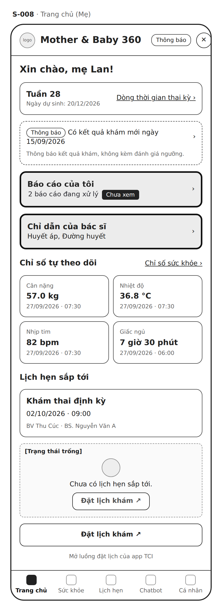

# Screen Spec: S-008 Home

| Field | Value |
|---|---|
| Screen ID | `S-008` |
| Screen name | Home |
| Actor | Mother |
| Priority | Must |
| Belongs to module | `spec-ACC.md` |
| Mockup image | `img/S-008.png` |
| Status | Draft (revised 14/10/2026 — week widget opens S-048 (D-75), appointment section Could (D-77); image to redraw) |

> **v1.0.0 app (07/11/2026, D-80 – D-85):** Header "Mẹ & Bé 360" + ✕ (S-083); week card; next-appointment card from the TCI host (spec-APT §7.3); report button; "Bác sĩ vừa gửi n thông báo" card; "Chỉ số của mẹ ›" (opens S-023) and 4 tiles with › (blood pressure, blood glucose, fetal heart rate with threshold labels; weight); "+ Nhập chỉ số tự theo dõi"; diary card. Tab bar Home · Thai kỳ · Chatbot · Thông báo · Hồ sơ (D-80). No menu rows.

## 1. Purpose

**Shown when:** the mother opens the sub-app from the "Mother & Baby 360" tile (every launch after the first — `S-001`), after she agrees on `S-001` state 2 and a due date already exists, after pregnancy setup on `S-007`/`S-046`, or when she taps the "Home" tab on any screen. There is no ← button (D-27: only Home and the first-time setup screen have no ←).

**The user leaves this screen when:** she taps "Pregnancy timeline ›" (`S-048`), the visit-result notification card, the "My reports" card (`S-029`), the "Doctor's instructions" card (`S-027`), "Health metrics ›" (`S-023`), "Book a visit ↗" (TCI app booking flow), another tab, or ✕ (`S-083`).

## 2. Mockup

## 3. Element inventory

| # | Element | Type | Content / data source | Required | Validation |
|---|---|---|---|---|---|
| 1 | Logo + "Mother & Baby 360" | Header | static | No | — |
| 2 | "Notifications" button (header) | Button | opens `S-009` Notification Center (D-39) | No | — |
| 3 | ✕ button | Button | closes the sub-app (D-01) | Yes | — |
| 4 | "Hello, Lan!" | Text | Profile — Name (`spec-ACC.md` `FR-017`) | No | — |
| 5 | Gestational-week card (timeline widget, D-75): "Week 28" + "Due date: 20/12/2026"; tapping the card opens `S-048` | Text | Profile — EDD (`FR-017`); gestational week calculated from the due date entered on `S-007`/`S-046`; format `dd/mm/yyyy` (D-27) | No | — |
| 6 | "Pregnancy timeline ›" link | Text (link) | navigation (D-30) | No | — |
| 7 | Notification card: label "Notification" + "New visit results from 15/09/2026" + › | Text / Button | update notification when new visit results are available — `spec-ALR.md` BR-003; Health Metric Record `source` = From visit (D-10). **No threshold assessment** (wireframe annotation) | No | — |
| 8 | "My reports" card (highlighted): number of reports being handled (e.g. "2 reports being handled" — the 2 "Not viewed" reports on `S-029`) + status label of the latest report / case (e.g. "Not viewed") + › | Button (card) | aggregated from Case (status ≠ Resolved) and the latest Case status (`spec-ALR.md` `FR-002`); report statuses D-18. Replaces the former "Risk assessment" card (ALR-01, HLT-02) | No | — |
| 9 | "Doctor's instructions" card: "Blood pressure, Blood glucose" + › (highlighted) | Button (card) | Watch-Flag (`spec-HLT.md` §6) — list of group-2 metrics assigned by the doctor (D-11) | No | — |
| 10 | "Self-tracked metrics" section heading | Header (section) | static; terminology D-27 | No | — |
| 11 | "Health metrics ›" link | Text (link) | navigation | No | — |
| 12 | "Weight" card — "57.0 kg" — "27/09/2026 · 07:30" | Text (card) | group-1 Health Metric Record, `source` = Self-entered (D-10, D-11); latest value + `measured_at`; `spec-HLT.md` `FR-005` | No | — |
| 13 | "Temperature" card — "36.8 °C" — "27/09/2026 · 07:30" | Text (card) | as #12 | No | — |
| 14 | "Heart rate" card — "82 bpm" — "27/09/2026 · 07:30" | Text (card) | as #12 | No | — |
| 15 | "Sleep" card — "7 h 30 min" — "27/09/2026 · 06:00" | Text (card) | as #12; duration calculated from the Bedtime / Wake-up time entered on `S-024` | No | — |
| 16 | "Upcoming appointments" section heading — **Could (D-77)**, hidden if APT is not built | Header (section) | static | No | — |
| 17 | Appointment card: "Routine antenatal check-up" — "02/10/2026 · 09:00" — "Thu Cuc Hospital · Dr. Nguyễn Văn A" | Text (card) | Appointment Record (`spec-APT.md` §6; the master record is in the TCI app — APT BR-002); `FR-005` (APT) — **Could (D-77)**, read from the TCI app | No | — |
| 18 | "Book a visit ↗" button (secondary, outlined) | Button | opens the TCI booking portal in a WebView inside the TCI app — `spec-APT.md` BR-001, FR-001 — **Could (D-77)** | No | — |
| 19 | 5-tab bar: Home (selected) · Health · Appointments · Chatbot · Profile | Toggle (tab) | navigation (D-27) | Yes | — |

Note: the lines "No threshold assessment on visit-result notices.", "Opens the TCI app booking flow" and the box "[Empty state] No upcoming appointments." are annotations / states on the wireframe — described in §4, §5, §6.

## 4. States

| State | What the user sees | Trigger |
|---|---|---|
| Default | all sections as drawn: gestational week, new visit-result notification, 2 highlighted cards, 4 self-tracked metric cards, upcoming appointment + "Book a visit ↗" | screen opens with data |
| Empty (no data) | **Appointments (drawn):** icon + "No upcoming appointments." + CTA "Book a visit ↗" (D-27 template). **Other sections (not drawn):** use the same D-27 empty template (icon + 1 sentence + CTA if needed); the notification card is hidden when there are no new results; the exact wording for the "My reports" card, the "Doctor's instructions" card and the self-tracked metrics section is `[NEEDS CLARIFICATION]` — see §9 Q2 | new mother, no data yet in the section concerned |
| Loading | shared skeleton: grey blocks in place of content, same layout (D-27) | screen opening, data loading |
| Error | shared banner "⚠ Could not load data. Retry" (D-27); tapping "Retry" reloads | data load fails |
| Success / confirmation | not applicable — destination screen with no action that needs confirmation | — |
| "My reports" card when there is no report to view | `[NEEDS CLARIFICATION: card content when there are 0 reports being handled — not drawn]` | no open Case |

## 5. Interactions and navigation

| # | Element | User action | System response | Goes to screen |
|---|---|---|---|---|
| 1 | "Notifications" (header) | tap | opens the notification list | `S-009` (D-39) |
| 2 | ✕ | tap | asks for confirmation to close the sub-app (D-01) | `S-083` |
| 3 | "Pregnancy timeline ›" or the gestational-week card (#5) | tap | — | `S-048` (Home tab, D-30; widget D-75) |
| 4 | "New visit results…" card | tap | — | `S-023` ("Latest visit results" section) — inferred; the wireframe does not state the target `[NEEDS CLARIFICATION]` |
| 5 | "My reports" card | tap | — | `S-029` "My reports" (D-26 as revised) |
| 6 | "Doctor's instructions" card | tap | — | `S-027` |
| 7 | "Health metrics ›" | tap | — | `S-023` |
| 8 | Self-tracked metric cards (#12–#15) | tap | `[NEEDS CLARIFICATION: the wireframe does not state whether the cards are tappable]` | — |
| 9 | "Book a visit ↗" (also in the empty state) | tap | opens the TCI app booking flow (`spec-APT.md` BR-001); opens as a WebView of the TCI booking portal (`spec-APT.md` §10 Q1 resolved, D-77) | TCI app (booking flow) |
| 10 | "Health" tab | tap | — | `S-023` |
| 11 | "Appointments" tab | tap | opens the TCI app appointment flow directly, no screen in the sub-app (`spec-APT.md` §1, BR-001; MVP scope backlog item 6) | TCI app |
| 12 | "Chatbot" tab | tap | — | `S-031` |
| 13 | "Profile" tab | tap | — | `S-103` |

## 6. Screen-level rules

| Rule ID | Rule | Source |
|---|---|---|
| SR-001 | The new visit-result notification is a routine update notification, carries no threshold assessment, and must not be presented as an "Alert". | `spec-ALR.md` BR-003; D-22; wireframe annotation |
| SR-002 | The "My reports" card leads to `S-029` "My reports"; the number of reports being handled and the latest status come from ALR and are not recalculated on this screen. Only the shared status set is used. No risk summary is shown (ALR-01). | D-26 as revised, D-18; ALR-01 |
| SR-003 | The "Self-tracked metrics" section contains only group-1 metrics (weight, temperature, heart rate, sleep) with no threshold label; each card shows the measured time `dd/mm/yyyy · HH:mm`. | D-11, D-27 |
| SR-004 | "Book a visit ↗" does not open a booking screen of the sub-app; `S-012`–`S-018` are reference only. | `spec-APT.md` BR-001, §7 |
| SR-005 | Header: no ←; ✕ → `S-083`. The tab bar always has 5 tabs, with "Home" highlighted. | D-01, D-27 |
| SR-006 | No overall "Normal" banner. | No basis in the module specs |
| SR-007 | The appointment section (#16 – #18) is a Could element (APT); if APT is not built it is hidden and the rest of the screen is unchanged. | D-77 |

## 7. Linked requirements

| FR ID (from the module spec) | What this screen does for it |
|---|---|
| FR-016 (`spec-ACC.md`) | This is the personalized dashboard loaded after entering the sub-app |
| FR-017 (`spec-ACC.md`) | Shows the mother's name, due date / gestational week |
| FR-005 (`spec-HLT.md`) | Shows the self-tracked metric cards (group 1) |
| FR-002 (`spec-ALR.md`) | Summarizes the mother's report list on the "My reports" card |
| BR-003 (`spec-ALR.md`) | New visit-result notification card, kept separate from Alerts |
| FR-005 (`spec-APT.md`) | Shows the upcoming appointment |
| BR-001 (`spec-APT.md`) | "Book a visit ↗" opens the TCI app booking flow |

## 8. Responsive and accessibility notes

- Smallest supported width: `[NEEDS CLARIFICATION: not specified]`.
- The 2-by-2 grid of metric cards may stack into 1 column on a narrow screen `[NEEDS CLARIFICATION]`.
- Text that must remain readable: metric values and measured times, the "Not viewed" label. Status labels must not rely on colour alone (D-27: colour only supplements the text).

## 9. Open questions

| # | Question | Blocking? | Status |
|---|---|---|---|
| 2 | [NEEDS CLARIFICATION: The empty-state wording for the "My reports" card, the "Doctor's instructions" card and the "Self-tracked metrics" section is not drawn.] | No | Open |
| 3 | [NEEDS CLARIFICATION: Which screen does the "New visit results" card lead to? D-39 does not state it; the inferred target is `S-023` (§5 #4; the same notification type on `S-009` opens `S-023`).] | No | Open |
| 4 | What does the "Appointments" tab open? **Resolved:** the TCI app appointment flow directly, no separate screen (`spec-APT.md` §1). How it opens technically: still open, `spec-APT.md` §10 Q1. | No | Resolved |

---

## Completion checklist

- [x] The mockup is a separate cropped image file, named with the Screen ID.
- [x] Every visible element in the mockup appears in the element inventory.
- [x] Every input element has a validation rule or an explicit "none" — the screen has no input fields.
- [x] All five states are filled in, or marked "not applicable"/`[NEEDS CLARIFICATION]` with a reason.
- [x] Every navigation target is a Screen ID that exists in the Screen List, the TCI app, or is tagged `[NEEDS CLARIFICATION]`.
- [x] Every element that displays data names the field it displays, matching the module spec.
