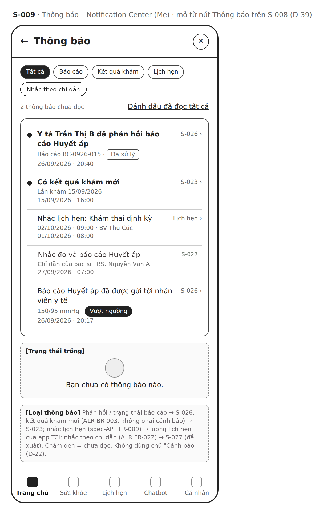

# Screen Spec: S-009 Notifications

**Current navigation — D-80 / D-86 (confirmed 11/11/2026):** any Appointments/Health tab row below describes the historical wireframe, not the current shell. The five root screens use Home · Timeline · Chatbot · From doctor · Profile; child screens have back navigation and no root tab bar. No Home booking CTA is present. Historical navigation rows and images are retained as reference only; unrelated open questions remain open.

| Field | Value |
|---|---|
| Screen ID | `S-009` |
| Screen name | Notifications (DBIZ2 name: Notification Center) |
| Actor | Mother |
| Priority | Must |
| Belongs to module | **SHARED** (SHARED module in the DBIZ2 Screen List); listed in `spec-ACC.md` §7.1 because it is opened from the "Notifications" button in the `S-008` header (D-39). Notification content comes from `spec-ALR.md` and `spec-APT.md` (see §7) |
| Mockup image | `img/S-009.png` |
| Status | Draft (revised 29/09/2026 — screen-spec fix #5) |

> **v1.0.0 app (07/11/2026, D-80 – D-85):** Behind the "Thông báo" tab; chips All · Unread · 4 types; "Mark all as read"; an answer from clinical staff opens a detail screen (Màn 10, no Screen ID yet).

## 1. Purpose

**Shown when:** the mother taps the **"Notifications"** button in the header of `S-008` Home (D-39).

**The user leaves this screen when:** the mother taps a notification (→ `S-026` / `S-023` / the TCI app appointment flow), the ← button (back to `S-008`), the ✕ button (→ `S-083`) or another tab.

The screen collects the notifications sent to the mother: report status changes / responses, new visit results, appointment reminders. This is a notification list, **not** an Alert screen — the word "Alert" is used only on `S-028` (D-22).

## 2. Mockup

## 3. Element inventory

| # | Element | Type | Content / data source | Required | Validation |
|---|---|---|---|---|---|
| 1 | ← button | Button | navigation | Yes | — |
| 2 | Title "Notifications" | Header | static | Yes | — |
| 3 | ✕ button | Button | close the sub-app (D-01) `[PENDING CLIENT: D-01]` | Yes | — |
| 4 | Filter chips "All" (selected), "Report", "Visit result", "Appointment", "Instruction reminder" | Toggle (chip, single select) | Notification — `type` (`spec-ACC.md` §6, FR-025; D-48). The "Instruction reminder" chip is drawn on a second chip row. Note: the latest MVP Scope lists 3 types in the notification list; this 4th type is derived from the "doctor's-instruction reminders" switch listed in the MVP Scope's notification settings | Yes | exactly 1 chip selected; default "All" |
| 5 | "2 unread notifications" | Text | number of unread notifications (`n`) — `spec-ACC.md` FR-025 (D-48); counted for the selected filter or for all `[NEEDS CLARIFICATION]` | No | — |
| 6 | "Mark all as read" link | Button (link) | marks all notifications as read — `spec-ACC.md` FR-026 (D-48) | No | — |
| 7 | Black dot before the title | Icon | unread status (dot = unread; no dot = read — wireframe annotation) | No | — |
| 8 | Report-type notification — response: "Nurse Trần Thị B responded to your Blood pressure report"; "Report BC-0926-015 ·" label "Resolved"; "26/09/2026 · 20:40"; "S-026 ›" | List item | Metric Report / Case — ID, metric, status (D-18 status set), responder (role + name, D-28) — `spec-ALR.md` §6, FR-005; timestamp `dd/mm/yyyy · HH:mm` (D-27) | No | — |
| 9 | Visit-result notification: "New visit results available"; "Visit 15/09/2026"; "15/09/2026 · 16:00"; "S-023 ›" | List item | update notification when a new visit record exists — `spec-ALR.md` BR-003 (not an Alert); data source "From visit" (D-10). No threshold label | No | — |
| 10 | Appointment notification: "Appointment reminder: Routine antenatal check-up"; "02/10/2026 · 09:00 · Thu Cuc Hospital"; "01/10/2026 · 08:00"; "Appointments ›" | List item | Appointment Record + Reminder (`spec-APT.md` §6, FR-009; the source record is in the TCI app — APT BR-002). Secondary line = appointment date/time + facility; timestamp line = time the reminder was sent | No | — |
| 11a | Instruction-reminder notification (read): "Reminder: measure and report Blood pressure"; "Doctor's instructions · Dr. Nguyễn Văn A"; "27/09/2026 · 07:00"; "S-027 ›" | List item | Notification type "Instruction reminder" created by `spec-ALR.md` FR-022 from the mother's Watch-Flag (`spec-HLT.md` §6); only when "Doctor's-instruction reminders" is on in `S-010` | No | — |
| 11 | Report-type notification — submitted: "Your Blood pressure report has been sent to clinical staff"; "150/95 mmHg ·" label "Above threshold"; "26/09/2026 · 20:17"; "S-026 ›" | List item | Metric Report — metric, value, threshold label (3 labels D-17; blood pressure threshold systolic ≥ 140 or diastolic ≥ 90 mmHg — D-14) — `spec-ALR.md` §6 | No | — |
| 12 | Empty-state box: icon + "You have no notifications." | Text (empty state) | shared empty pattern (D-27) | — | — |
| 13 | 5-tab bar, "Home" tab selected | Toggle (tab) | navigation (D-27) | Yes | — |
| 14 | Annotation "[Notification types] …" | Annotation (wireframe note, not shown in the app) | rules in §6 | — | — |

Note: the "S-026 ›", "S-023 ›" labels in the drawing are wireframe navigation-target notes; in the app they are just a › sign. `[NEEDS CLARIFICATION: confirm]`

The screen has no input fields.

## 4. States

| State | What the user sees | Trigger |
|---|---|---|
| Default | Filter chips, the line "`n` unread notifications" + "Mark all as read", notification list as drawn | Opened from "Notifications" on `S-008` |
| Filtered | Only notifications of the selected chip's type (Report / Visit result / Appointment / Instruction reminder) are shown | A chip tapped |
| Empty (no data) | Icon + "You have no notifications." (drawn). Empty while filtering by one type: same message or a different one `[NEEDS CLARIFICATION: not drawn]` | No notifications |
| Loading | Shared "Loading" pattern (D-27): grey placeholders instead of the list, layout kept | List loading |
| Error | Shared "Error" pattern (D-27): "⚠ Could not load data." + "Retry" `[NEEDS CLARIFICATION: not drawn specifically for this screen]` | Loading the list failed |
| Success / confirmation | After "Mark all as read": all unread dots disappear, the counter goes to 0 `[NEEDS CLARIFICATION: does the counter show "0 unread notifications" or is it hidden]` | "Mark all as read" tapped |

## 5. Interactions and navigation

| # | Element | User action | System response | Goes to screen |
|---|---|---|---|---|
| 1 | ← button | tap | — | `S-008` |
| 2 | ✕ button | tap | asks for confirmation to close the sub-app (D-01) | `S-083` |
| 3 | Filter chip | tap | filters the list by type | stays |
| 4 | "Mark all as read" | tap | marks all notifications as read | stays |
| 5 | Report-type notification (response / status / submitted) | tap | opens the corresponding report details (`spec-ALR.md` FR-005, FR-006); marks the notification as read `[NEEDS CLARIFICATION: does tapping mark it as read automatically — not stated on the wireframe]` | `S-026` |
| 6 | Visit-result notification | tap | opens the Health metrics screen (`spec-ALR.md` BR-003) | `S-023` |
| 7a | Instruction-reminder notification (#11a) | tap | opens the Doctor's instructions list — **proposed target `S-027`, team to confirm** (screen-spec fix #5) | `S-027` (proposed) |
| 7 | Appointment notification | tap | goes to the TCI app appointment flow (`spec-APT.md` BR-001) `[PENDING CLIENT: D-01]` `[NEEDS CLARIFICATION: opening mechanism — spec-APT §10 Q1]` | TCI app appointment flow (no screen in the sub-app) |
| 8 | Tab Home / Health / Appointments / Chatbot / Profile | tap | — | `S-008` / `S-023` / TCI app `[NEEDS CLARIFICATION: same as S-008 Q4]` / `S-031` / `S-103` |

## 6. Screen-level rules

| Rule ID | Rule | Source |
|---|---|---|
| SR-001 | There are 4 notification types, tied to the 4 type chips: Report (report responses / status) → `S-026`; Visit result (new visit results) → `S-023`; Appointment (appointment reminders) → the TCI app appointment flow; Instruction reminder (reminders to measure / report a metric in the Doctor's instructions) → `S-027` (proposed, team to confirm). | Wireframe annotation; D-39, D-48 as revised; `spec-ACC.md` ACC-02; screen-spec fix #5 |
| SR-002 | The word "Alert" is not used on this screen, including for above-threshold reports (which show the label "Above threshold"). "Alert" is used only on `S-028`. | D-22 |
| SR-003 | A new-visit-results notification is a routine update notification, with no threshold assessment, and is not presented as an Alert. | `spec-ALR.md` BR-003; D-22 |
| SR-004 | Report status labels use exactly the D-18 set (Not viewed / Viewed / Escalated to doctor / Resolved); threshold labels use the 3 D-17 labels. | D-17, D-18 |
| SR-005 | Black dot = unread. Read / unread status must not rely on the coloured dot alone (see §8). | Wireframe annotation |
| SR-006 | Date and time use the format `dd/mm/yyyy · HH:mm`. | D-27 |
| SR-007 | Appointment reminders come from the TCI app's appointment records; the sub-app keeps no appointments of its own. | `spec-APT.md` BR-001, BR-002; `[PENDING CLIENT: D-01]` |
| SR-008 | Notifications are sent only for the types the mother has turned on in `S-010` `[NEEDS CLARIFICATION: does turning a type off in S-010 only stop push notifications, or also hide it from this list]`. | `S-010`; D-39 |

## 7. Linked requirements

| FR ID (from the module spec) | What this screen does for it |
|---|---|
| FR-025, FR-026 (`spec-ACC.md`, new, Must — D-48, D-56) | Load / filter the list (type ENUM: Report / Visit result / Appointment / Instruction reminder), count unread, mark as read (one / all) |
| BR-003 (`spec-ALR.md`) | "New visit results available" notification — separate from Alerts |
| FR-005, FR-006 (`spec-ALR.md`) | Tapping a report notification → report details `S-026` |
| FR-009 (`spec-APT.md`, Should) | Source of the "Appointment reminder" notification, delivered via the TCI app (X-05) |
| FR-018 (`spec-ALR.md`, new, Must — D-48, D-56) | Creates Report-type notifications for the mother when a case changes status / receives a response (#8, #11) |
| FR-019 (`spec-ALR.md`) | Creates the "Visit result" notification (#9) |
| FR-022 (`spec-ALR.md`, new, Should until `spec-ALR.md` §10 Q20 is answered — D-56; ACC-02, ALR-04) | Creates the "Instruction reminder" notification (#11a) |

Note: no FR in `spec-TML.md`, `spec-HLT.md` or `spec-BOT.md` feeds notifications into this screen (the "notifications" in TML/HLT are "… saved" toasts on those screens; BOT only notifies nurses through a case).

## 8. Responsive and accessibility notes

- Smallest supported width: `[NEEDS CLARIFICATION: not specified]`
- Filter chips may scroll horizontally on narrow screens `[NEEDS CLARIFICATION]`.
- Unread status must have a cue besides the coloured dot (e.g. bold title as drawn, a screen-reader label "unread"). The "Above threshold" / "Resolved" labels must include text, not rely on colour alone.

## 9. Open questions

| # | Question | Blocking? | Status |
|---|---|---|---|
| 3 | [NEEDS CLARIFICATION: sort order — the sample data in the drawing is not in chronological order (26/09 20:40, 15/09, 01/10, 26/09 20:17).] | No | Open |
| 4 | [NEEDS CLARIFICATION: does tapping a notification mark it as read automatically; how long are notifications kept.] | No | Open |
| 5 | [NEEDS CLARIFICATION: does a visit-result notification open `S-023` in general or go directly to the specific visit.] | No | Open |
| 6 | [NEEDS CLARIFICATION: "Notifications are sent via the TCI app" (S-010) — does this list come from the sub-app or from the TCI app's notification inbox?] `[PENDING CLIENT: D-01]` | No | Open |

---

## Appointment demo fixture (Part A, 11/11/2026)

`tci-000133` receives one unread `Appointment` notice for tomorrow's 09:00 host appointment when the demo fixture is installed. The "Lịch hẹn" filter selects that type; the tab badge counts all unread types. Opening the reminder marks it read and redirects to `/tci/booking` using the existing flow. In this demo only, disabling reminders prevents NEW notices and keeps received notices visible; S-010 Q4 remains open. See `docs/build/appointment-part-a.md`.

## Completion checklist

- [x] The mockup is a separate cropped image file, named with the Screen ID.
- [x] Every visible element in the mockup appears in the element inventory.
- [x] Every input element has a validation rule or an explicit "none" — the screen has no input fields; filter chips have a single-select rule.
- [x] All five states are filled in, or marked `[NEEDS CLARIFICATION]` with a reason.
- [x] Every navigation target is a Screen ID that exists in the Screen List, or is a hand-off to the TCI app ("Appointment").
- [x] Every element that displays data names the field it displays, matching the module spec (Notification — `spec-ACC.md` §6).

## UI review — 10/11/2026

User-approved labels: list and detail title, and bottom tab: "Thông báo". "Thai máy giảm" displays as "Cử động thai giảm"; "Không thấy thai máy" displays as "Không cảm nhận được cử động thai". Stored symptom enum and clinical rules stay unchanged.

List: wrapping filter chips; separate status/time row, bold title, muted preview and sender/read metadata. Detail: status, title and sender; stacked label/value pairs in the reported-information card; distinct comment and action sections; equal-width footer actions that wrap on narrow screens.

Affected implementation: `docs/ui-label-reference.md`, `app/mb360/templates/notices.html`, `app/mb360/templates/notice_detail.html`, `app/mb360/static/tci.css`. No data-model, schema or seed changes.

### Follow-up — reports entry placement (10/11/2026)

At the user’s request, "Báo cáo của tôi" is the first card below the header, above the introduction and filters. Remove the "Báo cáo" filter chip; report notifications remain visible in All and Unread. The report list and notification targets are unchanged. This updates the filter presentation described above; existing `?type=Report` links remain supported. Affected downstream file: `app/mb360/templates/notices.html`; no data-model, schema or seed changes.

### Follow-up — two-level filters (10/11/2026)

Supersedes the filter presentation above, at the user's request: top level contains only All / Unread. Within either view, single-select type chips offer All types / Report / Visit result / Appointment / Instruction reminder. The user confirmed "Lịch khám" and "Lịch hẹn" are one category, displayed as "Lịch hẹn". Changing the type keeps the read-state view; changing the view keeps the selected type. All types clears the type selection. Unread counts retain existing global-count behavior (ACC §10 Q16 remains open).

Each card displays its notification type tag and, when different, its existing clinical/status tag (e.g. Report + Above threshold). "Báo cáo của tôi" stays at the top. No new notification enum or clinical rule. Affected files: `acc/notices.py`, `acc/routes.py`, `templates/notices.html`, `static/tci.css`, `docs/ui-label-reference.md`; no data-model, schema or seed changes.

### Follow-up — compact dropdown (10/11/2026)

At the user’s request, replace the type chips with one labelled native dropdown ("Loại thông báo", default "Tất cả loại"). Selecting a type submits the GET filter while retaining All/Unread. The two top-level views and notification tags stay as described above. Dropdown options use the same four existing types. A submit button is available without JavaScript.

### Dropdown refinement — 11/11/2026

User requested a smaller, left-aligned dropdown with no visible "Loại thông báo" label. Keep that label for accessibility only (`aria-label`). The first option now reads "Tất cả thông báo". Filtering behavior and notification tags are unchanged.

### Toolbar alignment — 11/11/2026

User requested removing the separate unread-count sentence (the Unread tab retains its badge). Place "Đánh dấu đã đọc tất cả" on the left and the type dropdown on the right of one vertically centered toolbar row. The read-all action remains shown only when unread notifications exist.

### Toolbar polish — 11/11/2026

User requested resolving arrow misalignment and the floating read-all appearance. Use an explicit 16px dropdown chevron centered vertically with right padding reserved for it. Render read-all as a subtle green button; both controls are 40px high with matching corner radii and 12px separation. Preserve left read-all/right filter order.

### Read-all contrast — 11/11/2026

User requested stronger separation from the page background. Read-all uses a more saturated pale green fill (#D6F1E1), visible green border (#91D7AE) and dark green text (#006E35), retaining the balanced toolbar geometry.

## Proposed D-88

Opening an Appointment notice marks it read and opens S-106 at the matching appointment where available, otherwise the current list.
