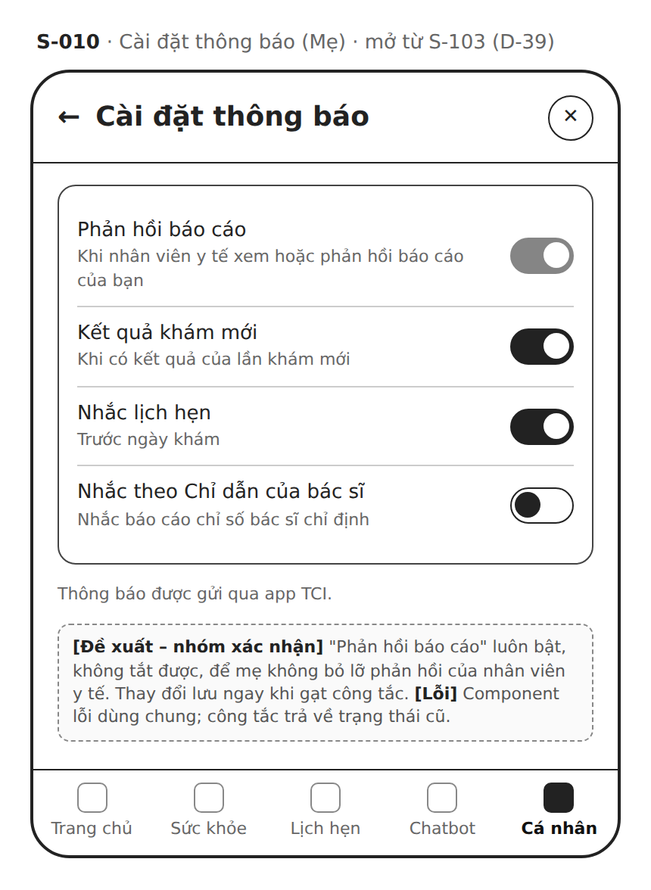

# Screen Spec: S-010 Notification settings

**Current navigation — D-80 / D-86 (confirmed 11/11/2026):** any Appointments/Health tab row below describes the historical wireframe, not the current shell. The five root screens use Home · Timeline · Chatbot · From doctor · Profile; child screens have back navigation and no root tab bar. No Home booking CTA is present. Historical navigation rows and images are retained as reference only; unrelated open questions remain open.

| Field | Value |
|---|---|
| Screen ID | `S-010` |
| Screen name | Notification settings (DBIZ2 name: Settings) |
| Actor | Mother |
| Priority | Must |
| Belongs to module | `spec-ACC.md` |
| Mockup image | `img/S-010.png` |
| Status | Draft (revised 29/09/2026 — screen-spec fix #5) |

> **v1.0.0 app (07/11/2026, D-80 – D-85):** 4 switches including "Appointment reminders"; "Report responses" locked on.

## 1. Purpose

**Shown when:** the mother taps the **"Notification settings"** row on `S-103` Profile (D-39).

**The user leaves this screen when:** the mother taps ← (back to `S-103`), ✕ (→ `S-083`) or another tab. The screen has no Save button — changes are saved as soon as a switch is toggled.

The mother chooses which notification types she wants to receive. These types match the notification types on `S-009`, plus reminders based on the Doctor's instructions.

## 2. Mockup

## 3. Element inventory

| # | Element | Type | Content / data source | Required | Validation |
|---|---|---|---|---|---|
| 1 | ← button | Button | navigation | Yes | — |
| 2 | Title "Notification settings" | Header | static | Yes | — |
| 3 | ✕ button | Button | close the sub-app (D-01) `[PENDING CLIENT: D-01]` | Yes | — |
| 4 | "Report responses" — "When clinical staff view or respond to your report" + switch (on, grey = locked) | Toggle | notification setting for the Report type (related to `spec-ALR.md` FR-004, FR-005; statuses D-18). **Team proposal: always on, cannot be turned off** — see SR-001 | Yes | locked in the on position (proposed) `[NEEDS CLARIFICATION]` |
| 5 | "New visit results" — "When results from a new visit are available" + switch (on in the drawing) | Toggle | notification setting for new visit results (`spec-ALR.md` BR-003) | Yes | on / off |
| 6 | "Appointment reminders" — "Before the visit date" + switch (on in the drawing) | Toggle | appointment reminder setting (`spec-APT.md` FR-009) — **Could (D-77)**: hidden if APT is not built. How far in advance `[NEEDS CLARIFICATION]` | Yes | on / off |
| 7 | "Doctor's-instruction reminders" — "Reminders to report the metrics your doctor assigned" + switch (off in the drawing) | Toggle | reminder setting for the "Instruction reminder" notification type — created by `spec-ALR.md` FR-022 (new, ACC-02 / ALR-04) from the mother's Doctor's instructions (Watch-Flag, `spec-HLT.md` §6); stored in Notification Preference `watch_flag_reminder`. When / how often a reminder is created is still open (`spec-ALR.md` §10 Q20) — the switch is no longer orphaned: it has an FR, only its trigger is pending | Yes | on / off |
| 8 | "Notifications are sent via the TCI app." | Text | static `[PENDING CLIENT: D-01]` | No | — |
| 9 | 5-tab bar, "Profile" tab selected | Toggle (tab) | navigation (D-27) | Yes | — |
| 10 | Annotations "[Proposed] …", "[Error] …" | Annotation (wireframe note, not shown in the app) | rules in §4, §6 | — | — |

The on / off position of each switch in the drawing is sample data. Default values before the mother changes anything `[NEEDS CLARIFICATION]`.

## 4. States

| State | What the user sees | Trigger |
|---|---|---|
| Default | 4 switch rows reflecting the current settings + the line "Notifications are sent via the TCI app." | Opened from `S-103` |
| Empty (no data) | Not applicable — fixed list of switches | — |
| Loading | Shared "Loading" pattern (D-27) while settings load `[NEEDS CLARIFICATION: not drawn]`; switch state while saving `[NEEDS CLARIFICATION: not drawn]` | Screen opened / switch toggled |
| Error | Shared error component (D-27); **the switch returns to its previous state** (wireframe annotation) | Saving the setting failed |
| Success / confirmation | The switch keeps its new state; no toast or Save button in the drawing `[NEEDS CLARIFICATION: is there any confirmation]` | Saved successfully |

## 5. Interactions and navigation

| # | Element | User action | System response | Goes to screen |
|---|---|---|---|---|
| 1 | ← button | tap | — | `S-103` |
| 2 | ✕ button | tap | asks for confirmation to close the sub-app (D-01) | `S-083` |
| 3 | "Report responses" switch | tap | no change (locked on — proposed, SR-001) `[NEEDS CLARIFICATION: is an explanation shown on tap]` | stays |
| 4 | "New visit results" / "Appointment reminders" / "Doctor's-instruction reminders" switch | toggle | saves immediately; on error → shared error component, the switch returns to its previous state | stays |
| 5 | Tab Home / Health / Appointments / Chatbot / Profile | tap | — | `S-008` / `S-023` / TCI app `[NEEDS CLARIFICATION: same as S-008 Q4]` / `S-031` / `S-103` |

## 6. Screen-level rules

| Rule ID | Rule | Source |
|---|---|---|
| SR-001 | **Team proposal (not yet a Client requirement):** "Report responses" is always on and cannot be turned off, so the mother does not miss responses from clinical staff. `[NEEDS CLARIFICATION: team / Client to confirm whether this switch is locked]` | Wireframe annotation "[Proposed]"; `spec-ACC.md` §7.1 |
| SR-002 | Changes are saved as soon as a switch is toggled; there is no Save button. | Wireframe annotation |
| SR-003 | Save error → shared error component (D-27); the switch returns to its state before the toggle. | Wireframe annotation; D-27 |
| SR-004 | Notifications are sent via the TCI app (the sub-app has no delivery channel of its own). | Wireframe; D-01 `[PENDING CLIENT: D-01]` |
| SR-005 | Turning off "Doctor's-instruction reminders" does not prevent the mother from reporting Group 2 metrics. | D-11 `[NEEDS CLARIFICATION: team to confirm — inferred from D-11, not stated on the wireframe]` |

## 7. Linked requirements

| FR ID (from the module spec) | What this screen does for it |
|---|---|
| FR-027 (`spec-ACC.md`, new, Must — D-48, D-56) | Saves the setting as soon as a switch is toggled; on error the switch returns to its previous state |
| BR-003 (`spec-ALR.md`) | "New visit results" notification type |
| FR-009 (`spec-APT.md`, Could — D-77) | "Appointment reminders" notification type |
| FR-018 (`spec-ALR.md`, new, Must — D-48, D-56) | "Report responses" notification type |
| FR-022 (`spec-ALR.md`, new, Should until `spec-ALR.md` §10 Q20 is answered — D-56; ACC-02, ALR-04) | "Doctor's-instruction reminders" notification type (trigger / frequency: `spec-ALR.md` §10 Q20) |

## 8. Responsive and accessibility notes

- Smallest supported width: `[NEEDS CLARIFICATION: not specified]`
- What collapses or stacks on a narrow screen: not applicable — single-column list; description lines wrap on narrow screens.
- Switches must have labels readable by screen readers (name + on / off); a locked switch must announce that it cannot be changed, not rely on the grey colour alone.

## 9. Open questions

| # | Question | Blocking? | Status |
|---|---|---|---|
| 1 | [NEEDS CLARIFICATION: is "Report responses" locked always on? This is a team proposal on the wireframe, not yet a Client requirement; pending team / Client confirmation.] | No | Open |
| 3 | [NEEDS CLARIFICATION: default value of each switch; how far in advance "Appointment reminders" are sent.] How often "Doctor's-instruction reminders" are sent is tracked in `spec-ALR.md` §10 Q20 (FR-022 exists; only its trigger is open). | No | Open |
| 4 | [NEEDS CLARIFICATION: does turning a type off only stop push notifications via the TCI app, or also hide it from `S-009`?] | No | Open |

---

## Appointment demo assumption (Part A, 11/11/2026)

For demo/test only, generated accounts `tci-000133` and `tci-000134` start with `appointment_reminder` on. A reminder is generated one calendar day before the simulated host visit, on startup or Home/S-009 access. Turning the switch off prevents new reminders; previously received notices remain visible. **Q4 cần nhóm trưởng/sản phẩm xác nhận.** The Q3/Q4 markers in §9 above remain unchanged and unresolved; this note records no product decision. See `docs/build/appointment-part-a.md`.

## Completion checklist

- [x] The mockup is a separate cropped image file, named with the Screen ID.
- [x] Every visible element in the mockup appears in the element inventory.
- [x] Every input element has a validation rule or an explicit "none" — 4 on / off switches; "Report responses" locked (proposed).
- [x] All five states are filled in, or marked "not applicable" / `[NEEDS CLARIFICATION]` with a reason.
- [x] Every navigation target is a Screen ID that exists in the Screen List, or is a hand-off to the TCI app (the "Appointments" tab).
- [x] Every element that displays data names the field it displays, matching the module spec (Notification Preference — `spec-ACC.md` §6).
