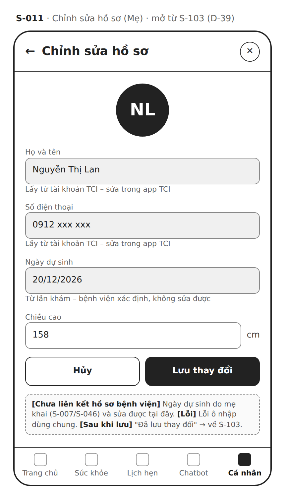

# Screen Spec: S-011 Edit profile

**Current navigation — D-80 / D-86 (confirmed 11/11/2026):** any Appointments/Health tab row below describes the historical wireframe, not the current shell. The five root screens use Home · Timeline · Chatbot · From doctor · Profile; child screens have back navigation and no root tab bar. No Home booking CTA is present. Historical navigation rows and images are retained as reference only; unrelated open questions remain open.

| Field | Value |
|---|---|
| Screen ID | `S-011` |
| Screen name | Edit profile (DBIZ2 name: Personal Information) |
| Actor | Mother |
| Priority | Must |
| Belongs to module | `spec-ACC.md` |
| Mockup image | `img/S-011.png` |
| Status | Draft (revised 29/09/2026 — screen-spec fix #8) |

## 1. Purpose

**Shown when:** the mother taps the **"Edit profile"** row on `S-103` Profile (D-39).

**The user leaves this screen when:** the mother taps "Save changes" successfully (→ `S-103`), "Cancel" or ← (→ `S-103`), ✕ (→ `S-083`) or another tab.

The mother views her profile and edits the parts the sub-app allows her to edit. Full name and phone number belong to the TCI account and are therefore read-only `[PENDING CLIENT: D-01]`.

## 2. Mockup

## 3. Element inventory

| # | Element | Type | Content / data source | Required | Validation |
|---|---|---|---|---|---|
| 1 | ← button | Button | navigation | Yes | — |
| 2 | Title "Edit profile" | Header | static | Yes | — |
| 3 | ✕ button | Button | closes the sub-app (D-01) `[PENDING CLIENT: D-01]` | Yes | — |
| 4 | Avatar "NL" | Image | Profile → Name (initials), as on `S-103` `[NEEDS CLARIFICATION: is the TCI account profile picture used; can the picture be changed here — the image has no change button]` | No | — |
| 5 | "Full name" — "Nguyễn Thị Lan" + "From your TCI account – edit in the TCI app" | Input (read-only) | User Account → Full name, taken from the TCI account (`spec-ACC.md` §6, FR-017; D-01) | Yes | not editable — none |
| 6 | "Phone number" — "0912 xxx xxx" + "From your TCI account – edit in the TCI app" | Input (read-only) | User Account → Phone number, taken from the TCI account (D-01) `[NEEDS CLARIFICATION: is the partial masking a display rule or sample data — as S-103 #7]` | Yes | not editable — none |
| 7 | "Due date" — "20/12/2026" + "From visit – set by the hospital, cannot be edited" | Input (date) | Profile → Due date (EDD), Due-date source (`spec-ACC.md` §6; BR-003). **Hospital record linked:** read-only (as in the image). **Not linked:** the date the mother entered on `S-007`/`S-046`, editable (wireframe annotation) | Yes | When editable: `dd/mm/yyyy` (D-27); the `S-007` error rules apply (due date in the past / gestational week outside 0–42 weeks — `spec-ACC.md` FR-004) `[NEEDS CLARIFICATION: team to confirm the same rules are used; the 0–42 week range is not yet confirmed by the SME — spec-ACC Q10]` |
| 8 | "Height" — field "158" + unit "cm" | Input (number) | Profile → Height (cm, optional) (`spec-ACC.md` §6; D-13) | No `[NEEDS CLARIFICATION: can it be left empty — it is optional on S-007]` | number; valid range `[NEEDS CLARIFICATION: D-16]` |
| 9 | "Cancel" button (outlined) | Button | discards changes | Yes | — |
| 10 | "Save changes" button (primary, filled) | Button | validates then saves the profile (`spec-ACC.md` FR-020, FR-022); CTA D-27 | Yes | validation (FR-020); condition for enabling the button (e.g. only when something has changed) `[NEEDS CLARIFICATION]` |
| 11 | 5-tab bar, "Profile" tab selected | Toggle (tab) | navigation (D-27) | Yes | — |
| 12 | Annotations "[Hospital record not linked] …", "[Error] …", "[After saving] …" | Annotation (wireframe annotation, not shown in the app) | rules in §4, §6 | — | — |

The screen has no fields for weight, first day of last menstrual period (LMP), medical record number or gestational week. `[NEEDS CLARIFICATION: where is the weight entered on S-007 edited; when not linked, can the mother edit via the LMP here — the image only has a due date field]`

## 4. States

| State | What the user sees | Trigger |
|---|---|---|
| Default — hospital record linked (drawn) | Full name, phone number, due date read-only (grey background + source line); height editable; "Cancel" / "Save changes" | Opened from `S-103` when the EMR Linkage Request is linked (`spec-ACC.md` FR-002) — **the link status is decided by seed data in the MVP** (ACC-01, screen-spec fix #8) |
| Default — hospital record not linked | As above, but the due date is the date the mother entered (`S-007`/`S-046`) and is editable. What the source line below the field shows `[NEEDS CLARIFICATION: not drawn]` | Link is "Pending link" / does not exist — **decided by seed data in the MVP**; both states are kept because the demo needs them (screen-spec fix #8) |
| Empty (no data) | Not applicable — full name and phone number always come from the TCI account (D-01); the due date always exists because it was entered on `S-007` (`spec-ACC.md` BR-006). Empty height → empty field | — |
| Loading | Shared "Loading" pattern (D-27) while the profile loads; "Save changes" button in progress `[NEEDS CLARIFICATION: not drawn]` | Screen opened / "Save changes" tapped |
| Error | Shared field error directly below the field (D-27; wireframe annotation). Error when saving (connection lost): shared "Error" pattern `[NEEDS CLARIFICATION: not drawn]` | Invalid value / save fails |
| Success / confirmation | "Changes saved" → back to `S-103` (wireframe annotation) | Save succeeds |

## 5. Interactions and navigation

| # | Element | User action | System response | Goes to screen |
|---|---|---|---|---|
| 1 | ← button | tap | discards unsaved changes `[NEEDS CLARIFICATION: is confirmation asked when something has been edited]` | `S-103` |
| 2 | ✕ button | tap | asks for confirmation to close the sub-app (D-01) | `S-083` |
| 3 | Full name / Phone number field | tap | not editable; edited in the TCI app `[NEEDS CLARIFICATION: is there a link that opens the TCI app — not in the image]` | stays |
| 4 | Due date field (linked) | tap | not editable (BR-003) | stays |
| 5 | Due date field (not linked) | pick a date | updates the date; the gestational week is recalculated from the due date on save (Profile → Week Info calculated from the EDD, `spec-ACC.md` §6) | stays |
| 6 | Height field | type | — | stays |
| 7 | "Cancel" | tap | discards changes | `S-103` |
| 8 | "Save changes" — valid | tap | validates (FR-020), saves (FR-022), shows "Changes saved" | `S-103` |
| 9 | "Save changes" — invalid | tap | shared field error below the invalid field; nothing is saved | stays |
| 10 | Tab Home / Health / Appointments / Chatbot / Profile | tap | — | `S-008` / `S-023` / TCI app `[NEEDS CLARIFICATION: as S-008 Q4]` / `S-031` / `S-103` |

## 6. Screen-level rules

| Rule ID | Rule | Source |
|---|---|---|
| SR-001 | Full name and phone number come from the TCI account and are read-only; they are edited in the TCI app. | D-01 `[PENDING CLIENT: D-01]`; `spec-ACC.md` BR-002; wireframe |
| SR-002 | Once the hospital record is linked, the due date is set by the hospital and is read-only. When not linked, the due date is the date the mother entered and can be edited on this screen. | `spec-ACC.md` BR-003; wireframe annotation |
| SR-003 | Height is part of the Profile and can be edited here; there is no BMI. | D-13 |
| SR-004 | The valid height range (to block typing errors) is not yet decided — no number is set. | D-16 (pending SME); `spec-ACC.md` Q11 |
| SR-005 | Changes are saved only when "Save changes" is tapped; "Cancel" / ← do not save. | Wireframe |
| SR-006 | Dates use the `dd/mm/yyyy` format; height is in cm. | D-27 |

## 7. Linked requirements

| FR ID (from the module spec) | What this screen does for it |
|---|---|
| FR-024 (`spec-ACC.md`) | Displays the profile in editable form (by permission: which fields are editable) |
| FR-017, FR-018 (`spec-ACC.md`) | Retrieves the profile information to display |
| FR-020 (`spec-ACC.md`) | Validates the edited information before saving |
| FR-022 (`spec-ACC.md`) | Saves the validated profile information |
| FR-001, FR-002 (`spec-ACC.md`) | The hospital record link status (seed data in the MVP) decides whether the due date field is locked or editable |
| BR-003 (`spec-ACC.md`) | The hospital's due date takes priority and cannot be edited |

## 8. Responsive and accessibility notes

- Smallest supported width: `[NEEDS CLARIFICATION: not specified]`
- What collapses or stacks on a narrow screen: the "Cancel" / "Save changes" button pair may stack vertically.
- Read-only fields must be announced as not editable to screen readers, not only indicated by the grey background; the source line below each field and the error line must be readable.

## 9. Open questions

| # | Question | Blocking? | Status |
|---|---|---|---|
| 1 | [NEEDS CLARIFICATION: valid height range.] (D-16, pending SME) | No | Open |
| 2 | [NEEDS CLARIFICATION: does editing the due date (when not linked) use the S-007 error rules; can it be edited via the LMP?] | No | Open |
| 3 | [NEEDS CLARIFICATION: where is the weight entered on S-007 edited; does the "Pregnancy information" row on S-103 open S-007 or S-011 (spec-ACC FR-024 says both rows open the edit screen; S-007 §9 Q5)?] | No | Open |
| 4 | [NEEDS CLARIFICATION: does tapping ← / "Cancel" after editing ask for confirmation to discard changes?] | No | Open |
| 5 | [NEEDS CLARIFICATION: when the hospital's due date replaces the date the mother entered, is the mother informed (spec-ACC Q12)?] | No | Open |
| 6 | [NEEDS CLARIFICATION: Client to confirm the sub-app model (full name, phone number read-only from the TCI app).] `[PENDING CLIENT: D-01]` | Yes | Open [PENDING CLIENT: D-01] |

---

## Completion checklist

- [x] The mockup is a separate cropped image file, named with the Screen ID.
- [x] Every visible element in the mockup appears in the element inventory.
- [x] Every input element has a validation rule or an explicit "none" / `[NEEDS CLARIFICATION]` (height: D-16).
- [x] All five states are filled in, or marked "not applicable" / `[NEEDS CLARIFICATION]` with a reason.
- [ ] Every navigation target is a Screen ID that exists in the Screen List — the "Appointments" tab goes to the TCI app (no Screen ID).
- [x] Every element that displays data names the field it displays, matching the module spec.
