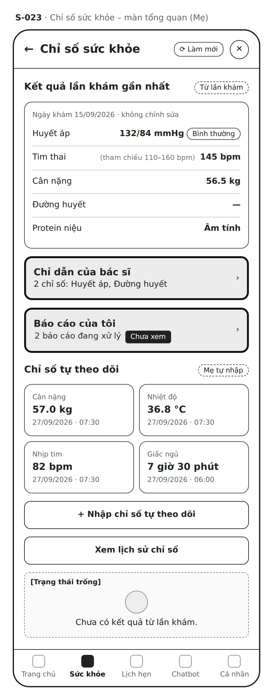

# Screen Spec: S-023 Health metrics

**Current navigation — D-80 / D-86 (confirmed 11/11/2026):** any Appointments/Health tab row below describes the historical wireframe, not the current shell. The five root screens use Home · Timeline · Chatbot · From doctor · Profile; child screens have back navigation and no root tab bar. No Home booking CTA is present. Historical navigation rows and images are retained as reference only; unrelated open questions remain open.

| Field | Value |
|---|---|
| Screen ID | `S-023` |
| Screen name | Health metrics |
| Actor | Mother |
| Priority | Must |
| Belongs to module | `spec-HLT.md` |
| Mockup image | `img/S-023.png` |
| Status | Draft (revised 29/09/2026 — screen-spec fix #1; fetal heart rate per the latest MVP Scope) |

> **v1.0.0 app (07/11/2026, D-80 – D-85):** Reached from the S-008 title and tiles and from "New visit results"; protein without a value shows "Chưa đánh giá".

## 1. Purpose

**Shown when:** the mother taps the "Health" tab, "Health metrics ›" or the new visit result card on `S-008`; or returns from `S-024` (after saving / cancelling), `S-027` (←), S-025 or `S-029`.

**The user leaves this screen when:** she taps ← (`S-008`), the "Doctor's instructions" button (`S-027`), "My reports" (`S-029`), "+ Enter self-tracked metrics" (`S-024`), "View metric history" (S-025), another tab, or ✕ (`S-083`).

## 2. Mockup

## 3. Element inventory

| # | Element | Type | Content / data source | Required | Validation |
|---|---|---|---|---|---|
| 1 | ← button | Button | navigation | Yes | — |
| 2 | Title "Health metrics" | Header | static | No | — |
| 3 | "⟳ Refresh" button | Button | `spec-HLT.md` `FR-003` / `FR-004` | No | — |
| 4 | ✕ button | Button | closes the sub-app (D-01) | Yes | — |
| 5 | Section title "Latest visit results" + source label "From visit" | Header (section) + Label | Health Metric Record `source` = From visit (D-10) | No | — |
| 6 | "Visit date 15/09/2026 · not editable" | Text | date of the latest visit (`dd/mm/yyyy`, D-27); "not editable" per `spec-HLT.md` BR-001 | No | — |
| 7 | "Blood pressure" — "132/84 mmHg" — label "Normal" | Text + Label | Health Metric Record (visit); threshold label per `spec-ALR.md` BR-004, threshold systolic ≥ 140 or diastolic ≥ 90 mmHg (D-14); 3 labels per D-17 | No | — |
| 8 | "Fetal heart rate" — "145 bpm" + reference "(reference range 110–160 bpm)" | Text | Health Metric Record (visit) — fetal heart rate comes only from visits (the mother does not report it). The 110–160 bpm range is **display only**: shown as a reference, **no threshold label**, no check, never an alert (D-12; MVP Scope (latest) §5: the 110–160 bpm range is "shown for reference" / "for display only" and does not raise an alert). The wireframe shows the reference range text next to the value and no label | No | — |
| 9 | "Weight" — "56.5 kg" | Text | Health Metric Record (visit) | No | — |
| 10 | "Blood glucose" — "—" | Text | Health Metric Record (visit); "—" = the visit has no value. Threshold per `spec-ALR.md` BR-004 (D-15): fasting ≥ 5.3 / 1 h after meal ≥ 7.8 / 2 h after meal ≥ 6.7 mmol/L | No | — |
| 11 | "Urine protein" — "Negative" | Text | Health Metric Record (visit); threshold per `spec-ALR.md` BR-004 (D-15): Negative / Trace → Normal, ≥ 1+ → Above threshold. The wireframe shows no threshold label for this row | No | — |
| 12 | Card button "Doctor's instructions" — "2 metrics: Blood pressure, Blood glucose" + › | Button (card) | Watch-Flag (`spec-HLT.md` §6) — count and names of the assigned Group 2 metrics (D-11) | No | — |
| 13 | Card button "My reports" (highlighted) — number of reports being handled (e.g. "2 reports being handled" — the 2 "Not viewed" reports on `S-029`) + status label of the latest report / case (e.g. "Not viewed") + › | Button (card) | Case (status ≠ Resolved) and the latest Case status (`spec-ALR.md` `FR-002`); D-18, D-26 as revised. Replaces the former "Risk assessment" card (ALR-01, HLT-02) | No | — |
| 14 | Section title "Self-tracked metrics" + source label "Self-entered" | Header (section) + Label | Health Metric Record `source` = Self-entered, `metric_group` = 1 (D-10, D-11) | No | — |
| 15 | Card "Weight" — "57.0 kg" — "27/09/2026 · 07:30" | Text (card) | Group 1 Health Metric Record: latest value + `measured_at`; `spec-HLT.md` `FR-005` | No | — |
| 16 | Card "Temperature" — "36.8 °C" — "27/09/2026 · 07:30" | Text (card) | as #15 | No | — |
| 17 | Card "Heart rate" — "82 bpm" — "27/09/2026 · 07:30" | Text (card) | as #15 | No | — |
| 18 | Card "Sleep" — "7 h 30 min" — "27/09/2026 · 06:00" | Text (card) | as #15; duration calculated from Bedtime / Wake-up time (`S-024`) | No | — |
| 19 | "+ Enter self-tracked metrics" button | Button | navigates to `S-024` | No | — |
| 20 | "View metric history" button | Button | `spec-HLT.md` `FR-009` – `FR-012`; CTA per D-27 | No | — |
| 21 | 5-item tab bar, "Health" selected | Toggle (tab) | navigation (D-27) | Yes | — |

Note: the frame "[Empty state] No visit results yet." is a state and is described in §4. Group 1 metrics carry no threshold label (D-11). There are no input fields — the screen is view-only (`spec-HLT.md` BR-001).

## 4. States

| State | What the user sees | Trigger |
|---|---|---|
| Default | the 3 sections as in the mockup | visit data and self-entered metrics exist |
| Empty (no data) | **"Latest visit results" section (drawn):** icon + "No visit results yet." (D-27 pattern, no CTA). **"Self-tracked metrics" section (not drawn):** uses the D-27 pattern with CTA "+ Enter self-tracked metrics"; wording `[NEEDS CLARIFICATION]`. "Doctor's instructions" button when there are no instructions: `[NEEDS CLARIFICATION]` (the target screen `S-027` already has an empty state) | the mother has no visit yet / has not self-entered any metric |
| Loading | shared skeleton that keeps the layout (D-27) | screen opens or "⟳ Refresh" is tapped |
| Error | shared banner "⚠ Could not load data. Retry" (D-27) | load / refresh fails |
| Success / confirmation | after a successful "⟳ Refresh": data updated + confirmation message (`FR-003`); message wording not drawn `[NEEDS CLARIFICATION]`. When returning from `S-024`: toast "Metrics saved" (see `screen-spec-S-024.md`) | refresh completed / metrics saved |

## 5. Interactions and navigation

| # | Element | User action | System response | Goes to screen |
|---|---|---|---|---|
| 1 | ← | tap | — | `S-008` |
| 2 | "⟳ Refresh" | tap | reloads data, shows confirmation (`FR-003`/`FR-004`) | stays |
| 3 | ✕ | tap | asks to confirm closing the sub-app | `S-083` |
| 4 | "Doctor's instructions" button | tap | — | `S-027` |
| 5 | "My reports" card | tap | — | `S-029` "My reports" (D-26 as revised) |
| 6 | "+ Enter self-tracked metrics" | tap | opens the Group 1 entry form | `S-024` |
| 7 | "View metric history" | tap | opens the history chart | S-025 (D-38) |
| 8 | Tab Home / Appointments / Chatbot / Profile | tap | — | `S-008` / TCI app (see `screen-spec-S-008.md` §9 Q4) / `S-031` / `S-103` |

## 6. Screen-level rules

| Rule ID | Rule | Source |
|---|---|---|
| SR-001 | Values from visits are display-only; there are no edit controls. | `spec-HLT.md` BR-001 |
| SR-002 | Every health data section carries a source label: "From visit" / "Self-entered" (and "Doctor-assigned" on `S-027`). | D-10 |
| SR-003 | The "Self-tracked metrics" section contains only Group 1 metrics and has no threshold labels. | D-11 |
| SR-004 | Fetal heart rate comes only from visits; the mother does not enter or report it. Its 110–160 bpm range is shown for reference only — no threshold label, no alert. | D-12; latest MVP Scope §5; `spec-HLT.md` BR-005 |
| SR-005 | Height and BMI are not displayed (height is moved to the Profile). | D-13 |
| SR-006 | Threshold labels use only Normal / Above threshold / Not assessed; blood pressure is above threshold when systolic ≥ 140 or diastolic ≥ 90 mmHg; blood glucose is above threshold at ≥ 5.3 (fasting) / ≥ 7.8 (1 h after meal) / ≥ 6.7 (2 h after meal) mmol/L; urine protein ≥ 1+ → Above threshold. The thresholds were set by the team based on ADA / the Ministry of Health (D-15) and must be confirmed by a Thu Cuc doctor before real use. | D-14, D-15, D-17; `spec-ALR.md` BR-004 |
| SR-007 | The "My reports" card is highlighted and leads to `S-029` "My reports". No risk summary is shown (ALR-01). | D-26 as revised; ALR-01 |
| SR-008 | Header: ← · left-aligned title · "⟳ Refresh" · ✕ (→ `S-083`). | D-01, D-27 |

## 7. Linked requirements

| FR ID (from the module spec) | What this screen does for it |
|---|---|
| FR-002 (`spec-HLT.md`) | The health dashboard screen that FR-002 loads |
| FR-001 (`spec-HLT.md`) | Attaches threshold labels to group 2 visit values (blood pressure); fetal heart rate shows only its reference range |
| FR-003 / FR-004 (`spec-HLT.md`) | "⟳ Refresh" button + confirmation |
| FR-005 (`spec-HLT.md`) | Summary metric cards |
| FR-009 (`spec-HLT.md`) | "View metric history" leads to S-025 |
| FR-002 (`spec-ALR.md`) | Report summary on the "My reports" card |

## 8. Responsive and accessibility notes

- Smallest supported width: `[NEEDS CLARIFICATION: not specified]`.
- The 2 x 2 grid of self-tracked metric cards may stack into 1 column on narrow screens `[NEEDS CLARIFICATION]`.
- Text must be legible: numeric values, units, threshold labels, source labels. Threshold labels must include text, not colour alone.

## 9. Open questions

| # | Question | Blocking? | Status |
|---|---|---|---|
| 3 | Should fetal heart rate show a threshold label? | No | Resolved — **no**: the latest MVP Scope §5 says the 110–160 bpm range is shown for reference only and does not raise an alert; the screen shows the value + reference range, no label (D-12) |
| 4 | [NEEDS CLARIFICATION: The empty-state wording for the "Self-tracked metrics" section and the confirmation message after "Refresh" are not drawn.] | No | Open |

---

## Completion checklist

- [x] The mockup is a separate cropped image file, named with the Screen ID.
- [x] Every visible element in the mockup appears in the element inventory.
- [x] Every input element has a validation rule or an explicit "none" — view-only screen, no input fields (BR-001).
- [x] All five states are filled in, or marked "not applicable"/`[NEEDS CLARIFICATION]` with a reason.
- [x] Every navigation target is a Screen ID that exists in the Screen List.
- [x] Every element that displays data names the field it displays, matching the module spec.
