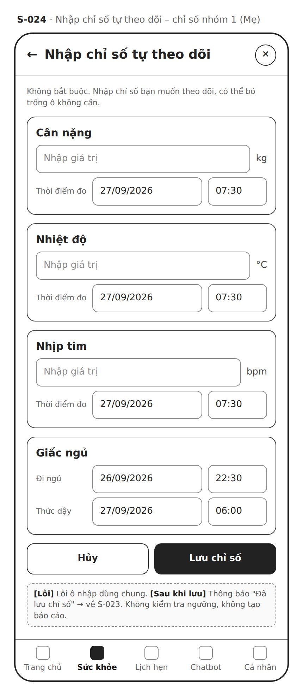

# Screen Spec: S-024 Enter self-tracked metrics

| Field | Value |
|---|---|
| Screen ID | `S-024` |
| Screen name | Enter self-tracked metrics |
| Actor | Mother |
| Priority | Must |
| Belongs to module | `spec-HLT.md` (D-07) |
| Mockup image | `img/S-024.png` |
| Status | Draft (revised 29/09/2026 — screen-spec fix #2) |

## 1. Purpose

**Shown when:** the mother taps "+ Enter self-tracked metrics" on `S-023`.

**The user leaves this screen when:** she taps "Save metrics" (after saving → `S-023`), "Cancel" or ← (discards the data just entered → `S-023`), a tab, or ✕ (`S-083`).

## 2. Mockup

## 3. Element inventory

| # | Element | Type | Content / data source | Required | Validation |
|---|---|---|---|---|---|
| 1 | ← button | Button | navigation | Yes | — |
| 2 | Title "Enter self-tracked metrics" | Header | static | No | — |
| 3 | ✕ button | Button | closes the sub-app (D-01) | Yes | — |
| 4 | Instruction text "Optional. Enter the metrics you want to track; you can leave fields you don't need blank." | Text | static (D-11: Group 1 is optional) | No | — |
| 5 | Label "Weight" + field "Enter value" + unit "kg" | Input | Health Metric Record — `metric_group` = 1, `unit` = kg, `source` = Self-entered (D-10, D-11) | No | number; valid range to block typing errors `[NEEDS CLARIFICATION: D-16]` |
| 6 | "Measured at" for weight: date "27/09/2026" + time "07:30" | Input (date + time) | Health Metric Record — `measured_at` | Yes when #5 is entered `[NEEDS CLARIFICATION]` | `dd/mm/yyyy` + `HH:mm` (D-27); default value (current time?) and whether a future time can be selected `[NEEDS CLARIFICATION]` |
| 7 | Label "Temperature" + field "Enter value" + unit "°C" | Input | as #5, `unit` = °C | No | number; valid range `[NEEDS CLARIFICATION: D-16]` |
| 8 | "Measured at" for temperature: "27/09/2026" + "07:30" | Input (date + time) | as #6 | as #6 | as #6 |
| 9 | Label "Heart rate" + field "Enter value" + unit "bpm" | Input | as #5, `unit` = bpm | No | number; valid range `[NEEDS CLARIFICATION: D-16]` |
| 10 | "Measured at" for heart rate: "27/09/2026" + "07:30" | Input (date + time) | as #6 | as #6 | as #6 |
| 11 | Label "Sleep" | Text | static | No | — |
| 12 | "Bedtime": date "26/09/2026" + time "22:30" | Input (date + time) | Health Metric Record — sleep (bedtime) | No | `dd/mm/yyyy` + `HH:mm`; if entered, "Wake-up time" is also required `[NEEDS CLARIFICATION]` |
| 13 | "Wake-up time": date "27/09/2026" + time "06:00" | Input (date + time) | Health Metric Record — sleep (wake-up time); duration shown on `S-023`/`S-008` | No | `dd/mm/yyyy` + `HH:mm`; must be after "Bedtime" — proposed logic rule, not yet decided `[NEEDS CLARIFICATION]` |
| 14 | "Cancel" button (secondary, outlined) | Button | discards the data just entered | Yes | — |
| 15 | "Save metrics" button (primary, filled) | Button | saves Health Metric Records (`spec-HLT.md` `FR-007`); CTA per D-27 | Yes | checks format / valid range before saving (`spec-ALR.md` `FR-014`); whether the button is disabled or shows an error when all fields are empty `[NEEDS CLARIFICATION]` |
| 16 | 5-item tab bar, "Health" selected | Toggle (tab) | navigation (D-27) | Yes | — |

Note: the frames "[Error] Shared field error." and "[After saving] …" are annotations, described in §4/§5. The screen has no height field (D-13), no Group 2 metrics (blood pressure, blood glucose, urine protein — Group 2 is reported only on `S-025A`, and only for the metrics flagged in the mother's Doctor's instructions — ALR-02, screen-spec fix #2) and no fetal heart rate (D-12).

## 4. States

| State | What the user sees | Trigger |
|---|---|---|
| Default | value fields empty; "Measured at" fields prefilled with date and time as in the mockup | screen opens |
| Empty (no data) | not applicable — entry form, no list | — |
| Loading | "Save metrics" button in a processing state; the D-27 skeleton pattern does not apply to forms `[NEEDS CLARIFICATION: saving indicator not drawn]` | "Save metrics" tapped |
| Error | **Field error (drawn, shared D-27 pattern):** field border in error style + the line "⚠ Value outside the valid range" directly below the field; valid range `[NEEDS CLARIFICATION: D-16]`. **Save error:** shared banner "⚠ Could not load data. Retry" (D-27); whether entered data is kept `[NEEDS CLARIFICATION]` | value outside the valid range / save fails |
| Success / confirmation | toast "Metrics saved" → back to `S-023`, Group 1 cards updated. No threshold check, no report created | save succeeds |

## 5. Interactions and navigation

| # | Element | User action | System response | Goes to screen |
|---|---|---|---|---|
| 1 | Value / "Measured at" fields | type / select | inline format check (`FR-014` ALR) | stays |
| 2 | "Save metrics" | tap | validates; saves each entered metric as one Health Metric Record (`source` = Self-entered, `measured_at`) (`FR-007`); toast "Metrics saved" | `S-023` |
| 3 | "Cancel" / ← | tap | discards data; whether to ask for confirmation when data has been entered `[NEEDS CLARIFICATION]` | `S-023` |
| 4 | ✕ | tap | asks to confirm closing the sub-app | `S-083` |
| 5 | Tab Home / Health / Appointments / Chatbot / Profile | tap | — | `S-008` / `S-023` / TCI app / `S-031` / `S-103` |

## 6. Screen-level rules

| Rule ID | Rule | Source |
|---|---|---|
| SR-001 | Only Group 1 metrics are entered (weight, temperature, heart rate, sleep); all are optional. | D-07, D-11 |
| SR-002 | Group 1 values are **not** threshold-checked, carry no threshold label, and create no report or Alert. | D-11, D-22 |
| SR-003 | Each metric is saved with its measurement time and the source label "Self-entered". | D-10 |
| SR-004 | The valid-range check only blocks typing errors and is distinct from clinical thresholds; the figures are not yet decided. | D-16 (Pending SME) |
| SR-005 | No height field; fetal heart rate is not entered. | D-13, D-12 |

## 7. Linked requirements

| FR ID (from the module spec) | What this screen does for it |
|---|---|
| FR-007 (`spec-HLT.md`) | Saves the entered values as Health Metric Records |
| FR-004 (`spec-HLT.md`) | `S-023` refreshes with the new data after saving |
| FR-014 (`spec-ALR.md`, cross-ref) | Validates entered values before saving (valid range per D-16) |

## 8. Responsive and accessibility notes

- Smallest supported width: `[NEEDS CLARIFICATION: not specified]`.
- Date + time field pairs may stack vertically on narrow screens.
- Text must be legible: the unit (kg, °C, bpm) next to each field and the error line below it; screen readers must read the error together with its field.

## 9. Open questions

| # | Question | Blocking? | Status |
|---|---|---|---|
| 3 | [NEEDS CLARIFICATION: Valid value ranges for weight, temperature, heart rate and sleep (D-16, pending SME).] | Yes | Open |
| 4 | [NEEDS CLARIFICATION: Required-field rules: is the measurement time required when a value is entered; how does "Save metrics" behave when all fields are empty; what is the default value of "Measured at"; should future times / "Wake-up time" before "Bedtime" be blocked?] | No | Open |

---

## Completion checklist

- [x] The mockup is a separate cropped image file, named with the Screen ID.
- [x] Every visible element in the mockup appears in the element inventory.
- [x] Every input element has a validation rule or an explicit "none"/`[NEEDS CLARIFICATION]`.
- [x] All five states are filled in, or marked "not applicable"/`[NEEDS CLARIFICATION]` with a reason.
- [x] Every navigation target is a Screen ID that exists in the Screen List.
- [x] Every element that displays data names the field it displays, matching the module spec.
