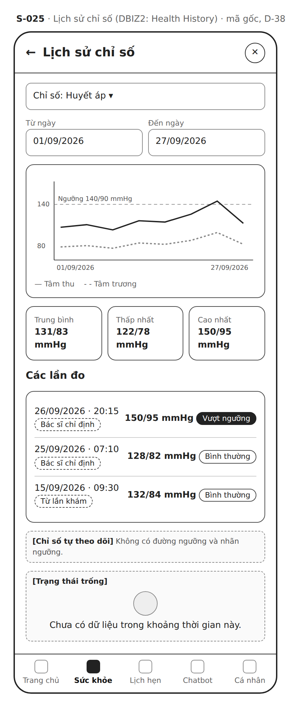

# Screen Spec: S-025 Metric history

| Field | Value |
|---|---|
| Screen ID | `S-025` |
| Screen name | Metric history |
| Actor | Mother |
| Priority | Must (`spec-HLT.md` FR-009–FR-012) |
| Belongs to module | `spec-HLT.md` |
| Mockup image | `img/S-025.png` |
| Spec version | v1.4 |
| Status | Draft (revised 29/09/2026 — fetal heart rate per the latest MVP Scope; Self-entered label per D-33 as revised) |

> **v1.0.0 app (07/11/2026, D-80 – D-85):** Blood pressure, last 30 days by default; blood glucose opens on "fasting"; axis with one decimal on narrow ranges; urine levels by name; no sleep statistics (HLT Q12).

## 1. Purpose

**Shown when:** the mother taps "View metric history" on `S-023` Health metrics or "View metric history ›" on a metric card on `S-027` Doctor's instructions. `[NEEDS CLARIFICATION: when opened from a card on `S-027`, is that card's metric preselected; when opened from `S-023`, what is the default metric?]`

**The user leaves this screen when:** she taps ← (back to the previous screen), ✕ (→ `S-083`), or selects another tab.

## 2. Mockup

## 3. Element inventory

| # | Element | Type | Content / data source | Required | Validation |
|---|---|---|---|---|---|
| 1 | ← button | Button | navigation | Yes | — |
| 2 | Title "Metric history" | Header (Page title) | static | No | — |
| 3 | ✕ button | Button | navigation — opens `S-083` | Yes | — |
| 4 | Selector "Metric: Blood pressure ▾" | Dropdown | Health Metric Record — Metric ID (`spec-HLT.md` FR-009). List: Group 1 (weight, temperature, heart rate, sleep), Group 2 (blood pressure, blood glucose, urine protein) and **fetal heart rate** ("From visit" values only; reference range, no label — D-12) | Yes | select 1 metric |
| 5 | Field "From date" (`01/09/2026`) | Input (date picker) | Time Range — start date (FR-010) | Yes | `dd/mm/yyyy`; ≤ "To date" `[NEEDS CLARIFICATION: rule not stated; default value?]` |
| 6 | Field "To date" (`27/09/2026`) | Input (date picker) | Time Range — end date (FR-010) | Yes | `dd/mm/yyyy`; ≥ "From date"; whether future dates are allowed `[NEEDS CLARIFICATION]` |
| 7 | Line chart: 2 lines (Systolic solid, Diastolic dotted), vertical axis (labels 140, 80), horizontal axis (01/09/2026 – 27/09/2026) | Chart | Health Metric Record — Metric Value by `measured_at` within the filtered range (FR-009, FR-012) | — | — |
| 8 | Dashed threshold line + label "Threshold 140/90 mmHg" (on-screen text; means systolic ≥ 140 or diastolic ≥ 90 mmHg — D-14) | Chart annotation | configured threshold of the Group 2 metric — blood pressure systolic ≥ 140 or diastolic ≥ 90 mmHg (D-14); blood glucose by measurement context (`glucose_context`): fasting ≥ 5.3 / 1 h after meal ≥ 7.8 / 2 h after meal ≥ 6.7 mmol/L; urine protein ≥ 1+ (D-15; `spec-ALR.md` BR-004; `spec-HLT.md` FR-012). **Shown only for Group 2 metrics**; self-tracked metrics (Group 1) have none | — | — |
| 9 | Legend "— Systolic - - Diastolic" | Legend | static per metric (blood pressure) | No | — |
| 10 | Card "Average" — "131/83 mmHg" | Stat card | Stats Avg (FR-011) on the filtered data | — | — |
| 11 | Card "Lowest" — "122/78 mmHg" | Stat card | Stats Min (FR-011) | — | — |
| 12 | Card "Highest" — "150/95 mmHg" | Stat card | Stats Max (FR-011) | — | — |
| 13 | Section title "Measurements" | Text | static | No | — |
| 14 | Each measurement row: date and time (`26/09/2026 · 20:15`), source label, value (`150/95 mmHg`), threshold label ("Above threshold" / "Normal" / "Not assessed") | List item | Health Metric Record — `measured_at`, `source` (D-10), Metric Value + `unit`, threshold comparison result (D-17; `spec-HLT.md` FR-001). Source label by group: **Group 2 → "Doctor-assigned" (reported by the mother) or "From visit"**; Group 1 → "Self-entered" (S-024, S-007 weight) or "From visit"; fetal heart rate → "From visit" only. A Group 2 value is never "Self-entered" (D-33 as revised, ALR-02) | — | — |
| 15 | Annotation block "[Self-tracked metrics] No threshold line and no threshold labels." | Annotation | design annotation, **not UI** — describes the Group 1 variant | — | — |
| 16 | Block "[Empty state]" — icon + "No data for this period." | Empty state | shared empty component (D-27) | — | — |
| 17 | 5-tab navigation bar | Toggle (tab) | navigation; **Health** tab selected (per the tab convention: "Health (S-023 → S-029, metric history)") | Yes | — |

## 4. States

The empty / loading / error states use the shared components defined on the `00-QUY-UOC` page (D-27).

| State | What the user sees | Trigger |
|---|---|---|
| Default (Group 2 metric, e.g. blood pressure) | metric selector, date range, chart with threshold line, 3 stat cards, "Measurements" list with source labels and threshold labels | screen opens |
| Empty (no data) | "No data for this period." `[NEEDS CLARIFICATION: are the chart and stat cards hidden when empty?]` | no records in the selected range |
| Loading | shared "Loading" component (grey placeholders that keep the layout) — not drawn separately | screen opens; metric or date range changes |
| Error | shared error component "⚠ Could not load data." + "Retry"; field error below the date field when the date range is invalid `[NEEDS CLARIFICATION: error wording]` | load fails; invalid date |
| Success / confirmation | not applicable — view-only screen, no save action | — |
| Self-tracked metric – Group 1 (additional) | as Default but **with no threshold line and no threshold label** on each measurement | weight / temperature / heart rate / sleep selected |
| Fetal heart rate (additional, not drawn) | chart of the "From visit" values with the 110–160 bpm range drawn as **reference lines**; the measurements have **no threshold label**; source label "From visit"; no report or case is ever created from it (D-12; latest MVP Scope §5: "display only") | fetal heart rate selected |
| Other Group 2 metric — blood glucose / urine protein (additional, not drawn) | as Default: threshold line and threshold labels per `spec-ALR.md` BR-004 (D-15) — blood glucose: threshold by measurement context (fasting ≥ 5.3 / 1 h after meal ≥ 7.8 / 2 h after meal ≥ 6.7 mmol/L); urine protein: Negative / Trace → Normal, ≥ 1+ → Above threshold. `[NEEDS CLARIFICATION: not drawn in the mockup — how the blood glucose threshold line is shown when measurements have different measurement contexts (filter by context or draw several lines)]` | blood glucose / urine protein selected |

## 5. Interactions and navigation

| # | Element | User action | System response | Goes to screen |
|---|---|---|---|---|
| 1 | Metric selector | select | loads data for the new metric; redraws chart, statistics, list (FR-009, FR-011, FR-012) | (same screen) |
| 2 | "From date" / "To date" | pick a date | filters by date range (FR-010); recalculates statistics (FR-011); redraws chart (FR-012) | (same screen) |
| 3 | Row in "Measurements" | tap | `[NEEDS CLARIFICATION: not drawn — does it open the report detail (`S-026`, "View status") for a measurement that was submitted as a report?]` | — |
| 4 | ← | tap | back to the previous screen | `S-023` or `S-027` (whichever opened it) |
| 5 | ✕ | tap | opens the close-sub-app confirmation | `S-083` `[PENDING CLIENT: D-01]` |
| 6 | Navigation bar tab | tap | switches module | `S-008` · `S-023` · Appointments `[NEEDS CLARIFICATION: no Screen ID in the wireframe set]` · `S-031` · `S-103` |

## 6. Screen-level rules

| Rule ID | Rule | Source |
|---|---|---|
| SR-001 | The threshold line and threshold labels appear **only** for Group 2 metrics; fetal heart rate shows its 110–160 bpm range as reference lines only, with no threshold label; self-tracked metrics (Group 1) have no threshold line and no threshold labels. | D-11; D-12; latest MVP Scope §5; mockup annotation "[Self-tracked metrics]" |
| SR-002 | The displayed blood pressure threshold label is "140/90 mmHg"; "Above threshold" when systolic ≥ 140 or diastolic ≥ 90 mmHg (D-14). Blood glucose: "Above threshold" at ≥ 5.3 (fasting) / ≥ 7.8 (1 h after meal) / ≥ 6.7 (2 h after meal) mmol/L according to the measurement's `glucose_context`; urine protein: Negative / Trace → Normal, ≥ 1+ → Above threshold (D-15). The thresholds were set by the team based on ADA / the Ministry of Health (D-15) and must be confirmed by a Thu Cuc doctor before real use. | D-14, D-15; `spec-ALR.md` BR-004 |
| SR-003 | Only 3 threshold labels are used: Normal / Above threshold / Not assessed. "Not assessed" is used only when there is no value (or the report contains only symptoms); all 3 Group 2 metrics have thresholds. | D-17; D-15; `spec-ALR.md` BR-005 |
| SR-004 | Every measurement always carries a source label: From visit / Self-entered / Doctor-assigned. "Doctor-assigned" = a value the mother reports for a metric included in the Doctor's instructions — since the mother can report only those metrics (ALR-02), **every Group 2 value she reports is "Doctor-assigned"**; "Self-entered" applies only to Group 1 metrics (S-024) and the weight declared on S-007. | D-10; D-33 as revised; `00-QUY-UOC` page |
| SR-005 | The screen is view-only; "From visit" records cannot be edited by the mother. | `spec-HLT.md` BR-001 |
| SR-006 | Statistics (Average / Lowest / Highest) are calculated on the data within the selected date range. `[NEEDS CLARIFICATION: for blood pressure, are min / max calculated separately for systolic and diastolic or per measurement; are all data sources combined?]` | `spec-HLT.md` FR-011; US-2 AS2 |
| SR-007 | Formats: date `dd/mm/yyyy`; date and time `dd/mm/yyyy · HH:mm`; blood pressure `150/95 mmHg`. | D-27 |

## 7. Linked requirements

| FR ID (from the module spec) | What this screen does for it |
|---|---|
| FR-009 (`spec-HLT.md`, F-090) | Shows the detailed chart of the selected metric over time |
| FR-010 (`spec-HLT.md`, F-091) | Filters by the "From date – To date" range |
| FR-011 (`spec-HLT.md`, F-095) | Calculates and shows Average / Lowest / Highest |
| FR-012 (`spec-HLT.md`, F-096) | Redraws the chart from the filtered data |
| FR-008 (`spec-HLT.md`, F-084) | Queries / aggregates the data behind the chart (not displayed directly) |
| FR-001 (`spec-HLT.md`, F-051) | Highlights above-threshold values ("Above threshold" label) for Group 2 metrics |
| (cross-ref) BR-004 (`spec-ALR.md`) | Threshold values for blood pressure (D-14), blood glucose and urine protein (D-15) used for the threshold line and labels |

## 8. Responsive and accessibility notes

- Smallest supported width: `[NEEDS CLARIFICATION: not specified]`
- What collapses or stacks on a narrow screen: the 3 stat cards sit side by side and the unit "mmHg" already wraps in the mockup; on narrow screens they may stack vertically — `[NEEDS CLARIFICATION]`. The two date fields may stack vertically.
- Text that must remain readable: value, unit, threshold label and source label on each measurement; the label "Threshold 140/90 mmHg".
- The two chart lines are distinguished by line style (solid / dotted), not by colour alone; threshold labels must include text, not rely on colour alone (D-27). The chart needs a text alternative for screen readers — the "Measurements" list may serve this purpose `[NEEDS CLARIFICATION]`.

## 9. Open questions

| # | Question | Blocking? | Status |
|---|---|---|---|
| 2 | List of metrics in the selector; is fetal heart rate included, and does it have a threshold line? | No | Resolved — fetal heart rate is in the selector (visit values only) with the 110–160 bpm range as reference lines and **no** threshold label; it never creates a report or case (D-12; latest MVP Scope §5) |
| 3 | [NEEDS CLARIFICATION: default metric and date range when the screen is opened from `S-023` and from `S-027`.] | No | Resolved 09/11/2026 (Ánh, HLT owner, PR #20): blood pressure, last 30 days; blood glucose opens on "fasting" (HLT §10 Q12) |
| 4 | [NEEDS CLARIFICATION: for blood pressure, are Lowest / Highest calculated per component or per measurement (SR-006)?] | No | Open — the v1.0.0 app takes them per component and says so under the cards (review of PR #18, Ánh); to be confirmed by the HLT owner |
| 5 | [NEEDS CLARIFICATION: the mockup draws only one threshold line at 140 (systolic) while the label reads "140/90" — should a 90 line for diastolic also be drawn?] | No | Open |
| 10 | [NEEDS CLARIFICATION: how the blood glucose threshold line is shown on the chart when measurements have different measurement contexts (§4) — not drawn in the mockup.] | No | Open |
| 7 | [NEEDS CLARIFICATION: does tapping a measurement open the report detail / status (`S-026`)?] | No | Open |
| 8 | [NEEDS CLARIFICATION: date range rules — From date ≤ To date, maximum range length, whether future dates can be selected.] | No | Open |

---

## Completion checklist

- [x] The mockup is a separate cropped image file, named with the Screen ID. (`img/S-025.png`)
- [x] Every visible element in the mockup appears in the element inventory.
- [x] Every input element has a validation rule or an explicit "none"/`[NEEDS CLARIFICATION]`.
- [x] All five states are filled in, or marked "not applicable"/`[NEEDS CLARIFICATION]` with a reason.
- [ ] Every navigation target is a Screen ID that exists in the Screen List. (the Appointments tab has no Screen ID in the wireframe set)
- [x] Every element that displays data names the field it displays, matching the module spec.
