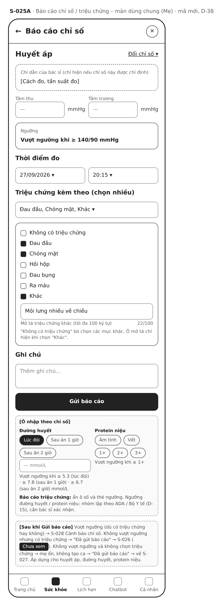

# Screen Spec: S-025A Report a metric

| Field | Value |
|---|---|
| Screen ID | `S-025A` |
| Screen name | Report a metric |
| Actor | Mother |
| Priority | Must |
| Belongs to module | `spec-ALR.md` |
| Mockup image | `img/S-025A.png` |
| Status | Draft (revised 29/09/2026 — screen-spec fix #1, #2; FR links) |

## 1. Purpose

**Shown when:** the mother taps on `S-027`:
- "+ Report metric" on the card of an assigned metric → opens with that metric preselected (with the "Doctor's instructions" box);
- *("+ Report another metric" is removed — the mother reports only a flagged indicator, i.e. a metric in her Doctor's instructions, or symptoms: MVP v8 §4; screen-spec fix #2, ALR-02.)*
- "+ Report symptoms" (including from the empty state of `S-027`) → symptom-report mode (numeric fields and threshold card hidden).

**The user leaves this screen when:** she taps "Submit report" → `S-028` / `S-026` / `S-027` depending on the result (D-19); taps ← (discards the data → `S-027`); taps a tab; or taps ✕ (`S-083`).

## 2. Mockup

## 3. Element inventory

| # | Element | Type | Content / data source | Required | Validation |
|---|---|---|---|---|---|
| 1 | ← button | Button | navigation | Yes | — |
| 2 | Title "Report a metric" | Header | static | No | — |
| 3 | ✕ button | Button | closes the sub-app (D-01) | Yes | — |
| 4 | Name of the metric being reported ("Blood pressure") | Header (section) | Metric Report — Indicator (`spec-ALR.md` §6) | Yes | — |
| 5 | "Change metric ▾" | Dropdown | list of reportable metrics: **only the Group 2 metrics in the mother's active Doctor's instructions** + symptom mode (ALR-02, D-11 as revised); `spec-ALR.md` `FR-011`/`FR-012`. A mother with no instructions sees only symptom mode | No | select one item |
| 6 | "Doctor's instructions" box — "[How to measure, measurement frequency]" | Text (card) | Watch-Flag — note written by the doctor on `S-064` (`spec-HLT.md` §6; D-24, D-29). **Shown when a metric is selected** (every selectable metric is assigned); **hidden in symptom mode**, where no metric is selected (screen-spec fix #2) | No | — |
| 7 | "Systolic" field — "—" — "mmHg" | Input | Metric Report — Value (systolic blood pressure), `unit` = mmHg | Yes (when reporting blood pressure) | integer; valid range `[NEEDS CLARIFICATION: D-16]` |
| 8 | "Diastolic" field — "—" — "mmHg" | Input | Metric Report — Value (diastolic), `unit` = mmHg | Yes (when reporting blood pressure) | integer; valid range `[NEEDS CLARIFICATION: D-16]` |
| 9 | Card "Threshold — Above threshold when ≥ 140/90 mmHg" (on-screen text; means systolic ≥ 140 or diastolic ≥ 90 mmHg — D-14) | Text (card) | threshold for the metric — `spec-ALR.md` BR-004: blood pressure systolic ≥ 140 or diastolic ≥ 90 mmHg (D-14); blood glucose / urine protein see #16, #17 (D-15). Hidden only in symptom mode | No | — |
| 10 | "Measured at": date "27/09/2026 ▾" + time "20:15 ▾" | Input (picker) | Metric Report — `measured_at` | Yes (when reporting a metric) | `dd/mm/yyyy` + `HH:mm` (D-27); default value and blocking of future times `[NEEDS CLARIFICATION]` |
| 11 | "Accompanying symptoms (select multiple)" — summary field "Severe headache / dizziness / blurred vision, Other ▾" (the image still shows the D-23 example) | Dropdown (multi-select) | Metric Report — `symptoms[]` (D-73) | **Yes — at least 1 item** in every mode; "No symptoms" counts (D-45) | only items from list #12; nothing selected → error "Please select your symptoms" `[NEEDS CLARIFICATION: wording]`; symptom mode hides "No symptoms" (D-45, proposed) |
| 12 | Option list: "No symptoms", "Vaginal bleeding", "Severe abdominal pain", "Waters breaking / fluid leakage", "Severe headache / dizziness / blurred vision", "Absence of fetal movement", "Palpitations", "Other" (the image still shows the D-23 list — to redraw) | Checkbox list | fixed list (D-73, replaces D-23; Pending SME — `spec-ALR.md` Q21) | — | "No symptoms" excludes the other items (selecting it deselects all others) |
| 13 | Field "Describe other symptom (max 100 characters)" (example "Back ache in afternoon") + counter "22/100" | Input (text) | Metric Report — `other_symptom_text` (D-23 limit, kept by D-73) | Yes when "Other" is selected `[NEEDS CLARIFICATION]` | ≤ 100 characters; **shown only when "Other" is selected** |
| 14 | "Note" — field "Add a note…" | Input (text) | Metric Report — `note` | No | maximum length `[NEEDS CLARIFICATION]` |
| 15 | "Submit report" button (primary, filled) | Button | creates a Metric Report (`submitted_at`), runs the threshold check; CTA D-27 | Yes | validation (`FR-014`); button enabling condition `[NEEDS CLARIFICATION]` |
| 16 | "Blood glucose" input variant — "— mmol/L" | Input | Metric Report — Value, `unit` = mmol/L | Yes (when reporting blood glucose) | number; valid range `[NEEDS CLARIFICATION: D-16]` |
| 16a | Blood glucose measurement-timing selector — select one: "Fasting", "1 h after meal", "2 h after meal" | Segmented control | Metric Report — `glucose_context` ENUM(fasting / post_1h / post_2h) (`spec-ALR.md` §6, FR-013; D-15) | Yes (when reporting blood glucose) | exactly 1 item; missing → error, cannot submit (`FR-014`, D-15) |
| 16b | Blood glucose threshold card "Above threshold when ≥ 5.3 (fasting) · ≥ 7.8 (1 h after meal) · ≥ 6.7 (2 h after meal) mmol/L" | Text (card) | blood glucose threshold by `glucose_context` — `spec-ALR.md` BR-004; D-15 | No | — |
| 17 | "Urine protein" input variant — select one: "Negative", "Trace", "1+", "2+", "3+" | Segmented control | Metric Report — Value (level) | Yes (when reporting urine protein) | exactly 1 level |
| 17a | Urine protein threshold card "Above threshold when ≥ 1+" | Text (card) | `spec-ALR.md` BR-004; D-15 (Negative / Trace → Normal; ≥ 1+ → Above threshold) | No | — |
| 18 | 5-item tab bar, "Health" selected | Toggle (tab) | navigation (D-27) | Yes | — |

Note: the mockup boxes "[Input fields per metric]", "Symptom report: numeric fields and threshold card hidden…", "Blood glucose / urine protein thresholds: prepared by the team based on ADA / Ministry of Health (D-15), to be confirmed by a doctor", "[After Submit report] …" and the symptom-selection rule sentence are annotations, described in §4–§6. The thresholds were prepared by the team based on ADA / Ministry of Health guidance (D-15) and must be confirmed by a Thu Cuc doctor before real use.

## 4. States

| State | What the user sees | Trigger |
|---|---|---|
| Default — blood pressure (shown in mockup) | metric name, Doctor's instructions box, 2 empty numeric fields, threshold card, measurement time, symptoms, note, "Submit report" | opened from "+ Report metric" (blood pressure) |
| Blood glucose / urine protein variant | blood glucose: numeric field #16 + measurement-timing selector #16a + threshold card #16b; urine protein: level selector #17 + threshold card #17a (D-15) | the corresponding metric is selected |
| Symptom-report mode | numeric fields, threshold card and "Doctor's instructions" box hidden; symptoms, note and "Submit report" remain; whether "Measured at" is shown `[NEEDS CLARIFICATION]` | opened from "+ Report symptoms" |
| "Describe other symptom" field | shown with an x/100 counter | "Other" selected |
| Empty (no data) | not applicable — input form | — |
| Loading | "Submit report" button in a processing state `[NEEDS CLARIFICATION: not drawn]`; D-27 skeleton while the doctor's instructions are loading | "Submit report" tapped / screen opened |
| Error | shared field error directly under the field: "⚠ Value outside the valid range" (D-27, range per D-16); submission error: banner "⚠ Could not load data. Retry" (D-27) | invalid value / submission failed |
| Success / confirmation | per D-19: above threshold → `S-028` Metric alert; not above threshold but with symptoms → toast "Report submitted" → `S-026` (Not viewed); not above threshold and no symptoms selected → the mother is fine, no case created → toast "Report submitted" → `S-027`, no status created (D-21). Applies to blood pressure, blood glucose and urine protein (D-31, D-32) | submission succeeded |

## 5. Interactions and navigation

| # | Element | User action | System response | Goes to screen |
|---|---|---|---|---|
| 1 | "Change metric ▾" | select an assigned metric or symptom mode | switches the set of input fields; shows the threshold card and the Doctor's instructions box for a metric, hides both in symptom mode | stays |
| 2 | Symptom list | select / deselect | "No symptoms" deselects the other items; selecting "Other" shows the description field | stays |
| 3 | "Submit report" — above threshold | tap | stores Health Metric Record + Metric Report (`spec-ALR.md` FR-020) + creates the **Case** (`case_source` = Metric report, Not viewed — FR-021, D-41), sends it to clinical staff (BR-002) | `S-028` |
| 4 | "Submit report" — not above threshold, with symptoms (including symptom reports) | tap | stores Metric Report (+ Health Metric Record if there is a value — FR-020) + creates the **Case** (`case_source` = Symptom, Not viewed — FR-021, D-20, D-41); toast "Report submitted" | `S-026` |
| 5 | "Submit report" — Normal, no symptoms | tap | stores the Metric Report + Health Metric Record (FR-020), no case / no status created (D-21); toast "Report submitted" | `S-027` |
| 6 | Blood glucose measurement-timing selector (#16a) | select | records `glucose_context`; the threshold check uses the corresponding cut-off (≥ 5.3 / ≥ 7.8 / ≥ 6.7 mmol/L — D-15). Post-submission branches as in #3–#5 (D-31, D-32) | stays |
| 7 | ← | tap | discards the data just entered | `S-027` |
| 8 | ✕ | tap | asks for confirmation to close the sub-app | `S-083` |
| 9 | Tab Home / Health / Appointments / Chatbot / Profile | tap | — | `S-008` / `S-023` / TCI app / `S-031` / `S-103` |

## 6. Screen-level rules

| Rule ID | Rule | Source |
|---|---|---|
| SR-001 | Every Group 2 value the mother reports (always an assigned metric) is checked against thresholds; an above-threshold value creates an Alert and is sent to clinical staff (`S-028`), never saved silently. | `spec-ALR.md` BR-002; D-11, D-19 |
| SR-002 | Thresholds: blood pressure is above threshold when systolic ≥ 140 or diastolic ≥ 90 mmHg (D-14); blood glucose by the measurement timing the mother selects — fasting ≥ 5.3, 1 h after meal ≥ 7.8, 2 h after meal ≥ 6.7 mmol/L; urine protein Negative / Trace → Normal, ≥ 1+ → Above threshold (D-15). The thresholds were prepared by the team based on ADA / Ministry of Health guidance (D-15) and must be confirmed by a Thu Cuc doctor before real use. The threshold card is configuration data, not hard-coded. | D-14, D-15; `spec-ALR.md` BR-004 |
| SR-002a | A blood glucose report requires a measurement timing (`glucose_context`: Fasting / 1 h after meal / 2 h after meal). | D-15; `spec-ALR.md` FR-013, FR-014 |
| SR-003 | **Removed** (screen-spec fix #2): the mother can no longer report a Group 2 metric that is not assigned. "Change metric ▾" lists only assigned metrics + symptom mode. | MVP v8 §4; ALR-02 |
| SR-004 | Symptoms are a fixed multi-select list (the PRD alarm symptoms + Palpitations + Other); "No symptoms" excludes the other items; "Other" has a description field of ≤ 100 characters, shown only when "Other" is selected. Any selected symptom sends the report to a nurse (`spec-ALR.md` BR-007). | D-73 (replaces D-23) |
| SR-005 | A report with symptoms is always sent to a nurse (Not viewed). | D-20 |
| SR-006 | Post-submission flow as in §4 Success, for all three Group 2 metrics; above threshold takes priority when symptoms are also present; not above threshold + no symptoms selected → no case created, no status. | D-19, D-21, D-31, D-32; `spec-ALR.md` BR-008 |
| SR-007 | "Alert" is used only when above threshold (`S-028`); this screen uses "Report". | D-22 |
| SR-008 | The valid range that blocks typing errors is distinct from the clinical threshold; the figures are not yet decided. | D-16 (Pending SME) |
| SR-009 | At least 1 symptom item must be selected; "No symptoms" counts. | D-45; `spec-ALR.md` BR-017 |

## 7. Linked requirements

| FR ID (from the module spec) | What this screen does for it |
|---|---|
| FR-010 (`spec-ALR.md`) | Loads the report screen |
| FR-011 (`spec-ALR.md`) | List of reportable metrics ("Change metric ▾": assigned metrics + symptom mode) |
| FR-012 / FR-013 (`spec-ALR.md`) | Shows the form and input fields for the metric type (blood glucose with the measurement-timing selector — D-15) |
| FR-014 (`spec-ALR.md`) | Validates values before submission (D-16); blood glucose must have `glucose_context` (D-15) |
| FR-015 (`spec-ALR.md`) | Attaches the gestational week to the submitted report |
| FR-020 (`spec-ALR.md`, new — X-01) | Stores the submitted report (Metric Report + Report Symptom + Health Metric Record) |
| FR-021 (`spec-ALR.md`, new — X-01) | Creates the case "Not viewed" when above threshold or with symptoms |
| FR-002 / FR-003 (`spec-ALR.md`) | Submitted reports appear in the mother's report list (`S-029` "My reports") |
| FR-007 (`spec-HLT.md`, cross-ref) | Stores the reported value (source "Doctor-assigned" — D-10, D-33 as revised) |

## 8. Responsive and accessibility notes

- Smallest supported width: `[NEEDS CLARIFICATION: not specified]`.
- The Systolic / Diastolic field pair may stack vertically on narrow screens.
- Text must be legible: thresholds, units, error lines under fields, character counter. The symptom list uses checkboxes with labels readable by screen readers.

## 9. Open questions

| # | Question | Blocking? | Status |
|---|---|---|---|
| 5 | [NEEDS CLARIFICATION: Valid value range for systolic, diastolic and blood glucose (D-16, Pending SME).] | Yes | Open |
| 7 | [NEEDS CLARIFICATION: Is a description mandatory when "Other" is selected; maximum length of "Note"; does symptom mode show "Measured at"?] | No | Open |

---

## Completion checklist

- [x] The mockup is a separate cropped image file, named with the Screen ID.
- [x] Every visible element in the mockup appears in the element inventory (including the blood glucose / urine protein variants).
- [x] Every input element has a validation rule or an explicit "none"/`[NEEDS CLARIFICATION]`.
- [x] All five states are filled in, or marked "not applicable"/`[NEEDS CLARIFICATION]` with a reason.
- [x] Every navigation target is a Screen ID that exists in the Screen List; undecided cases carry `[NEEDS CLARIFICATION]`.
- [x] Every element that displays data names the field it displays, matching the module spec.
