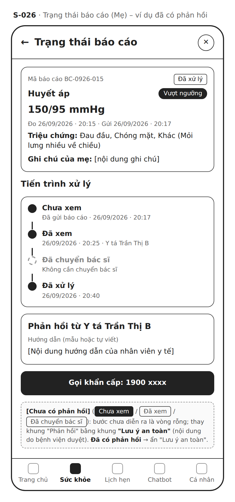

# Screen Spec: S-026 Report status

**Current navigation — D-80 / D-86 (confirmed 11/11/2026):** any Appointments/Health tab row below describes the historical wireframe, not the current shell. The five root screens use Home · Timeline · Chatbot · From doctor · Profile; child screens have back navigation and no root tab bar. No Home booking CTA is present. Historical navigation rows and images are retained as reference only; unrelated open questions remain open.

| Field | Value |
|---|---|
| Screen ID | `S-026` |
| Screen name | Report status |
| Actor | Mother |
| Priority | Must |
| Belongs to module | `spec-ALR.md` |
| Mockup image | `img/S-026.png` (metric-report variant; the "Chatbot case" variant is not drawn — §4) |
| Status | Draft (revised 29/09/2026 — screen-spec fix #1, #3, #4) |

## 1. Purpose

**Shown when:**
- right after submitting a report on `S-025A` that is not above threshold but has symptoms (status Not viewed — D-19, D-20);
- the mother taps "View status" on `S-028` Metric alert;
- the mother taps a report on `S-029` "My reports" (D-06 as revised) — including a case created from the chatbot when the mother tapped "Connect to nurse" (D-34; `spec-BOT.md` FR-008). A chatbot case uses the **"Chatbot case" variant** (§4): the mother's question + source "Chatbot" instead of metric / value / threshold / symptoms (screen-spec fix #3);
- opened from a report response / status notification on `S-009` (D-39; `spec-ACC.md` §7).

**The user leaves this screen when:** she taps ← (to `S-029` "My reports" — D-53 as revised), "Emergency call" (leaves the app, opens the phone dialler), a tab, or ✕ (`S-083`).

## 2. Mockup

## 3. Element inventory

| # | Element | Type | Content / data source | Required | Validation |
|---|---|---|---|---|---|
| 1 | ← button | Button | navigation | Yes | — |
| 2 | Title "Report status" | Header | static | No | — |
| 3 | ✕ button | Button | closes the sub-app (D-01) | Yes | — |
| 4 | "Report code BC-0926-015" | Text | Metric Report / Case — ID (`spec-ALR.md` §6); the code format is a sample `[NEEDS CLARIFICATION]`. Chatbot case: whether it gets a code is open (`spec-ALR.md` §10 Q16) | No | — |
| 5 | Current status label ("Resolved") | Label | Case — Status (D-18) | No | one of the 4 D-18 values |
| 6 | Metric name "Blood pressure" + threshold label "Above threshold" | Text + Label | Metric Report — Indicator; threshold check result (`spec-ALR.md` BR-004, D-14); 3 labels D-17. **Chatbot case:** replaced by the source label "Chatbot" (no threshold label) | No | — |
| 6a | (Chatbot case only — not drawn) "Your question: [question text]" + "Sent `dd/mm/yyyy · HH:mm`" | Text | Chat Message → text, sent_at (`spec-BOT.md` §6) via Case → chat_message_id | No | — |
| 7 | Value "150/95 mmHg" | Text | Metric Report — Value, `unit` (format D-27). Hidden for a chatbot case | No | — |
| 8 | "Measured 26/09/2026 · 20:15 · Submitted 26/09/2026 · 20:17" | Text | Metric Report — `measured_at`, `submitted_at` (`dd/mm/yyyy · HH:mm`). Hidden for a chatbot case (the sent time is in #6a) | No | — |
| 9 | "Symptoms: Severe headache / dizziness / blurred vision, Other (Back ache worse in the afternoon)" (the image still shows the D-23 example) | Text | Metric Report — `symptoms[]`, `other_symptom_text` (D-73). Hidden for a chatbot case | No | — |
| 10 | "Mother's note: [note content]" | Text | Metric Report — `note`. Hidden for a chatbot case | No | — |
| 11 | Title "Handling progress" | Header (section) | static | No | — |
| 12 | Step "Not viewed" — "Report submitted · 26/09/2026 · 20:17" | Stepper step | Case — status history (creation time) | No | — |
| 13 | Step "Viewed" — "26/09/2026 · 20:25 · Nurse Trần Thị B" | Stepper step | Case — time + person who changed the status (`spec-ALR.md` `FR-004`; permissions per D-29) | No | — |
| 14 | Step "Escalated to doctor" — "No doctor escalation needed" (skipped circle, grey text) | Stepper step | Case — step skipped when the case is not escalated | No | — |
| 15 | Step "Resolved" — "26/09/2026 · 20:40" | Stepper step | Case — time the case was closed ("Close case"; D-29, D-37) | No | — |
| 16 | "Response from Nurse Trần Thị B" box | Text (card) | responder (name + role) | No | — |
| 17 | "Guidance (template or custom)" — "[Guidance content from clinical staff]" | Text | Staff Response — custom_text / template_id: chosen from a Guidance Template or written by clinical staff (D-24; `spec-ALR.md` `FR-007`, `FR-016` Guidance Template) | No | — |
| 18 | "Emergency call: 1900 xxxx" button | Button | phone call (tel:) — hotline number `[NEEDS CLARIFICATION]` | Yes | — |
| 19 | "Safety note" box (only in the no-response state) | Text (card) | hospital-approved content (D-25) — `[NEEDS CLARIFICATION: content not yet available]` | No | — |
| 20 | 5-item tab bar, "Health" selected | Toggle (tab) | navigation (D-27) | Yes | — |

Note: the "[No response yet] …" box is an annotation describing a state in §4. The guidance content is only a placeholder — this screen is not a source of clinical content.

## 4. States

| State | What the user sees | Trigger |
|---|---|---|
| Default — response received (shown in mockup) | report information, progress with time and actor on each step, "Response" + "Guidance" box, "Emergency call" button; "Safety note" **hidden** | the Case has a response (usually in status Resolved) |
| No response yet (Not viewed / Viewed / Escalated to doctor) | steps not yet reached are empty circles; the "Response" box is replaced by the **"Safety note"** box (hospital-approved content); "Emergency call" still shown | no response yet (D-25) |
| Skipped step | the "Escalated to doctor" step reads "No doctor escalation needed", grey circle | the case is handled without escalation to a doctor |
| Chatbot case (not drawn) | #4 (code, if any), #5 status, source label "Chatbot" (#6), the mother's question + sent time (#6a); #7 – #10 hidden; the stepper (#11 – #15), the response / "Safety note" and "Emergency call" are the same as for a report | Case `case_source` = Chatbot (D-34; screen-spec fix #3) |
| Empty (no data) | not applicable — the screen always opens for a specific report | — |
| Loading | shared skeleton, keeps the layout (D-27) | report loading |
| Error | shared banner "⚠ Could not load data. Retry" (D-27) | the report cannot be loaded |
| Success / confirmation | when entered from `S-025A`: toast "Report submitted", then the screen shows the Not viewed state (D-19) | a report with symptoms submitted successfully |

## 5. Interactions and navigation

| # | Element | User action | System response | Goes to screen |
|---|---|---|---|---|
| 1 | ← | tap | always goes to the report list, never back to the submitted form or the closed popup (D-53 as revised) | `S-029` "My reports" |
| 2 | "Emergency call: 1900 xxxx" | tap | opens the device's phone dialler | leaves the app |
| 3 | ✕ | tap | asks for confirmation to close the sub-app | `S-083` |
| 4 | Tab Home / Health / Appointments / Chatbot / Profile | tap | — | `S-008` / `S-023` / TCI app / `S-031` / `S-103` |

## 6. Screen-level rules

| Rule ID | Rule | Source |
|---|---|---|
| SR-001 | The progress reflects the real status; a step is marked only when it has actually happened (with time and actor). | Inferred; D-18 |
| SR-002 | Only the shared status set "Not viewed → Viewed → Escalated to doctor → Resolved" is used, with the same names as on the clinical staff side (`S-061`/`S-064`). | D-18 |
| SR-003 | "Safety note" is shown only when the report has no response yet; hidden once there is a response. | D-25 |
| SR-004 | Guidance content must come from a real action by clinical staff for this report — a chosen template or custom text; the responder's name and role are shown. | D-24 |
| SR-005 | Threshold labels are only Normal / Above threshold / Not assessed; "Slightly elevated" is not used. | D-17 |
| SR-006 | Only reports that need clinical staff review have a status screen; Normal reports without symptoms have no status. | D-21 |
| SR-007 | Who changes the status: Nurse (Viewed, Escalated to doctor, Resolved — only for cases **not** escalated to a doctor); Doctor (Resolved — only cases "Escalated to doctor"; the doctor does not "Mark as viewed"). "Send guidance" shows the response but does not change the status; the "Resolved" step is marked only on "Close case". | D-29, D-37, D-43 as revised; `spec-CLI.md` CLI-02; `spec-ALR.md` BR-015 |
| SR-008 | A chatbot case shows the mother's question and the source "Chatbot"; it has no value, threshold label or symptoms. | D-34; screen-spec fix #3 |

## 7. Linked requirements

| FR ID (from the module spec) | What this screen does for it |
|---|---|
| FR-005 / FR-006 (`spec-ALR.md`) | Shows the details of one selected report / alert |
| FR-004 (`spec-ALR.md`) | Shows the result of the status change ("Viewed": by the nurse, or recorded automatically — D-29, D-43) |
| FR-007 (`spec-ALR.md`) | Shows the guidance / recommendation from clinical staff (D-05) |
| FR-016 (`spec-ALR.md`) | Guidance Template — source of "template" guidance (D-24) |
| FR-021 (`spec-ALR.md`), FR-008 (`spec-BOT.md`) | Cases created from a report or from the chatbot hand-off are the cases shown here |
| (cross-ref) `spec-CLI.md` | Case-handling actions on `S-061`/`S-064` create the steps and responses shown here (`spec-CLI.md` FR-004, FR-016, FR-019, FR-024) |

## 8. Responsive and accessibility notes

- Smallest supported width: `[NEEDS CLARIFICATION: not specified]`.
- The time + actor line of each step may wrap on narrow screens.
- Text must be readable: value, threshold label, status, "Safety note", "Emergency call" button. The skipped step must carry the text "No doctor escalation needed", not rely on grey colour alone.

## 9. Open questions

| # | Question | Blocking? | Status |
|---|---|---|---|
| 5 | [NEEDS CLARIFICATION: The "Emergency call" hotline number and the "Safety note" content (hospital-approved) are not yet available.] | Yes | Open |

---

## Completion checklist

- [x] The mockup is a separate cropped image file, named with the Screen ID.
- [x] Every visible element in the mockup appears in the element inventory.
- [x] Every input element has a validation rule or an explicit "none" — the screen has no input fields, only a call button and navigation.
- [x] All states are filled in (including the no-response state and the skipped step), or marked "not applicable"/`[NEEDS CLARIFICATION]` with a reason.
- [x] Every navigation target is a Screen ID that exists in the Screen List, or explicitly flagged `[NEEDS CLARIFICATION]`.
- [x] Every element that displays data names the field it displays, matching the module spec.

## UI review — 11/11/2026

User requested removing the bottom "Báo cáo của tôi ›" link from the report-status page. Keep the header back navigation and the "Chỉ dẫn của bác sĩ ›" link. Affected implementation: `app/mb360/templates/report_status.html`. No data or clinical-rule changes.

### Instructions link placement — 11/11/2026

User requested moving the instructions link directly below the response text, inside the response card, renamed "Chỉ dẫn cụ thể của bác sĩ". Show once, in the last response card, with a subtle divider; remove the standalone bottom link. Target remains S-027. No changes to clinical content or data.

### Inline doctor instructions — 18/11/2026

Replace the S-027 link from S-026 with one “Chỉ dẫn theo dõi đang áp dụng” card below the final response. Show each active instruction's metric and note when present. The card appears when the report has a response and the mother has an active instruction.

Use second-level headings for the report summary, handling progress, responses and instructions. Within the instructions, each metric has a third-level heading, the latest reported value and measurement time when available, its threshold label when applicable, and a link to that metric's history. Reporting actions stay on S-027.

Separate the instruction from the latest result with a thin divider. Show the measurement date and time together on their own line below the value.
