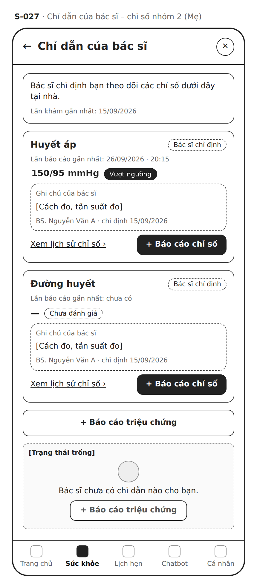

# Screen Spec: S-027 Doctor's instructions

**Current navigation — D-80 / D-86 (confirmed 11/11/2026):** any Appointments/Health tab row below describes the historical wireframe, not the current shell. The five root screens use Home · Timeline · Chatbot · From doctor · Profile; child screens have back navigation and no root tab bar. No Home booking CTA is present. Historical navigation rows and images are retained as reference only; unrelated open questions remain open.

| Field | Value |
|---|---|
| Screen ID | `S-027` |
| Screen name | Doctor's instructions |
| Actor | Mother |
| Priority | Must |
| Belongs to module | `spec-HLT.md` |
| Mockup image | `img/S-027.png` |
| Status | Draft (revised 29/09/2026 — screen-spec fix #2) |

## 1. Purpose

**Shown when:** the mother taps the "Doctor's instructions" card on `S-008` or the "Doctor's instructions" button on `S-023`; or returns after submitting a Normal report without symptoms on `S-025A` (D-19), or taps ← on `S-025A` / S-025.

**The user leaves this screen when:** she taps ← (`S-023`), "+ Report metric" / "+ Report symptoms" (`S-025A`), "View metric history ›" (S-025), a tab, or ✕ (`S-083`).

## 2. Mockup

## 3. Element inventory

| # | Element | Type | Content / data source | Required | Validation |
|---|---|---|---|---|---|
| 1 | ← button | Button | navigation | Yes | — |
| 2 | Title "Doctor's instructions" | Header | static; terminology D-27 | No | — |
| 3 | ✕ button | Button | closes the sub-app (D-01) | Yes | — |
| 4 | "Your doctor has asked you to monitor the metrics below at home." | Text | static | No | — |
| 5 | "Last visit: 15/09/2026" | Text | date of the latest visit (`dd/mm/yyyy`) | No | — |
| 6 | Metric card — name "Blood pressure" + source label "Doctor-assigned" | Text + Label | Watch-Flag — Metric ID (`spec-HLT.md` §6); group-2 metric (D-11); source label D-10 | No | — |
| 7 | "Last report: 26/09/2026 · 20:15" | Text | latest Metric Report for this metric — `measured_at` (`dd/mm/yyyy · HH:mm`) | No | — |
| 8 | Value "150/95 mmHg" + label "Above threshold" | Text + Label | Metric Report — Value; threshold label per `spec-ALR.md` BR-004, D-14, D-17 | No | — |
| 9 | "Doctor's note" — "[How to measure, how often]" | Text | Watch-Flag — note (written by the doctor on `S-064`, D-24, D-29) | No | — |
| 11 | "View metric history ›" link | Text (link) | `spec-HLT.md` `FR-009`; CTA D-27 | No | — |
| 12 | "+ Report metric" button | Button | opens `S-025A` with the card's metric | No | — |
| 13 | Second metric card — "Blood glucose" + "Doctor-assigned" | Text + Label | as #6 | No | — |
| 14 | "Last report: none yet" | Text | as #7 — no Metric Report yet | No | — |
| 15 | Value "—" + label "Not assessed" | Text + Label | no value yet (no Metric Report) → "Not assessed" (D-17); once there is a value, the label follows the blood glucose threshold D-15 (`spec-ALR.md` BR-004) | No | — |
| 16 | "Doctor's note" + "Dr. Nguyễn Văn A · assigned 15/09/2026" + "View metric history ›" + "+ Report metric" (blood glucose card) | Text / Link / Button | as #9–#12 | No | — |
| 17 | *(Removed — screen-spec fix #2, ALR-02)* "+ Report another metric" button — not drawn and not built. The mother reports only the metrics in her instructions ("+ Report metric" on each card) or symptoms ("+ Report symptoms") | — | — | — | — |
| 18 | "+ Report symptoms" button | Button | opens `S-025A` in symptom-report mode (D-20, D-23) | No | — |
| 19 | 5-item tab bar, "Health" selected | Toggle (tab) | navigation (D-27) | Yes | — |

**Sample data note:** #7 – #8 show the report of 26/09/2026 · 20:15, "150/95 mmHg — Above threshold", the same report as on S-025, S-026, S-028 and in the seed data; 132/84 mmHg is the value from the 15/09/2026 visit (S-023).

Note: the "[Empty state] …" box is a state, described in §4. The screen has no input fields. The "Doctor's note" content is a placeholder, not a source of clinical content.

## 4. States

| State | What the user sees | Trigger |
|---|---|---|
| Default | list of cards for the assigned metrics (mockup: Blood pressure with a value, Blood glucose with no report yet) + the button "+ Report symptoms" | the mother has at least 1 Doctor's instruction |
| Card with no report | "Last report: none yet", value "—", label "Not assessed" | the metric has never been reported |
| Empty (no data) | icon + "Your doctor has not given you any instructions yet." + CTA "+ Report symptoms" (D-27 template, drawn) | no Doctor's instructions yet |
| Loading | shared skeleton, keeps the layout (D-27) | screen opens |
| Error | shared banner "⚠ Could not load data. Retry" (D-27) | loading fails |
| Success / confirmation | when returning from `S-025A` (Normal report, no symptoms): toast "Report submitted", the card updates its last report (D-19) | report submitted |

## 5. Interactions and navigation

| # | Element | User action | System response | Goes to screen |
|---|---|---|---|---|
| 1 | ← | tap | — | `S-023` |
| 2 | ✕ | tap | asks for confirmation to close the sub-app | `S-083` |
| 3 | "+ Report metric" (on a card) | tap | opens the form with the selected metric, including the Doctor's instructions box | `S-025A` |
| 4 | *(Removed — screen-spec fix #2)* | — | — | — |
| 5 | "+ Report symptoms" (also in the empty state) | tap | opens the form in symptom mode | `S-025A` |
| 6 | "View metric history ›" | tap | opens the history of the card's metric | S-025 (D-38) |
| 7 | Tab Home / Health / Appointments / Chatbot / Profile | tap | — | `S-008` / `S-023` / TCI app / `S-031` / `S-103` |

## 6. Screen-level rules

| Rule ID | Rule | Source |
|---|---|---|
| SR-001 | The screen shows only group-2 metrics (blood pressure, blood glucose, urine protein) assigned by the doctor; no group-1 metrics (no temperature card). | D-11 |
| SR-002 | The screen only displays; it does not calculate or edit values. Threshold checking and alert creation belong to `ALR` when the mother submits a report on `S-025A`. | `spec-HLT.md` §1 Out of scope |
| SR-003 | Doctor's instructions are informational, not an alert, and do not by themselves notify clinical staff. | `spec-HLT.md` BR-002; D-22 |
| SR-004 | Instructions are never removed automatically by the system; only the doctor adds / edits / removes them. | `spec-ALR.md` BR-001; D-29 |
| SR-005 | Values the mother reports for a metric in an instruction carry the source label "Doctor-assigned". | D-10 |
| SR-006 | Threshold labels: Normal / Above threshold / Not assessed. Blood pressure: systolic ≥ 140 or diastolic ≥ 90 mmHg; blood glucose fasting ≥ 5.3 / 1 h after meal ≥ 7.8 / 2 h after meal ≥ 6.7 mmol/L; urine protein ≥ 1+ → Above threshold. "Not assessed" only when there is no data yet. The team set these thresholds based on ADA / Ministry of Health guidance (D-15); they must be confirmed by a Thu Cuc doctor before live use. | D-14, D-15, D-17; `spec-ALR.md` BR-004, BR-005 |
| SR-007 | From this screen the mother reports only the group-2 metrics in her instructions ("+ Report metric") and symptoms ("+ Report symptoms"); she cannot report a group-2 metric that is not assigned. | MVP v8 §4 "Report a Flagged Indicator or Self-Observed Symptom"; D-11 as revised (ALR-02); D-20 |

## 7. Linked requirements

| FR ID (from the module spec) | What this screen does for it |
|---|---|
| FR-005 (`spec-HLT.md`) | Summary card for each assigned metric |
| FR-001 (`spec-HLT.md`) | Highlights the doctor-assigned metrics and the threshold label of the latest report |
| FR-009 (`spec-HLT.md`) | "View metric history ›" leads to S-025 |
| BR-002 (`spec-HLT.md`) | Instructions are informational only |
| (cross-ref) FR-010 / FR-011 (`spec-ALR.md`) | The "+ Report …" buttons are the entry points to the `S-025A` report flow |

## 8. Responsive and accessibility notes

- Smallest supported width: `[NEEDS CLARIFICATION: not specified]`.
- One card per column.
- Text must be readable: value, threshold label, "Doctor-assigned" label, doctor's note.

## 9. Open questions

No open questions.

---

## Completion checklist

- [x] The mockup is a separate cropped image file, named with the Screen ID.
- [x] Every visible element in the mockup appears in the element inventory.
- [x] Every input element has a validation rule or an explicit "none" — the screen has no input fields, only navigation.
- [x] All states are filled in, or marked "not applicable"/`[NEEDS CLARIFICATION]` with a reason.
- [x] Every navigation target is a Screen ID that exists in the Screen List (S-025 = DBIZ2 "Health History", D-38).
- [x] Every element that displays data names the field it displays, matching the module spec.

## UI review — 11/11/2026

User requested removing the bottom "Báo cáo của tôi ›" link from Doctor’s instructions. Metric history/report actions, symptom report action and header back remain unchanged. Implementation: `app/mb360/templates/instructions.html`; no data or clinical-rule changes.
