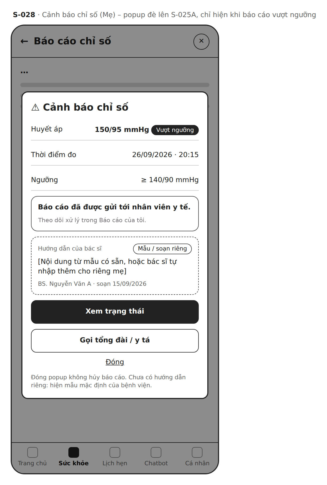

# Screen Spec: S-028 Metric alert

| Field | Value |
|---|---|
| Screen ID | `S-028` |
| Screen name | Metric alert |
| Actor | Mother |
| Priority | Must |
| Belongs to module | `spec-ALR.md` |
| Mockup image | `img/S-028.png` |
| Status | Draft (revised 29/09/2026 — screen-spec fix #1, #2; FR links) |

## 1. Purpose

**Shown when:** the mother taps **Submit report** on `S-025A` and the threshold check returns **Above threshold** (D-19). The screen appears as a popup over `S-025A` (Health tab). "Alert" is used only for this case (D-22). A report that is not above threshold does not show this screen: with symptoms → `S-026` (Not viewed); normal, no symptoms → back to `S-027` (D-19).

**The user leaves this screen when:** the mother taps **View status** (→ `S-026`), **Call hotline / nurse** (opens a phone call) or **Close**.

## 2. Mockup

*Note: the popup sits on top of `S-025A` (header "← Report a metric ✕", 5-tab bar with the Health tab selected).*

## 3. Element inventory

| # | Element | Type | Content / data source | Required | Validation |
|---|---|---|---|---|---|
| 1 | Dimmed `S-025A` background (header "← Report a metric ✕", 5-tab bar, Health tab selected) | Container | The screen that opens the popup; tabs per D-27 / `00-QUY-UOC` convention | Yes | — |
| 2 | Title "⚠ Metric alert" | Header | static; the term "Alert" is used only on S-028 (D-22) | Yes | — |
| 3 | Metric name (e.g. "Blood pressure") | Text | Metric Report → Indicator (`spec-ALR.md` §6); Group 2 metric (D-11) | Yes | — |
| 4 | Value (e.g. "150/95 mmHg") | Text | Metric Report → Value; format `150/95 mmHg` (D-27) | Yes | — |
| 5 | Label "Above threshold" | Tag | Threshold check result, `spec-ALR.md` BR-002/BR-004; set of 3 labels (D-17) | Yes | — |
| 6 | "Measured at" + value (e.g. "26/09/2026 · 20:15") | Text | Metric Report → measured time (the time the mother entered on S-025A); format `dd/mm/yyyy · HH:mm` (D-27) | Yes | — |
| 7 | "Threshold" + value (e.g. "≥ 140/90 mmHg") (on-screen text; means systolic ≥ 140 or diastolic ≥ 90 mmHg — D-14) | Text | Hospital threshold, `spec-ALR.md` BR-004: blood pressure systolic ≥ 140 or diastolic ≥ 90 mmHg (D-14); blood glucose per the report's `glucose_context` — fasting ≥ 5.3 / 1 h after meal ≥ 7.8 / 2 h after meal ≥ 6.7 mmol/L; urine protein ≥ 1+ (D-15). The mockup shows blood pressure only | Yes | — |
| 8 | Text "The report has been sent to clinical staff." | Text | static; an above-threshold report creates a Case with status Not viewed (`spec-ALR.md` BR-002, D-18, D-19) | Yes | — |
| 9 | Text "Track progress in My reports." | Text | static; points to `S-029` "My reports" (D-06 as revised, ALR-01) | Yes | — |
| 10 | "Doctor's guidance" card + label "Template / Custom" | Card | Above-threshold guidance attached to the Doctor's instructions, written on `S-064`; two forms: a selected template (Guidance Template, `spec-ALR.md` FR-016) and/or additional text written by the doctor (D-24). Shows the recommendation per `spec-ALR.md` FR-007 (D-05) | Yes | — |
| 11 | Guidance content ("[Content from an existing template, or written by the doctor specifically for this mother]") | Text | As #10; no custom guidance → the hospital's default template (D-24) | Yes | — |
| 12 | Author line (e.g. "Dr. Nguyễn Văn A · written 15/09/2026") | Text | Doctor's instructions → assigning doctor, date written; format `dd/mm/yyyy` (D-27). When the default template is used: `[NEEDS CLARIFICATION: what this line shows — see §9 Q4]` | No | — |
| 13 | "View status" button (primary) | Button | standard CTA (D-27) | Yes | — |
| 14 | "Call hotline / nurse" button (secondary) | Button | The "Call Nurse" suggestion of Figure 15 (`spec-ALR.md` §4.2). Phone number: `[NEEDS CLARIFICATION: hotline / nurse number not provided; S-026 and S-034 show "1900 xxxx"]` | Yes | — |
| 15 | "Close" button (text link) | Button | closes the popup | Yes | — |
| 16 | Annotation "Closing the popup does not cancel the report. No custom guidance: show the hospital's default template." | Annotation (wireframe note, not shown in the app) | Rule in §6 (D-24) | — | — |

The screen has no input fields.

## 4. States

| State | What the user sees | Trigger |
|---|---|---|
| Default | Popup as in the mockup: above-threshold metric, measurement time, threshold, sent-to-clinical-staff text, guidance, 3 buttons | Report submitted with an Above threshold value (D-19) |
| Default – default template | As above, with the guidance card showing the hospital's default template | The doctor did not write above-threshold guidance in the instruction for this metric (D-24). (The former branch "metric not included in the Doctor's instructions" no longer exists: the mother can report only assigned metrics — ALR-02) |
| Empty (no data) | Not applicable — the popup appears only once an above-threshold report exists; the guidance section always has content thanks to the default template (D-24) | — |
| Loading | Shared "Loading" pattern (D-27): grey placeholders replace the content, keeping the layout. The waiting state while submitting the report belongs to `S-025A` | Popup opens while the guidance content has not finished loading |
| Error | Shared "Error" pattern (D-27): "⚠ Could not load data." + "Retry". `[NEEDS CLARIFICATION: if the guidance cannot be loaded, is the default template shown instead — not drawn]`. Report submission errors belong to `S-025A` | Popup content cannot be loaded |
| Success / confirmation | The popup itself confirms that the report has been recorded and sent to clinical staff (#8) | Report submitted successfully and above threshold |

## 5. Interactions and navigation

| # | Element | User action | System response | Goes to screen |
|---|---|---|---|---|
| 1 | "View status" | tap | Opens the status of the report just submitted (`spec-ALR.md` FR-005/FR-006) | `S-026` |
| 2 | "Call hotline / nurse" | tap | Opens the device dialler (tel) with the hotline / nurse number `[NEEDS CLARIFICATION: phone number]` | Outside the app (call); popup stays |
| 3 | "Close" | tap | Closes the popup; the report and the Case are kept (SR-002) | `[NEEDS CLARIFICATION: target screen after closing — S-027 or S-025A; see §9 Q3]` |
| 4 | Text "My reports" | — | Guidance text only, not a link in the mockup; if it becomes a link it opens `S-029` "My reports" (D-54 as revised) | — |

## 6. Screen-level rules

| Rule ID | Rule | Source |
|---|---|---|
| SR-001 | The popup appears only when the report has at least one Above threshold value. The word "Alert" is not used on any other screen. | D-19, D-22; `spec-ALR.md` BR-002 |
| SR-002 | Closing the popup does not cancel the report or delete the Case; the Case stays in Not viewed status in the nurse's queue. | Mockup annotation; `spec-ALR.md` BR-002; D-18 |
| SR-003 | Guidance content is taken in this order: the above-threshold guidance the doctor wrote when creating the Doctor's instructions (template, custom text, or both) → otherwise the hospital's default template. | D-24 |
| SR-004 | The displayed threshold comes from the hospital thresholds: blood pressure systolic ≥ 140 or diastolic ≥ 90 mmHg (D-14); blood glucose fasting ≥ 5.3 / 1 h after meal ≥ 7.8 / 2 h after meal ≥ 6.7 mmol/L (according to the measurement context the mother selected); urine protein ≥ 1+ (D-15). The popup is triggered for all 3 Group 2 metrics; above threshold takes priority even when symptoms are present (D-31, D-32). The thresholds were set by the team based on ADA / the Ministry of Health (D-15) and must be confirmed by a Thu Cuc doctor before real use. | D-14, D-15, D-19, D-31, D-32; `spec-ALR.md` BR-004 |
| SR-005 | Recommendations for the mother (FR-007) are shown on S-028 (when above threshold) and S-026 (clinical staff response); there is no separate S-030 screen. | D-05 |

## 7. Linked requirements

| FR ID (from the module spec) | What this screen does for it |
|---|---|
| FR-007 (`spec-ALR.md`) | Shows guidance / recommendations to the mother when above threshold (D-05, D-24) |
| FR-005, FR-006 (`spec-ALR.md`) | The "View status" button leads to the report detail on `S-026` |
| FR-020, FR-021 (`spec-ALR.md`, new — X-01) | The report shown here has been stored (FR-020) and its case created with status "Not viewed" (FR-021) before the popup opens |
| (cross-ref) BR-002, BR-004 (`spec-ALR.md`) | The popup is the direct result of an above-threshold report |
| (cross-ref) Guidance Template (`spec-ALR.md` §6; FR-016) | Source of guidance templates and the default template (D-24) |

## 8. Responsive and accessibility notes

- Smallest supported width: `[NEEDS CLARIFICATION: not specified]`
- What collapses or stacks on a narrow screen: not applicable — single-column popup; the primary / secondary buttons are stacked vertically as in the mockup.
- Text that must remain readable: value, "Above threshold" label, threshold and the "Call hotline / nurse" button (safety-related). Threshold labels must include text and not rely on colour alone (orange when coloured per `00-QUY-UOC`).

## 9. Open questions

| # | Question | Blocking? | Status |
|---|---|---|---|
| 3 | [NEEDS CLARIFICATION: after tapping "Close", does the mother return to `S-027` (as in the D-19 flow for a normal report) or stay on `S-025A`? The mockup does not say.] | No | Open |
| 4 | [NEEDS CLARIFICATION: when the hospital's default template is used, what does the "Dr. … · written dd/mm/yyyy" line show (hidden, or "Hospital template")?] | No | Open |
| 5 | [NEEDS CLARIFICATION: is the number behind the "Call hotline / nurse" button the general hotline or the number of the nurse in charge?] | Yes | Open |
| 6 | [NEEDS CLARIFICATION: if one report contains several above-threshold metrics at once, does the popup show one or several metric rows? All 3 Group 2 metrics have thresholds (D-15), so this applies whenever a single report can contain several metrics.] | No | Open |
| 7 | [NEEDS CLARIFICATION: for blood glucose, does the popup show the selected measurement context (Fasting / 1 h after meal / 2 h after meal) next to the "Threshold" line — not drawn.] | No | Open |

---

## Completion checklist

- [x] The mockup is a separate cropped image file, named with the Screen ID.
- [x] Every visible element in the mockup appears in the element inventory.
- [x] Every input element has a validation rule or an explicit "none" — the screen has no input fields.
- [x] All five states are filled in (using the shared D-27 patterns), or marked "not applicable" with a reason.
- [ ] Every navigation target is a Screen ID that exists in the Screen List — the "Close" button is still `[NEEDS CLARIFICATION]` (§9 Q3).
- [x] Every element that displays data names the field it displays, matching the module spec.
