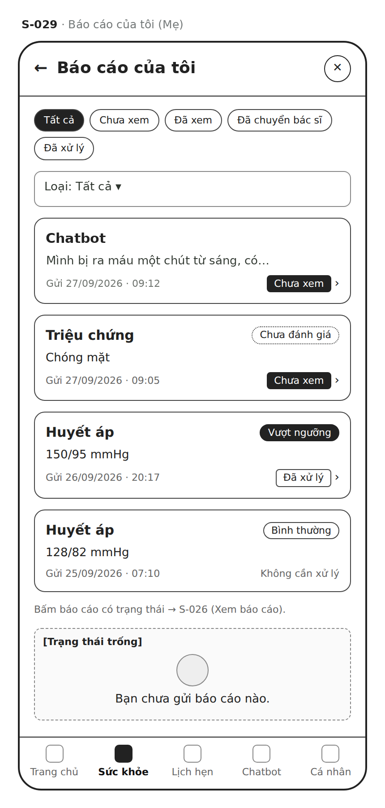

# Screen Spec: S-029 My reports

**Current navigation — D-80 / D-86 (confirmed 11/11/2026):** any Appointments/Health tab row below describes the historical wireframe, not the current shell. The five root screens use Home · Timeline · Chatbot · From doctor · Profile; child screens have back navigation and no root tab bar. No Home booking CTA is present. Historical navigation rows and images are retained as reference only; unrelated open questions remain open.

| Field | Value |
|---|---|
| Screen ID | `S-029` |
| Screen name | My reports (the mother's reports and chatbot cases with their handling status) |
| Actor | Mother |
| Priority | Must |
| Belongs to module | `spec-ALR.md` |
| Mockup image | `img/S-029.png` |
| Status | Draft (revised 29/09/2026 — screen-spec fix #1, #3; review ALR-01) |

*Change note (29/09/2026): the former tab 1 "Risk assessment" (7 / 30-day risk summary, elements #4 and #6 – #20) is removed — MVP v8 §4 gives the mother only "View Report Status & Care Team Response", with no risk summary sent back to her (review ALR-01, HLT-02). S-029 is now a single list that opens directly. Element numbers #21 – #27 are kept so that existing references stay valid.*

## 1. Purpose

**Shown when:** the mother taps the "My reports" card on Home `S-008` or on `S-023` (D-26 as revised); or she taps ← on `S-026` when `S-026` was opened from `S-025A`, `S-028` or `S-009` (D-53 as revised). The Health tab is selected on the 5-tab bar.

The screen lists the reports the mother has submitted and the chatbot cases she agreed to pass to a nurse, with their handling status (D-18).

**The user leaves this screen when:** the mother taps a report / case that has a status (→ `S-026`), the ← button, the ✕ button (→ `S-083`) or another tab on the bottom bar.

## 2. Mockup

## 3. Element inventory

| # | Element | Type | Content / data source | Required | Validation |
|---|---|---|---|---|---|
| 1 | ← button | Button | navigation | Yes | — |
| 2 | Title "My reports" | Header | static | Yes | — |
| 3 | ✕ button | Button | closes the sub-app (D-01) | Yes | — |
| 5 | Bottom 5-tab bar (Home – Health – Appointments – Chatbot – Profile), Health tab selected | Toggle (tab) | navigation (D-27) | Yes | — |
| 21 | Status filter chips "All" (selected) / "Not viewed" / "Viewed" / "Escalated to doctor" / "Resolved" | Toggle | Filter by Case → Status (`spec-ALR.md` FR-003; status set D-18) | Yes | exactly 1 selected; default "All" |
| 22 | Filter "Type: All ▾" — options: All / Blood pressure / Blood glucose / Urine protein / Symptom / Chatbot | Dropdown | Filter by Metric Report → metric, or Case → `case_source` = Chatbot (`spec-ALR.md` FR-003) | No | exactly 1 option; default "All" |
| 23 | Report card "Symptom · [Not assessed] · Severe headache / dizziness / blurred vision · Sent 27/09/2026 · 09:05 · [Not viewed] ›" (the image shows "Dizziness", D-23 example) | List item | Metric Report (symptom type) → symptoms, submitted_at; "Not assessed" label because symptoms have no threshold (D-17); Case status (D-18, D-20) | — | — |
| 24 | Report card "Blood pressure · [Above threshold] · 150/95 mmHg · Sent 26/09/2026 · 20:17 · [Resolved] ›" | List item | Metric Report → metric, Health Metric Record → value, submitted_at; threshold label; Case status (D-14, D-18) | — | — |
| 25 | Report card "Blood pressure · [Normal] · 128/82 mmHg · Sent 25/09/2026 · 07:10 · No action needed" (no ›) | List item | Normal Metric Report without symptoms: no Case, no status (D-21) | — | — |
| 26 | Annotation "Tap a report that has a status → S-026 (View report)." | Annotation | Rule in §5 | — | — |
| 26a | Chatbot case card "Chatbot · [question text, first line] · Sent `dd/mm/yyyy · HH:mm` · [status] ›" — drawn as "Chatbot · I've had a little bleeding since this morning, is… · Sent 27/09/2026 · 09:12 · Not viewed ›" | List item | Case with `case_source` = Chatbot, created when the mother taps "Connect to nurse" on `S-034` (`spec-BOT.md` FR-008, `spec-ALR.md` FR-021; D-34) → Chat Message text, Case created_at, status. **No value, no threshold label, no symptoms** (screen-spec fix #3) | — | — |
| 27 | Empty state "You have not submitted any reports." | Empty state | Shared empty-state pattern (D-27) | — | — |

The screen has no text input fields; only filter chips / dropdown. (Numbers #4 and #6 – #20 belonged to the removed tab 1.)

## 4. States

| State | What the user sees | Trigger |
|---|---|---|
| Default | Report / case list with the newest on top; each report card with its threshold label and status (or "No action needed"); chatbot cards with the question and status | Screen opens |
| Empty (no data) | Shared empty-state pattern (D-27): "You have not submitted any reports." `[NEEDS CLARIFICATION: wording when a filter returns no results — not drawn]` | The mother has no reports and no chatbot cases |
| Loading | Shared "Loading" pattern (D-27): grey placeholders replace the cards, keeping the layout; applies when the screen opens or a filter changes | Data loading |
| Error | Shared "Error" pattern (D-27): "⚠ Could not load data." + "Retry" | Data load fails |
| Success / confirmation | Not applicable — view-only screen | — |

## 5. Interactions and navigation

| # | Element | User action | System response | Goes to screen |
|---|---|---|---|---|
| 1 | ← button | tap | — | The screen that opened S-029 (`S-008` or `S-023`); if S-029 was reached with ← from `S-026`, back to the screen before that `[NEEDS CLARIFICATION: exact back stack — default `S-023`]` |
| 2 | ✕ button | tap | Asks to confirm closing the sub-app (D-01) | `S-083` |
| 7 | Status chip | tap | Filters the list by status (`spec-ALR.md` FR-003) | stays |
| 8 | "Type: All ▾" | select | Filters the list by metric / Symptom / Chatbot (`spec-ALR.md` FR-003) | stays |
| 9 | Report card or chatbot case card with a status (D-34) | tap | Opens the report / case detail (`spec-ALR.md` FR-005/FR-006) | `S-026` |
| 10 | "No action needed" report card | tap | No navigation — the card has no ›, the report has no status (D-21) | stays |
| 11 | 5-tab bar | tap | — | main screen of the corresponding tab (Appointments → TCI app booking flow, `spec-APT.md` BR-003) |

(Numbers #3 – #6 belonged to the removed tab 1.)

## 6. Screen-level rules

| Rule ID | Rule | Source |
|---|---|---|
| SR-001 | **Removed** — applied to the removed tab 1. S-029 shows no per-metric risk summary (ALR-01). | ALR-01 |
| SR-002 | Only 3 threshold labels are used on report cards: Normal / Above threshold / Not assessed. "Not assessed" = the report contains only symptoms. Chatbot cards carry no threshold label. | D-17; `spec-ALR.md` BR-005 |
| SR-003 | **Removed** — the threshold values were shown on the removed tab 1; report cards show only the label. Thresholds: `spec-ALR.md` BR-004. | ALR-01 |
| SR-004 | Every displayed value carries a source label: From visit / Self-entered / Doctor-assigned. | D-10 |
| SR-005 | Report status uses a single set Not viewed → Viewed → Escalated to doctor → Resolved, with the same names as on the clinical staff side (S-061, S-064). | D-18 |
| SR-006 | A Normal report without symptoms has no status; the list shows "No action needed" and it cannot open S-026. | D-21 |
| SR-007 | A symptom report always has a status (always routed to a nurse, starting at Not viewed). | D-20 |
| SR-008 | **Removed** — the disclaimer belonged to the risk summary of tab 1 (ALR-01). | ALR-01 |
| SR-009 | **Removed** — applied to the removed tab 1; recommendations are on S-028 and S-026 (D-05). | ALR-01; D-05 |
| SR-010 | The list also shows cases created from the chatbot (only when the mother has tapped "Connect to nurse"): question + source "Chatbot" + status, no value / threshold / symptoms; the mother reads the nurse's response on `S-026`. | D-34; `spec-BOT.md` FR-008; screen-spec fix #3 |

## 7. Linked requirements

| FR ID (from the module spec) | What this screen does for it |
|---|---|
| FR-001 (`spec-ALR.md`) | Opens "My reports" |
| FR-002 (`spec-ALR.md`) | Shows the mother's report and chatbot case list |
| FR-003 (`spec-ALR.md`) | Status chips and the "Type" filter (incl. Chatbot) |
| FR-005, FR-006 (`spec-ALR.md`) | Report / case cards lead to the detail on `S-026` |
| FR-021 (`spec-ALR.md`), FR-008 (`spec-BOT.md`) | Cases created from reports and from the chatbot hand-off appear here |
| BR-002, BR-005 (`spec-ALR.md`) | Threshold labels on report cards |

*FR-017 (risk assessment summary) is Won't (ALR-01) and no longer linked.*

## 8. Responsive and accessibility notes

- Smallest supported width: `[NEEDS CLARIFICATION: not specified]`
- What collapses or stacks on a narrow screen: single column; the row of status chips (5 chips) may need horizontal scrolling on narrow devices `[NEEDS CLARIFICATION]`.
- Text that must remain readable: threshold labels, values and statuses. Threshold labels and statuses must include text and not rely on colour alone.

## 9. Open questions

| # | Question | Blocking? | Status |
|---|---|---|---|
| 4 | Which report does "View report ›" on the tab 1 Blood pressure card open? | No | Resolved — not applicable: tab 1 removed (ALR-01) |
| 6 | What does the tab 1 summary card count? | No | Resolved — not applicable: tab 1 removed (ALR-01) |
| 7 | [NEEDS CLARIFICATION: sort order of the list (the mockup shows newest first) and whether there is pagination.] | No | Open |
| 8 | What does a chatbot case card show, and does the filter have a "Chatbot" option? | No | Resolved (screen-spec fix #3) — question + source "Chatbot" + status, no value / threshold / symptoms (#26a); "Chatbot" added to the "Type" filter (#22) |
| 9 | Blood glucose card on tab 1: threshold label by measurement context? | No | Resolved — not applicable: tab 1 removed (ALR-01) |

---

## Completion checklist

- [x] The mockup is a separate cropped image file, named with the Screen ID.
- [x] Every visible element in the mockup appears in the element inventory (#1 – #3, #5, #21 – #27, #26a).
- [x] Every input element has a validation rule or an explicit "none" — only filter chips / dropdown.
- [x] All five states are filled in (using the shared D-27 patterns), or marked `[NEEDS CLARIFICATION]` with a reason.
- [x] Every navigation target is a Screen ID that exists in the Screen List.
- [x] Every element that displays data names the field it displays, matching the module spec.

## UI review — 11/11/2026

User requested a compact, consistent layout. Replace horizontal status chips with two equal-width dropdowns (status and type) that preserve one another's selection; keep the existing handling count. Each card has the same order: source/type and timestamp, report title, metric classification and case status tags, then a separated footer. All actionable cards use the same "View report" text link and chevron, including resolved and chatbot cases. No-case reports retain "No action needed". Preserve existing targets, statuses and filtering rules. Reuse the explicit centered dropdown chevron from notifications; no native/literal duplicate arrow.

Affected downstream implementation: `app/mb360/templates/my_reports.html`, `app/mb360/static/tci.css`. No FR, data-model, schema or seed changes.

### Filter labels — 11/11/2026

At the user’s request, the unfiltered dropdown labels are "Trạng thái" (left) and "Chỉ số" (right). Selected values still display the chosen status/type. Empty values still mean all; existing options and filtering behavior stay unchanged.

### Filter menu refinement — 11/11/2026

User requested hiding the initial "Trạng thái" placeholder from the opened status menu, and changing the type dropdown’s first option to "Tất cả chỉ số". Keep the placeholder for the initial unfiltered status display; type reset remains available. No data or clinical-rule changes.

### Default options — 11/11/2026

User refined the first dropdown options to "Tất cả" for status and "Tất cả chỉ số" for type. Accessible dropdown names remain "Trạng thái" and "Chỉ số". Empty values still mean all; options and filtering logic stay unchanged.

### Default option wording clarification — 11/11/2026

User clarified the first options inside the selects: left "Tất cả", right "Tất cả chỉ số". These replace the previous default-option wording; accessible names remain Trạng thái / Chỉ số. No option values or filtering behavior change.

### Visible filter labels — 11/11/2026

To distinguish the two fields, add visible labels above the selects: "Trạng thái" on the left and "Chỉ số" on the right. Retain the first options "Tất cả" / "Tất cả chỉ số" and the existing filtering behavior. Labels are associated with their controls via for/id.

### Default option refinement — 11/11/2026

User requested "Tất cả" as the first option in both dropdowns. Visible labels remain "Trạng thái" / "Chỉ số". This supersedes "Tất cả chỉ số" above; filter values and behavior are unchanged.

### Filter color — 18/11/2026

Use a pale green filter bar, dark green field labels and a compact green count badge. A filter with a specific selection uses a stronger green border and tint.

### Page layout — 18/11/2026

Group the two filters and count in an inset white panel. Reserve the stronger green tint for applied filters. In the report list, use compact cards with the type and date above the title, followed by tags and the detail link on a wrapping row. Use an orange start border for above-threshold reports.

Align the measurement result at the start of the final row and the handling status at the end. Use distinct colors for handling states. Cards that open report or chatbot details expose a chevron and use the entire card as the link.

Show each report in a compact row with a leading icon for its type, followed by the title, type and time, and result or handling labels. Center the detail chevron on the trailing edge of linked rows. Highlight above-threshold reports in the icon tile.

Group labels at the start of the row below the timestamp. Use the shared rounded, tinted tags from the notification screen for measurement results and handling states.

Keep report titles to one visible line. Show an ellipsis when the title exceeds the available width.

Report rows use the same white card surface, shadow and corner radius as S-009. Put the filters in a full-width pale green strip immediately below the header, using the same dropdown styling as S-009. Report titles use the shared bold body style and filter labels use the shared bold caption style.
