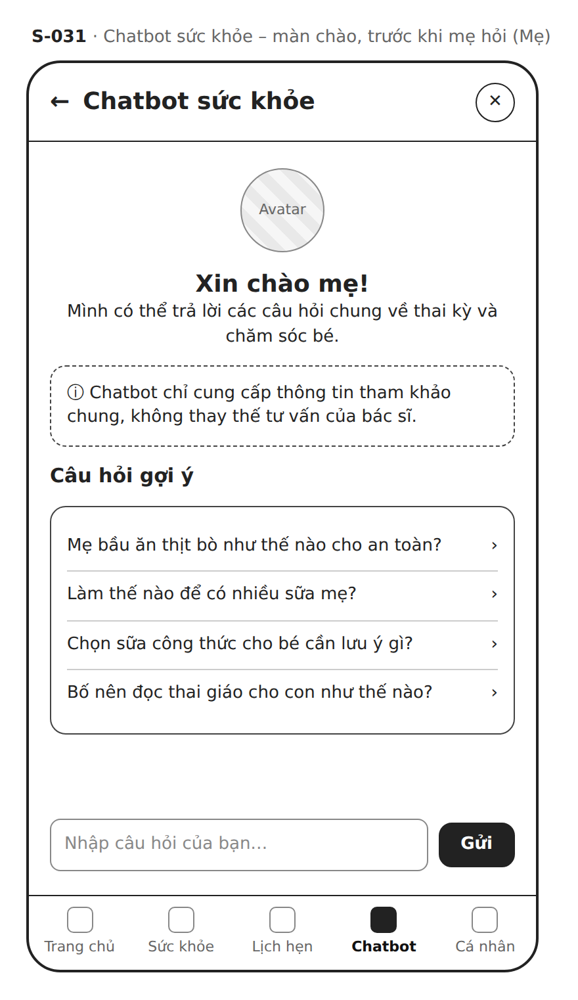

# Screen Spec: S-031 Health chatbot

| Field | Value |
|---|---|
| Screen ID | `S-031` |
| Screen name | Health chatbot |
| Actor | Mother |
| Priority | Must |
| Belongs to module | `spec-BOT.md` |
| Mockup image | `img/S-031.png` |
| Status | Draft |

## 1. Purpose

**Shown when:** the mother taps the **Chatbot** tab in the 5-tab bar.

**The user leaves this screen when:** the mother sends a question (types it and taps **Send**, or taps a suggested question) → moves to the conversation flow `S-032` – `S-034`; or taps ←, ✕ (→ `S-083`), or another tab.

## 2. Mockup

## 3. Element inventory

| # | Element | Type | Content / data source | Required | Validation |
|---|---|---|---|---|---|
| 1 | ← button | Button | navigation | Yes | — |
| 2 | Title "Health chatbot" | Header | static | Yes | — |
| 3 | ✕ button | Button | closes the sub-app | Yes | — |
| 4 | Chatbot avatar | Image | static | No | — |
| 5 | Greeting "Hello, Mom!" + "I can answer general questions about pregnancy and baby care." | Text | static | Yes | — |
| 6 | Disclaimer "ⓘ The chatbot provides general reference information only and does not replace your doctor's advice." | Text | static; general-knowledge scope, no diagnosis | Yes | — |
| 7 | Heading "Suggested questions" | Text | static | No | — |
| 8 | Suggested question 1 "How can I eat beef safely during pregnancy?" › | List item | static content | No | — |
| 9 | Suggested question 2 "How can I produce more breast milk?" › | List item | static content | No | — |
| 10 | Suggested question 3 "What should I look for when choosing formula for my baby?" › | List item | static content | No | — |
| 11 | Suggested question 4 "How should Dad read to the baby during pregnancy?" › | List item | static content | No | — |
| 12 | Input field "Type your question…" | Input | `spec-BOT.md` FR-001 User Text | Yes | can only be sent when not empty; maximum length **500 characters** (D-46) |
| 13 | "Send" button | Button | triggers FR-001 → FR-002 | Yes | disabled while the input field is empty |
| 14 | 5-tab bar, Chatbot tab selected | Toggle (tab) | navigation | Yes | — |

## 4. States

| State | What the user sees | Trigger |
|---|---|---|
| Default | Greeting, disclaimer, 4 suggested questions, empty input field | Opening the Chatbot tab |
| Empty (no data) | Not applicable | — |
| Loading | No separate loading state on this screen | — |
| Error | An error when sending a question is shown on the conversation screen | The chatbot service does not respond |
| Success / confirmation | Not applicable | — |

## 5. Interactions and navigation

| # | Element | User action | System response | Goes to screen |
|---|---|---|---|---|
| 1 | ← button | tap | — | `S-008` |
| 2 | ✕ button | tap | Asks for confirmation to close the sub-app | `S-083` |
| 3 | Input field + "Send" | type, tap | FR-001 receives the question; FR-005 shows "•••"; checks for risk keywords, then answers or offers to connect to a nurse | `S-032` → `S-033` → `S-034` |
| 4 | Suggested question | tap | Sends that question immediately | `S-032` → `S-033` → `S-034` |
| 5 | 5-tab bar | tap | — | main screen of the corresponding tab |

## 6. Screen-level rules

| Rule ID | Rule | Source |
|---|---|---|
| SR-001 | Questions about the mother's own health or containing a risk keyword (haemorrhage/bleeding, severe abdominal pain/hard contractions, blurred vision/dizziness/fainting, no fetal movement/baby not kicking, waters breaking/leaking amniotic fluid) are not answered directly; the chatbot offers to connect to a nurse and, if the mother agrees, opens a case in the `S-061` queue with source "Chatbot", status Not viewed. | `spec-BOT.md` BR-002; keyword list: D-47 (**Pending SME** — used provisionally for the demo) |
| SR-002 | The disclaimer is always shown on the welcome screen. | Wireframe |
| SR-003 | Only the question and light context (e.g. gestational week) are sent to the chatbot service, not the full record. | `spec-BOT.md` BR-001 |
| SR-004 | The screen belongs to the Chatbot tab; the Chatbot tab is highlighted. | — |

## 7. Linked requirements

| FR ID (from the module spec) | What this screen does for it |
|---|---|
| FR-001 | Receives the mother's question (maximum 500 characters) |
| FR-002 | Called when Send is tapped; the answer is shown on `S-034` |
| BR-002 | A risk question triggers the connect-to-nurse flow |
| BR-004 | The disclaimer is always shown |

## 8. Responsive and accessibility notes

- Smallest supported width: `[NEEDS CLARIFICATION: not specified]`.
- The whole row of a suggested question must be tappable (not only the › mark); text must not be cut off on narrow screens and wraps when long.
- The disclaimer must be readable and must not rely only on the dashed border to stand out.

## 9. Open questions

| # | Question | Blocking? | Status |
|---|---|---|---|
| 1 | [NEEDS CLARIFICATION: the risk keyword list (SR-001) was drafted by the team — it needs a doctor's approval (D-47, Pending SME).] | Yes | Open |
| 2 | [NEEDS CLARIFICATION: where the ← button goes (`S-008` or the previous screen); whether the 4 suggested questions are fixed or change with the gestational week.] | No | Open |
| 3 | [NEEDS CLARIFICATION: when the Chatbot tab is reopened after a conversation exists, is this welcome screen shown or the previous conversation (`S-034`)?] | No | Open |

---

## Completion checklist

- [x] The mockup is a separate cropped image file, named with the Screen ID.
- [x] Every visible element in the mockup appears in the element inventory.
- [x] Every input element has a validation rule — input field: not empty, ≤ 500 characters.
- [x] All five states are filled in, or marked "not applicable" with a reason.
- [x] Every navigation target is a Screen ID that exists in the Screen List.
- [x] Every element that displays data names the field it displays, matching the module spec.
