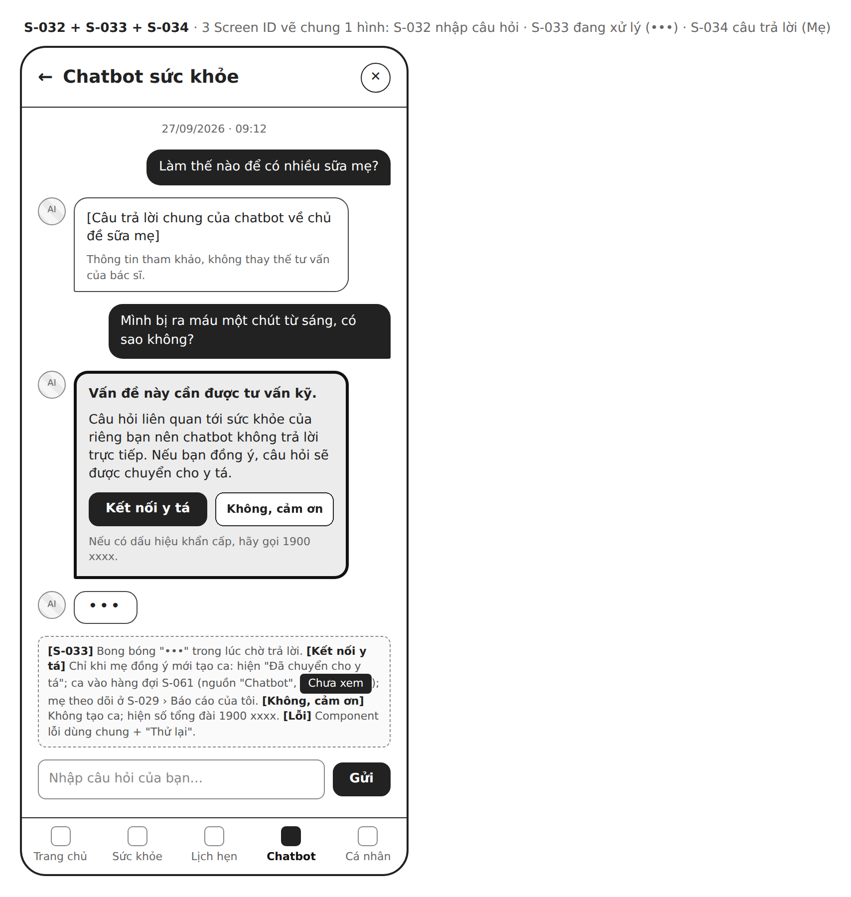

# Screen Spec: S-032 Chatbot question input

| Field | Value |
|---|---|
| Screen ID | `S-032` |
| Screen name | Chatbot question input (DBIZ2 name: Chatbot Input Screen) |
| Actor | Mother |
| Priority | Must |
| Belongs to module | `spec-BOT.md` |
| Mockup image | `img/S-032.png` — copy of the shared image `img/S-034.png`: S-032, S-033 and S-034 are drawn in one conversation frame (D-09). The S-032 part is the input area at the bottom of the frame and the question bubble the mother has just sent. |
| Related screens | `S-031` (chatbot welcome, where the first question is typed), `S-033` (processing "•••"), `S-034` (answer) — same conversation frame (D-09) |
| Status | Draft |

*The shared elements are also described in `screen-spec-S-034.md`; if the two files differ, raise it as an open question rather than choosing one.*

## 1. Purpose

The state of the chatbot conversation in which the mother types a question and sends it. It receives the question (≤ 500 characters) and passes it to the chatbot (`spec-BOT.md` FR-001).

**Shown when:** the mother is in the chatbot conversation (after her first question from `S-031`) and the input field is ready for a new question.

**The user leaves this screen when:** she taps "Send" (→ `S-033` processing, then `S-034` answer); taps ← (→ `S-031` `[NEEDS CLARIFICATION: or the previous screen — see S-034 §5 #5]`), ✕ (→ `S-083`), or a tab.

## 2. Mockup

## 3. Element inventory

| # | Element | Type | Content / data source | Required | Validation |
|---|---|---|---|---|---|
| 1 | ← button | Button | navigation | Yes | — |
| 2 | Title "Health chatbot" | Header | static | No | — |
| 3 | ✕ button | Button | closes the sub-app (D-01) | Yes | — |
| 4 | Timestamp "27/09/2026 · 09:12" | Text | Chat Message — Timestamp (`dd/mm/yyyy · HH:mm`, D-27) | No | — |
| 5 | Question bubble just sent by the mother (e.g. "How can I produce more breast milk?") | Chat bubble (right, dark background) | Chat Message — text, sender = Mother (`spec-BOT.md` FR-001) | No | — |
| 6 | Input field, placeholder "Type your question…" | Input (text) | Chat Message — text (`spec-BOT.md` FR-001, §6) | Yes | not empty; ≤ **500 characters** (D-46); whether a text of spaces only counts as empty `[NEEDS CLARIFICATION]` |
| 7 | Character counter "n/500" | Text | number of characters typed in #6 | — | **Not drawn on the mockup.** Added because the 500-character limit (D-46) needs a counter; position, wording and what happens at 500 characters (typing blocked or error shown) `[NEEDS CLARIFICATION]` |
| 8 | "Send" button | Button (primary) | sends the question (FR-001 → FR-002) | Yes | disabled while #6 is empty |
| 9 | 5-tab bar, "Chatbot" selected | Toggle (tab) | navigation (D-27, D-30) | Yes | — |

Note: the dashed annotation box on the image belongs to `S-033` / `S-034` and is not UI.

## 4. States

| State | What the user sees | Trigger |
|---|---|---|
| Default | empty input field with the placeholder "Type your question…"; counter "0/500" (not drawn); "Send" disabled | the conversation is open and nothing is typed |
| Typing | the placeholder disappears; the counter updates; "Send" enabled | the mother types (placeholder behaviour: DBIZ2 screen-layout note for screen 31) |
| Empty (no data) | not applicable — there is always at least the question just sent; an empty input is the Default state | — |
| Loading | the question bubble appears on the right and the "•••" bubble appears (= `S-033`) | "Send" tapped |
| Error | shared error component + "Retry" (D-27); whether the typed question stays in the field `[NEEDS CLARIFICATION]` | sending fails (network lost / chatbot service does not answer) |
| Success / confirmation | the question is shown as a bubble on the right with its timestamp; the input field is ready for the next question — whether the field is cleared after sending `[NEEDS CLARIFICATION: not drawn]` | the question is received (FR-001) |

## 5. Interactions and navigation

| # | Element | User action | System response | Goes to screen |
|---|---|---|---|---|
| 1 | Input field | type | updates the counter; enables "Send" when not empty | stays |
| 2 | "Send" | tap | stores the Chat Message (FR-001, FR-003); shows the "•••" bubble (FR-005) | `S-033` → `S-034` |
| 3 | Keyboard "Enter" | press | same as "Send" — from the DBIZ2 screen-layout note ("submit questions by pressing Search or Enter"); not drawn `[NEEDS CLARIFICATION: does Enter send or add a new line?]` | `S-033` → `S-034` |
| 4 | ← | tap | — | `S-031` `[NEEDS CLARIFICATION]` |
| 5 | ✕ | tap | asks for confirmation to close the sub-app | `S-083` |
| 6 | Tab Home / Health / Appointments / Chatbot / Profile | tap | — | `S-008` / `S-023` / TCI app / `S-031` / `S-103` |

## 6. Screen-level rules

| Rule ID | Rule | Source |
|---|---|---|
| SR-001 | A question has at most 500 characters. | D-46; `spec-BOT.md` FR-001 |
| SR-002 | "Send" is disabled while the input field is empty. | `S-031` / `S-034` specs; DBIZ2 screen-layout note (screen 31) |
| SR-003 | Only the question and light context (e.g. gestational week) are sent to the chatbot service, not the full record. | `spec-BOT.md` BR-001 |
| SR-004 | The risk check (personal health question / risk keyword) happens after sending; its result is shown on `S-034`. | `spec-BOT.md` BR-002; D-47 (Pending SME) |

## 7. Linked requirements

| FR ID (from the module spec) | What this screen does for it |
|---|---|
| FR-001 (`spec-BOT.md`) | Receives the question (text, ≤ 500 characters) |
| FR-003 | Stores the question in the conversation context |
| FR-005 | Hands over to the "•••" state (`S-033`) after sending |

## 8. Responsive and accessibility notes

- Smallest supported width: `[NEEDS CLARIFICATION: not specified]`.
- Whether the input field grows to several lines for long questions `[NEEDS CLARIFICATION]`.
- The counter must be readable by screen readers (e.g. "120 of 500 characters"); "Send" needs a text label, not only an icon.

## 9. Open questions

| # | Question | Blocking? | Status |
|---|---|---|---|
| 1 | [NEEDS CLARIFICATION: the character counter is not drawn — position, wording, and behaviour at 500 characters (block typing or show an error).] | No | Open |
| 2 | [NEEDS CLARIFICATION: does a text of spaces only count as empty?] | No | Open |
| 3 | [NEEDS CLARIFICATION: after sending, is the input field cleared; after a sending error, is the typed question kept?] | No | Open |
| 4 | [NEEDS CLARIFICATION: does the keyboard "Enter" send the question or add a new line?] | No | Open |
| 5 | [NEEDS CLARIFICATION: where ← goes (`S-031` or the previous screen) — same as `screen-spec-S-034.md` §5 #5.] | No | Open |
| 6 | DBIZ2's screen-layout note for screen 31 also mentions image upload (up to 5 images) in the chatbot input; it is not drawn in the MVP wireframe and is not in `spec-BOT.md` FR-001. Is it out of the MVP? `[NEEDS CLARIFICATION]` | No | Open |

---

## Completion checklist

- [x] The mockup is a separate image file, named with the Screen ID (copy of the shared image — D-09, D-55).
- [x] Every visible element in the mockup that belongs to S-032 appears in the element inventory (the counter #7 is marked as not drawn).
- [x] Every input element has a validation rule (input field: not empty, ≤ 500 characters).
- [x] All five states are filled in, or marked "not applicable" / `[NEEDS CLARIFICATION]` with a reason.
- [x] Every navigation target is a Screen ID that exists in the Screen List, or flagged `[NEEDS CLARIFICATION]`.
- [x] Every element that displays data names the field it displays, matching the module spec.
