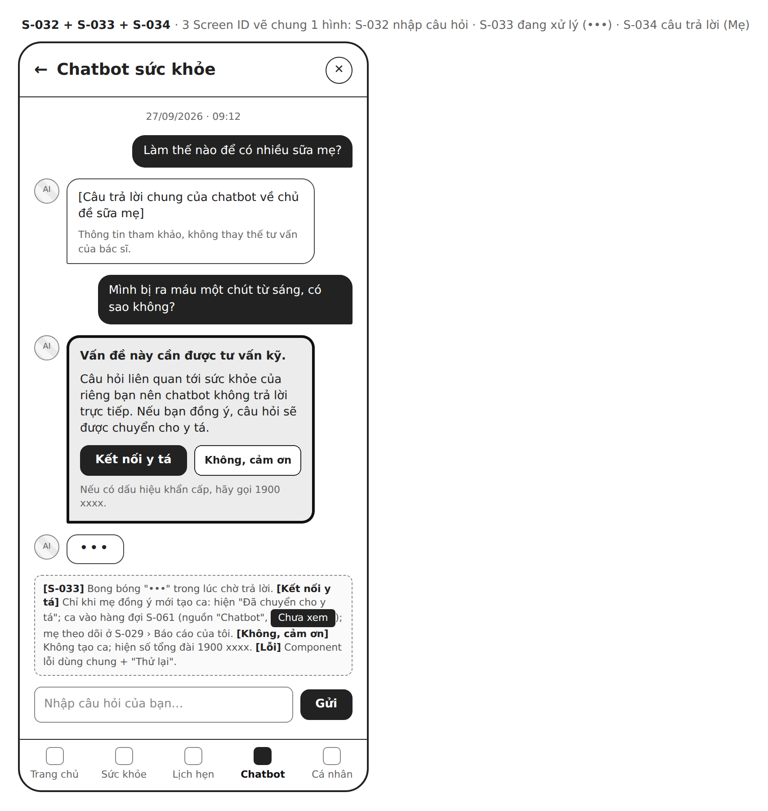

# Screen Spec: S-033 Chatbot processing

| Field | Value |
|---|---|
| Screen ID | `S-033` |
| Screen name | Chatbot processing — "•••" bubble (DBIZ2 name: Chatbot Processing Screen) |
| Actor | Mother |
| Priority | Must |
| Belongs to module | `spec-BOT.md` |
| Mockup image | `img/S-033.png` — copy of the shared image `img/S-034.png`: S-032, S-033 and S-034 are drawn in one conversation frame (D-09). The S-033 part is the "•••" bubble next to the "AI" avatar. |
| Related screens | `S-032` (question input), `S-034` (answer) — same conversation frame (D-09) |
| Status | Draft |

*The shared elements are also described in `screen-spec-S-034.md`; if the two files differ, raise it as an open question rather than choosing one.*

## 1. Purpose

Shows the mother that the chatbot has received her question and is preparing an answer, with a "•••" typing bubble (`spec-BOT.md` FR-005; DBIZ2 F-144 "Displays a visual indicator (dots/wave) to show that the chatbot is generating a response").

**Shown when:** right after the mother sends a question on `S-032` (or taps a suggested question on `S-031`), until the answer or the nurse hand-off offer arrives.

**The user leaves this screen when:** the answer arrives (→ `S-034`), an error occurs (error state below), or she taps ✕ (→ `S-083`) or a tab.

## 2. Mockup

## 3. Element inventory

| # | Element | Type | Content / data source | Required | Validation |
|---|---|---|---|---|---|
| 1 | ← button | Button | navigation | Yes | — |
| 2 | Title "Health chatbot" | Header | static | No | — |
| 3 | ✕ button | Button | closes the sub-app (D-01) | Yes | — |
| 4 | Question bubble just sent (right) | Chat bubble | Chat Message — text, sender = Mother (FR-001) | No | — |
| 5 | "AI" avatar | Image | static | No | — |
| 6 | "•••" bubble (left) | Indicator | FR-005 — shown while waiting for the answer | Yes (while waiting) | disappears when the answer, the hand-off offer or an error arrives |
| 7 | Input field "Type your question…" + "Send" | Input + Button | see `S-032` | — | whether they are disabled while "•••" is shown `[NEEDS CLARIFICATION: not drawn]` |
| 8 | 5-tab bar, "Chatbot" selected | Toggle (tab) | navigation (D-27, D-30) | Yes | — |

Note: the annotation "[S-033] "•••" bubble while waiting for the answer." on the image is a design note, not UI.

## 4. States

| State | What the user sees | Trigger |
|---|---|---|
| Default | the question bubble on the right + the "•••" bubble on the left | a question was sent (FR-001 → FR-005) |
| Empty (no data) | not applicable — the screen exists only after a question is sent | — |
| Loading | this screen is the loading state of the conversation: the "•••" bubble | waiting for the chatbot service (FR-002) |
| Error | the "•••" bubble is replaced by the shared error component + "Retry" (D-27); timeout value and error text `[NEEDS CLARIFICATION: spec-BOT.md §10 Q10]` | the chatbot service does not answer / network lost |
| Success / confirmation | the "•••" bubble is replaced by the answer bubble (general answer) or by the nurse hand-off bubble → `S-034` | the answer arrives (FR-002) |

## 5. Interactions and navigation

| # | Element | User action | System response | Goes to screen |
|---|---|---|---|---|
| 1 | "•••" bubble | — (no action) | replaced by the answer when it arrives | `S-034` |
| 2 | "Retry" (error state) | tap | sends the same question again (FR-001 → FR-002) | stays (`S-033`) |
| 3 | ✕ | tap | asks for confirmation to close the sub-app; what happens to the pending answer `[NEEDS CLARIFICATION]` | `S-083` |
| 4 | Tab | tap | — ; whether the answer is still shown when she comes back `[NEEDS CLARIFICATION]` | `S-008` / `S-023` / TCI app / `S-031` / `S-103` |

## 6. Screen-level rules

| Rule ID | Rule | Source |
|---|---|---|
| SR-001 | The "•••" bubble is shown for the whole time the chatbot is preparing the answer, and only then. | `spec-BOT.md` FR-005; DBIZ2 F-144 |
| SR-002 | While waiting, only the question and light context have been sent to the chatbot service. | `spec-BOT.md` BR-001 |
| SR-003 | A failure is shown with the shared error component + "Retry"; no case is created by an error. | D-27; D-34 (a case is created only by "Connect to nurse") |

## 7. Linked requirements

| FR ID (from the module spec) | What this screen does for it |
|---|---|
| FR-005 (`spec-BOT.md`) | Shows the "•••" typing indicator |
| FR-002 | Waits for the chatbot answer |
| FR-004 | The answer is logged when it arrives |

## 8. Responsive and accessibility notes

- Smallest supported width: `[NEEDS CLARIFICATION: not specified]`.
- The "•••" bubble needs a text alternative for screen readers (e.g. "The chatbot is answering").
- If the dots are animated, the animation must not be the only sign of progress `[NEEDS CLARIFICATION: animated or static]`.

## 9. Open questions

| # | Question | Blocking? | Status |
|---|---|---|---|
| 1 | [NEEDS CLARIFICATION: timeout before the error state, and the error text — `spec-BOT.md` §10 Q10.] | No | Open |
| 2 | [NEEDS CLARIFICATION: are the input field and "Send" disabled while "•••" is shown?] | No | Open |
| 3 | [NEEDS CLARIFICATION: what happens to a pending answer when the mother taps ✕ or changes tab?] | No | Open |
| 4 | [NEEDS CLARIFICATION: is the "•••" animated (DBIZ2 F-144 says "dots/wave") or static?] | No | Open |

---

## Completion checklist

- [x] The mockup is a separate image file, named with the Screen ID (copy of the shared image — D-09, D-55).
- [x] Every visible element in the mockup that belongs to S-033 appears in the element inventory.
- [x] Every input element has a validation rule — this state has no input of its own (the input belongs to `S-032`).
- [x] All five states are filled in, or marked "not applicable" with a reason.
- [x] Every navigation target is a Screen ID that exists in the Screen List.
- [x] Every element that displays data names the field it displays, matching the module spec.
