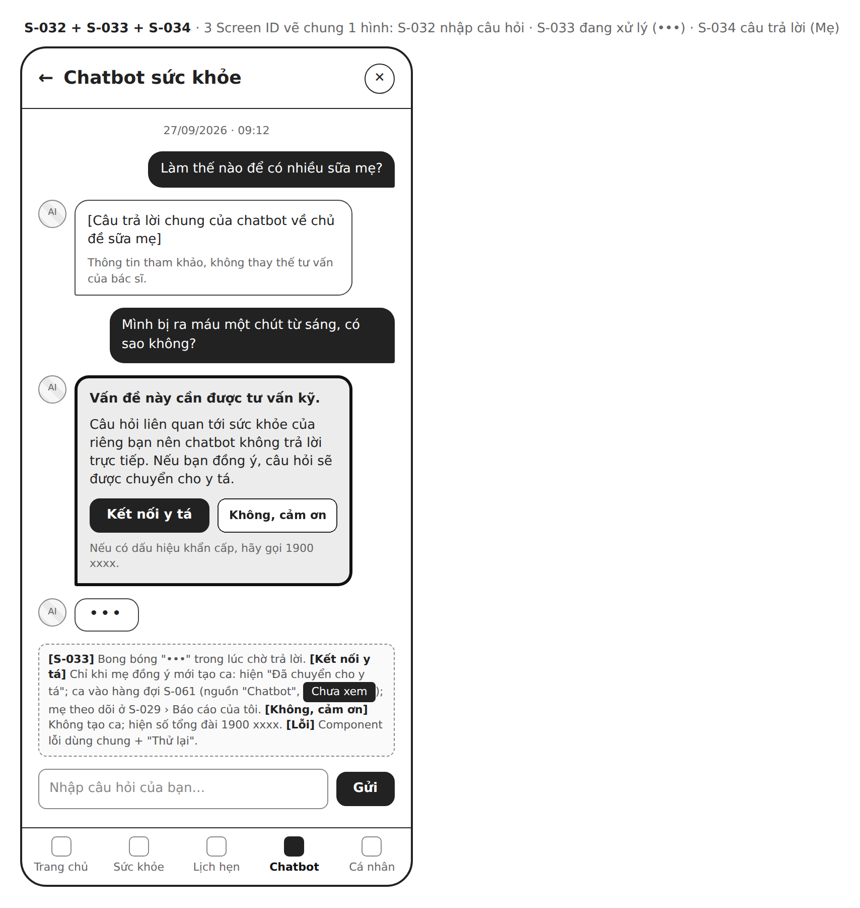

# Screen Spec: S-034 Chatbot conversation

**Current navigation — D-80 / D-86 (confirmed 11/11/2026):** any Appointments/Health tab row below describes the historical wireframe, not the current shell. The five root screens use Home · Timeline · Chatbot · From doctor · Profile; child screens have back navigation and no root tab bar. No Home booking CTA is present. Historical navigation rows and images are retained as reference only; unrelated open questions remain open.

| Field | Value |
|---|---|
| Screen ID | `S-032` + `S-033` + `S-034` (3 Screen IDs drawn in one image — D-09) |
| Screen name | Chatbot conversation — S-032 question input, S-033 processing ("•••"), S-034 answer |
| Actor | Mother |
| Priority | Must |
| Belongs to module | `spec-BOT.md` |
| Mockup image | `img/S-034.png` |
| Specs for secondary IDs | `screen-spec-S-032.md` + `img/S-032.png`, `screen-spec-S-033.md` + `img/S-033.png` — own full specs (D-55). S-032 = question input (#15, #16); S-033 = "•••" (#14). |
| Spec version | v1.7 |
| Status | Draft (revised 14/10/2026 — medical-attention notice and out-of-scope decline, D-76; image to redraw) |

> **v1.0.0 app (07/11/2026, D-80 – D-85):** Danger card: notice, "Mẹ cần được kiểm tra ngay", Call emergency (hotline pending) · Connect to nurse · No, thanks; after connecting "Đã chuyển cho y tá · kèm đoạn chat" and View status, no call-back promise; error "Chưa nhận được câu trả lời. Thử lại" (BOT §5.3).

## 1. Purpose

The conversation screen between the mother and the chatbot: it answers general pregnancy questions, and for questions about the mother's own health / containing a risk keyword it **does not answer directly** but offers to connect her to a nurse (`spec-BOT.md` BR-002).

**Shown when:** the mother sends her first question from `S-031` (types it and taps "Send", or taps a suggested question).

**The user leaves this screen when:** she taps ←, ✕ (`S-083`), or a tab. Tapping "Connect to nurse" does not leave the screen (a confirmation is shown in the conversation).

## 2. Mockup

## 3. Element inventory

| # | Element | Type | Content / data source | Required | Validation |
|---|---|---|---|---|---|
| 1 | ← button | Button | navigation | Yes | — |
| 2 | Title "Health chatbot" | Header | static | No | — |
| 3 | ✕ button | Button | closes the sub-app (D-01) | Yes | — |
| 4 | Timestamp "27/09/2026 · 09:12" | Text | Chat Message — Timestamp (`dd/mm/yyyy · HH:mm`, D-27) | No | — |
| 5 | Mother's question bubble (e.g. "How can I produce more breast milk?") | Chat bubble (right, dark background) | Chat Message — text, sender = Mother (`spec-BOT.md` FR-001) | No | — |
| 6 | General answer bubble "[Chatbot's general answer about breast milk]" | Chat bubble (left, labelled "AI") | AI Response (`spec-BOT.md` FR-002); the content is a placeholder | No | — |
| 7 | Disclaimer below the answer "For reference only; does not replace your doctor's advice." | Text | static (`spec-BOT.md` BR-004) | Yes | always shown below every general answer |
| 8 | *(Removed — screen-spec fix #11, BOT-02)* "Was this answer helpful?" + "Yes" / "No" — not drawn and not built (rating is Could, not in the MVP; no FR or entity stores it) | — | — | — | — |
| 9 | Mother's risk question bubble (e.g. "I've had a little bleeding since this morning, is that okay?") | Chat bubble (right) | Chat Message — text; `is_risk` = true, set by the classification (`spec-BOT.md` FR-006, §6) | No | — |
| 10a | Notice "Signs that need medical attention" at the top of bubble #10 (not drawn — D-76) | Text (warning style, no word "Alert") | shown when the question matches a danger phrase (`spec-BOT.md` FR-011, D-47) | No | — |
| 10b | Polite decline bubble for an out-of-scope question, e.g. "I can only help with pregnancy, prenatal care, nutrition and postpartum wellness. Could you ask me a pregnancy question?" (not drawn; wording `spec-BOT.md` Q13) | Chat bubble (left) | Chatbot message (`spec-BOT.md` FR-010, BR-005) | No | no hand-off buttons |
| 10 | Nurse hand-off bubble: heading "This needs a proper consultation." + "Your question relates to your own health, so the chatbot does not answer it directly. If you agree, your question will be sent to a nurse." | Chat bubble (bold frame) | static per BR-002, D-34; shown by `spec-BOT.md` FR-007 | No | — |
| 11 | "Connect to nurse" button | Button (primary) | records `handoff_choice` and creates a Case with `case_source` = Chatbot (`spec-BOT.md` FR-008 → `spec-ALR.md` FR-021; D-34, D-41) | No | can be tapped only once per question `[NEEDS CLARIFICATION]` |
| 12 | "No, thanks" button | Button (secondary) | records `handoff_choice`; no case is created (`spec-BOT.md` FR-009; D-34) | No | — |
| 13 | "If you have any emergency signs, call 1900 xxxx." | Text | hotline number — placeholder `[NEEDS CLARIFICATION: spec-BOT.md §10 Q8]` | No | — |
| 14 | "•••" bubble (S-033) | Indicator | `spec-BOT.md` FR-005 | No | shown while waiting for the answer |
| 15 | "Type your question…" field | Input (text) | Chat Message — text (`spec-BOT.md` FR-001) | Yes | not empty; ≤ **500 characters** (D-46) |
| 16 | "Send" button | Button (primary) | sends the question (FR-001 → FR-002) | Yes | disabled while the input field is empty |
| 17 | 5-tab bar, "Chatbot" selected | Toggle (tab) | navigation (D-27, D-30) | Yes | — |
| 18 | *(Added 15/11/2026, D-89 proposed)* Data-lookup answer bubble, e.g. "Latest blood pressure: 145/92 mmHg, 26/09/2026 · 18:02" + caption "The chatbot only repeats your data from the app and does not assess it. If you are worried, ask a nurse." + link "View in the app ›" | Chat bubble (left) | built by the app from the mother's own data, not by the LLM (`spec-BOT.md` FR-012, BR-006); the link opens the screen that shows the data (S-106, S-023, S-025, S-105, From doctor, S-029, S-027) | No | no "For reference only" line: it is not an AI answer; not in the wireframe |

Note: the "[S-033] … [Connect to nurse] … [No, thanks] … [Error] …" boxes on the image are annotations, described in §4–§6. The answer content is a placeholder.

## 4. States

| State | What the user sees | Trigger |
|---|---|---|
| Default — S-032 | the question just sent appears as a bubble on the right | the mother sends a question |
| Processing — S-033 | "•••" bubble on the left | waiting for the chatbot's answer (FR-005) |
| General answer — S-034 | answer bubble + disclaimer (no rating buttons — BOT-02) | a general question |
| Nurse hand-off offered | bubble #10 + "Connect to nurse" / "No, thanks" + hotline number | a personal health question or one matching a risk keyword (BR-002, D-47) |
| Danger phrase (not drawn) | notice #10a above bubble #10; no general advice | the question matches a danger phrase (`spec-BOT.md` FR-011, D-76) |
| Out of scope (not drawn) | decline bubble #10b; no buttons, no case | the question is outside pregnancy, prenatal care, nutrition and postpartum wellness (`spec-BOT.md` FR-010) |
| Connected to nurse | "Sent to a nurse" bubble (per the annotation); the mother follows the case on `S-029` "My reports" → `S-026` (chatbot case variant) | the mother taps "Connect to nurse" |
| Hand-off declined | no case is created; the hotline number 1900 xxxx is shown | the mother taps "No, thanks" |
| Empty (no data) | not applicable — the screen only opens after the first question | — |
| Loading | the "•••" bubble on the left — the same as "Processing — S-033" (`screen-spec-S-033.md`) | waiting for the chatbot's answer (FR-005) |
| Success / confirmation | the answer bubble is shown (general answer), or the "Sent to a nurse" bubble after "Connect to nurse"; no separate toast `[NEEDS CLARIFICATION: wording of "Sent to a nurse" — §9 Q5]` | the answer arrives (FR-002) / the case is created (D-34) |
| Error | shared error component + "Retry" (D-27) | the chatbot service does not answer / sending fails |

## 5. Interactions and navigation

| # | Element | User action | System response | Goes to screen |
|---|---|---|---|---|
| 1 | Input field + "Send" | type, tap | stores the Chat Message (FR-001, FR-003); shows "•••" (FR-005); classifies the question (FR-006); answers (FR-002, FR-004) or offers to connect to a nurse (FR-007, BR-002) | stays |
| 2 | *(Removed — screen-spec fix #11: no rating buttons)* | — | — | — |
| 3 | "Connect to nurse" | tap | records `handoff_choice` = Connect to nurse and creates a **Case** (`case_source` = Chatbot, `chat_message_id` = the question, Not viewed — `spec-BOT.md` FR-008, `spec-ALR.md` FR-021; D-34, D-41); the case enters the `S-061` queue; shows "Sent to a nurse" | stays |
| 4 | "No, thanks" | tap | records `handoff_choice` = No thanks; no case is created; shows the hotline number (`spec-BOT.md` FR-009) | stays |
| 5 | ← | tap | — | `S-031` `[NEEDS CLARIFICATION: or the previous screen]` |
| 6 | ✕ | tap | asks for confirmation to close the sub-app | `S-083` |
| 7 | Tab Home / Health / Appointments / Chatbot / Profile | tap | — | `S-008` / `S-023` / TCI app / `S-031` / `S-103` |

## 6. Screen-level rules

| Rule ID | Rule | Source |
|---|---|---|
| SR-001 | Questions about the mother's own health or containing a risk keyword are not answered directly; the chatbot shows bubble #10 and the two buttons. Keyword groups: haemorrhage / bleeding; severe abdominal pain / hard contractions; blurred vision / dizziness / fainting; no fetal movement / baby not kicking; waters breaking / leaking amniotic fluid. | `spec-BOT.md` BR-002; D-47 (**Pending SME** — used provisionally for the demo) |
| SR-002 | A case is created only when the mother taps "Connect to nurse"; "No, thanks" creates no case and shows the hotline number. | D-34 |
| SR-003 | Every general answer always carries the disclaimer. | `spec-BOT.md` BR-004 |
| SR-004 | Only the question, the earlier questions / answers of the conversation and the gestational week are sent to the chatbot service — never medical-record data. | `spec-BOT.md` BR-001 (BOT-05) |
| SR-006 | No rating of answers in the MVP ("Was this answer helpful?" is not built). | `spec-BOT.md` BOT-02; screen-spec fix #11 |
| SR-005 | Question ≤ 500 characters. | D-46 |
| SR-007 | Only pregnancy, prenatal care, nutrition and postpartum wellness questions are answered; others get the decline bubble. A danger phrase shows the notice "Signs that need medical attention" above the hand-off offer. | `spec-BOT.md` BR-005; D-76 |

## 7. Linked requirements

| FR ID (from the module spec) | What this screen does for it |
|---|---|
| FR-001 (`spec-BOT.md`) | Receives the question (≤ 500 characters) |
| FR-002 | Returns the chatbot's answer |
| FR-003 | Stores the conversation context |
| FR-004 | Logs the answer |
| FR-005 | "•••" bubble (S-033) |
| FR-006 (new — BOT-03) | Classifies the question: general answer or nurse hand-off |
| FR-007 (new — BOT-03) | Shows the nurse hand-off bubble (#10 – #13) |
| FR-008 (new — BOT-03), `spec-ALR.md` FR-021 | "Connect to nurse" → records the choice and creates a Case with source Chatbot, shown on `S-061` and on `S-029` "My reports" |
| FR-009 (new — BOT-03) | "No, thanks" → records the choice, no case, shows the hotline number |
| FR-010 (new — D-76) | Decline bubble for an out-of-scope question (#10b) |
| FR-011 (new — D-76) | Medical-attention notice for a danger phrase (#10a) |
| BR-002 (`spec-BOT.md`) | The hand-off rule |

## 8. Responsive and accessibility notes

- Smallest supported width: `[NEEDS CLARIFICATION: not specified]`.
- Bubbles wrap automatically; the two buttons "Connect to nurse" / "No, thanks" stack vertically on narrow screens.
- Bubble #10 must have a clear text heading and not rely only on the bold frame; the hotline number is tappable to call `[NEEDS CLARIFICATION]`.

## 9. Open questions

| # | Question | Blocking? | Status |
|---|---|---|---|
| 1 | [NEEDS CLARIFICATION: the risk keyword list (SR-001) needs a doctor's approval (D-47, Pending SME).] | Yes | Open |
| 2 | Which entity stores the "Yes / No" rating? | No | Resolved — not applicable: rating removed (screen-spec fix #11, BOT-02) |
| 3 | [NEEDS CLARIFICATION: the real hotline number — see `spec-BOT.md` §10 Q8.] | No | Open |
| 4 | [NEEDS CLARIFICATION: after "Connect to nurse" is tapped, are the two buttons locked; does a follow-up question on the same topic create a new case?] | No | Open |
| 5 | [NEEDS CLARIFICATION: the exact wording of the "Sent to a nurse" bubble — it exists only in the annotation and is not drawn.] | No | Open |
| 6 | [NEEDS CLARIFICATION: element #18 (data-lookup bubble, D-89 proposed) has no wireframe; layout and wording to be confirmed by UX/UI — see `spec-BOT.md` §10 Q17.] | No | Open |

---

## Completion checklist

- [x] The mockup is a separate cropped image file, named with the Screen ID.
- [x] Every visible element in the mockup appears in the element inventory.
- [x] Every input element has a validation rule (input field: not empty, ≤ 500 characters).
- [x] All states are filled in (including S-033, the nurse hand-off offer, error).
- [x] Every navigation target is a Screen ID that exists in the Screen List, or flagged `[NEEDS CLARIFICATION]`.
- [x] Every element that displays data names the field it displays, matching the module spec.
