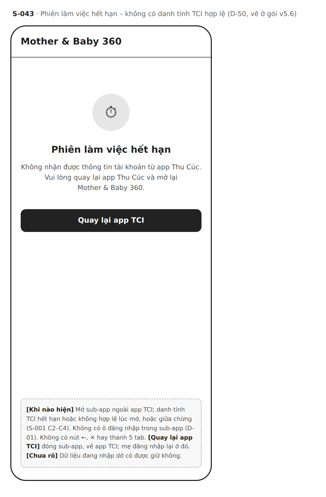

# Screen Spec: S-043 Session expired

| Field | Value |
|---|---|
| Screen ID | `S-043` |
| Screen name | Session expired (DBIZ2 name: Session Expired) |
| Actor | Mother |
| Priority | Must `[PENDING CLIENT: D-01]` |
| Belongs to module | `spec-ACC.md` (SHARED ID in the DBIZ2 Screen List) |
| Mockup image | `img/S-043.png` |
| Status | Draft |

> **v1.0.0 app (07/11/2026, D-80 – D-85):** Answers HTTP 401 (ACC §5.3 E-1).

## 1. Purpose

The sub-app has no sign-in screen (D-01). When the sub-app does not receive a valid TCI identity, this screen explains why and sends the mother back to the TCI app to sign in again.

**Shown when:** (conditions C2 – C4 in `S-001` §1)

- the sub-app is opened **outside the TCI app** (no TCI identity received);
- the TCI identity is **expired or invalid** when the sub-app is opened;
- the TCI identity expires **mid-session**, at the next action that needs the identity.

**The user leaves this screen when:** taps "Back to TCI app" (closes the sub-app, returns to the TCI app).

## 2. Mockup

## 3. Element inventory

| # | Element | Type | Content / data source | Required | Validation |
|---|---|---|---|---|---|
| 1 | Header title "Mother & Baby 360" | Header | static | No | — |
| 2 | Clock icon | Icon | static | No | — |
| 3 | "Session expired" | Header | static | No | — |
| 4 | "Could not receive your account information from the Thu Cuc app. Please go back to the Thu Cuc app and reopen Mother & Baby 360." | Text | static — draft wording `[NEEDS CLARIFICATION: final wording]` | No | — |
| 5 | "Back to TCI app" button | Button (primary) | closes the sub-app (`spec-ACC.md` FR-019, FR-021) | Yes | — |

Note: the "[When shown] … [Back to TCI app] … [Unclear] …" box is an annotation, described in §1, §5, §9. The screen has **no** ← button, ✕ button or 5-tab bar, because there is no sub-app session to return to.

## 4. States

| State | What the user sees | Trigger |
|---|---|---|
| Default (drawn) | explanation + "Back to TCI app" | one of the conditions in §1 |
| Empty (no data) | not applicable | — |
| Loading | not applicable — static screen | — |
| Error | not applicable — this screen is itself the identity error state | — |
| Success / confirmation | not applicable (error screen) | — |

## 5. Interactions and navigation

| # | Element | User action | System response | Goes to screen |
|---|---|---|---|---|
| 1 | "Back to TCI app" | tap | ends the sub-app session (FR-019), clears temporary data on the device (FR-021) | TCI app (`S-001` state 1) — when the sub-app was opened outside the TCI app: `[NEEDS CLARIFICATION: mechanism for opening the TCI app — spec-ACC.md §10 Q9]` |
| 2 | Operating-system back button | tap | as #1 | TCI app |

## 6. Screen-level rules

| Rule ID | Rule | Source |
|---|---|---|
| SR-001 | Phone number / password fields are never shown; the mother signs in again in the TCI app. | D-01, D-50 |
| SR-002 | Data being entered on the previous screen `[NEEDS CLARIFICATION: is it kept?]`. | D-50 |

## 7. Linked requirements

| FR ID (from the module spec) | What this screen does for it |
|---|---|
| FR-015 (`spec-ACC.md`) | Shown when the sub-app session cannot be created from the TCI identity |
| FR-019, FR-021 (`spec-ACC.md`) | Ends the sub-app session, clears temporary data |

## 8. Responsive and accessibility notes

- Smallest supported width: `[NEEDS CLARIFICATION: not specified]`.
- The "Back to TCI app" button needs an accessible label that makes clear it leaves the sub-app.

## 9. Open questions

| # | Question | Blocking? | Status |
|---|---|---|---|
| 1 | Does the Client approve the sub-app model (D-01)? If not, this screen reverts to DBIZ2's "sign in again". | Yes | Open `[PENDING CLIENT: D-01]` |
| 2 | Is data being entered kept when the identity expires mid-session? | No | Open |
| 3 | Final wording of the screen. | No | Open |
| 4 | Mechanism for returning the mother to the TCI app when the sub-app was opened outside the TCI app (`spec-ACC.md` §10 Q9). | No | Open |

---

## Completion checklist

- [x] The mockup is a separate cropped image file, named with the Screen ID.
- [x] Every visible element in the mockup appears in the element inventory.
- [x] Every input element has a validation rule — the screen has no input fields.
- [x] All states are filled in, or marked "not applicable" with a reason.
- [x] Every navigation target is a Screen ID that exists in the Screen List, or marked as handoff to the TCI app.
- [x] Every element that displays data names the field it displays — the screen has only static content.
