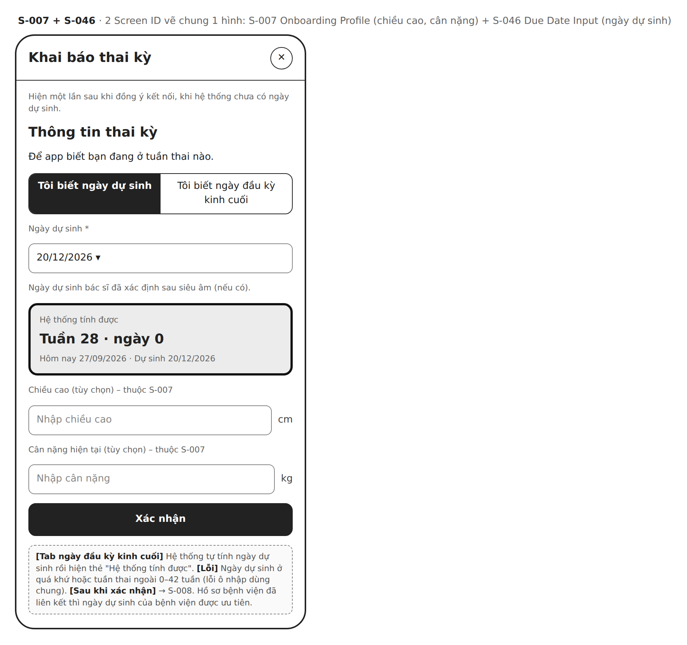

# Screen Spec: S-046 Due date input

| Field | Value |
|---|---|
| Screen ID | `S-046` |
| Screen name | Due date input (DBIZ2 name: Due Date Input Screen) — the "Pregnancy information" part of the "Pregnancy setup" screen |
| Actor | Mother |
| Priority | Must |
| Belongs to module | `spec-TML.md` (the due date is the basis of the pregnancy timeline); the date is validated and saved by `spec-ACC.md` FR-004, FR-005 |
| Mockup image | `img/S-046.png` — copy of `img/S-007.png`: S-007 (height, weight — `ACC`) and S-046 (due date — `TML`) are drawn in one frame because the mother enters both in one step. The S-046 part is the "Pregnancy information" section: the 2-tab selector, the date field and the "Calculated by the system" card. |
| Related screens | `S-007` (height, weight, "Confirm" — same frame), `S-001` (comes from), `S-008` (goes to), `S-048` (uses the gestational week) |
| Status | Draft (revised 14/10/2026 — optional first visit date, D-72; image to redraw) |

*The same elements are also described in `screen-spec-S-007.md` (#4 – #9); if the two files differ, raise it as an open question rather than choosing one.*

## 1. Purpose

Lets the mother give the system her due date (EDD) **or** the first day of her last menstrual period (LMP), so that the system can calculate her current gestational week. Without this date the timeline (`S-048`) and the other modules cannot personalise content by week.

**Shown when:** once, after the mother taps "Agree & continue" on `S-001` (state 2), when the system has no due date for her `[PENDING CLIENT: D-01]`.

**The user leaves this screen when:** she taps "Confirm" (shared with `S-007`) with a valid date (→ `S-008`), or taps ✕ (→ `S-083`). There is no ← button (D-27: the first-time setup screen has no ←).

## 2. Mockup

## 3. Element inventory

| # | Element | Type | Content / data source | Required | Validation |
|---|---|---|---|---|---|
| 1 | Title "Pregnancy setup" | Header | static | No | — |
| 2 | ✕ button | Button | opens `S-083` | Yes | — |
| 3 | Section title "Pregnancy information" + "So the app knows which gestational week you are in." | Text | static | No | — |
| 4 | **Tab 1** "I know my due date" (selected on the mockup) | Toggle (segmented, tab) | chooses the method "due date" (Profile — date type = EDD) | Yes | exactly 1 of the 2 tabs selected; default tab 1 |
| 5 | **Tab 2** "I know the first day of my last period" | Toggle (segmented, tab) | chooses the method "last menstrual period" (Profile — date type = LMP) | Yes | exactly 1 of the 2 tabs selected |
| 6 | "Due date *" field (tab 1), example `20/12/2026 ▾` | Input (date picker) | Profile — EDD (`spec-ACC.md` FR-004, FR-005) | Yes (on tab 1) | format `dd/mm/yyyy`; not in the past; the calculated gestational week must be within 0–42 weeks (mockup annotation) |
| 7 | Hint "The due date your doctor set after an ultrasound (if any)." | Text (caption) | static | No | — |
| 8 | "First day of last period" field (tab 2) — **not drawn**; described only in the annotation "[First-day-of-last-period tab] The system calculates the due date and shows the 'Calculated by the system' card." | Input (date picker) | Profile — LMP (`spec-ACC.md` FR-004, FR-005) | Yes (on tab 2) | format `dd/mm/yyyy`; the calculated gestational week must be within 0–42 weeks; formula LMP → EDD `[NEEDS CLARIFICATION: §9 Q1]` |
| 9 | "Calculated by the system" card: "Week 28 · day 0", "Today 27/09/2026 · Due 20/12/2026" | Card (read-only) | calculated from today's date + EDD (tab 1) or the EDD derived from the LMP (tab 2) — `spec-TML.md` FR-003 input `Current Date; EDD`; formula EDD → week/day `[NEEDS CLARIFICATION: §9 Q1]` | No | display only |
| 9a | "Date of first antenatal check-up (optional)" field (not drawn — D-72) | Input (date picker) | Profile — first_visit_date (`spec-ACC.md` §6) | No | format `dd/mm/yyyy`; not after today; not before EDD − 280 days (`spec-ACC.md` FR-004) |
| 10 | "Confirm" button (shared with `S-007`) | Button (primary) | validates and saves the Profile (`spec-ACC.md` FR-004, FR-005) | Yes | the date of the selected tab must be present and valid |

Not part of S-046 (described in `screen-spec-S-007.md`): the description line under the title, "Height (optional)" and "Current weight (optional)" fields, the annotation block.

## 4. States

| State | What the user sees | Trigger |
|---|---|---|
| Default | tab 1 selected; "Due date *" field; whether the "Calculated by the system" card is shown before a date is entered `[NEEDS CLARIFICATION: the mockup shows only the state with a date]` | screen opened for the first time |
| Tab 2 selected | the "First day of last period" field replaces the due date field; after a valid date the system calculates the due date and shows the card | tab 2 tapped |
| Empty (no data) | not applicable — data-entry screen, no list | — |
| Loading | shared loading component while saving after "Confirm" `[NEEDS CLARIFICATION: is a saving state shown? not drawn]` | "Confirm" tapped |
| Error | shared field error below the field (D-27) when the due date is in the past or the gestational week is outside 0–42 weeks; save error (network / system) → shared error component + "Retry" | invalid date; save fails |
| Success / confirmation | no separate confirmation is drawn; after saving, goes straight to `S-008` | save succeeds |

## 5. Interactions and navigation

| # | Element | User action | System response | Goes to screen |
|---|---|---|---|---|
| 1 | Tab 1 / Tab 2 | tap | switches the date field; whether a date typed on the other tab is kept `[NEEDS CLARIFICATION]` | stays |
| 2 | Date field (#6 or #8) | pick a date | validates; calculates the gestational week and updates the card (tab 2: also calculates the due date) | stays |
| 3 | "Confirm" | tap | validates (`spec-ACC.md` FR-004), saves to the Profile (FR-005) | `S-008` (`spec-ACC.md` FR-003) |
| 4 | ✕ | tap | opens the close-sub-app confirmation | `S-083` `[PENDING CLIENT: D-01]` |

## 6. Screen-level rules

| Rule ID | Rule | Source |
|---|---|---|
| SR-001 | Exactly one date is required: the due date (tab 1) **or** the first day of the last period (tab 2). | `spec-ACC.md` FR-004 |
| SR-002 | A due date in the past, or a gestational week outside 0–42 weeks → field error; "Confirm" is not accepted. | Mockup annotation "[Error]" |
| SR-003 | On tab 2 the due date is calculated by the system; the mother does not type it. | Mockup annotation "[First-day-of-last-period tab]" |
| SR-004 | Once the hospital record is linked, the hospital's due date takes priority over the date entered here. **In the MVP the hospital's due date is seed data** (ACC-01, screen-spec fix #8). When the SME confirms the LMP → due date rule (`spec-ACC.md` Q10), update this file and `screen-spec-S-007.md` together. | Mockup annotation "[After confirming]"; `spec-ACC.md` BR-003 |
| SR-005 | The screen is shown only when the system has no due date for the mother. | `spec-ACC.md` BR-006 |
| SR-006 | The date of the first antenatal check-up is optional; if entered it is not in the future and not before EDD − 280 days. | `spec-ACC.md` FR-004; D-72 |

## 7. Linked requirements

| FR ID (from the module spec) | What this screen does for it |
|---|---|
| FR-003 (`spec-TML.md`) | Provides the EDD used to calculate the current gestational week |
| FR-004 (`spec-ACC.md`) | Validates the due date / LMP |
| FR-005 (`spec-ACC.md`) | Saves EDD / LMP / first visit date to the Profile (the gestational week is calculated, not stored) |
| FR-003 (`spec-ACC.md`) | Goes to `S-008` after confirming |

## 8. Responsive and accessibility notes

- Smallest supported width: `[NEEDS CLARIFICATION: not specified]`.
- The tab label "I know the first day of my last period" already wraps to 2 lines on the mockup; on narrower screens the 2 tabs may need to stack `[NEEDS CLARIFICATION]`.
- The gestational week and the due date in the card must stay readable; field errors are shown as text below the field, not by colour alone (D-27).

## 9. Open questions

| # | Question | Blocking? | Status |
|---|---|---|---|
| 1 | [NEEDS CLARIFICATION: the formula LMP → EDD and EDD → "Week X · day Y" is not given in DBIZ2, the MVP document or the module specs (same as `screen-spec-S-007.md` §9 Q2, `spec-ACC.md` §10 Q10).] | Yes | Open |
| 2 | [NEEDS CLARIFICATION: is the "Calculated by the system" card shown before a date is entered?] | No | Open |
| 3 | [NEEDS CLARIFICATION: is a date typed on one tab kept when switching to the other tab?] | No | Open |
| 4 | [NEEDS CLARIFICATION: is a saving (loading) state shown after "Confirm"?] | No | Open |
| 5 | [NEEDS CLARIFICATION: DBIZ2 also lists `S-045` Due Date Check and `S-047` Due Date Confirmation (no mockup). Does the card (#9) take over the role of `S-047`? (same as `screen-spec-S-007.md` §9 Q6)] | No | Open |
| 6 | `[PENDING CLIENT: D-01]` The entry context (after `S-001` consent, no separate registration) depends on the sub-app model. | Yes | Open |

---

## Completion checklist

- [x] The mockup is a separate image file, named with the Screen ID (copy of the shared image — D-55).
- [x] Every visible element in the mockup that belongs to S-046 appears in the element inventory (the tab-2 field #8 is marked as not drawn).
- [x] Every input element has a validation rule or an explicit `[NEEDS CLARIFICATION]`.
- [x] All five states are filled in, or marked "not applicable" / `[NEEDS CLARIFICATION]` with a reason.
- [x] Every navigation target is a Screen ID that exists in the Screen List.
- [x] Every element that displays data names the field it displays, matching the module spec.
