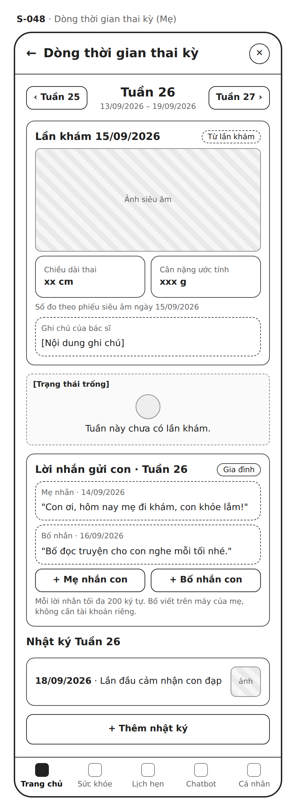

# Screen Spec: S-048 Pregnancy timeline

| Field | Value |
|---|---|
| Screen ID | `S-048` |
| Screen name | Pregnancy timeline (DBIZ2 name: Pregnancy Timeline (weekly)) |
| Actor | Mother (the father writes "Messages to Baby" on the mother's device) |
| Priority | Must — the "Messages to Baby" area (#14 – #19) is part of the Must item in the latest MVP Scope, **pending Client approval (D-03)** |
| Belongs to module | `spec-TML.md` |
| Mockup image | `img/S-048.png` |
| Status | Draft (revised 29/09/2026 — Messages to Baby per the latest MVP Scope) |

## 1. Purpose

View each gestational week: the actual visit in that week (ultrasound image, measurements from the report, doctor's note — seed data in the MVP, D-59) and the week's diary entries. The mother's and father's "Messages to Baby" are part of the Must item "Pregnancy Timeline & Baby Memory Journal" in the latest MVP Scope, pending Client approval (D-03); if the Client does not approve, #14 – #19 are removed. There is no system-generated weekly reference content (Tips, "Size of") `[PENDING CLIENT: D-02]`.

**Shown when:** the mother taps the gestational week card / "Pregnancy timeline ›" on Home `S-008` (belongs to the Home tab — D-30). Opens on the current week by default `[NEEDS CLARIFICATION: the drawing shows Week 26 while the current week is Week 28 — see §9 Q3]`.

**The user leaves this screen when:** she taps ←, ✕ (`S-083`), "+ Add diary entry" (popup `S-051`), or a tab.

## 2. Mockup

## 3. Element inventory

| # | Element | Type | Content / data source | Required | Validation |
|---|---|---|---|---|---|
| 1 | ← button | Button | navigation | Yes | — |
| 2 | Title "Pregnancy timeline" | Header | static | No | — |
| 3 | ✕ button | Button | close the sub-app (D-01) | Yes | — |
| 4 | "‹ Week 25" button | Button | previous week (`spec-TML.md` FR-002, D-04) | Yes | hidden / disabled on the first week `[NEEDS CLARIFICATION]` |
| 5 | "Week 26" + date range "13/09/2026 – 19/09/2026" | Text | Pregnancy Week Content — Week Info, date range (calculated from the EDD — `spec-ACC.md` Profile) | No | — |
| 6 | "Week 27 ›" button | Button | next week (FR-002) | Yes | maximum week limit `[NEEDS CLARIFICATION]` |
| 7 | Card "Visit 15/09/2026" + label "From visit" | Card header + Label | Visit — visit_date (`spec-HLT.md` §6, D-42); source label D-10 | No | — |
| 8 | "Ultrasound image" | Image | Visit — ultrasound_image | No | hidden when the visit has no image `[NEEDS CLARIFICATION: spec-TML.md Q10]` |
| 9 | "Fetal length — xx cm" | Text | Visit — fetal_length | No | — |
| 10 | "Estimated weight — xxx g" | Text | Visit — estimated_fetal_weight | No | — |
| 11 | "Measurements per ultrasound report dated 15/09/2026" | Text | Visit — ultrasound_report_date (`spec-TML.md` BR-003) | No | always shown with the measurements |
| 12 | "Doctor's note — [Note content]" | Text (card) | Visit — doctor_note | No | — |
| 13 | Empty state "No visit this week." | Empty state | when the week has no Visit (BR-003, D-04) | — | — |
| 14 | Card "Messages to Baby · Week 26" + label "Family" — Must item, **pending Client approval (D-03)** (applies to #14 – #19) | Card header | Family Message (`spec-TML.md` §6, FR-011) `[PENDING CLIENT: D-03]` | No | — |
| 15 | Message "From Mom · 14/09/2026 — "Baby, Mom had a check-up today and you are doing great!"" | Text (card) | Family Message — author = Mother, created_at, text | No | — |
| 16 | Message "From Dad · 16/09/2026 — "Dad will read you a story every night."" | Text (card) | Family Message — author = Father | No | — |
| 17 | "+ Message from Mom" button | Button | creates a Family Message with author = Mother (FR-011) | No | ≤ 200 characters (BR-004); input form not drawn `[NEEDS CLARIFICATION: spec-TML.md Q8]` |
| 18 | "+ Message from Dad" button | Button | creates a Family Message with author = Father | No | same as #17 |
| 19 | "Each message is limited to 200 characters. Dad writes on Mom's device and does not need a separate account." | Text | static (D-03) | No | — |
| 20 | Title "Diary · Week 26" | Header (section) | static | No | — |
| 21 | Diary entry "18/09/2026 · First time feeling the baby kick" + thumbnail | List item | Diary Entry — entry date, text (truncated), first Diary Image (`spec-TML.md` §6) | No | — |
| 22 | "+ Add diary entry" button | Button | opens popup `S-051` (FR-008) | Yes | — |
| 23 | 5-tab bar, "Home" selected | Toggle (tab) | navigation (D-30) | Yes | — |

## 4. States

| State | What the user sees | Trigger |
|---|---|---|
| Default (drawn) | a week with a visit, messages and diary entries (messages: pending Client approval, D-03) | screen opened / week changed |
| Week with no visit | the visit card is replaced by "No visit this week."; no system-generated measurements (BR-003) | the week has no Visit |
| Week with no messages / diary entries | `[NEEDS CLARIFICATION: not drawn — hide the card, or show it empty with the button]` | no Family Message / Diary Entry |
| Empty (no data) | as the two rows above | — |
| Loading | shared skeleton (D-27); adjacent weeks already prefetched (FR-004) | week changed |
| Error | shared error component + "Retry" (D-27) | loading the week failed |
| Success / confirmation | after a diary entry is saved: toast "Diary entry saved" (S-053), then back to this screen (FR-010) | save on `S-051` |

## 5. Interactions and navigation

| # | Element | User action | System response | Goes to screen |
|---|---|---|---|---|
| 1 | "‹ Week …" / "Week … ›" | tap | loads the previous / next week (FR-002, FR-003) | stays |
| 2 | "+ Message from Mom" / "+ Message from Dad" | tap | opens the message input `[NEEDS CLARIFICATION: input form not drawn]`; saves a Family Message | stays |
| 3 | Diary entry | tap | no edit or delete (D-60); `[NEEDS CLARIFICATION: whether a detail view opens — not drawn]` | — |
| 4 | "+ Add diary entry" | tap | opens the diary popup (linked to the current week — BR-005) | `S-051` |
| 5 | ← | tap | — | `S-008` |
| 6 | ✕ | tap | asks for confirmation to close the sub-app | `S-083` |
| 7 | Tab | tap | — | `S-008` / `S-023` / TCI app / `S-031` / `S-103` |

## 6. Screen-level rules

| Rule ID | Rule | Source |
|---|---|---|
| SR-001 | Week content comes only from actual visits (ultrasound image, measurements from the report with the report date, doctor's note). No system-generated weekly measurements, no Tips, no "Size of". | D-04; D-02 `[PENDING CLIENT: D-02]`; `spec-TML.md` BR-003 |
| SR-002 | Visit data is read-only; the mother cannot create / edit it. | `spec-TML.md` BR-001 |
| SR-003 | Each message ≤ 200 characters; the author is Mother or Father; the father writes on the mother's device and has no account of his own. | D-03 `[PENDING CLIENT: D-03]`; `spec-TML.md` BR-004 |
| SR-004 | A new diary entry is always linked to the current week, even while another week is being viewed. | `spec-TML.md` BR-005 |
| SR-005 | The visit card always carries the source label "From visit". | D-10 |

## 7. Linked requirements

| FR ID (from the module spec) | What this screen does for it |
|---|---|
| FR-002 (`spec-TML.md`) | Week navigation with arrows |
| FR-003 | Loads the week's data (Visit + diary entries + messages) |
| FR-004 | Prefetches adjacent weeks |
| FR-005 | The week's visit card |
| FR-006 | Personalization by the mother's gestational week |
| FR-008 | "+ Add diary entry" opens `S-051` |
| FR-011 (new, Must — pending Client approval) | "Messages to Baby" `[PENDING CLIENT: D-03]`; if the Client does not approve D-03: remove #14 – #19, FR-011 and the Family Message entity |
| FR-001, FR-007 | **Won't** — weekly Tips / reference content removed `[PENDING CLIENT: D-02]` |

## 8. Responsive and accessibility notes

- Smallest supported width: `[NEEDS CLARIFICATION: not specified]`.
- The two measurement fields (fetal length, estimated weight) stack vertically on narrow screens; so do the "+ Message from Mom" / "+ Message from Dad" buttons.
- The ultrasound image needs alternative text (e.g. "Ultrasound image, 15/09/2026").

## 9. Open questions

| # | Question | Blocking? | Status |
|---|---|---|---|
| 1 | Does the Client approve removing Tips (D-02) and adding "Messages to Baby" (D-03)? If D-02 is not approved, FR-001 / FR-007 return to Must and the screen must be redrawn; if D-03 is not approved, remove #14 – #19, `spec-TML.md` FR-011 and the Family Message entity. The latest MVP Scope lists "Messages to Baby" in the Must item, pending Client approval. | Yes | Open `[PENDING CLIENT: D-02]` `[PENDING CLIENT: D-03]` |
| 2 | Is a message linked to the week being viewed or to the current week (D-35); can messages be edited / deleted; limit on the number of messages per week; input form (see `spec-TML.md` Q8). | No | Open |
| 3 | Which week does the screen open on by default (the drawing shows Week 26; the current week is Week 28)? | No | Open |
| 4 | How is a week with several visits displayed; how is a visit missing an image / measurements displayed (see `spec-TML.md` Q10)? | No | Open |
| 5 | Where does Visit data come from in the MVP (demo seed data or an entry screen) (see `spec-HLT.md` Q14)? | No | Resolved (D-59): demo seed data, no entry screen |

---

## Completion checklist

- [x] The mockup is a separate cropped image file, named with the Screen ID.
- [x] Every visible element in the mockup appears in the element inventory.
- [x] Every input element has a validation rule or an explicit `[NEEDS CLARIFICATION]` (messages ≤ 200 characters).
- [x] All states are filled in, or marked `[NEEDS CLARIFICATION]` with a reason.
- [x] Every navigation target is a Screen ID that exists in the Screen List.
- [x] Every element that displays data names the field it displays, matching the module spec.
