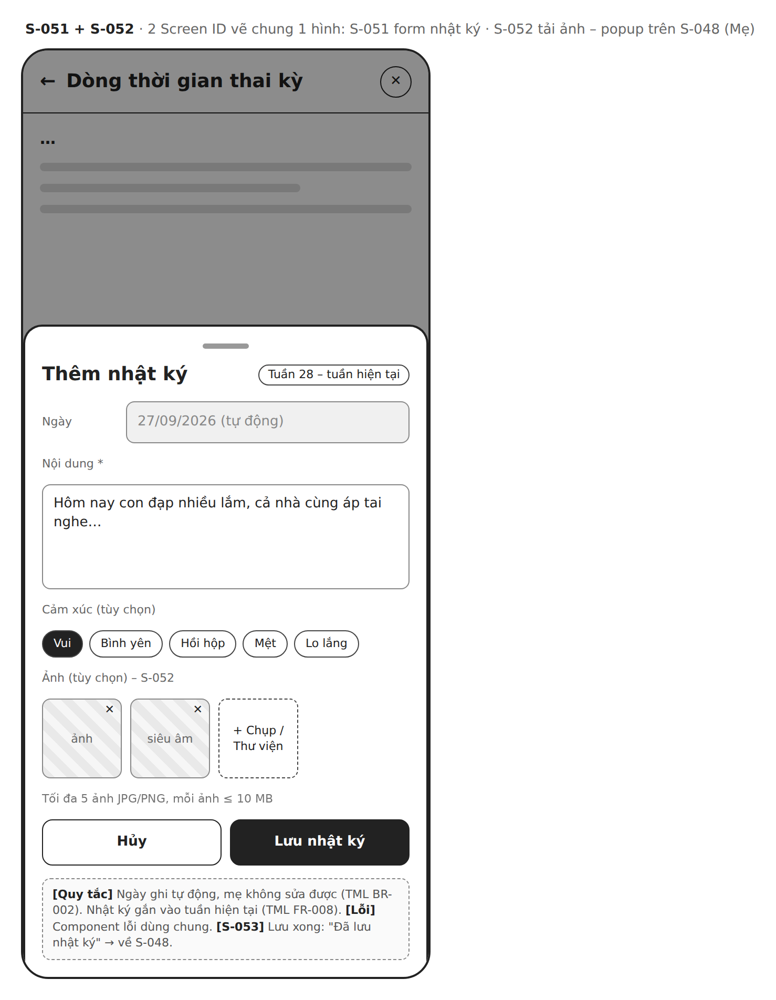

# Screen Spec: S-051 Add diary entry

| Field | Value |
|---|---|
| Screen ID | `S-051` + `S-052` (2 Screen IDs drawn in one image: S-051 diary form, S-052 photo upload) |
| Screen name | Add diary entry & Photo upload (DBIZ2 name: Add Diary Entry / Pregnancy Memory Upload Screen) |
| Actor | Mother |
| Priority | Must |
| Belongs to module | `spec-TML.md` |
| Mockup image | `img/S-051.png` |
| Spec for secondary ID | `screen-spec-S-052.md` + `img/S-052.png` — own full spec (D-55). S-052 = the photo upload area (#7 – #10). |
| Status | Draft |

## 1. Purpose

Popup in which the mother writes a diary entry for the week: content, mood (optional), photos (optional).

**Shown when:** the mother taps "+ Add diary entry" on `S-048` (the popup slides up, `S-048` is dimmed behind it).

**The user leaves this screen when:** she taps "Save diary entry" (after saving → toast "Diary entry saved" (S-053) → `S-048`), or "Cancel" (closes the popup without saving).

## 2. Mockup

## 3. Element inventory

| # | Element | Type | Content / data source | Required | Validation |
|---|---|---|---|---|---|
| 1 | Popup drag handle | Handle | navigation | No | — |
| 2 | Title "Add diary entry" | Header | static | No | — |
| 3 | Label "Week 28 – current week" | Label | Week Info = current week (`spec-TML.md` BR-005) | No | — |
| 4 | "Date" — "27/09/2026 (automatic)" | Text (read-only) | Diary Entry — entry date, set on save (BR-002) | — | not editable |
| 5 | "Content *" — multi-line field (e.g. "The baby kicked a lot today, the whole family put their ears close to listen…") | Textarea | Diary Entry — Text (FR-009) | Yes | not empty; maximum length `[NEEDS CLARIFICATION: spec-TML.md Q9]` |
| 6 | "Mood (optional)" — chips "Happy", "Calm", "Nervous", "Tired", "Worried" | Toggle (chip) | Diary Entry — Mood (FR-009) | No | single or multiple selection `[NEEDS CLARIFICATION: spec-TML.md Q9]` |
| 7 | "Photos (optional) – S-052" | Header (section) | static | No | — |
| 8 | Selected photos (2 tiles "photo", "ultrasound") with an ✕ button | Image thumbnail | Diary Image (`spec-TML.md` §6) | No | tap ✕ to remove the photo |
| 9 | "+ Take photo / Library" tile | Button | picks a photo from the camera or the library | No | up to **5 images**, ≤ **10 MB per image**, **JPG/PNG**, no video (D-46); hidden once 5 images are selected `[NEEDS CLARIFICATION]` |
| 10 | Caption "Up to 5 JPG/PNG images, each ≤ 10 MB" | Text | static (D-46) | No | — |
| 11 | "Cancel" button | Button (secondary) | closes the popup without saving | Yes | — |
| 12 | "Save diary entry" button | Button (primary) | saves the Diary Entry (FR-010) | Yes | enabled when Content is not empty |

Note: the "[Rule] … [Error] … [S-053] …" box on the drawing is an annotation; it is described in §4–§6.

## 4. States

| State | What the user sees | Trigger |
|---|---|---|
| Default (drawn) | automatic date, Content, Mood, 2 selected photos | popup opened |
| No photo selected | only the "+ Take photo / Library" tile | popup opened for the first time |
| Invalid photo | shared field error (D-27): over 10 MB / wrong format / more than 5 images `[NEEDS CLARIFICATION: wording]` | a selected photo violates D-46 |
| Empty (no data) | not applicable — input form | — |
| Loading | "Save diary entry" button processing; photos uploading `[NEEDS CLARIFICATION: not drawn]` | save tapped |
| Error | shared error component (D-27) | save failed |
| Success / confirmation | toast "Diary entry saved" (S-053), then back to `S-048` (FR-010) | save succeeded |

## 5. Interactions and navigation

| # | Element | User action | System response | Goes to screen |
|---|---|---|---|---|
| 1 | Mood chip | tap | select / deselect | stays |
| 2 | "+ Take photo / Library" | tap | opens the camera / library; checks D-46 | stays |
| 3 | ✕ on a photo | tap | removes the photo | stays |
| 4 | "Save diary entry" | tap | saves the Diary Entry + Diary Images, linked to the current week, with an automatic date (FR-010, BR-002, BR-005) | `S-048` (toast S-053) |
| 5 | "Cancel" / drag the popup down | tap / drag | closes without saving `[NEEDS CLARIFICATION: ask for confirmation when content has been entered?]` | `S-048` |

## 6. Screen-level rules

| Rule ID | Rule | Source |
|---|---|---|
| SR-001 | The diary entry date is recorded by the system on save; the mother cannot edit or backdate it. | `spec-TML.md` BR-002 |
| SR-002 | A diary entry is always linked to the current week, even when opened from another week on `S-048`. | `spec-TML.md` BR-005 |
| SR-003 | Photos: up to 5, ≤ 10 MB per image, JPG/PNG, no video. | D-46 |
| SR-004 | Content is required; mood and photos are optional. | `spec-TML.md` FR-009; MVP v8 ("mood tag (optional)", "attached photo (optional)") |

## 7. Linked requirements

| FR ID (from the module spec) | What this screen does for it |
|---|---|
| FR-008 (`spec-TML.md`) | Creates a diary entry for the current week |
| FR-009 | Enter content, mood, photos (S-052) |
| FR-010 | Saves, shows "Diary entry saved" (S-053), returns to `S-048` |

## 8. Responsive and accessibility notes

- Smallest supported width: `[NEEDS CLARIFICATION: not specified]`.
- Mood chips wrap to a new line on narrow screens; photo thumbnails are laid out in a grid.
- The ✕ button on a photo needs a large enough touch target and a readable label ("Remove photo").

## 9. Open questions

| # | Question | Blocking? | Status |
|---|---|---|---|
| 1 | Maximum length of Content; single or multiple Mood selection (see `spec-TML.md` Q9). | No | Open |
| 2 | Can a saved diary entry be edited / deleted? | No | Resolved (D-60): no — a saved entry is read-only in the MVP |
| 3 | Does the caption on the drawing (#10) show the D-46 limits? | No | Resolved — the caption reads "Up to 5 JPG/PNG images, each ≤ 10 MB" |
| 4 | Does "Cancel" ask for confirmation when content has been entered? | No | Open |

---

## Completion checklist

- [x] The mockup is a separate cropped image file, named with the Screen ID.
- [x] Every visible element in the mockup appears in the element inventory.
- [x] Every input element has a validation rule or an explicit `[NEEDS CLARIFICATION]`.
- [x] All states are filled in, or marked `[NEEDS CLARIFICATION]` with a reason.
- [x] Every navigation target is a Screen ID that exists in the Screen List.
- [x] Every element that displays data names the field it displays, matching the module spec.
