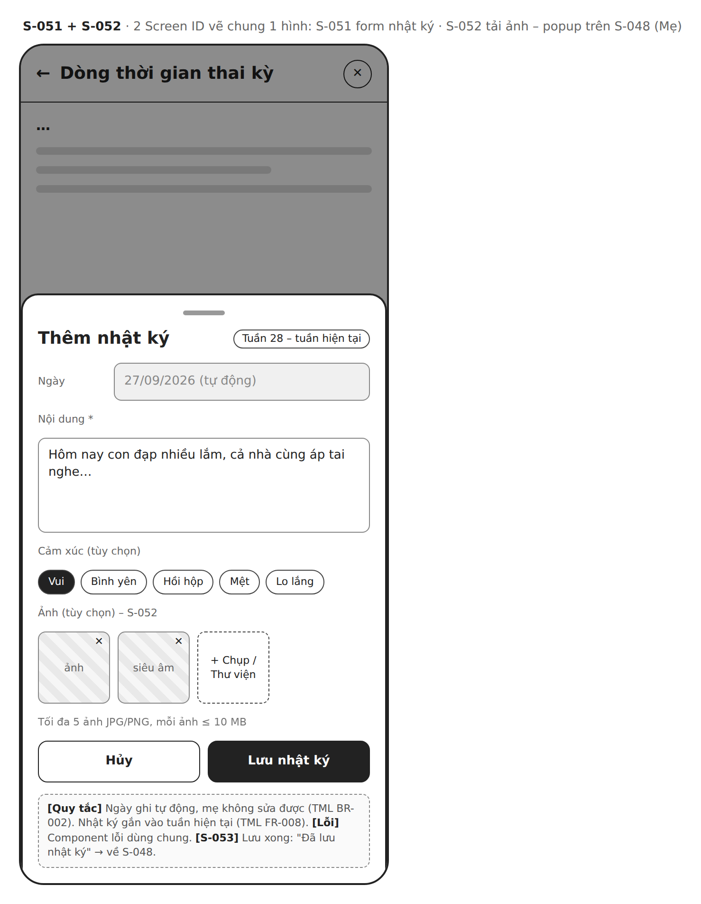

# Screen Spec: S-052 Diary photo upload

| Field | Value |
|---|---|
| Screen ID | `S-052` |
| Screen name | Diary photo upload (DBIZ2 name: Pregnancy Memory Upload Screen) |
| Actor | Mother |
| Priority | Must |
| Belongs to module | `spec-TML.md` |
| Mockup image | `img/S-052.png` — copy of `img/S-051.png`: S-051 (diary form) and S-052 (photo upload) are drawn in one "Add diary entry" popup. The S-052 part is the "Photos (optional) – S-052" area: the thumbnail grid and the "+ Take photo / Library" tile. |
| Related screens | `S-051` (diary form — same popup), `S-048` (weekly dashboard behind the popup), `S-053` (toast "Diary entry saved") |
| Status | Draft |

*The same elements are also described in `screen-spec-S-051.md` (#7 – #10); if the two files differ, raise it as an open question rather than choosing one.*

## 1. Purpose

Lets the mother attach photos (e.g. a photo, an ultrasound image) to a diary entry, from the camera or the photo library, and see / remove the selected photos before saving (`spec-TML.md` FR-009; DBIZ2 Figure 16 "Upload Ultrasound Images").

**Shown when:** the mother has opened "Add diary entry" (`S-051`) from `S-048`; the photo area is part of the popup.

**The user leaves this screen when:** she taps "Save diary entry" or "Cancel" on `S-051` (→ `S-048`). Picking a photo opens the camera / library of the phone and returns to this area.

## 2. Mockup

## 3. Element inventory

| # | Element | Type | Content / data source | Required | Validation |
|---|---|---|---|---|---|
| 1 | Section title "Photos (optional) – S-052" | Header (section) | static | No | — |
| 2 | Thumbnail grid — 2 selected photos on the mockup ("photo", "ultrasound") | Image thumbnails (grid) | Diary Image (`spec-TML.md` §6) — photos selected, not yet saved | No | up to **5** photos in total (D-46) |
| 3 | ✕ on each thumbnail | Button | removes that photo from the selection | No | — |
| 4 | "+ Take photo / Library" tile | Button | opens the photo source choice (#5) | No | hidden or disabled when 5 photos are selected `[NEEDS CLARIFICATION]` |
| 5 | Photo source choice "Take photo" / "Choose from library" | Picker (phone's own sheet) | camera or photo library of the phone | — | **Not drawn** — the tile label names the two sources; whether the app shows its own sheet or the phone's standard sheet `[NEEDS CLARIFICATION]` |
| 6 | Caption "Up to 5 JPG/PNG images, each ≤ 10 MB" | Text | static (D-46) | No | — |

Each selected photo is checked against: format **JPG or PNG**, size **≤ 10 MB**, total **≤ 5 images**, **no video** (D-46; `spec-TML.md` FR-009). The server also checks file type and size (DBIZ2 Figure 16 "Validate File Type & Size").

Not part of S-052 (described in `screen-spec-S-051.md`): title, week label, date, Content, Mood, "Cancel", "Save diary entry", annotation block.

## 4. States

| State | What the user sees | Trigger |
|---|---|---|
| Default — no photo | only the "+ Take photo / Library" tile | popup opened |
| Photos selected (drawn) | thumbnails with ✕ + the "+ Take photo / Library" tile | 1–4 photos selected |
| Limit reached | 5 thumbnails; the add tile hidden or disabled `[NEEDS CLARIFICATION]` | 5 photos selected |
| Empty (no data) | same as "Default — no photo"; photos are optional | — |
| Loading | photos uploading while saving; how progress is shown `[NEEDS CLARIFICATION: not drawn]` | "Save diary entry" tapped |
| Error | **invalid photo** (not JPG/PNG, over 10 MB, more than 5): shared field error (D-27), the photo is not added `[NEEDS CLARIFICATION: wording]`; **upload failed** while saving: shared error component + "Retry" (D-27); **no permission** to camera / library: `[NEEDS CLARIFICATION: not drawn]` | photo rejected; upload fails; permission denied |
| Success / confirmation | the entry and its photos are saved: toast "Diary entry saved" (`S-053`), back to `S-048` | save succeeds (`spec-TML.md` FR-010) |

## 5. Interactions and navigation

| # | Element | User action | System response | Goes to screen |
|---|---|---|---|---|
| 1 | "+ Take photo / Library" | tap | shows the choice "Take photo" / "Choose from library" (#5) | stays (phone camera / library) |
| 2 | "Take photo" / "Choose from library" | tap, pick a photo | checks D-46; adds the photo to the grid or shows the field error | stays |
| 3 | ✕ on a thumbnail | tap | removes the photo from the selection | stays |
| 4 | "Save diary entry" (on `S-051`) | tap | uploads the photos with the entry (FR-010) | `S-048` (toast `S-053`) |
| 5 | "Cancel" (on `S-051`) | tap | discards the selected photos | `S-048` |

## 6. Screen-level rules

| Rule ID | Rule | Source |
|---|---|---|
| SR-001 | Up to 5 photos per diary entry; each JPG or PNG and ≤ 10 MB; no video. | D-46; `spec-TML.md` FR-009 |
| SR-002 | Photos are optional; a diary entry can be saved without photos. | `spec-TML.md` FR-009; MVP v8 ("attached photo (optional)") |
| SR-003 | Photos are saved only together with the diary entry ("Save diary entry"); "Cancel" discards them. | `screen-spec-S-051.md` §5 |
| SR-004 | The server checks file type and size again before storing. | DBIZ2 Figure 16 ("Validate File Type & Size") |

## 7. Linked requirements

| FR ID (from the module spec) | What this screen does for it |
|---|---|
| FR-009 (`spec-TML.md`) | Attach photos / ultrasound images to the diary entry |
| FR-010 | Photos are saved with the entry; "Diary entry saved" (`S-053`) |

## 8. Responsive and accessibility notes

- Smallest supported width: `[NEEDS CLARIFICATION: not specified]`.
- Thumbnails are laid out in a grid that wraps to a new row on narrow screens.
- The ✕ on each thumbnail needs a large enough touch target and a readable label ("Remove photo"); each thumbnail needs a text alternative.

## 9. Open questions

| # | Question | Blocking? | Status |
|---|---|---|---|
| 1 | [NEEDS CLARIFICATION: is the "+ Take photo / Library" tile hidden or disabled when 5 photos are selected?] | No | Open |
| 2 | [NEEDS CLARIFICATION: the photo source choice (#5) is not drawn — app sheet or the phone's standard sheet?] | No | Open |
| 3 | [NEEDS CLARIFICATION: error wording for an invalid photo, and what is shown when camera / library permission is denied.] | No | Open |
| 4 | [NEEDS CLARIFICATION: how upload progress is shown while saving.] | No | Open |
| 5 | Does the caption (#6) show the D-46 limits (same as `screen-spec-S-051.md` §9 Q3)? | No | Resolved — the caption reads "Up to 5 JPG/PNG images, each ≤ 10 MB" |

---

## Completion checklist

- [x] The mockup is a separate image file, named with the Screen ID (copy of the shared image — D-55).
- [x] Every visible element in the mockup that belongs to S-052 appears in the element inventory (the photo source choice #5 is marked as not drawn).
- [x] Every input element has a validation rule (D-46 limits).
- [x] All five states are filled in, or marked `[NEEDS CLARIFICATION]` with a reason.
- [x] Every navigation target is a Screen ID that exists in the Screen List.
- [x] Every element that displays data names the field it displays, matching the module spec.
