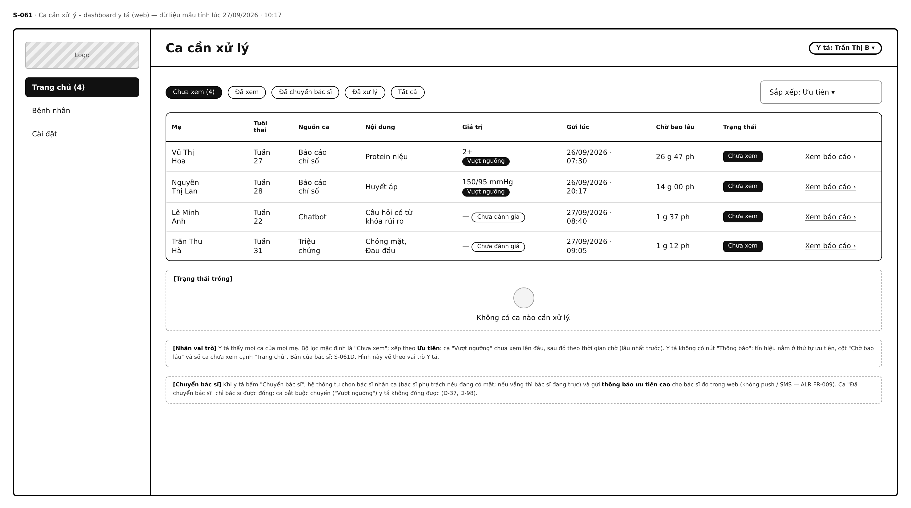

# Screen Spec: S-061 Cases to handle

| Field | Value |
|---|---|
| Screen ID | `S-061` |
| Screen name | Cases to handle — nurse dashboard, web (DBIZ2 name: Doctor Dashboard Screen). The doctor version is `S-061D` |
| Actor | Nurse (web) |
| Priority | Should |
| Belongs to module | `spec-CLI.md` |
| Mockup image | `img/S-061.png` (drawn for the Nurse role) — redrawn for v1.9.0-draft: no "Notifications" button, "Waiting" column, "Sort: Priority" |
| Status | Draft (revised 17/11/2026 — split of the Nurse and Doctor screens, D-103 – D-106 proposed; "Notifications" button and its list, D-107 proposed, see element #4; earlier: 29/09/2026 screen-spec fix #4, #9) |

> **v1.0.0 app (07/11/2026, D-80 – D-85):** Also opened filtered from the new Overview (`?flag=`); see the Overview and Case board in spec-CLI §7.3 (D-85).

> **Split of the Nurse and Doctor screens (17/11/2026, D-103 – D-106, proposed):** this file now describes the **Nurse** only. The Doctor version is `S-061D` (`screens/screen-spec-S-061D.md`). Rules come from `spec-CLI.md` v1.9.0-draft (BR-004, BR-010 – BR-013).

## 1. Purpose

Web home page for nurses: one table, at full width, combining every case created by any mother (metric reports, symptoms, chatbot), filtered by status and sorted by priority so that the nurse sees at once what to handle first (D-104). (The former quick-notes panel is removed — screen-spec fix #9, CLI-03.) Doctors use `S-061D`.

**Shown when:** a nurse signs in on the web (`S-054`, not drawn) or clicks "Home" in the sidebar.

**The user leaves this screen when:** they click "View report ›" on a row (→ `S-064`), "Patients" (`S-062`, not drawn) or "Settings" (not drawn).

## 2. Mockup

## 3. Element inventory

| # | Element | Type | Content / data source | Required | Validation |
|---|---|---|---|---|---|
| 1 | Logo | Image | static | No | — |
| 2 | Sidebar: "Home (n)" (selected), "Patients", "Settings" | Navigation | navigation; n = number of cases in status "Not viewed" (calculated, not stored) | Yes | — |
| 3 | Title "Cases to handle" | Header | static | No | — |
| 4 | "Notifications (n)" button | Button + badge | Number of cases waiting for a first look (status "Not viewed") — the same cases element #6 counts and the same the sidebar's "Home (n)" shows, which is what the mockup's "Notifications (2)" shows. Derived from Case, nothing stored, no read / unread state (DM-32; no push / SMS — ALR-03). Opens the notification list, built in the v1.0.0 app as `/staff/{id}/notifications` although S-059 has no mockup; it orders the cases above threshold (Threshold Rule) or with an alarm symptom (D-73) first, then the longest wait (**D-107, proposed — Chi to confirm**; `spec-CLI.md` §10 Q5, Q20). The Doctor version is on `S-061D`. **Disagreement to settle (Ánh / Chi).** D-105 (proposed) removes this button for the Nurse and puts the signal inside the list (Priority order, "Waiting" column, "Home (n)"); D-107 (proposed) keeps it as **one more way in to the same cases**, not a replacement — both signals are built in the v1.0.0 app and do not exclude each other. The app currently shows the button; remove it here if D-105 wins. | No | — |
| 5 | Role label "Nurse: Trần Thị B ▾" | Dropdown | Staff — role + full name (`spec-CLI.md` §6, D-28) | Yes | matches the signed-in user (BR-005) |
| 6 | Filters "Not viewed (n)", "Viewed", "Escalated to doctor", "Resolved", "All" | Toggle (chip, single select) | Case — status (D-18); count on "Not viewed" | Yes | default: **"Not viewed"** (D-102, proposed) — the first job of the nurse is the cases nobody has seen |
| 7 | "Sort: Priority ▾" | Dropdown | options **Priority** (default) and Newest. Priority: cases "Above threshold" and "Not viewed" first; then every other case by waiting time, longest first (SR-006) | No | one of the 2 values (D-104, proposed) |
| 8 | Table — "Mother" column (e.g. Nguyễn Thị Lan) | Table column | User Account — full name (`spec-ACC.md` §6) | — | — |
| 9 | "Gestational age" column (e.g. Week 28) | Table column | current gestational week (calculated from the EDD) | — | — |
| 10 | "Case source" column (Metric report / Symptom / Chatbot) | Table column | Case — `case_source` (D-41) | — | one of the 3 values |
| 11 | "Content" column (e.g. Blood pressure; Severe headache / dizziness / blurred vision; Question with a risk keyword; Urine protein — the image shows the D-23 example "Dizziness, Headache") | Table column | Metric Report — metric / symptoms[]; Chatbot case: the mother's question (Chat Message — text, `spec-BOT.md` §6) | — | — |
| 12 | "Value" column + threshold label (e.g. "150/95 mmHg — Above threshold"; "— Not assessed"; "2+ — Above threshold") | Table column + Label | Health Metric Record — value, unit; threshold_label from Threshold Rule (D-17, D-52) | — | "Not assessed" only when there is no measured value |
| 13 | "Submitted at" column (`dd/mm/yyyy · HH:mm`) | Table column | Metric Report — submitted_at / Case — created_at (Chatbot case) | — | — |
| 13A | "Waiting" column (e.g. "2 h 15 min") | Table column | time from `submitted_at` / `created_at` to now, for cases not "Resolved"; "—" for "Resolved"; calculated, not stored; no time limit and no colour threshold (D-85) | — | — |
| 14 | "Status" column | Label | Case — status (D-18) | — | — |
| 15 | "View report ›" link on each row | Link | opens the case | Yes | — |
| 16 | Empty state "No cases to handle." | Empty state | when the filter has no cases | — | — |
| 17 | *(Removed — screen-spec fix #9, CLI-03)* "Quick notes" panel — not drawn and not built (not in MVP v8; `spec-CLI.md` FR-011 Won't) | — | — | — | — |
| 18 | *(Removed — screen-spec fix #9)* "Write a note…" field + "Auto-saved" | — | — | — | — |

Note: the "[Role label] …" and "[Escalate to doctor] …" boxes in the mockup are annotations, described in §6. The mother names in the mockup are sample data.

## 4. States

| State | What the user sees | Trigger |
|---|---|---|
| Default (shown in mockup) | case table per filter, at full width | screen opens |
| Nurse role, default *(D-102, proposed)* | the table opens with the filter **"Not viewed"** — the cases waiting for the nurse; she can switch to "All" and the other statuses | screen opens without a filter |
| Doctor role | not on this screen — see `S-061D` | — |
| Empty (no data) | "No cases to handle." | the filter has no cases |
| Loading | shared skeleton (D-27) | table loading |
| Error | shared error component + "Retry" (D-27) | loading fails |
| Success / confirmation | not applicable — the list screen has no save action; case actions are confirmed on `S-064` | — |

## 5. Interactions and navigation

| # | Element | User action | System response | Goes to screen |
|---|---|---|---|---|
| 1 | Status chip | click | filters the table (`spec-CLI.md` FR-002, FR-020) | stays |
| 2 | "Sort" | select | re-sorts the table | stays |
| 3 | "View report ›" | click | opens the quick profile with the case's Report block (FR-006) | `S-064` |
| 4 | *(Removed — Quick notes, screen-spec fix #9)* | — | — | — |
| 5 | *(Removed — Quick notes, screen-spec fix #9)* | — | — | — |
| 6 | "Notifications" | click | opens the notification list of the signed-in nurse: the cases "Not viewed", above threshold or with an alarm symptom first (D-107, proposed; removed for the Nurse by D-105 — see element #4) | `S-059` |
| 7 | Sidebar "Patients" / "Settings" | click | — | `S-062` / `[NEEDS CLARIFICATION: no ID yet]` |
| 8 | Role label ▾ | click | `[NEEDS CLARIFICATION: account menu not drawn]` | — |

## 6. Screen-level rules

| Rule ID | Rule | Source |
|---|---|---|
| SR-001 | The header always shows the correct role + name of the signed-in user. | D-28; `spec-CLI.md` BR-005 |
| SR-002 | One table combines cases from 3 sources; statuses use the same names as on the mother's side. | D-18, D-41 |
| SR-003 | Threshold labels are only Normal / Above threshold / Not assessed; "Not assessed" only for cases without a measured value. | D-15, D-17 |
| SR-004 | When a nurse clicks "Escalate to doctor" (on `S-064`), the case becomes "Escalated to doctor" and the system chooses the receiving doctor by BR-011 — the nurse does not choose; only a doctor can close this case. A nurse sees all cases and all mothers (BR-010). | D-29, D-37, D-43 as revised; D-96, D-97 (proposed); `spec-CLI.md` BR-004, BR-010, BR-011 |
| SR-005 | Status only moves forward (D-43); the table always shows the case's current status. | D-43 |
| SR-006 | Priority order: cases whose threshold label is "Above threshold" and whose status is "Not viewed" come first; every other case follows by waiting time, longest first. Only the order changes — no new status, no time limit. | D-104 (proposed); D-85 |

## 7. Linked requirements

| FR ID (from the module spec) | What this screen does for it |
|---|---|
| FR-001 (`spec-CLI.md`) | Loads the dashboard |
| FR-002, FR-020 | Case table, filtering by status, Priority order, "Waiting" column |
| FR-006 | "View report ›" opens `S-064` |
| FR-008 (`spec-ALR.md`) | "Not viewed" queue |

## 8. Responsive and accessibility notes

- Web screen; minimum width `[NEEDS CLARIFICATION: not specified]`. The case table uses the full width; on narrow screens columns may scroll horizontally `[NEEDS CLARIFICATION]`.
- Statuses and threshold labels must have text, not rely on background colour alone.

## 9. Open questions

| # | Question | Blocking? | Status |
|---|---|---|---|
| 1 | Default filter when the screen opens. | No | Decided 17/11/2026 (D-102, proposed): nurse "Not viewed", doctor "Escalated to doctor" (`spec-CLI.md` Q5) |
| 2 | Does the nurse see all cases or only assigned cases; which escalated cases does a given doctor see. | No | Resolved (D-96, proposed; `spec-CLI.md` BR-010) — a nurse sees all cases; a doctor sees his own mothers' cases, the cases routed to him, and — while on duty — the mothers of an Away doctor (`S-061D`) |
| 3 | Are quick notes per person or shared by the shift. | No | Resolved — not applicable: Quick notes removed (screen-spec fix #9, CLI-03) |
| 4 | The web "Notifications" (S-059), "Patients" (S-062) and "Settings" screens are not drawn. | No | Open — S-059 is **built** in the v1.0.0 app for both roles (D-107, content in `spec-CLI.md` §10 Q20); a mockup is still missing. S-062 and Settings unchanged |
| 5 | What does the "Notifications (n)" button show for a nurse? | No | **Two proposals, to settle.** D-105 (Ánh): hide the button for the Nurse; the signal is the Priority order, the "Waiting" column and the count on "Home (n)". D-107 (Trung): show it, counting the cases "Not viewed" — the same cases, one more way in, and it is what the mockup drawn for the Nurse shows. Both are built; the app shows the button. Owner: UX/UI (Chi) with Ánh |

---

## Completion checklist

- [x] The mockup is a separate cropped image file, named with the Screen ID.
- [x] Every visible element in the mockup appears in the element inventory.
- [x] Every input element has a validation rule — no input fields remain after removing Quick notes; filters only.
- [x] All states are filled in, or marked `[NEEDS CLARIFICATION]` with a reason.
- [x] Every navigation target is a Screen ID that exists in the Screen List, or flagged `[NEEDS CLARIFICATION]`.
- [x] Every element that displays data names the field it displays, matching the module spec.

## Clinical web UI review — 11/11/2026

User requested matching the Overview’s restrained desktop style on Case board and Case list, preserving status-column order and all table fields. Shared desktop margins and source/date filter layout; board uses neutral column borders, consistent headers/counts and card footers. List uses explicit column widths, no-wrap week/action cells, consistent compact status tags and local horizontal scrolling on smaller screens. Existing filters, targets, case ordering and clinical rules are unchanged. Downstream: `templates/staff_base.html`, `_staff_filters.html`, `staff_board.html`, `cases.html`, and `static/staff.css`. No data-model, schema or seed changes.
