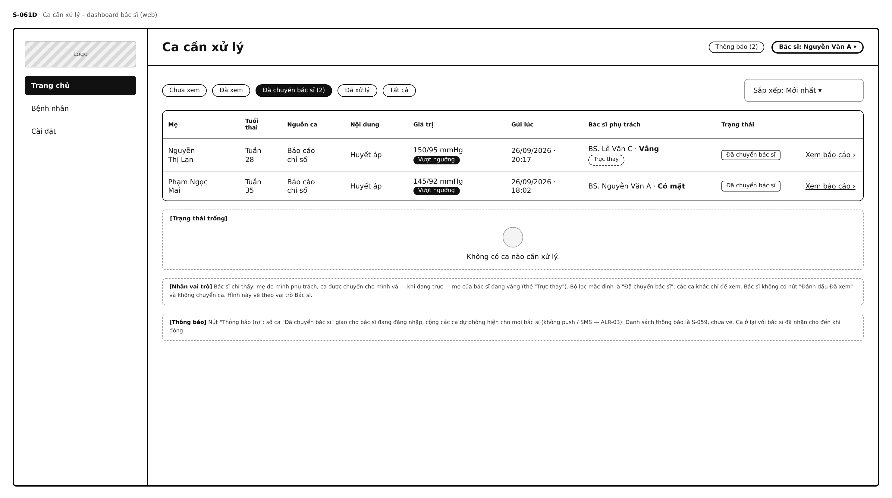

# Screen Spec: S-061D Cases to handle — Doctor

| Field | Value |
|---|---|
| Screen ID | `S-061D` (Doctor version of `S-061`; the "D" suffix follows the precedent of `S-025A`) |
| Screen name | Cases to handle — doctor dashboard, web (DBIZ2 name: Doctor Dashboard Screen) |
| Actor | Doctor (web) |
| Priority | Should |
| Belongs to module | `spec-CLI.md` |
| Mockup image | `img/S-061D.png` — drawn (same layout as `S-061`, with the differences listed in §3) |
| Status | Draft (created 17/11/2026 — split of the Nurse and Doctor screens, D-103 – D-106 proposed) |

> **Split of the Nurse and Doctor screens (17/11/2026, D-103 – D-106, proposed):** this file was split out of `screen-spec-S-061.md`, which now describes the Nurse only. Rules come from `spec-CLI.md` v1.9.0-draft (BR-004, BR-010, BR-011).

## 1. Purpose

Web home page for doctors: one table with the cases a doctor is allowed to see (BR-010), opened on the filter "Escalated to doctor", showing for each case who the mother's responsible doctor is and whether he is Available or Away, so that a doctor on duty knows whose mothers he is covering. The doctor receives escalated cases here and opens them on `S-064D`.

**Shown when:** a doctor signs in on the web (`S-060`, not drawn) or clicks "Home" in the sidebar.

**The user leaves this screen when:** they click "View report ›" on a row (→ `S-064D`), "Patients" (`S-062`, not drawn), "Settings" (not drawn), or "Notifications" (`S-059`, not drawn).

## 2. Mockup

## 3. Element inventory

Rows marked "as `S-061` #n" are the same shared block as in the Nurse screen.

| # | Element | Type | Content / data source | Required | Validation |
|---|---|---|---|---|---|
| 1 | Logo | Image | static | No | — |
| 2 | Sidebar: "Home" (selected), "Patients", "Settings". No guidance-template editor in the MVP (D-106) | Navigation | navigation | Yes | — |
| 3 | Title "Cases to handle" | Header | static | No | — |
| 4 | "Notifications (n)" button + badge | Button + badge | n = number of cases in status "Escalated to doctor" whose `assigned_doctor_id` is the signed-in doctor, plus the fail-safe cases visible to every doctor (BR-011 steps 3 and 4) — derived from Case, not stored, no read / unread state (`spec-ALR.md` FR-009, DM-32, D-68; no push / SMS — ALR-03). The notification list has no mockup but is **built** in the v1.0.0 app as `/staff/{id}/notifications`: one line per case, each naming the nurse who escalated it and when (Case Status History), the cases he has not answered yet first (D-109, proposed; `spec-CLI.md` §10 Q20) | No | — |
| 5 | Role label "Doctor: Nguyễn Văn A ▾" | Dropdown | Staff — role + full name (`spec-CLI.md` §6, D-28) | Yes | matches the signed-in user (BR-005) |
| 6 | Filters "Not viewed", "Viewed", "Escalated to doctor (n)", "Resolved", "All" | Toggle (chip, single select) | Case — status (D-18); count on "Escalated to doctor" | Yes | default: **"Escalated to doctor"** (CLI-02); the doctor may switch filters to view other cases, but can act only on escalated cases |
| 7 | "Sort: Newest ▾" | Dropdown | order by submission time | No | only "Newest" `[NEEDS CLARIFICATION: does the doctor need the Priority order of the Nurse screen? §9 Q1]` |
| 8 | "Mother" column | Table column | as `S-061` #8 | — | — |
| 9 | "Gestational age" column | Table column | as `S-061` #9 | — | — |
| 10 | "Case source" column (Metric report / Symptom / Chatbot) | Table column | Case — `case_source` (D-41) | — | one of the 3 values |
| 11 | "Content" column | Table column | as `S-061` #11 | — | — |
| 12 | "Value" column + threshold label | Table column + Label | Health Metric Record — value, unit; threshold_label (D-17, D-52) | — | "Not assessed" only when there is no measured value |
| 13 | "Submitted at" column (`dd/mm/yyyy · HH:mm`) | Table column | as `S-061` #13 | — | — |
| 14 | "Responsible doctor" column (e.g. "Dr. Lê Văn C · Away") + the tag "Covering" when the signed-in doctor is on duty for an Away doctor | Table column + Label | Patient Assignment → Staff — name, availability; Staff — `on_duty` (`spec-CLI.md` FR-027, D-68, BR-010) | — | availability is Available or Away; "No responsible doctor" when none |
| 15 | "Status" column | Label | Case — status (D-18) | — | — |
| 16 | "View report ›" link on each row | Link | opens the case | Yes | — |
| 17 | Empty state "No cases to handle." | Empty state | when the filter has no cases | — | — |

## 4. States

| State | What the user sees | Trigger |
|---|---|---|
| Default (shown in mockup) | case table on the filter "Escalated to doctor": the cases routed to this doctor and the cases of his own mothers | a doctor signs in |
| Doctor on duty, covering | in addition, the cases and mothers of an Away doctor, with the tag "Covering" and "Dr. … · Away" in the "Responsible doctor" column (BR-010) | the signed-in doctor is on duty and the responsible doctor is Away |
| Fail-safe cases | cases with no responsible doctor, or when nobody is on duty, are visible to every doctor (BR-011 step 4) | BR-011 step 4 |
| Empty (no data) | "No cases to handle." | the filter has no cases |
| Loading | shared skeleton (D-27) | table loading |
| Error | shared error component + "Retry" (D-27) | loading fails |
| Success / confirmation | not applicable — case actions are confirmed on `S-064D` | — |

## 5. Interactions and navigation

| # | Element | User action | System response | Goes to screen |
|---|---|---|---|---|
| 1 | Status chip | click | filters the table (`spec-CLI.md` FR-002, FR-020) | stays |
| 2 | "Sort" | select | re-sorts the table | stays |
| 3 | "View report ›" | click | opens the quick profile with the case's Report block (FR-006) | `S-064D` |
| 4 | "Notifications" | click | opens the list of the cases escalated to this doctor, with the escalating nurse and the time; the ones he has not answered yet first (D-109, proposed) | `S-059` |
| 5 | Sidebar "Patients" / "Settings" | click | the Patients list shows his own mothers and, while on duty, the mothers of an Away doctor (BR-010) | `S-062` / `[NEEDS CLARIFICATION: no ID yet]` |
| 6 | Role label ▾ | click | `[NEEDS CLARIFICATION: account menu not drawn]` | — |

## 6. Screen-level rules

| Rule ID | Rule | Source |
|---|---|---|
| SR-001 | The header always shows the correct role + name of the signed-in user. | D-28; `spec-CLI.md` BR-005 |
| SR-002 | One table combines cases from 3 sources; statuses use the same names as on the mother's side. | D-18, D-41 |
| SR-003 | Threshold labels are only Normal / Above threshold / Not assessed. | D-15, D-17 |
| SR-004 | Visibility (BR-010): a doctor sees the cases of the mothers he is responsible for, the cases routed to him by BR-011, and — while on duty — the mothers of an Away doctor. A case with no receiving doctor is visible to every doctor. | D-96, D-97 (proposed); `spec-CLI.md` BR-010, BR-011 |
| SR-005 | The doctor can act only on cases "Escalated to doctor" (Send guidance, Close case on `S-064D`); he does not "Mark as viewed" and does not escalate. | D-37, D-43 as revised; `spec-CLI.md` CLI-02, BR-004 |
| SR-006 | A case stays with the doctor who received it until it is closed, even if the responsible doctor becomes Available again. | `spec-CLI.md` BR-011 |

## 7. Linked requirements

| FR ID (from the module spec) | What this screen does for it |
|---|---|
| FR-001 (`spec-CLI.md`) | Loads the dashboard |
| FR-002, FR-020 | Case table, filtering by status |
| FR-006 | "View report ›" opens `S-064D` |
| FR-027 | Responsible doctor and availability in the table |
| FR-009 (`spec-ALR.md`) | "Notifications" badge: cases escalated to this doctor |

## 8. Responsive and accessibility notes

- Web screen; minimum width `[NEEDS CLARIFICATION: not specified]`. The case table uses the full width; on narrow screens columns may scroll horizontally `[NEEDS CLARIFICATION]`.
- Statuses, threshold labels and "Available / Away" must have text, not rely on background colour alone.

## 9. Open questions

| # | Question | Blocking? | Status |
|---|---|---|---|
| 1 | Does the doctor need the Priority order and the "Waiting" column of the Nurse screen (`S-061` D-104)? Proposal: no, the doctor's list is already limited to escalated cases. | No | Open |
| 2 | The web "Notifications" (`S-059`), "Patients" (`S-062`) and "Settings" screens are not drawn. | No | Open for the mockups. List content of `S-059`: **answered** (D-109, proposed; `spec-CLI.md` §10 Q20) and built in the v1.0.0 app |
| 3 | Which doctor receives an escalated case. | No | Resolved (D-97, proposed; `spec-CLI.md` BR-011) |

---

## Completion checklist

- [x] The mockup is a separate cropped image file, named with the Screen ID (`img/S-061D.png`, drawn).
- [x] Every visible element in the mockup appears in the element inventory.
- [x] Every input element has a validation rule — filters and sort only.
- [x] All states are filled in, or marked `[NEEDS CLARIFICATION]` with a reason.
- [x] Every navigation target is a Screen ID that exists in the Screen List, or flagged `[NEEDS CLARIFICATION]` (`S-064D` is new and must be added to the Screen List).
- [x] Every element that displays data names the field it displays, matching the module spec.
