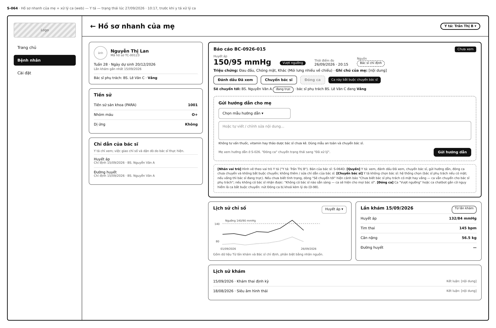

# Screen Spec: S-064 Mother quick profile

> **Split of the Nurse and Doctor screens (17/11/2026, D-103 – D-106, proposed):** this file now describes the **Nurse** only. The Doctor version is `S-064D` (`screens/screen-spec-S-064D.md`): handling an escalated case, Doctor's instructions, guidance. Rules come from `spec-CLI.md` v1.9.0-draft (BR-004, BR-010 – BR-013).

| Field | Value |
|---|---|
| Screen ID | `S-064` |
| Screen name | Mother quick profile + case handling, web — Nurse (DBIZ2 name: Patient Snapshot Screen). The doctor version is `S-064D` |
| Actor | Nurse (web) |
| Priority | Should |
| Belongs to module | `spec-CLI.md` |
| Mockup image | `img/S-064.png` (drawn for the Nurse role) — snapshot at 26/09/2026 · 20:18, before the nurse handled Lan's case, so the case shows "Not viewed"; after handling it shows "Resolved" (`S-026`, `S-061`). The "Chatbot case" Report block is not drawn. **To be redrawn for v1.9.0-draft:** no Doctor's-instruction form, "Responsible doctor" line, "Will be sent to" line, hint under the guidance field |
| Status | Draft (revised 17/11/2026 — split of the Nurse and Doctor screens, D-103 – D-106 proposed; earlier: 29/09/2026 screen-spec fix #3, #4, #10) |

## 1. Purpose

Quick profile of one mother together with the handling block for the open case: enough context for the nurse to decide whether to handle the case herself or escalate it to a doctor. The Doctor version (handle an escalated case, assign metrics to monitor) is `S-064D`.

**Shown when:** the nurse clicks "View report ›" on `S-061`.

**The user leaves this screen when:** they click "←" (back to `S-061`) or a sidebar item.

## 2. Mockup

## 3. Element inventory

| # | Element | Type | Content / data source | Required | Validation |
|---|---|---|---|---|---|
| 1 | Sidebar: "Home", "Patients" (selected), "Settings" | Navigation | navigation | Yes | — |
| 2 | "← Mother quick profile" | Header + Button | back to `S-061` | Yes | — |
| 3 | Role label "Nurse: Trần Thị B ▾" | Dropdown | Staff — role + full name (D-28) | Yes | — |
| 4 | Profile card: photo, "Nguyễn Thị Lan", "Medical record number TC-00123", "Week 28 · Due date 20/12/2026", "Last visit 15/09/2026" | Card | User Account (full name, medical record number); Profile (EDD, gestational week); latest Visit (`spec-CLI.md` FR-007) | No | — |
| 4A | Line in the profile card: "Responsible doctor: Dr. [name] · Available / Away" | Text + Label | Patient Assignment → Staff — name, availability (`spec-CLI.md` FR-027, D-68) | No | shows "No responsible doctor" when the mother has none |
| 5 | "Medical history": Obstetric history (PARA) 1001; Blood type O+; Allergies None | Card | Patient Clinical Profile (`spec-HLT.md` §6, D-42) | No | — |
| 6 | "Doctor's instructions" (read-only for the nurse) | Card | Watch-Flag (`spec-HLT.md` §6) | No | no "Edit" and no form for the nurse (D-29) |
| 7 | Instruction rows "Blood pressure — Assigned 15/09/2026 · Dr. Nguyễn Văn A"; "Blood glucose — …" (no "Edit" link for the nurse) | List item | Watch-Flag — metric, flagged_at, flagged_by | No | — |
| 8 | *(Moved to `S-064D` — D-103)* "Add / edit instruction" form, "Metric to monitor" | — | — | — | — |
| 9 | *(Moved to `S-064D`)* "Note for the mother" textarea | — | — | — | — |
| 10 | *(Moved to `S-064D`)* "Above-threshold guidance" template + custom text | — | — | — | — |
| 11 | *(Moved to `S-064D`)* "Cancel" / "Save instruction" | — | — | — | — |
| 12 | "Report BC-0926-015" block + status label "Not viewed" | Card header + Label | Metric Report — report_code; Case — status. Chatbot case: code per `spec-ALR.md` Q16 | No | — |
| 13 | "Blood pressure — 150/95 mmHg — Above threshold"; "Measured at 26/09/2026 · 20:15"; "Source — Doctor-assigned" | Text + Label | Health Metric Record — value, unit, measured_at, source; threshold_label (D-17). **Chatbot case:** replaced by "Question: [the mother's question]" + "Sent `dd/mm/yyyy · HH:mm`" + source "Chatbot" (Chat Message — text, sent_at; not drawn) | No | — |
| 14 | "Symptoms: Severe headache / dizziness / blurred vision, Other (Back ache worse in the afternoon) · Mother's note: [content]" (the image shows the D-23 example) | Text | Metric Report — symptoms[], other_symptom_text, note. Hidden for a chatbot case | No | — |
| 15 | "Mark as viewed" button | Button | Case → "Viewed" (`spec-ALR.md` FR-004; `spec-CLI.md` FR-004) | No | **nurse only** — not shown to doctors (D-43 as revised); hidden once the case is past "Viewed" `[NEEDS CLARIFICATION]` |
| 16 | "Escalate to doctor" button | Button | Case → "Escalated to doctor" + high-priority notification (`spec-CLI.md` FR-019; `spec-ALR.md` FR-009) | No | nurse only; not shown to doctors |
| 16A | Line under "Escalate to doctor": "Will be sent to: Dr. [name] · Available / Away". Fail-safe warnings: (a) availability unknown: "Availability of the responsible doctor is not known — the case goes to him."; (b) no doctor can take it: "No doctor is available — the case will be visible to every doctor." | Text + Label | the receiving doctor resolved by BR-011 (`spec-CLI.md` FR-026, FR-027); Staff — name, availability, on_duty | No | warning wording `[NEEDS CLARIFICATION: confirm with the team]`; the nurse does not choose the doctor |
| 17 | "Close case" button | Button | Case → "Resolved" (FR-016) | No | nurse: only cases that are **not escalated** and **not must-escalate** (BR-012). Hidden when the case is "Escalated to doctor" (D-37); **disabled with a tooltip** when the case is "Above threshold" or a chatbot case flagged danger: "This case must be escalated to a doctor" (D-98, proposed) |
| 18 | "Send guidance to the mother": "Choose a guidance template ▾" + "Or write / edit the text…" + "Send guidance" button + the sentence "The mother sees the guidance on S-026. "Close case" moves the status to "Resolved"." | Dropdown + Textarea + Button | Staff Response {template_id, custom_text} (`spec-CLI.md` FR-024; `spec-ALR.md` §6) | — | at least one of template / custom text; custom text ≤ **1000 characters** (D-46) |
| 18A | Hint under the guidance field: "Do not advise on medicines, vitamins or herbal products that no doctor prescribed. Use the safe template and escalate to the doctor." | Text | BR-013 (D-99, proposed): the nurse only restates what a doctor wrote in the system; safe template: "Your question has been passed to your doctor. Please do not start, stop or change any medicine, vitamin or herbal product until the doctor replies." The template list is empty in the MVP (only seed examples marked illustrative) | — | — |
| 19 | "Metric history" + "Blood pressure ▾" + chart with a "Threshold 140/90 mmHg" line (on-screen text; means systolic ≥ 140 or diastolic ≥ 90 mmHg — D-14), axis 01/09/2026 – 26/09/2026 + the sentence "Includes From visit and Doctor-assigned data, distinguished by source label." | Chart | Health Metric Record per metric — **only "From visit" and "Doctor-assigned" data** (no Self-entered data, CLI-01); Threshold Rule (FR-008, D-52) | No | — |
| 20 | "Visit 15/09/2026" + label "From visit": Blood pressure 132/84 mmHg; Fetal heart rate 145 bpm; Weight 56.5 kg; Blood glucose — | Card | Visit + Health Metric Record with source "From visit" (FR-010) | No | — |
| 21 | *(Removed — screen-spec fix #10, CLI-01)* "Self-tracked metrics" card — not drawn and not built: the mother's self-tracked metrics are for her own reference and are not shown to clinical staff | — | — | — | — |
| 22 | "Visit history": "15/09/2026 · Routine antenatal check-up — Conclusion: [content]"; "18/08/2026 · Anomaly scan — Conclusion: [content]" | List | Visit — visit_date, visit_type, conclusion (FR-010) | No | — |

Note: the "Escalate to doctor: … Close case: …" box below the 3 buttons and the "[Role label] … [Permissions] …" box in the mockup are annotations, described in §6.

## 4. States

| State | What the user sees | Trigger |
|---|---|---|
| Default — Nurse role (shown in mockup) | all blocks; no "Edit" and no instruction form; "Escalate to doctor" present | a nurse opens a case |
| Doctor role | not on this screen — see `S-064D` | — |
| Case "Escalated to doctor", Nurse role | "Close case" hidden / disabled (D-37); the case shows a red flag (D-44) `[NEEDS CLARIFICATION: how the red flag is displayed is not drawn]` | the case has been escalated |
| Must-escalate case, Nurse role | "Close case" is disabled with the tooltip "This case must be escalated to a doctor"; "Escalate to doctor" is available (BR-012) | threshold label "Above threshold", or a chatbot case flagged danger |
| Escalation with a fail-safe | the line under "Escalate to doctor" shows warning (a) or (b) of element 16A; the escalation still goes through (BR-011) | availability unknown, or no doctor available |
| Case "Resolved" | handling buttons hidden / disabled `[NEEDS CLARIFICATION: not drawn]` | the case is closed |
| Chatbot case (not drawn) | the Report block shows the mother's question + sent time + source "Chatbot" in place of the value / threshold / symptoms (#13, #14), followed by the **conversation transcript** — every question and answer of the same conversation in time order, the escalated question highlighted, read-only (`spec-CLI.md` FR-003, BR-009, D-78); status label, handling buttons and "Send guidance" are the same as for a report; the metric history (#19) shows the default metric | `case_source` = Chatbot (screen-spec fix #3) |
| Empty (no data) | each empty block uses the shared empty template (D-27) | the mother has no visits / metrics yet |
| Loading | shared skeleton (D-27) | screen opens |
| Error | shared error component + "Retry" (D-27) | loading / saving fails |
| Success / confirmation | the new status appears immediately on the Report block label; toast `[NEEDS CLARIFICATION: wording]` | action succeeds |

## 5. Interactions and navigation

| # | Element | User action | System response | Goes to screen |
|---|---|---|---|---|
| 1 | "Mark as viewed" | click | Case → Viewed; recorded in status_history (D-43) | stays |
| 2 | "Escalate to doctor" (nurse) | click | Case → Escalated to doctor ("Viewed" recorded automatically if missing — D-43); the system resolves the receiving doctor by BR-011 (responsible doctor if Available; otherwise the on-duty doctor; fail-safes (a) / (b)); high-priority notification to him inside the clinical web (`spec-ALR.md` FR-009; not stored, DM-32); the mother receives a notification (`spec-ALR.md` FR-018) | stays |
| 3 | "Close case" | click | Case → Resolved (nurse: not escalated and not must-escalate — D-37, BR-012); the mother receives a notification | stays |
| 4 | "Send guidance" | click | saves the Staff Response; the mother sees it on `S-026`; **no status change** (D-37) | stays |
| 5 | *(Moved to `S-064D`)* | — | — | — |
| 6 | "Blood pressure ▾" (Metric history) | select | changes the metric on the chart | stays |
| 7 | "←" | click | — | `S-061` |

## 6. Screen-level rules

| Rule ID | Rule | Source |
|---|---|---|
| SR-001 | Role-based permissions for the Nurse: view; Mark as viewed; Escalate to doctor; Send guidance (without advising on medicines no doctor prescribed); Close case only for cases not escalated and not must-escalate. The nurse does **not** add or edit Doctor's instructions and does **not** create or edit guidance templates. | D-29, D-37, D-43 as revised, D-98, D-99 (proposed); `spec-CLI.md` BR-004, BR-012, BR-013 |
| SR-002 | "Send guidance" does not change the status; only "Close case" moves it to "Resolved". | D-37 |
| SR-003 | Every value is shown with a source label. | D-10 |
| SR-004 | If there is no above-threshold guidance, S-028 uses the hospital's default template. | D-24 |
| SR-005 | No Call / Message / SpO2 / "via Bluetooth" / document links / "Risk Level" on this screen. | `spec-CLI.md` §1 Out of scope |
| SR-006 | For a chatbot case the whole conversation of the escalated question is shown, so the mother does not have to repeat herself; other conversations of the mother are not shown. | `spec-CLI.md` BR-009; D-78 |
| SR-007 | A case is must-escalate when its threshold label is "Above threshold" or it is a chatbot case flagged danger; the nurse can only escalate it. The list is waiting for the Client's confirmation. | D-98 (proposed); `spec-CLI.md` BR-012, Q21, Q24 |
| SR-008 | Medicine guidance: the nurse restates only what a doctor already wrote for this mother (guidance texts, Doctor's instructions, Visit conclusion). Anything else about medicines, vitamins or herbal products gets the safe template and an escalation. | D-99 (proposed); `spec-CLI.md` BR-013, Q23 |

## 7. Linked requirements

| FR ID (from the module spec) | What this screen does for it |
|---|---|
| FR-003, FR-014, FR-015 (`spec-CLI.md`) | The case's Report block |
| FR-004 | Mark as viewed |
| FR-005, FR-016, FR-021 | Status change, Close case |
| FR-007 | Profile card + Medical history |
| FR-008 | Metric history ("From visit" and "Doctor-assigned" data only — the self-tracked card is removed, CLI-01) |
| FR-010 | Visit, Visit history |
| FR-019 | Escalate to doctor |
| FR-024 | Send guidance to the mother |
| FR-026, FR-027 | Receiving doctor shown next to "Escalate to doctor"; responsible doctor and availability in the profile card |
| FR-004, FR-009 (`spec-ALR.md`) | Status change and doctor notification |

## 8. Responsive and accessibility notes

- Web screen; minimum width `[NEEDS CLARIFICATION: not specified]`. On narrow screens, the left column (profile, medical history, instructions) stacks above the Report block.
- A button disabled by permissions must have a readable reason (e.g. tooltip "Only a doctor can close an escalated case") `[NEEDS CLARIFICATION]`.

## 9. Open questions

| # | Question | Blocking? | Status |
|---|---|---|---|
| 1 | How the red flag (D-44) and the button states are displayed when the case is escalated / closed — not drawn. | No | Open |
| 2 | How a Chatbot case is displayed in the Report block. | No | Resolved (screen-spec fix #3) — the mother's question + sent time + source "Chatbot" replace value / threshold / symptoms (§4 "Chatbot case"); still to be drawn |
| 3 | Contacting the mother to verify (FR-023) — no call button. | No | Resolved — FR-023 is Won't (`spec-CLI.md` CLI-05, Q8) |
| 4 | Is a list of all the mother's cases needed on this screen (FR-009, FR-013). | No | Open (`spec-CLI.md` Q13) |
| 5 | The "Guidance template" list. | No | Open (`spec-CLI.md` Q15) — only doctors author templates (D-99, proposed); no templates in the MVP except seed examples marked illustrative |
| 6 | Where the Medical history and Visit data come from in the MVP. | No | Resolved (D-59): demo seed data (`spec-HLT.md` Q14) |
| 7 | Is the "Notifications (n)" button available on this screen? | No | Resolved for the Nurse (D-105, proposed) — the Nurse has no Notifications button. For the Doctor see `S-064D` |

---

## Completion checklist

- [x] The mockup is a separate cropped image file, named with the Screen ID (the chatbot-case Report block is not drawn — §4).
- [x] Every visible element in the mockup appears in the element inventory.
- [x] Every input element has a validation rule or an explicit `[NEEDS CLARIFICATION]`.
- [x] All states are filled in (including the Doctor role, escalated case, Chatbot case), or marked `[NEEDS CLARIFICATION]`.
- [x] Every navigation target is a Screen ID that exists in the Screen List.
- [x] Every element that displays data names the field it displays, matching the module spec.
