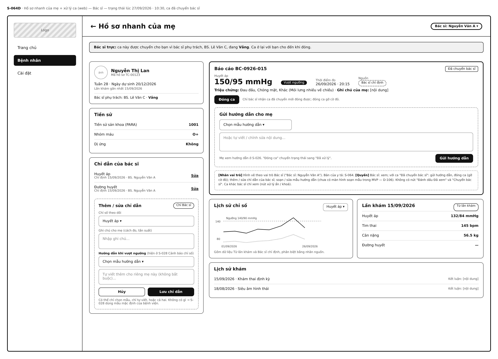

# Screen Spec: S-064D Mother quick profile — Doctor

| Field | Value |
|---|---|
| Screen ID | `S-064D` (Doctor version of `S-064`; the "D" suffix follows the precedent of `S-025A`) |
| Screen name | Mother quick profile + case handling, web — Doctor (DBIZ2 name: Patient Snapshot Screen) |
| Actor | Doctor (web) |
| Priority | Should |
| Belongs to module | `spec-CLI.md` |
| Mockup image | `img/S-064D.png` — drawn (same layout as `S-064`, with the differences listed in §3). The chatbot-case Report block is not drawn |
| Status | Draft (created 17/11/2026 — split of the Nurse and Doctor screens, D-103 – D-106 proposed) |

> **Split of the Nurse and Doctor screens (17/11/2026, D-103 – D-106, proposed):** this file was split out of `screen-spec-S-064.md`, which now describes the Nurse only. Rules come from `spec-CLI.md` v1.9.0-draft (BR-004, BR-010 – BR-013).

## 1. Purpose

Quick profile of one mother together with the handling block for a case that reached the doctor: enough context for the doctor to send guidance and close the case, and to assign the metrics the mother must monitor (Doctor's instructions).

**Shown when:** the doctor clicks "View report ›" on `S-061D`; or opens the case from the high-priority notification shown inside the clinical web (no push / SMS — ALR-03) `[NEEDS CLARIFICATION: S-059]`.

**The user leaves this screen when:** they click "←" (back to `S-061D`) or a sidebar item.

## 2. Mockup

## 3. Element inventory

Rows marked "as `S-064` #n" are the same read-only blocks as in the Nurse screen.

| # | Element | Type | Content / data source | Required | Validation |
|---|---|---|---|---|---|
| 1 | Sidebar: "Home", "Patients" (selected), "Settings" | Navigation | navigation | Yes | — |
| 2 | "← Mother quick profile" | Header + Button | back to `S-061D` | Yes | — |
| 3 | Role label "Doctor: Nguyễn Văn A ▾" | Dropdown | Staff — role + full name (D-28) | Yes | — |
| 4 | Profile card: photo, name, medical record number, week, due date, last visit | Card | as `S-064` #4 (`spec-CLI.md` FR-007) | No | — |
| 4A | Line in the profile card: "Responsible doctor: Dr. [name] · Available / Away" | Text + Label | Patient Assignment → Staff — name, availability (`spec-CLI.md` FR-027, D-68) | No | shows "No responsible doctor" when the mother has none |
| 4B | Banner "This case was routed to you as the doctor on duty — the responsible doctor, Dr. [name], is Away." | Banner | shown when the signed-in doctor is not the mother's responsible doctor (BR-010, BR-011) | No | hidden for the responsible doctor |
| 5 | "Medical history": Obstetric history (PARA), Blood type, Allergies | Card | Patient Clinical Profile (`spec-HLT.md` §6, D-42) | No | — |
| 6 | "Doctor's instructions" card | Card | Watch-Flag (`spec-HLT.md` §6) | No | — |
| 7 | Instruction rows "Blood pressure — Assigned 15/09/2026 · Dr. Nguyễn Văn A" + "Edit" | List item + Link | Watch-Flag — metric, flagged_at, flagged_by | No | "Edit" shown only to doctors (D-29) |
| 8 | "Add / edit instruction" form (label "Doctor only"): "Metric to monitor" (Blood pressure ▾) | Dropdown | Watch-Flag — metric (group 2 only) (`spec-CLI.md` FR-025) | Yes (on save) | select 1 group-2 metric |
| 9 | "Note for the mother (how to measure, frequency)" — "Enter a note…" | Textarea | Watch-Flag — note | No | maximum length `[NEEDS CLARIFICATION]` |
| 10 | "Above-threshold guidance (shown on S-028 Metric alert)": "Choose a guidance template ▾" + "Add custom text for this mother (optional)…" | Dropdown + Textarea | Watch-Flag — over_threshold_guidance {template_id, custom_text} (D-24) | No | custom text ≤ **1000 characters** (D-46) |
| 11 | "Cancel" / "Save instruction" + the sentence "You can choose only a template, only custom text, or both. If there is nothing → S-028 uses the hospital's default template." | Button pair + Text | FR-025; D-24 | — | — |
| 12 | "Report BC-…" block + status label | Card header + Label | Metric Report — report_code; Case — status. Chatbot case: code per `spec-ALR.md` Q16 | No | — |
| 13 | Value line, "Measured at …", "Source — …"; **chatbot case:** "Question: …" + "Sent `dd/mm/yyyy · HH:mm`" + source "Chatbot" | Text + Label | as `S-064` #13 | No | — |
| 14 | "Symptoms: …" + "Mother's note" (hidden for a chatbot case) | Text | as `S-064` #14 | No | — |
| 15 | "Send guidance to the mother": "Choose a guidance template ▾" + "Or write / edit the text…" + "Send guidance" button + the sentence "The mother sees the guidance on S-026. "Close case" moves the status to "Resolved"." | Dropdown + Textarea + Button | Staff Response {template_id, custom_text} (`spec-CLI.md` FR-024; `spec-ALR.md` §6). Templates, including medicine guidance, are authored by doctors only; the list is empty in the MVP (D-99, D-106, proposed) | — | at least one of template / custom text; custom text ≤ **1000 characters** (D-46) |
| 16 | "Close case" button | Button | Case → "Resolved" (FR-016, FR-021) | No | doctor: **only cases "Escalated to doctor"** — hidden / disabled with a tooltip on other cases: "Only the doctor who received an escalated case can close it" `[NEEDS CLARIFICATION: wording]` (CLI-02) |
| 17 | "Metric history" + metric selector + chart with the threshold line | Chart | as `S-064` #19 — only "From visit" and "Doctor-assigned" data (CLI-01) | No | — |
| 18 | "Visit dd/mm/yyyy" card + label "From visit" | Card | as `S-064` #20 (FR-010) | No | — |
| 19 | "Visit history" list | List | as `S-064` #22 (FR-010) | No | — |

No "Mark as viewed" and no "Escalate to doctor" on this screen (D-43 as revised).

## 4. States

| State | What the user sees | Trigger |
|---|---|---|
| Default — case "Escalated to doctor" (shown in mockup) | all blocks; "Edit" + the instruction form; "Send guidance" and "Close case" available | a doctor opens an escalated case |
| Doctor on duty, covering | banner 4B and "Responsible doctor … · Away" (4A); all actions as in Default | the signed-in doctor is not the responsible doctor |
| Case not escalated (view only) | handling buttons (15, 16) hidden / disabled; the profile, instructions and history stay visible; the instruction form stays available | a doctor opens a case in "Not viewed", "Viewed" or "Resolved" |
| Case "Resolved" | handling buttons hidden / disabled `[NEEDS CLARIFICATION: not drawn]` | the case is closed |
| Chatbot case (not drawn) | the Report block shows the mother's question + sent time + source "Chatbot" in place of value / threshold / symptoms (#13, #14), followed by the **conversation transcript**, read-only, the escalated question highlighted (`spec-CLI.md` FR-003, BR-009, D-78) | `case_source` = Chatbot |
| Empty (no data) | each empty block uses the shared empty template (D-27) | the mother has no visits / metrics yet |
| Loading | shared skeleton (D-27) | screen opens |
| Error | shared error component + "Retry" (D-27) | loading / saving fails |
| Success / confirmation | the new status appears immediately on the Report block label; toast `[NEEDS CLARIFICATION: wording]` | action succeeds |

## 5. Interactions and navigation

| # | Element | User action | System response | Goes to screen |
|---|---|---|---|---|
| 1 | "Send guidance" | click | saves the Staff Response; the mother sees it on `S-026`; **no status change** (D-37) | stays |
| 2 | "Close case" | click | Case → Resolved (doctor: escalated cases only, CLI-02); clears the red flag (D-44); the mother receives a notification | stays |
| 3 | "Edit" / "Save instruction" | click | saves the Watch-Flag (FR-025); the mother sees it on `S-027` | stays |
| 4 | Metric selector (Metric history) | select | changes the metric on the chart | stays |
| 5 | "←" | click | — | `S-061D` |

## 6. Screen-level rules

| Rule ID | Rule | Source |
|---|---|---|
| SR-001 | Role-based permissions for the Doctor: view; on cases "Escalated to doctor" only — Send guidance, Close case; add / edit Doctor's instructions; create and edit guidance templates (including medicine guidance). The doctor does not "Mark as viewed" and does not escalate. | D-29, D-37, D-43 as revised, D-44, D-99 (proposed); `spec-CLI.md` CLI-02, BR-004 |
| SR-002 | "Send guidance" does not change the status; only "Close case" moves it to "Resolved". | D-37 |
| SR-003 | Every value is shown with a source label. | D-10 |
| SR-004 | If there is no above-threshold guidance, S-028 uses the hospital's default template. | D-24 |
| SR-005 | No Call / Message / SpO2 / "via Bluetooth" / document links / "Risk Level" on this screen. | `spec-CLI.md` §1 Out of scope |
| SR-006 | For a chatbot case the whole conversation of the escalated question is shown; other conversations of the mother are not shown. | `spec-CLI.md` BR-009; D-78 |
| SR-007 | A doctor on duty sees the mothers and cases of an Away doctor (banner 4B); the case stays with the doctor who received it until closed. | D-96, D-97 (proposed); `spec-CLI.md` BR-010, BR-011 |
| SR-008 | The MVP has no screen to author guidance templates; the list is empty except seed examples marked illustrative. Only doctors may author them when the screen exists. | D-99, D-106 (proposed); `spec-CLI.md` BR-013, Q15 |

## 7. Linked requirements

| FR ID (from the module spec) | What this screen does for it |
|---|---|
| FR-003, FR-014, FR-015 (`spec-CLI.md`) | The case's Report block |
| FR-005, FR-016, FR-021 | Status change, Close case |
| FR-007 | Profile card + Medical history |
| FR-008 | Metric history ("From visit" and "Doctor-assigned" data only, CLI-01) |
| FR-010 | Visit, Visit history |
| FR-024 | Send guidance to the mother |
| FR-025 | Add / edit Doctor's instructions |
| FR-027 | Responsible doctor and availability |
| FR-009 (`spec-ALR.md`) | Case routed to the doctor |

## 8. Responsive and accessibility notes

- Web screen; minimum width `[NEEDS CLARIFICATION: not specified]`. On narrow screens, the left column (profile, medical history, instructions) stacks above the Report block.
- A button disabled by permissions must have a readable reason (tooltip) `[NEEDS CLARIFICATION]`.

## 9. Open questions

| # | Question | Blocking? | Status |
|---|---|---|---|
| 1 | How the red flag (D-44) and the button states are displayed when the case is escalated / closed — not drawn. | No | Open |
| 2 | Is the "Notifications (n)" button also available on this screen, so that a doctor can see a new escalation without going back to `S-061D`? | No | Open (carried from `S-064` Q7) |
| 3 | Is a list of all the mother's cases needed on this screen (FR-009, FR-013). | No | Open (`spec-CLI.md` Q13) |
| 4 | The "Guidance template" list. | No | Open (`spec-CLI.md` Q15) — only doctors author templates (D-99, proposed); none in the MVP |

---

## Completion checklist

- [x] The mockup is a separate cropped image file, named with the Screen ID (`img/S-064D.png`, drawn; the chatbot-case Report block is not drawn — §4).
- [x] Every visible element in the mockup appears in the element inventory.
- [x] Every input element has a validation rule or an explicit `[NEEDS CLARIFICATION]`.
- [x] All states are filled in, or marked `[NEEDS CLARIFICATION]`.
- [x] Every navigation target is a Screen ID that exists in the Screen List, or is new (`S-061D`, `S-064D` must be added to the Screen List).
- [x] Every element that displays data names the field it displays, matching the module spec.
