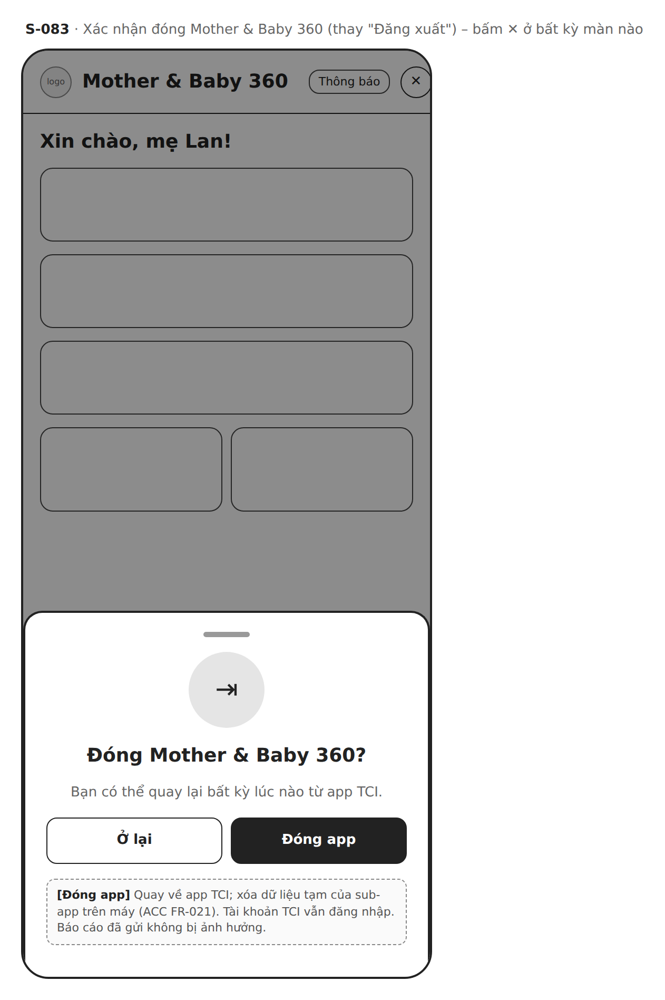

# Screen Spec: S-083 Close Mother & Baby 360

| Field | Value |
|---|---|
| Screen ID | `S-083` |
| Screen name | Close Mother & Baby 360 confirmation (DBIZ2 name: Logout Confirmation Screen) |
| Actor | Mother |
| Priority | Must `[PENDING CLIENT: D-01]` |
| Belongs to module | `spec-ACC.md` |
| Mockup image | `img/S-083.png` |
| Status | Draft |

## 1. Purpose

`[PENDING CLIENT: D-01]` — The sub-app has no logout of its own. The mother exits with the ✕ button in the header; this screen asks for confirmation before closing the sub-app and returning to the TCI app. The TCI account stays logged in.

**Shown when:** the mother taps the ✕ button in the header of any mobile screen of the sub-app. Shown as a bottom sheet over the screen that is open (drawn over Home `S-008`).

**The user leaves this screen when:** she taps "Stay" (closes the bottom sheet, stays on the previous screen) or "Close app" (closes the sub-app, returns to the TCI app).

## 2. Mockup

## 3. Element inventory

| # | Element | Type | Content / data source | Required | Validation |
|---|---|---|---|---|---|
| 1 | Background of the open screen (dimmed) | Overlay | the screen from which ✕ was tapped | — | — |
| 2 | Bottom sheet drag handle | Handle | navigation | No | — |
| 3 | "⇥" icon | Icon | static | No | — |
| 4 | Title "Close Mother & Baby 360?" | Header | static | No | — |
| 5 | "You can come back at any time from the TCI app." | Text | static | No | — |
| 6 | "Stay" button | Button (secondary) | closes the bottom sheet | Yes | — |
| 7 | "Close app" button | Button (primary) | ends the sub-app session (`spec-ACC.md` FR-019), clears temporary data (FR-021) | Yes | — |

Note: the box "[Close app] Returns to the TCI app; clears the sub-app's temporary data on the device (ACC FR-021). The TCI account stays logged in. Submitted reports are not affected." on the drawing is an annotation; it is described in §5–§6.

## 4. States

| State | What the user sees | Trigger |
|---|---|---|
| Default (drawn) | bottom sheet over the current screen | ✕ tapped |
| Empty (no data) | not applicable | — |
| Loading | not applicable — closes immediately | — |
| Error | `[NEEDS CLARIFICATION: if clearing temporary data fails — does the sub-app still close?]` | — |
| Success / confirmation | the sub-app closes and the TCI app home screen is shown (`S-001` state 1) | "Close app" tapped |

## 5. Interactions and navigation

| # | Element | User action | System response | Goes to screen |
|---|---|---|---|---|
| 1 | "Stay" / drag down / tap the background | tap | closes the bottom sheet | the screen from which ✕ was tapped |
| 2 | "Close app" | tap | ends the sub-app session (FR-019), clears temporary data on the device (FR-021); does not log out of the TCI account | TCI app (`S-001` state 1) |

## 6. Screen-level rules

| Rule ID | Rule | Source |
|---|---|---|
| SR-001 | Closing the sub-app does not log out of the TCI account and does not affect submitted reports. | `spec-ACC.md` BR-005; D-01 `[PENDING CLIENT: D-01]` |
| SR-002 | Data partially entered on the screen from which ✕ was tapped (e.g. `S-025A`) is discarded on "Close app" `[NEEDS CLARIFICATION: is there a separate warning]`. | inferred from FR-021 |
| SR-003 | There is no logout, change-password or delete-account button in the sub-app. | D-01 |

## 7. Linked requirements

| FR ID (from the module spec) | What this screen does for it |
|---|---|
| FR-019 (`spec-ACC.md`, reinterpreted) | Ends the sub-app session, keeps the TCI session |
| FR-021 (`spec-ACC.md`, reinterpreted) | Clears the sub-app's temporary data on the device |

## 8. Responsive and accessibility notes

- The two buttons are side by side; they stack vertically on narrow screens `[NEEDS CLARIFICATION]`.
- The bottom sheet can be closed with the operating system's back button (= "Stay").

## 9. Open questions

| # | Question | Blocking? | Status |
|---|---|---|---|
| 1 | Does the Client approve the sub-app model (D-01)? If not, this screen reverts to a logout confirmation. | Yes | Open `[PENDING CLIENT: D-01]` |
| 2 | Is there a warning when data is partially entered? | No | Open |

---

## Completion checklist

- [x] The mockup is a separate cropped image file, named with the Screen ID.
- [x] Every visible element in the mockup appears in the element inventory.
- [x] Every input element has a validation rule — the screen has no input fields.
- [x] All states are filled in, or marked "not applicable"/`[NEEDS CLARIFICATION]` with a reason.
- [x] Every navigation target is a Screen ID that exists in the Screen List.
- [x] Every element that displays data names the field it displays, matching the module spec.
