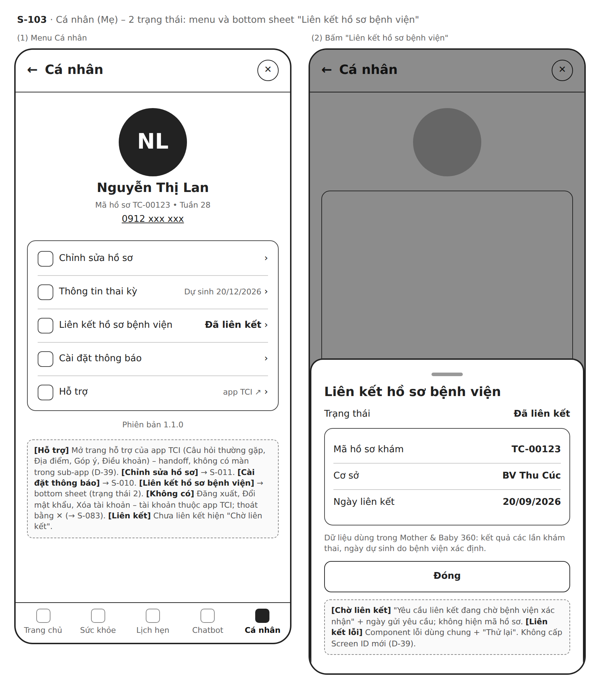

# Screen Spec: S-103 Profile

| Field | Value |
|---|---|
| Screen ID | `S-103` |
| Screen name | Profile (DBIZ2 name: Logout Screen) — 2 states: (1) Profile menu, (2) "Hospital record link" bottom sheet |
| Actor | Mother |
| Priority | Must |
| Belongs to module | `spec-ACC.md` |
| Mockup image | `img/S-103.png` (2 states in one image — D-40) |
| Status | Draft (revised 29/09/2026 — screen-spec fix #8) |

## 1. Purpose

The mother's profile page in the sub-app: basic information taken from the TCI account, entry to profile editing, pregnancy information, hospital record link status, notification settings and support. There is no logout / change password / delete account (D-01) `[PENDING CLIENT: D-01]`.

**Shown when:** the mother taps the "Profile" tab in the 5-tab bar.

**The user leaves this screen when:** she taps a menu row (→ `S-011`, `S-010`, TCI app), ←, ✕ (`S-083`), or a tab. State 2 opens when she taps "Hospital record link" and closes with "Close".

## 2. Mockup

## 3. Element inventory

**State 1 — Profile menu**

| # | Element | Type | Content / data source | Required | Validation |
|---|---|---|---|---|---|
| 1 | ← button | Button | navigation | Yes | — |
| 2 | Title "Profile" | Header | static | No | — |
| 3 | ✕ button | Button | close the sub-app (D-01) | Yes | — |
| 4 | Initials avatar "NL" | Image | generated from the full name | No | — |
| 5 | "Nguyễn Thị Lan" | Text | User Account — full name (copy from TCI — `spec-ACC.md` §6, D-42) | No | — |
| 6 | "Record no. TC-00123 • Week 28" | Text | User Account — medical record number; gestational week (calculated from the EDD) | No | — |
| 7 | "0912 xxx xxx" | Text | User Account — phone number, partially masked | No | — |
| 8 | Row "Edit profile ›" | List item | navigation (FR-024) | No | — |
| 9 | Row "Pregnancy information — Due 20/12/2026 ›" | List item | Profile — EDD (`dd/mm/yyyy`) | No | — |
| 10 | Row "Hospital record link — Linked ›" | List item | EMR Linkage Request — status ("Linked" / "Pending link") (FR-001, FR-002). **MVP: the link is simulated with seed data — the seed decides "Linked" or "Pending link"; no EMR call** (ACC-01) | No | — |
| 11 | Row "Notification settings ›" | List item | navigation | No | — |
| 12 | Row "Support — TCI app ↗ ›" | List item | opens the TCI app support page (FAQ, Locations, Feedback, Terms) | No | — |
| 13 | "Version 1.1.0" | Text | sub-app version | No | — |
| 14 | 5-tab bar, "Profile" selected | Toggle (tab) | navigation (D-27) | Yes | — |

**State 2 — "Hospital record link" bottom sheet** (no new Screen ID — D-39)

| # | Element | Type | Content / data source | Required | Validation |
|---|---|---|---|---|---|
| 15 | Title "Hospital record link" | Header | static | No | — |
| 16 | "Status — Linked" | Text | EMR Linkage Request — status | No | — |
| 17 | "Medical record number — TC-00123" | Text | EMR Linkage Request — EMR record ID | No | hidden when "Pending link" |
| 18 | "Facility — Thu Cuc Hospital" | Text | EMR Linkage Request — facility | No | — |
| 19 | "Linked on — 20/09/2026" | Text | EMR Linkage Request — linked_at | No | "Pending link": replaced by the request date (requested_at) |
| 20 | "Data used in Mother & Baby 360: results of prenatal visits, due date set by the hospital." | Text | static | No | — |
| 21 | "Close" button | Button | closes the bottom sheet | Yes | — |

Note: the boxes "[Support] … [Edit profile] … [Link] …" and "[Pending link] … [Link error] …" on the drawing are annotations; they are described in §4–§5. The "[Link error]" annotation no longer applies in the MVP (screen-spec fix #8).

## 4. States

| State | What the user sees | Trigger |
|---|---|---|
| Default — Menu (drawn) | state 1: profile header, 5 menu rows, version, 5-tab bar | Profile tab opened |
| Bottom sheet — Linked (drawn) | state 2 with medical record number, facility, link date | "Hospital record link" tapped |
| Bottom sheet — Pending link | "Link request awaiting hospital confirmation" + request date; the medical record number is not shown | EMR Linkage Request status = Pending (**set by seed data** — kept because the demo needs both states and S-011 uses the not-linked state) |
| Empty (no data) | not applicable | — |
| Loading | shared skeleton (D-27) | profile loading |
| Error | shared error component + "Retry" | loading failed |
| Success / confirmation | not applicable on this screen — it only displays data | — |

## 5. Interactions and navigation

| # | Element | User action | System response | Goes to screen |
|---|---|---|---|---|
| 1 | "Edit profile" | tap | — | `S-011` |
| 2 | "Pregnancy information" | tap | — | `S-011` `[NEEDS CLARIFICATION: the drawing does not state the target; spec-ACC FR-024 states it opens the edit screen]` |
| 3 | "Hospital record link" | tap | opens state 2 | stays |
| 4 | *(Removed — screen-spec fix #8: no "Link error" / "Retry" state in the MVP; the link is seed data)* | — | — | — |
| 5 | "Notification settings" | tap | — | `S-010` |
| 6 | "Support" | tap | opens the TCI app support page via deep link | TCI app (no screen in the sub-app) |
| 7 | "Close" (bottom sheet) | tap | closes state 2 | stays |
| 8 | ← | tap | — | `S-008` |
| 9 | ✕ | tap | asks for confirmation to close the sub-app | `S-083` |
| 10 | Tab | tap | — | `S-008` / `S-023` / TCI app / `S-031` / `S-103` |

## 6. Screen-level rules

| Rule ID | Rule | Source |
|---|---|---|
| SR-001 | No Log out, Change password or Delete account; the account belongs to the TCI app; exit is via ✕ (`S-083`). | D-01 `[PENDING CLIENT: D-01]` |
| SR-002 | Full name, phone number and medical record number come from the TCI account; they are edited in the TCI app. | `spec-ACC.md` §6, D-42 |
| SR-003 | When "Pending link", the medical record number is not shown; the request date is shown. | Wireframe annotation |
| SR-003a | In the MVP the hospital record link is simulated with seed data: "Linked" / "Pending link" are set by the seed; there is no link-error state and no "Retry". | ACC-01; screen-spec fix #8 |
| SR-004 | "Support" is a handoff to the TCI app; there is no screen in the sub-app. | D-39 |

## 7. Linked requirements

| FR ID (from the module spec) | What this screen does for it |
|---|---|
| FR-001, FR-002 (`spec-ACC.md`) | Hospital record link status (seed data in the MVP) |
| FR-017, FR-018 | Loads profile information |
| FR-023 | Displays the read-only profile |
| FR-024 | Entry to `S-011` |

## 8. Responsive and accessibility notes

- Smallest supported width: `[NEEDS CLARIFICATION: not specified]`.
- The partially masked phone number needs a readable label ("Phone number hidden").
- The "Support" row must indicate in advance that it opens outside the sub-app (↗ icon + readable label).

## 9. Open questions

| # | Question | Blocking? | Status |
|---|---|---|---|
| 1 | Does the Client approve D-01 (no logout / change password / delete account in the sub-app)? | Yes | Open `[PENDING CLIENT: D-01]` |
| 2 | No record found, or several records found, when linking (see `spec-ACC.md` Q2). | No | Resolved — not applicable in the MVP: the link is seed data (screen-spec fix #8, ACC-01) |
| 3 | Where does "Pregnancy information" open? | No | Open |
| 4 | Deep link mechanism to the TCI app (see `spec-ACC.md` Q9, `spec-APT.md` Q1). | No | Open |
| 5 | Confirmation after a successful "Retry" of the hospital record link? | No | Resolved — not applicable: "Retry" removed (screen-spec fix #8) |

---

## Completion checklist

- [x] The mockup is a separate cropped image file, named with the Screen ID (2 states in one image).
- [x] Every visible element in the mockup appears in the element inventory.
- [x] Every input element has a validation rule — the screen has no input fields.
- [x] All states are filled in (including Pending link; the Link error state is removed — seed data).
- [x] Every navigation target is a Screen ID that exists in the Screen List, or marked as a handoff to the TCI app.
- [x] Every element that displays data names the field it displays, matching the module spec.
