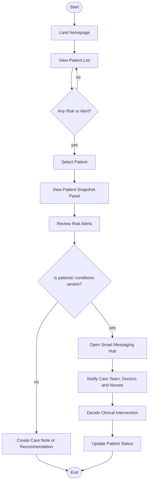
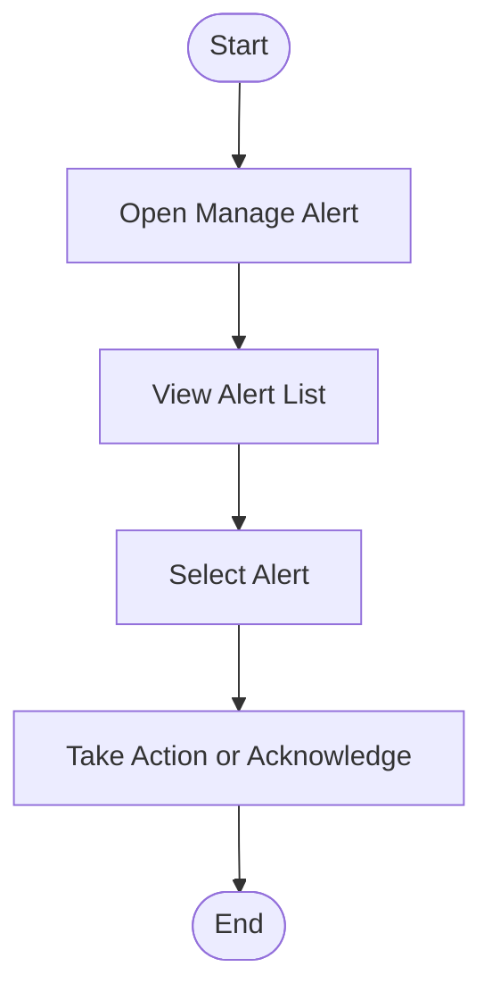
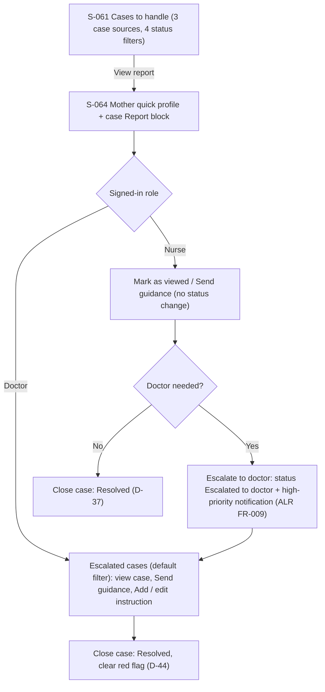
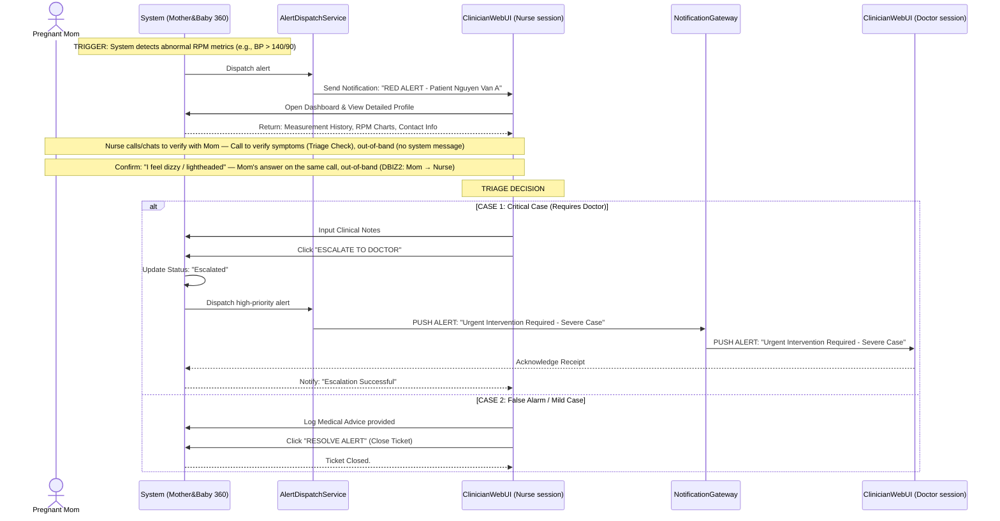
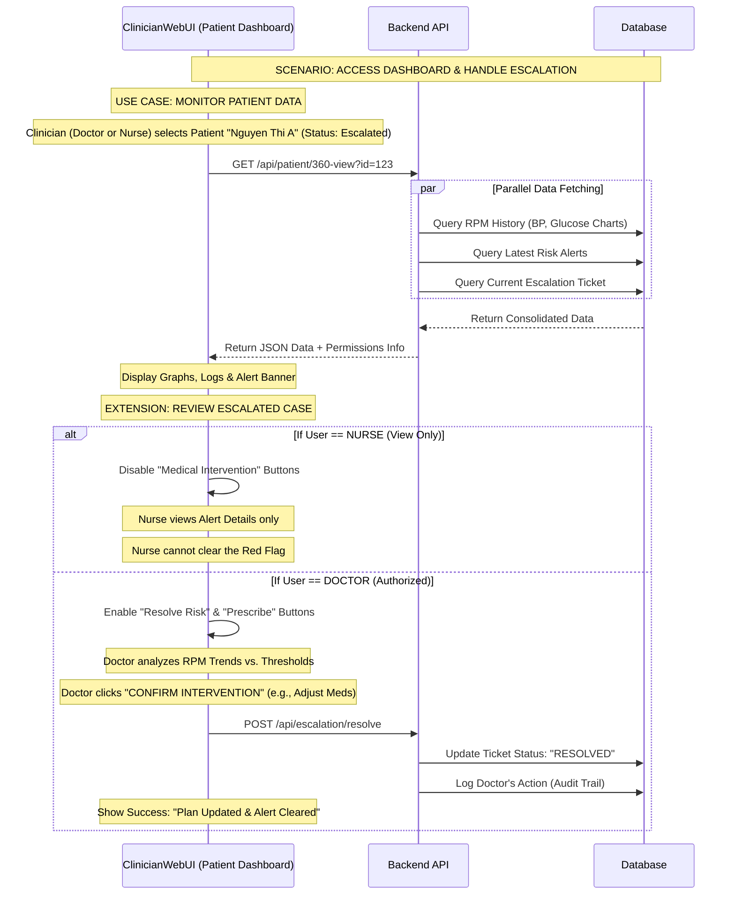

<!-- DBIZ3-SNAPSHOT source=specs/spec-CLI.md sha256=8d64de2068bd1e471934fda2d62690e9b33b8f8bd576b723bffbb39a525f8252 taken=2026-10-14T09:53Z -->
<!-- Read-only copy for Spec Kit. Do not edit here. Edit specs/spec-CLI.md, then run:
     uv run tools/start_feature.py --refresh -->

# Spec Document: Clinical Escalation (Nurse + Doctor)

| Field | Value |
|---|---|
| Module ID | `CLI` |
| Module name | Clinical Escalation — UI: "Cases to handle" / "Mother quick profile" (web, for Nurse and Doctor) |
| Spec version | v1.7.0 (14/10/2026: chat transcript in the hand-over — FR-003, BR-009, D-78) — v1.6.3 (30/09/2026: data-model review decisions applied — DM-02, DM-05, DM-10; responsible doctor D-68; 29/09/2026: fetal heart rate reference range aligned with the latest MVP Scope; review 29/09/2026: CLI-01 – CLI-06, X-02, X-04, X-07 / DM-25 data types; Doctor permissions per screen-spec fix #4) |
| Author (team member) | Trung (drafted 16/09/2026) — diagrams checked node by node by Tâm, 17/09/2026 (verifier ≠ converter) |
| Date | 14/10/2026 |
| Status | Draft |
| Approved by (Client role) | *pending* |
| DBIZ2 source | Function List rows `F-055`–`F-071`, `F-098`–`F-099`, `F-128`–`F-130`, `F-138` (23 rows); Screens `S-054`–`S-069` |

---

## 1. Purpose and scope (mandatory)

This module closes the safety loop that `ALR` opens: the nurse reviews cases created by the mother (above-threshold reports, reports with symptoms, chatbot questions the mother agreed to pass to a nurse) and decides whether to handle the case herself or escalate it to a doctor; the doctor reviews escalated cases with the full context of the mother, sends guidance and closes the case. The scope is the **minimum workflow** needed to close a case created by the mother, not a full doctor workstation.

**Terminology (X-04).** "Doctor's instructions" (UI; entity Watch-Flag, `spec-HLT.md` §6) = the **watch-flag** of MVP v8 §5.

**MVP functions → FRs and screens (CLI-04).** MVP v8 §4 lists the supporting clinical functions; this table shows where each one is met.

| MVP function (MVP v8 §4) | Role | Met by | Screen |
|---|---|---|---|
| Process Medical Alerts | Nurse | FR-001, FR-002, FR-020 (queue of "Not viewed" cases); FR-004 "Mark as viewed" | S-061, S-064 |
| Triage Patient | Nurse | FR-004 Mark as viewed, FR-024 Send guidance, FR-019 Escalate to doctor, FR-016 Close case (not escalated) | S-064 |
| Access Patient Dashboard | Nurse, Doctor | FR-006 – FR-008, FR-010, FR-014, FR-015 (Mother quick profile) | S-064 |
| Review Escalated Cases | Doctor | FR-002 with the default filter "Escalated to doctor" (CLI-02); FR-003 | S-061, S-064 |
| Provide Consultation | Doctor | FR-024 Send guidance, FR-025 Doctor's instructions — written consultation (D-58) | S-064 |
| Update Patient Status | Doctor | FR-016 / FR-021 "Close case" on an escalated case → Resolved = clearing the red flag (D-44) | S-064 |

**In scope**

- Web dashboard for **two roles: Nurse and Doctor** (D-28). The header shows the role + the name of the signed-in user ("Nurse: Trần Thị B" / "Dr. Nguyễn Văn A").
- A single **"Cases to handle"** table (S-061) combining cases from 3 sources: Metric report, Symptom, Chatbot (D-18, D-34, D-41); filtered by the 4 statuses + "All"; sorted "Newest".
- **Mother quick profile + case handling** (S-064): profile, medical history, Doctor's instructions, the case's Report block (for a chatbot case: the mother's question and the whole conversation it belongs to — D-78), metric history ("From visit" and "Doctor-assigned" data), latest visit, visit history. The mother's **self-tracked metrics are not shown** to clinical staff — they are for her own reference (CLI-01).
- **Case-handling actions:** Mark as viewed (nurse only), Escalate to doctor (nurse), Send guidance to the mother, Close case (D-18, D-24, D-29, D-37, D-43 as revised). The doctor acts on cases "Escalated to doctor" (CLI-02).
- **Add / edit Doctor's instructions** (doctor only), including "Above-threshold guidance" chosen from a template and/or custom-written (D-24, D-29).

**Out of scope**

- Free-text search (Search), Daily Schedule, Recent Messages / Messages (general messaging), START CALL / Call (video / telehealth — Figure 9), SpO2, the "via Bluetooth" label (Hardware Device Auto-Sync = Won't), document links (Prescription, Call Recording, 4D Ultrasound, Blood Test, Scan Results, Screening Results) — not part of the MVP.
- **Quick notes** (DBIZ2 F-065 — per-person notes on S-061) — **Won't** (CLI-03): not in MVP v8.
- A "false alarm" label (FR-018), a notification to the doctor when a case is closed (FR-022), the mother's phone number / emergency contact and call button (FR-023) — **Won't** (CLI-05): no devices, no calls, no screen.
- Push / SMS notifications to the doctor — the escalation notification is shown inside the clinical web (ALR-03).
- The "Risk Level: HIGH" scale and the Critical / Warning / Normal legend — the MVP uses only the 3 threshold labels Normal / Above threshold / Not assessed (D-17).
- E-prescribing and writing back to the medical record / editing the EDD (Figure 9, Figure 10) — "Deep Two-Way HIS/EMR Integration" is Won't.
- Doctors / nurses managing their own work schedule — outside the MVP functional scope.
- The mother's side of creating reports / cases — belongs to `ALR` (and `BOT` for chatbot cases). This module only receives and handles cases.

**Depends on**

- `ALR` defines the **Case** entity, the status set, the threshold labels, Guidance Template and Staff Response (`spec-ALR.md` §6, D-41).
- `HLT` for Health Metric Record, Visit and Watch-Flag ("Doctor's instructions") — this module is where Watch-Flag is **written**.
- `ACC` / the web sign-in system for clinical staff (S-054, S-060) — D-01 (sub-app) applies only to the mother's side; web sign-in `[NEEDS CLARIFICATION: §10 Q11]`.

## 2. Actors (mandatory)

| Actor | Role in this module | Where it comes from |
|---|---|---|
| Nurse | Primary — views the queue, Mark as viewed, Escalate to doctor, Send guidance, Close case **only for cases not escalated to a doctor** | MVP v8 §3, §5 "Nurse Triage & Alert Verification"; D-29, D-37 |
| Doctor | Primary — reviews cases **"Escalated to doctor"** (default filter on S-061), sends guidance and closes them (clears the red flag — D-44); adds / edits Doctor's instructions. Other cases are view-only for the doctor; the doctor does not "Mark as viewed" and does not escalate (D-43 as revised, CLI-02) | Function List `Actor` column; MVP v8 §4 (Review Escalated Cases, Provide Consultation, Update Patient Status), §5 "Doctor Escalation & Follow-up"; D-29, D-37 |
| System | Secondary — changes status, records history, sends notifications | Function List `Actor` column |

## 3. User scenarios and acceptance criteria (mandatory)

### US-1 (P1): Nurse works through the case queue

**Journey.** As a `Nurse`, I want to `see new cases, verify them and decide whether to handle them myself or escalate to a doctor`, so that `only cases that really need a doctor reach a doctor, and the mother gets a response early`.

**Acceptance scenarios**

1. **Given** the nurse is signed in, **When** she opens S-061, **Then** the header shows "Nurse: [name]" and the "Cases to handle" table is sorted "Newest"; default filter `[NEEDS CLARIFICATION: the wireframe highlights "Not viewed (2)" but states no rule — §10 Q5]`.
2. **When** she selects Not viewed / Viewed / Escalated to doctor / Resolved / All, **Then** the table shows only cases in that status.
3. **Given** there are no cases, **Then** "No cases to handle." is shown.
4. **When** she clicks "View report ›" on a row, **Then** S-064 opens with that case's Report block.
5. **When** she clicks "Mark as viewed", **Then** the status → "Viewed"; the mother sees the same status name on S-026 / S-029 (D-18).
6. **When** she clicks "Escalate to doctor", **Then** the status → "Escalated to doctor" **and** the system sends a high-priority notification to the responsible doctor (`spec-ALR.md` FR-009). If the case is still "Not viewed", the system first records a "Viewed" step (D-43).
7. **When** she chooses a guidance template and/or writes text and clicks "Send guidance", **Then** the mother sees the guidance on S-026; **the case status does not change** (D-37).
8. **Given** the case has **not** been escalated to a doctor, **When** the nurse clicks "Close case", **Then** the status → "Resolved". **Given** the case is "Escalated to doctor", **Then** the "Close case" button is hidden / disabled for the nurse (D-37).
9. **Given** a nurse is signed in, **Then** the "Doctor's instructions" block is view-only: no "Edit" button, no form.

### US-2 (P1): Doctor handles an escalated case

**Journey.** As a `Doctor`, I want to `see an escalated case with the mother's full context and decide`, so that `the case is closed with appropriate guidance`.

**Acceptance scenarios**

1. **Given** the doctor signs in, **When** S-061 opens, **Then** the "Cases to handle" table uses the default filter **"Escalated to doctor"** (CLI-02); the doctor may switch filters to view other cases, read-only.
2. **Given** the doctor receives a high-priority notification (in the clinical web — ALR-03), **When** he opens the case, **Then** S-064 shows the profile, medical history, Report block, metric history with threshold line ("From visit" and "Doctor-assigned" data), latest visit and visit history; the header shows "Dr. [name]". Self-tracked metrics are not shown (CLI-01).
3. **Given** S-064 in the Doctor role, **Then** the "Escalate to doctor" and "Mark as viewed" buttons are not shown.
4. **Given** a case "Escalated to doctor", **When** the doctor clicks "Send guidance", **Then** the mother sees it on S-026 and the status does not change; **When** he clicks "Close case", **Then** the status → "Resolved"; the case's red flag is cleared (D-44).
5. **Given** a case that is **not** "Escalated to doctor", **When** the doctor opens it, **Then** the case-handling buttons are hidden / disabled for him (view only).

### US-3 (P2): Doctor adds / edits Doctor's instructions

**Journey.** As a `Doctor`, I want to `assign the mother a group-2 metric to monitor and prepare above-threshold guidance in advance`, so that `the mother knows how to measure and receives guidance immediately when a report is above threshold`.

**Acceptance scenarios**

1. **When** the doctor clicks "Edit" or uses the "Add / edit instruction" form, enters Metric to monitor, Note for the mother (how to measure, frequency), Above-threshold guidance (template and/or custom text), and clicks "Save instruction", **Then** the instruction is saved; the mother sees it on S-027 / S-025A; the "Above-threshold guidance" is shown on S-028 when the mother reports an above-threshold value.
2. **Given** no above-threshold guidance is entered, **Then** S-028 uses the hospital's default template (D-24).

### Edge cases

- The mother has no active responsible doctor (her Patient Assignment has ended) when the nurse clicks "Escalate to doctor" — `[NEEDS CLARIFICATION: §10 Q10, remaining part]`.
- The nurse cannot reach the mother to verify (Figure 5 "Nurse calls/chats to verify") — `[NEEDS CLARIFICATION]`; S-064 has no call button.
- A nurse and a doctor act on the same case at the same time — `[NEEDS CLARIFICATION: not addressed by any source]`. Minimum: the later action must check the current status per D-43 (status never moves backwards).
- A doctor opens a case that is not "Escalated to doctor" (e.g. by switching the filter) — view only; no handling button is available to him (CLI-02, D-43 as revised).
- No doctor account exists for the demo — resolved (D-68, DM-10): doctor accounts and responsible-doctor assignments are seed data.

## 4. Flows (mandatory)

### 4.1 Usage flow

**(a) Original DBIZ2 flows** — from the Doctor and Nurse usage flows (`docs/architecture/usage-flow.md`), alert-handling part only.

**(b) MVP flow from the wireframe** — **not a DBIZ2 diagram**; drawn from S-061, S-064 and D-29, D-37, D-43, D-44.

### 4.2 Sequence for the main flow

Source: DBIZ2 `Schematic2`, Figure 5 (image46.png, "Process Medical Alerts") and Figure 8 (image39.png, "Access Patient Dashboard").

#### Figure 5 — Process Medical Alerts

#### Figure 8 — Access Patient Dashboard

**Participants (guide §5.4 "participants must be parts of the system, not job titles").** In DBIZ2 Figure 5 the lifelines "Nurse (Triage)" and "Doctor (Specialist)" are people; here they are replaced by the software they use: `ClinicianWebUI (Nurse session)` and `ClinicianWebUI (Doctor session)`. The DBIZ2 message labels are kept word for word. Added by the team (not in DBIZ2): the dispatch hops `System → AlertDispatchService → ClinicianWebUI` and `AlertDispatchService → NotificationGateway → ClinicianWebUI (Doctor session)`; the DBIZ2 arrows "Nurse → Mom: Call to verify symptoms" and "Mom → Nurse: Confirm: …" are written as notes because the call is made outside the system. In Figure 8 the lifeline "User (Doctor or Nurse)" is removed; the user's actions are written as notes on `ClinicianWebUI (Patient Dashboard)`. These changes were made after the diagram check of 17/09/2026 and need to be re-checked (see the completion checklist).

**Mapping from the DBIZ2 diagrams to the MVP** (the DBIZ2 flow and message labels are not modified; only the participants, see above):

| DBIZ2 | MVP | Basis |
|---|---|---|
| Figure 5 trigger "System detects abnormal RPM metrics" (device) | Cases are created only by the mother: a report on S-025A (above threshold or with symptoms) or the chatbot when the mother taps "Connect to nurse". No device trigger | D-07, D-11, D-19, D-34; Hardware Device Auto-Sync = Won't |
| "ESCALATE TO DOCTOR" → Status "Escalated" | "Escalate to doctor" → "Escalated to doctor" + high-priority notification | D-18, D-29; ALR FR-009 |
| "PUSH ALERT" via NotificationGateway | Notification shown inside the clinical web (S-061 "Notifications" / S-059); no push, no SMS | ALR-03 |
| "RESOLVE ALERT" (Close Ticket) by the nurse | "Close case" → "Resolved"; nurse only for cases not escalated to a doctor | D-37 |
| "Nurse cannot clear the Red Flag"; doctor "Resolve Risk" | Red flag = case "Escalated to doctor"; only the doctor closes it | D-44 |
| "Prescribe", "Adjust Meds" | Not in the MVP | Out of scope §1 |
| "Nurse calls/chats to verify" | No call / message button on S-064; FR-023 Won't | CLI-05; §10 Q8 |

#### Figure 9 — Provide Consultation (use case in the MVP; the DBIZ2 diagram is reference only)

DBIZ2 Figure 9 shows video consultation + e-prescribing (Twilio/Zoom, SOAP note, drug-interaction check). START CALL / Call are not on S-061 or S-064. The diagram is not transcribed here because video consultation and e-prescribing are not built.

**"Provide Consultation" in the MVP (D-58).** The MVP scope lists "Provide Consultation" as a supporting Doctor function. In the MVP the doctor provides consultation **in writing**, with the existing functions only: "Send guidance to the mother" (FR-024, shown to the mother on S-026) and "Doctor's instructions" with above-threshold guidance (FR-025, shown on S-027 / S-028), both on S-064. No new screen or FR is added; video call and e-prescribing stay out of scope.

## 5. Functional requirements (mandatory)

| FR ID | DBIZ2 Subfunction ID | Requirement (system MUST ...) | Actor | Priority | Screen |
|---|---|---|---|---|---|
| FR-001 | F-055 | The system MUST load the alert dashboard specifically designed for clinicians. — MVP: opens S-061 "Cases to handle"; the header shows role + name (D-28). | Nurse / Doctor | Should | S-061 |
| FR-002 | F-056 | The system MUST display a list of alerts assigned to the logged-in clinician. — MVP: "Cases to handle" table with columns Mother, Gestational age, Case source (Metric report / Symptom / Chatbot), Content (for a chatbot case: the mother's question), Value + threshold label, Submitted at (`dd/mm/yyyy · HH:mm`), Status, "View report"; filter by the 4 statuses + "All"; sort "Newest". **Default filter for the Doctor: "Escalated to doctor"** (CLI-02); default for the Nurse: §10 Q5. `[NEEDS CLARIFICATION: "assigned to the logged-in clinician" — does the nurse see all cases or only assigned cases? §10 Q10]` | Nurse / Doctor | Should | S-061 |
| FR-003 | F-057 | The system MUST display detailed information for a clinician-selected alert. — MVP: the "Report BC-…" block on S-064 (metric, value, threshold label, measurement time, source, symptoms, mother's note, status). For a chatbot case: the mother's question + source "Chatbot", no value / threshold / symptoms, **and the whole conversation of that question** (every Chat Message with the same `conversation_id`, in time order, the escalated question highlighted) so that the mother does not have to repeat herself (PRD §4 "Seamless Handover", D-78). | Nurse / Doctor | Should | S-064 |
| FR-004 | F-058 | The system MUST allow the clinician to acknowledge an alert and record a handling/intervention note. — MVP: "Mark as viewed" (= `spec-ALR.md` FR-004; X-02: ALR defines the status, this FR is the action). Per-case handling note: the wireframe draws no separate field; content sent to the mother goes through FR-024 `[NEEDS CLARIFICATION: is an internal per-case note needed — §10 Q12]`. | Nurse (D-43 as revised) | Should | S-064 |
| FR-005 | F-059 | The system MUST update the status of a health alert and notify relevant stakeholders (clinicians, nurses, or patients). — MVP: status changes per D-43 (recorded in `status_history`); notify the doctor on escalation inside the clinical web (`spec-ALR.md` FR-009), notify the mother on a status change / new response (`spec-ALR.md` FR-018, D-48). | System | Should | S-064 → S-026, S-009 |
| FR-006 | F-060 | The system MUST load the patient monitoring module for continuous health tracking and alert supervision. — MVP: opens S-064 from "View report ›". | Nurse / Doctor | Should | S-064 |
| FR-007 | F-061 | The system MUST retrieve and display the selected patient's profile information for monitoring and review. — MVP: name, medical record number, gestational week, due date, latest visit; obstetric history (PARA), blood type, allergies (D-42). | System | Should | S-064 |
| FR-008 | F-062 | The system MUST display patient health metrics in graphical and chart-based formats for trend analysis. — MVP: "Metric history" (metric selectable) with a threshold line per `spec-ALR.md` BR-004 (blood pressure systolic ≥ 140 or diastolic ≥ 90 mmHg — D-14; blood glucose, urine protein — D-15), data distinguished by source label (D-10) — only "From visit" and "Doctor-assigned" data; fetal heart rate from visits with the 110–160 bpm reference range (display only, no label — D-12). The mother's self-tracked metrics (group 1) are **not** shown to clinical staff (CLI-01). | Nurse / Doctor | Should | S-064 |
| FR-009 | F-063 | The system MUST display a list of risk alerts associated with the selected patient. — MVP: S-064 shows only the block of the open case. `[NEEDS CLARIFICATION: is a list of all the mother's cases needed on S-064 — §10 Q13]` | Nurse / Doctor | Should | S-064 |
| FR-010 | F-064 | The system MUST allow clinicians to view the patient's medical history, clinical notes, and prior observations. — MVP: "Visit `dd/mm/yyyy`" (blood pressure, fetal heart rate, weight, blood glucose) and "Visit history" (date, visit type, conclusion) — entity Visit (D-42). | Nurse / Doctor | Should | S-064 |
| FR-011 | F-065 | The system MUST record clinician observations or update the follow-up status for a patient case. — Not built: the "Quick notes" panel is not in the MVP (CLI-03); case follow-up status is covered by FR-005 / FR-016, content for the mother by FR-024. | Nurse / Doctor | **Won't (CLI-03)** | — |
| FR-012 | F-066 | The system MUST load the alert management module for reviewing and handling patient alert cases. | — (DBIZ2 lists Admin; D-49) | **Won't (D-49)** — the Admin actor is a DBIZ2 labelling error; the function is covered by FR-001 | — |
| FR-013 | F-067 | The system MUST display a list of alert cases associated with the patient. — MVP: as FR-009. | Nurse / Doctor | Should | S-064 |
| FR-014 | F-068 | The system MUST retrieve and display detailed alert cases for the selected patient. — MVP: data of the Report block (Case + Metric Report + Health Metric Record — D-41). | System | Should | S-064 |
| FR-015 | F-069 | The system MUST display detailed information of a specific alert case, including metrics and history. — MVP: Report block + Metric history for that metric. | Nurse / Doctor | Should | S-064 |
| FR-016 | F-070 | The system MUST update the outcome or resolution status of an alert case. — MVP: "Close case" → "Resolved" (permissions per D-37: nurse — cases not escalated; doctor — escalated cases). For the doctor this is the MVP function "Update Patient Status" (CLI-04, D-44). | Nurse / Doctor | Should | S-064 |
| FR-017 | F-071 | The system MUST close a reviewed alert case or schedule a follow-up action if required. — MVP: "Close case". Scheduling a follow-up visit / further monitoring: not drawn; appointments belong to the TCI app (`spec-APT.md`) `[NEEDS CLARIFICATION]`. | Nurse / Doctor | Should | S-064 |
| FR-018 | F-098 | The system MUST allow the nurse to classify an alert as a false alarm (e.g., loose sensor, artifact) and archive it without disturbing the doctor. — Not built: there are no devices (Hardware Device Auto-Sync = Won't, D-07), so there is no "false alarm" label; the nurse closes a case not escalated to a doctor with FR-016. | Nurse | **Won't (CLI-05)** | — |
| FR-019 | F-099 | The system MUST flag a verified high-risk alert and immediately route it to the assigned obstetrician for urgent review. — MVP: "Escalate to doctor" (= `spec-ALR.md` FR-009; X-02: ALR defines the status and notification, this FR is the action); the case shows a red flag (D-44); the doctor is notified inside the clinical web (ALR-03). The "assigned obstetrician" is the mother's active responsible doctor in Patient Assignment (D-68). | Nurse | Should | S-064, S-061 |
| FR-020 | F-128 | The system MUST display a list of alerts that are pending review or action. — MVP: "Not viewed" filter (= `spec-ALR.md` FR-008). | Nurse / Doctor | Should | S-061 |
| FR-021 | F-129 | The system MUST mark an alert case as resolved and close it. — MVP: as FR-016. | Nurse / Doctor | Should | S-064 |
| FR-022 | F-130 | The system MUST send a notification to the assigned doctor when an alert case is resolved. — Not built: not in MVP v8 and not drawn; a closed case is visible in the "Resolved" filter of S-061. | System | **Won't (CLI-05)** | — |
| FR-023 | F-138 | The system MUST display the patient's phone number and emergency contact details for immediate verification calls. — Not built: the MVP has no calls from the clinical web and S-064 has no phone number / Call button. | Nurse | **Won't (CLI-05)** | — |
| FR-024 | — (new) | The system MUST let a nurse or doctor send guidance to the mother for a case by choosing a guidance template and/or writing / editing text (≤ 1000 characters — D-46); the mother sees it on S-026 as "Response from …"; sending guidance does **not** change the case status (D-37). Doctor: on cases "Escalated to doctor" (CLI-02). Same behaviour as `spec-ALR.md` FR-016 (X-02: ALR defines the Staff Response data, this FR is the action). | Nurse / Doctor | Should | S-064 → S-026 |
| FR-025 | — (new) | The system MUST let a doctor add or edit a "Doctor's instructions" entry (Watch-Flag) for a group-2 metric: metric to monitor, note for the mother (how to measure, frequency), "Above-threshold guidance" (template and/or custom text ≤ 1000 characters — D-46); nurses can only view. | Doctor | Should | S-064 → S-027, S-025A, S-028 |

FR-025 is placed in `CLI` because Doctor's instructions are created / edited on S-064; `spec-HLT.md` only displays them. The Watch-Flag entity is defined in `spec-HLT.md` §6.

### 5.1 Input / Output contract

| FR ID | Input field | Type | Required | Output field | Type | Notes / validation |
|---|---|---|---|---|---|---|
| FR-001 | Navigation Request; Staff ID | EVENT; UUID | Yes | *(UI navigation target: S-061)* | — | Header label from `Staff.role` (D-28) |
| FR-002 | Staff ID; Status Filter; Sort | UUID; ENUM (All / Not viewed / Viewed / Escalated to doctor / Resolved); ENUM (Newest) | Yes; No; No | Case List | LIST of OBJECT (patient_name, gestational_week, case_source, content, value + unit, threshold_label, submitted_at, status) | Threshold label "Not assessed" for cases without a measured value (Symptom / Chatbot — `spec-ALR.md` BR-005) |
| FR-003 | Case ID | UUID | Yes | Case Detail; Conversation transcript (chatbot case only) | OBJECT; LIST of Chat Message (sender, text, sent_at) | Transcript = Case → `chat_message_id` → Chat Message → `conversation_id` → all its messages; no new column (D-78) |
| FR-004 | Case ID; Staff ID | UUID; UUID | Yes | Status = "Viewed" + status_history entry | ENUM; OBJECT | Status never moves backwards (D-43) |
| FR-005 | Case ID; New Status; Staff ID | UUID; ENUM (4 statuses, D-18); UUID | Yes | Status Updated; Notifications | CONFIRMATION; CONFIRMATION | "Viewed" recorded automatically when skipped (D-43); notifications: ALR FR-009 (doctor), ALR FR-018 (mother) |
| FR-006 | Case ID | UUID | Yes | *(UI navigation target: S-064)* | — | — |
| FR-007 | Patient ID | UUID | Yes | Patient Profile | OBJECT (name, record_code, gestational_week, EDD, last_visit_date, PARA, blood_type, allergies) | Medical history: Patient Clinical Profile (D-42) |
| FR-008 | Patient ID; Metric; Date Range | UUID; ENUM (group 2 + fetal heart rate); DATE × 2 | Yes | Metric Series + Threshold Line | LIST of Health Metric Record (source From visit / Doctor-assigned only); OBJECT (Threshold Rule — D-52) | Source label mandatory (D-10); no Self-entered data (CLI-01) |
| FR-009 | Patient ID | UUID | Yes | Case List of patient | LIST | §10 Q13 |
| FR-010 | Patient ID | UUID | Yes | Visit List + latest Visit metrics | LIST of Visit; LIST of Health Metric Record | D-42 |
| FR-011 | — | — | — | — | — | **Won't (CLI-03)** |
| FR-012 | — | — | — | — | — | **Won't (D-49)** |
| FR-013 | Patient ID | UUID | Yes | Case List of patient | LIST | as FR-009 |
| FR-014 | Case ID | UUID | Yes | Case + Metric Report + Health Metric Record | OBJECT | D-41 |
| FR-015 | Case ID | UUID | Yes | Case Detail + metric history | OBJECT | — |
| FR-016 | Case ID; Staff ID | UUID; UUID | Yes | Status = "Resolved"; closed_at; closed_by | ENUM; DATETIME; UUID | Nurse: only cases not "Escalated to doctor" (D-37) |
| FR-017 | Case ID; Action | UUID; ENUM (Close case) | Yes | Status = "Resolved" | ENUM | "Schedule follow-up" `[NEEDS CLARIFICATION]` |
| FR-018 | — | — | — | — | — | **Won't (CLI-05)** — use FR-016 |
| FR-019 | Case ID; Staff ID (Nurse); Responsible Doctor ID | UUID; UUID; UUID | Yes | Status = "Escalated to doctor"; High-priority Notification | ENUM; CONFIRMATION | = ALR FR-009; responsible doctor = active Patient Assignment (D-68); the notification is not stored (DM-32) |
| FR-020 | Status Filter = "Not viewed" | ENUM | Yes | Case List | LIST | = ALR FR-008 |
| FR-021 | Case ID; Staff ID | UUID; UUID | Yes | Status = "Resolved" | ENUM | as FR-016 |
| FR-022 | — | — | — | — | — | **Won't (CLI-05)** |
| FR-023 | — | — | — | — | — | **Won't (CLI-05)** |
| FR-024 | Case ID; Template ID; Custom Text; Staff ID | UUID; UUID; TEXT (≤ 1000); UUID | Case, Staff: Yes; at least one of Template ID / Custom Text | Staff Response saved | UUID | No status change (D-37); entity Staff Response (`spec-ALR.md` §6) |
| FR-025 | Patient ID; Metric; Note; Template ID; Custom Text; Doctor ID; Visit ID | UUID; ENUM (group 2); TEXT; UUID; TEXT (≤ 1000); UUID; UUID (`spec-HLT.md` §10 Q19) | Patient, Metric, Doctor: Yes; others No | Watch-Flag saved | UUID | Doctor only (D-29); no guidance → S-028 uses the default template (D-24) |

### 5.2 Business rules

| Rule ID | Rule | Why it exists |
|---|---|---|
| BR-001 | A nurse can view a case escalated to a doctor but **cannot** close it (cannot clear the red flag). Only a doctor closes a case that is "Escalated to doctor" and adds / edits Doctor's instructions. A nurse may "Close case" for a case **not** escalated to a doctor. | Figure 8 `alt` ("Nurse cannot clear the Red Flag"); adjusted per D-37, D-44; MVP v8 (nurse "either closes it with guidance or escalates it to the Doctor"). |
| BR-002 | One single status set: Not viewed → Viewed → (Escalated to doctor, optional) → Resolved, with the same names on the mother's side and the clinical staff side. Status only moves forward. If "Viewed" is skipped, the system records that step automatically; every change is recorded in `status_history` (status, time, changed by, role). | D-18, D-43. |
| BR-003 | "Escalate to doctor": case → "Escalated to doctor" and the system sends a high-priority notification to the **responsible doctor's** account inside the clinical web (`spec-ALR.md` FR-009; no push / SMS — ALR-03). The button is not shown to doctors. | D-29; wireframe S-061, S-064. |
| BR-004 | Role-based permission table — see the table below. The doctor handles cases "Escalated to doctor"; other cases are view-only for him (CLI-02). | D-29, D-37, D-43 (as revised). |
| BR-005 | The role label in the header always matches the signed-in user. | D-28. |
| BR-006 | "Above-threshold guidance" is prepared when the doctor creates an instruction (template, custom text, or both); if there is none, S-028 uses the hospital's default template. | D-24. |
| BR-007 | Only 3 threshold labels: Normal / Above threshold / Not assessed. "Not assessed" only when there is no measured value (Symptom / Chatbot cases). Thresholds come from `spec-ALR.md` BR-004 (configuration table, D-52). | D-15, D-17, D-52. |
| BR-008 | "Send guidance" does not change the case status; only "Close case" moves it to "Resolved". | D-37. |
| BR-009 | For a chatbot case, the clinical web shows the whole conversation of the escalated question (read-only); other conversations of the mother are not shown. | PRD §4 "Seamless Handover"; D-78. |

**Permission table (D-29, D-37, D-43, D-44)**

| Action | Nurse | Doctor | Notes |
|---|---|---|---|
| View the queue and the quick profile | Yes | Yes | |
| Mark as viewed | Yes | No (button not shown) — an escalated case already has its "Viewed" step recorded | D-43 as revised; status never moves backwards |
| Escalate to doctor | Yes | No (button not shown) | Wireframe S-064 |
| Send guidance to the mother | Yes | Yes — cases "Escalated to doctor" only | No status change (D-37); CLI-02 |
| Close case (→ Resolved) | Yes — only cases **not** escalated to a doctor; button hidden / disabled when the case is "Escalated to doctor" | Yes — cases "Escalated to doctor" only | D-37; CLI-02 |
| Clear red flag | No | Yes — by using "Close case" on an "Escalated to doctor" case | D-44 |
| Add / edit Doctor's instructions | No (view only) | Yes | Form labelled "Doctor only" |

## 6. Key entities

This module does **not** redefine Case: a case in the queue is the **Case** entity of `spec-ALR.md` §6 (D-41). Entities specific to `CLI`:

| Entity | Attributes | Relationships |
|---|---|---|
| Staff (clinical staff) | staff_id (UUID; Required), full_name (VARCHAR(100); Required), `role` (ENUM: Nurse / Doctor — D-49; Required), login_account — web sign-in account (VARCHAR(100); Required) `[NEEDS CLARIFICATION: provisional type — §10 Q11]` | handles many Cases; a doctor creates many Watch-Flags; writes many Staff Responses |
| Patient Assignment (responsible doctor) | patient_id (UUID; Required), doctor_id — Staff with role Doctor (UUID; Required), valid_from (DATE; Required), valid_to (DATE; Optional — empty = still active) | 1 mother has at most 1 active responsible doctor, assigned by the hospital (D-68, §10 Q10 option (b)); seed data in the MVP — no assignment screen or FR (DM-10); used by ALR FR-009 |
| Case Status History | case_id (UUID; Required), status (ENUM: Not viewed / Viewed / Escalated to doctor / Resolved; Required), changed_at (DATETIME; Required), changed_by — staff_id (UUID; Optional — empty when role = System), role (ENUM: System / Nurse / Doctor; Required — "System" writes the first "Not viewed" row, `spec-ALR.md` FR-021) | belongs to 1 Case (`spec-ALR.md` §6) — D-43 |
| *(reference)* Staff Response | see `spec-ALR.md` §6 | created by FR-024 |
| *(reference)* Watch-Flag | see `spec-HLT.md` §6 | created / edited by FR-025 |
| *(reference)* Visit, Patient Clinical Profile | see `spec-HLT.md` §6 (D-42) | read by FR-007, FR-010 |

*Quick Note is removed with FR-011 (CLI-03). Types (X-07 / DM-25): every attribute is written `name (TYPE; Required/Optional)`; types marked "provisional" depend on the open question named next to them.*

## 7. Screens involved

### 7.1 Screens with a mockup and a Screen Spec file

| Screen ID | Screen name | Priority | Screen Spec file |
|---|---|---|---|
| S-061 | Cases to handle (nurse / doctor dashboard, web) | Should | `screens/screen-spec-S-061.md` (mockup drawn for the Nurse role) |
| S-064 | Mother quick profile + case handling (web) | Should | `screens/screen-spec-S-064.md` (mockup drawn for the Nurse role) |

### 7.2 Screens without a mockup

S-061 and S-064 cover the work of "Nurse Alert review" (S-056 – S-058): the nurse views the queue on S-061 and handles a case on S-064. The IDs below are kept for traceability.

| Screen ID | Screen name | Priority | Note |
|---|---|---|---|
| S-054 | Nurse Login | Should | no mockup; web sign-in `[NEEDS CLARIFICATION: §10 Q11]` |
| S-055 | Nurse Home Screen | Should | content is in S-061 |
| S-056 | Alert Management Screen | Should | content is in S-061 |
| S-057 | Alert List Screen | Should | = "Cases to handle" table on S-061 |
| S-058 | Alert Detail Screen | Should | = Report block on S-064 |
| S-059 | Doctor Notification Screen | Should | no mockup; the high-priority notification (ALR FR-009) appears **inside the clinical web** under the "Notifications" button on S-061 (no push / SMS — ALR-03); derived from the cases in "Escalated to doctor" assigned to the signed-in doctor, not stored (DM-32) `[NEEDS CLARIFICATION: list content — §10 Q20]` |
| S-060 | Doctor Login Screen | Should | no mockup; as S-054 |
| S-062 | Patient List Screen | Should | "Patients" item in the S-061 / S-064 sidebar; not drawn |
| S-063 | Patient Selection Screen | Should | not drawn |
| S-065 | Risk Alert Review Screen | Should | no "Review" button; "View report ›" opens S-064 `[NEEDS CLARIFICATION: is S-065 still needed — §10 Q9]` |
| S-066 | Smart Messaging Screen | Should | no entry point from S-061 / S-064 → not in the MVP |
| S-067 | Clinical Decision Screen | Should | the handling decision is in the Report block on S-064 |
| S-068 | Patient Status Update Screen | Should | the status change is in the Report block on S-064 |
| S-069 | Care Note Screen | Should | content for the mother: "Send guidance" on S-064 (Quick notes are Won't — CLI-03) |

## 8. Success criteria (mandatory)

| SC ID | Criterion | How it is measured |
|---|---|---|
| SC-001 | From one screen, a nurse can tell which case to handle first and where it came from. | Walkthrough with a nurse scenario: find the first case to handle without help. |
| SC-002 | A doctor opening an escalated case sees enough context (metric history, visits, symptoms, mother's note) to decide without asking the nurse again. | Walkthrough: count the questions the doctor has to ask that a field on the screen should have answered. |
| SC-003 | The mother sees the response and the new status right after clinical staff act. | End-to-end test: act on S-064, check S-026 / S-009 on the mother's side. |

## 9. Assumptions

- A case in the queue is the Case entity of `spec-ALR.md` (D-41); this module stores no copy.
- `F-066` (Actor Admin) is a DBIZ2 labelling error (D-49) and is not built as an Admin feature.

## 10. Open questions

| # | Question | Blocking? | Owner | Status |
|---|---|---|---|---|
| 4 | S-054 / S-060 (sign-in), S-059, S-062, S-063, S-065 have no mockup. | No | UX/UI | Open |
| 5 | Default filter of S-061 (the wireframe highlights "Not viewed (2)"). | No | UX/UI | Open |
| 8 | Contacting the mother to verify (FR-023, Figure 5): S-064 has no phone number / call button. Is FR-023 still used? **Resolved (CLI-05):** no — FR-023 is Won't. | No | BA | Resolved |
| 9 | The target of "View report ›" on S-061 is S-064 (per the Report block on S-064; the spec currently uses S-064); is S-065 still needed? | No | UX/UI | Open |
| 10 | [NEEDS CLARIFICATION: How is the **responsible doctor** determined when the nurse clicks "Escalate to doctor"?] **Blocks:** `spec-ALR.md` FR-009 (who receives the high-priority notification; = ALR §10 Q19), this spec FR-019 and FR-022 (§5), BR-003 (§5.2), the Patient Assignment entity (§6), and the edge case "no responsible doctor" (§3). **What the sources say:** DBIZ2 F-099 says "assigned obstetrician", F-130 says "assigned doctor"; the wireframes (S-061, S-064) do not show a doctor being chosen; the Patient Assignment entity exists but no rule says how it is filled. **Options for the Client to choose from (the team has not chosen one):** (a) the obstetrician recorded for the mother in the hospital system; (b) a doctor assigned to the mother by the hospital inside the web tool; (c) the doctor on duty at the time of escalation; (d) every doctor account. **Team suggestion for the demo (CLI-06, not a decision):** option (d) — every doctor account sees escalated cases, so no assignment table is needed. **Also to answer:** what the system does when no responsible doctor is found; whether the nurse sees all cases or only the cases of assigned mothers. | Yes (main question resolved) | Client / Team | Resolved (D-68) — option (b): a doctor assigned to the mother by the hospital; in the MVP the assignment is seed data (DM-10), Patient Assignment is kept. **Still open (not blocking the data model):** behaviour when the mother has no active responsible doctor; whether the nurse sees all cases |
| 11 | Web sign-in for clinical staff (S-054, S-060): separate accounts or hospital accounts? D-01 applies only to the mother's side. Team suggestion for the demo (CLI-06, not a decision): seed accounts. | Yes | Team / Client | Open |
| 12 | Is an internal per-case note (FR-004 "handling note") needed in addition to "Send guidance"? (Quick notes are Won't — CLI-03.) | No | Team | Open |
| 13 | Does S-064 need a list of all the mother's cases (FR-009, FR-013)? | No | UX/UI | Open |
| 14 | Is FR-022 (notify the doctor when a case is closed) still needed? **Resolved (CLI-05):** no — FR-022 is Won't. | No | Team | Resolved |
| 15 | [NEEDS CLARIFICATION: is a Patient Assignment still active on its `valid_to` day (inclusive end), and the same for `valid_from`? The build (`specs/002-cli-core/research.md` R3) uses valid_from ≤ today ≤ valid_to (inclusive) until answered. Seed: U06's assignment ends on 27/09/2026 = seed NOW.] | No | Team | Open |
| 15 | Content of the "Guidance template" list (who writes it, which templates). | No | Team / Client | Open |
| 16 | The DBIZ2 Doctor Usage Flow has the doctor browse the patient list directly, without the nurse. In the MVP the doctor sees the same "Cases to handle" table; does the doctor open "Not viewed" cases on their own? **Resolved (CLI-02):** the doctor's default filter is "Escalated to doctor" and he handles escalated cases only; other cases are view-only. Which escalated cases a given doctor sees still depends on Q10. | No | BA / Nurse-Clinical SME | Resolved |
| 17 | [NEEDS CLARIFICATION: A nurse and a doctor act on the same case at the same time] | No | Team / Backend | Open |
| 18 | [NEEDS CLARIFICATION: "Schedule follow-up" in FR-017: still needed, and where?] | No | Team | Open |
| 19 | Quick notes: per person or shared by the shift? **Resolved (CLI-03):** not applicable — Quick notes are Won't. | No | UX/UI | Resolved |
| 20 | [NEEDS CLARIFICATION: Content of the doctor's notification list (S-059)] | No | UX/UI | Open |
| DM-02 | [NEEDS CLARIFICATION: is clinical staff a USER_ACCOUNT with a role, or a separate STAFF table? USER_ACCOUNT.`role` still lists Nurse / Doctor although §6 says "always Mother in the sub-app"] | Yes (resolved) | ACC / CLI (data model) | Resolved 29/09/2026 (data-model review, S1 / S4 — Tâm, Trung): separate STAFF table for Nurse / Doctor; USER_ACCOUNT holds mothers only and `role` = Mother (ACC §6 updated) |
| DM-05 | Where are notifications to clinical staff stored (high-priority notification on "Escalate to doctor", the "Notifications" button on S-061)? | No | ALR / CLI (data model) | Superseded by DM-32 (resolved 29/09/2026, data-model review): notifications to clinical staff are not stored in NOTIFICATION and there is no `staff_id`; the doctor sees escalated cases on the clinical web |
| DM-06 | [NEEDS CLARIFICATION: is the audit log a shared entity for BOT, APT and CLI?] | No | BOT / CLI (data model) | Open — default: AI_RESPONSE_LOG only; CASE_STATUS_HISTORY records case actions |
| DM-10 | [NEEDS CLARIFICATION: how are STAFF, PATIENT_ASSIGNMENT and GUIDANCE_TEMPLATE created in the MVP — entry screen, import, or seed data? (VISIT and PATIENT_CLINICAL_PROFILE: seed data, D-59)] | Yes (resolved) | HLT / CLI (data model) | Resolved 29/09/2026 (data-model review, S2 — Tâm): STAFF, PATIENT_ASSIGNMENT and GUIDANCE_TEMPLATE are seed data in the MVP (VISIT, PATIENT_CLINICAL_PROFILE: D-59); no entry screen. Responsible doctor = hospital assignment, D-68 |
| DM-12 | ALR FR-004 duplicates CLI FR-004, ALR FR-009 duplicates CLI FR-019, ALR FR-016 duplicates CLI FR-024 — which module owns each action? | No | ALR / CLI (data model) | Resolved (X-02) — ALR defines the data and status, CLI performs the action |
| DM-15 | [NEEDS CLARIFICATION: is a copy of the above-threshold guidance shown on S-028 stored with the report?] | No | ALR / CLI (data model) | Open — default: Not stored |
| DM-17 | [NEEDS CLARIFICATION: where does the gestational week shown for Symptom / Chatbot cases (CLI FR-002) come from?] | No | ALR / CLI (data model) | Open — default: Computed from the EDD at the case's `created_at` |
| DM-21 | [NEEDS CLARIFICATION: can one metric have several active instructions, and which function removes an instruction?] | No | HLT / CLI (data model) | Open — default: At most 1 active instruction per metric per mother; removal = editing `active` in CLI FR-025 |
| DM-25 | Columns without a declared type. | No | ACC / HLT / ALR / TML / BOT / APT / CLI (data model) | Resolved (X-07) — §6 declares `(TYPE; Required/Optional)` for every attribute; since 30/09/2026 this includes FAMILY_MESSAGE.`patient_id` (DM-33) |
| DM-26 | [NEEDS CLARIFICATION: what happens to a guidance template or a staff member that is removed while instructions, responses or case history still reference it?] | No | ALR / CLI (data model) | Open — default: No hard delete; references are kept |
| DM-28 | [NEEDS CLARIFICATION: `CARE_CASE.status`, `closed_at` and `closed_by` repeat the latest CASE_STATUS_HISTORY row — keep them with a rule that they always equal the latest history row, or drop them and derive the current status from the history?] | No | ALR / CLI (data model) | Open — default: Keep them; `CARE_CASE.status` = status of the latest history row, `closed_at` / `closed_by` = its time and author when Resolved (the seed checks it) |
| DM-34 | [NEEDS CLARIFICATION: CONSENT_RECORD, EMR_LINKAGE_REQUEST, REPORT_SYMPTOM, CASE_STATUS_HISTORY, PATIENT_ASSIGNMENT and FAMILY_MESSAGE have no declared identifier — composite natural keys, or surrogate ids?] | No | ACC / ALR / CLI / TML (data model) | Open — default: Composite natural keys: (`user_id`, `accepted_at`), (`user_id`, `requested_at`), (`report_id`, `symptom`), (`case_id`, `status`), (`patient_id`, `valid_from`), (`patient_id`, `created_at`) |
| DM-39 | [NEEDS CLARIFICATION: CARE_CASE.`patient_id`, STAFF_RESPONSE.`responder_role`, CASE_STATUS_HISTORY.`role` and HEALTH_METRIC_RECORD.`metric_group` repeat values that can be derived (the report / message owner, STAFF.`role`, the metric) — keep them with a consistency rule?] | No | ALR / CLI / HLT (data model) | Open — default: Keep them as declared; the seed checks that each equals its source |

*Missing numbers are closed questions; numbers are not reused so that references stay valid.*

## 11. Traceability to DBIZ2

| Spec section | DBIZ2 source | Location |
|---|---|---|
| 1. Purpose | MVP v8 §5 "Nurse Triage & Alert Verification", "Doctor Escalation & Follow-up"; D-18, D-24, D-28, D-29, D-37 | `Group-A_MVP_Scope_v1.1.docx` (MVP Scope Session 1, outside the package); `docs/decisions.md` (Decision log) |
| 4.1 Usage flow | (a) Doctor / Nurse usage flows; (b) wireframe — not DBIZ2 | sheet `Schematic2`, Figure 3; `screens/img/S-061.png`, `S-064.png` |
| 4.2 Sequence | Figures 5, 8 (Figure 9 for reference; "Provide Consultation" = FR-024, FR-025 — D-58) | sheet `Schematic2`, image46.png, image39.png |
| 5. Functional requirements | Function List (FR-001 – FR-023); FR-024, FR-025 new | sheet `FL&Cost1`, rows 55–71, 98–99, 128–130, 138 |
| 7. Screens | Screen List | sheet `ST`, rows 54–69 |

---

## Completion checklist

- [x] Every subfunction of this module in the DBIZ2 Function List appears as an FR row. (23/23; FR-012 Won't (D-49); FR-011 Won't (CLI-03); FR-018, FR-022, FR-023 Won't (CLI-05); FR-024, FR-025 marked as not in DBIZ2)
- [x] Every Input and Output field has a type and a required flag, or is marked `[NEEDS CLARIFICATION]`.
- [x] Every Mermaid block renders without an error.
- [ ] Every node and arrow in the Mermaid flow exists in the original DBIZ2 diagram — §4.1(a) and §4.2 are taken from DBIZ2; §4.1(b) is drawn from the wireframe. — checked by Tâm The §4.1(a) flowchart labels and the §4.2 lifelines ("Nurse" / "Doctor" → software components) were changed after the check of 17/09/2026 — Tâm to re-check.
- [x] At least one business rule is written that is not visible in any diagram. (BR-002 – BR-008)
- [x] Every screen this module touches (that has a mockup) is listed with an existing Screen Spec file (§7.1).
- [x] Success criteria contain no technology words.
- [x] Open questions list every point still open (responsible doctor, web sign-in, nurse default filter, guidance templates, S-065).
- [x] The traceability table points to real rows/sheets/figures.
