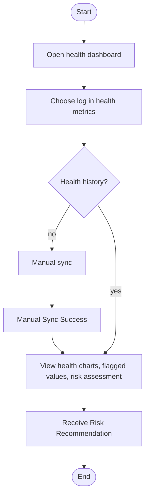
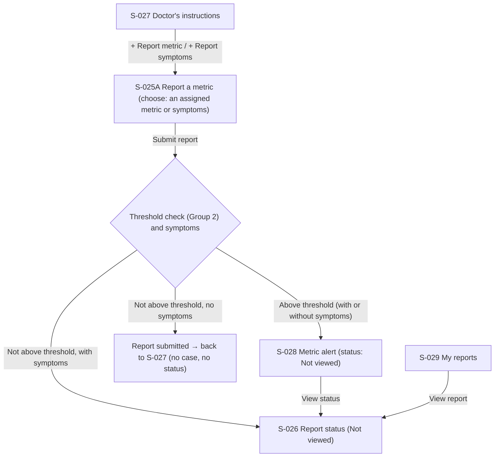
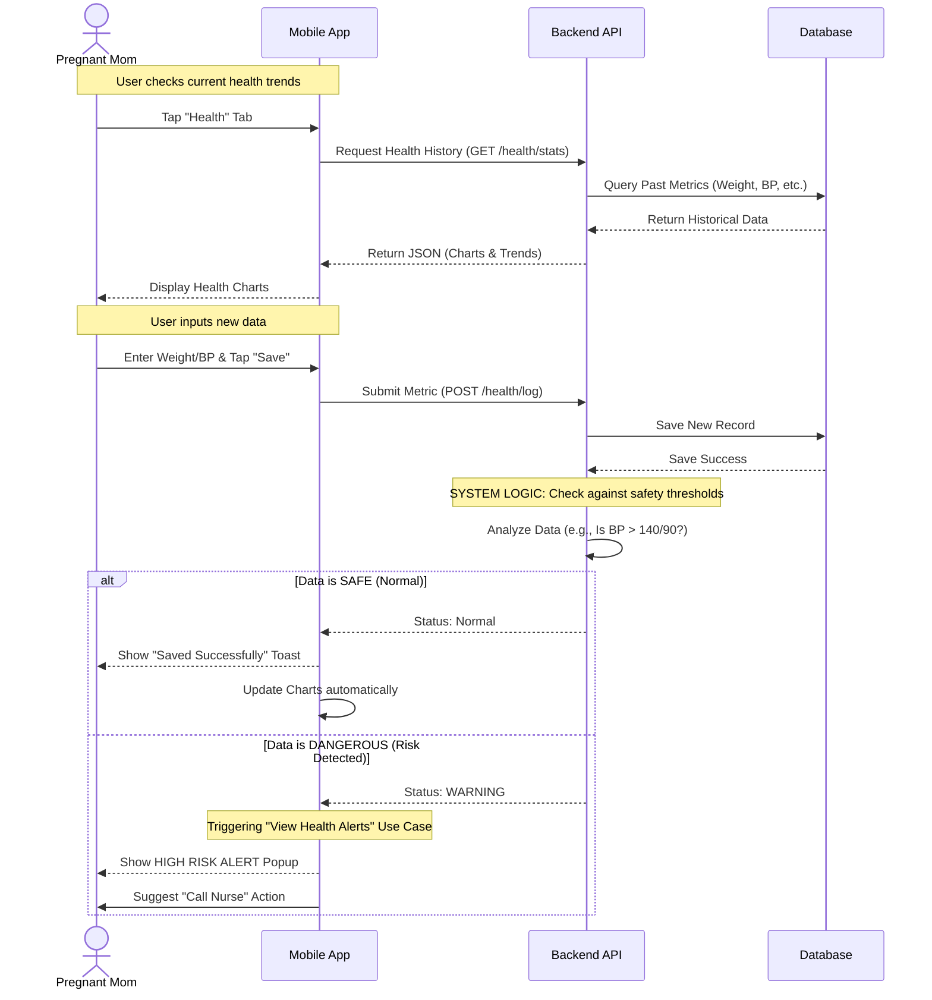

<!-- DBIZ3-SNAPSHOT source=specs/spec-ALR.md sha256=95fca3d7d8bed00ce46b4216b890ce3dbfc36a0311525336be0d147b65f34375 taken=2026-10-21T08:16Z -->
<!-- Read-only copy for Spec Kit. Do not edit here. Edit specs/spec-ALR.md, then run:
     uv run tools/start_feature.py --refresh -->

# Spec Document: Risk Feedback & Mom Alert

| Field | Value |
|---|---|
| Module ID | `ALR` |
| Module name | Risk Feedback & Health Alerts — UI: "Report" / "My reports" / "Metric alert" |
| Spec version | v1.8.0 (14/10/2026: PRD alignment — symptom list D-73 replaces D-23; thresholds cite PRD M3; Q21, Q22) — v1.7.3 (30/09/2026: data-model review decisions applied — DM-03, DM-05, DM-32, DM-40; responsible doctor D-68; 29/09/2026: fetal heart rate reference range aligned with the latest MVP Scope; review 29/09/2026: ALR-01 – ALR-05, X-01 – X-03, X-05, X-07 / DM-25 data types) |
| Author (team member) | Tâm (drafted 16/09/2026) — diagrams checked node by node by Sang, 17/09/2026 (verifier ≠ converter) |
| Date | 14/10/2026 |
| Status | Draft |
| Approved by (Client role) | *pending* |
| DBIZ2 source | Function List rows `F-045`–`F-050`, `F-072`–`F-076`, `F-081`, `F-082`, `F-097`, `F-100` (15 rows); Screens `S-025A` (D-38), `S-026`, `S-028`, `S-029`; `S-030` Removed (D-05); `S-024` belongs to `HLT` (D-07) |

---

## 1. Purpose and scope (mandatory)

This module lets the mother **submit a report** on a Group 2 metric (blood pressure, blood glucose, urine protein) or on symptoms she notices, checks the report against the defined clinical thresholds, and routes the report to clinical staff when needed. Reports flow **mother → hospital**, not the other way round (MVP v8 §5).

**Key principles**

- **The mother reports only a flagged indicator or a symptom** (MVP v8 §4 "Report a Flagged Indicator or Self-Observed Symptom"): a Group 2 metric (blood pressure, blood glucose, urine protein) that is in her "Doctor's instructions" (= watch-flag), or symptoms she notices (D-11 as revised, ALR-02). Every Group 2 value she reports is checked against thresholds. Group 1 metrics are not part of this module and are never checked against thresholds (`spec-HLT.md` BR-003).
- **A report with symptoms is always sent to a nurse** (into the queue, status "Not viewed"), even when the value is not above threshold (D-20).
- **"Alert" is used only when a report is above threshold** (S-028 "Metric alert") (D-22). A report that only has symptoms is not called an "Alert".
- A Normal report with no symptoms creates no status; it is shown as "No action needed" (D-21). This applies to all three Group 2 metrics (D-19, D-31).

**MVP objectives (MVP v8 §4).** *Instant Triage* — the mother's risk awareness comes from the threshold label shown with every Group 2 value (S-023, S-025, S-029), the "Metric alert" popup when a report is above threshold (S-028) and the care team's response on S-026; no separate risk summary is needed (FR-017 Won't). *Seamless Handover* — the case carries the report (value, measurement time, symptoms, the mother's note) or the chatbot question into the nurse queue (S-061) and the mother's quick profile (S-064), and "Escalate to doctor" passes the same case to the doctor, so the mother does not have to repeat her situation (FR-020, FR-021, FR-009).

**In scope**

- Shared report screen S-025A: choose a metric **that is in the mother's Doctor's instructions** or symptom mode, enter the value, measurement time, symptoms (fixed list of PRD alarm symptoms, D-73) and a note; "Submit report" button.
- Storing the report (FR-020) and creating the case "Not viewed" after the threshold check (FR-021) — also used for chatbot cases (`spec-BOT.md` FR-008).
- Threshold check and routing after submission (D-19): to S-028 / S-026 / back to S-027.
- "Metric alert" (S-028) with "Doctor's guidance" when above threshold (D-24).
- Report status (S-026) with 4 statuses (D-18) and the clinical staff response.
- "My reports" (S-029 — D-06 as revised): the list of the mother's reports and chatbot cases with their status, filtered by status and by type.
- Creating the "Not viewed" report queue for clinical staff (feeds `CLI`) and a high-priority notification to the doctor **in the clinical web** when a nurse chooses "Escalate to doctor" (D-29, ALR-03).
- Notifications to the mother: report responses / status (FR-018), new visit results (FR-019), Doctor's-instruction reminders (FR-022) — delivered via the TCI app (X-05).
- A library of guidance templates and individual guidance for each mother (D-24).

**Out of scope**

- Nurse / doctor case handling on the web (S-061, S-064: mark as viewed, escalate to doctor, send guidance, close case, remove red flag, create/edit instructions) — belongs to `CLI`. This module defines the statuses and data; `CLI` performs the actions.
- Dashboard display, entry of Group 1 self-tracked metrics (S-024), the "Doctor's instructions" list (S-027), metric history (S-025) — belong to `HLT`.
- Configuring threshold values — this module only uses the thresholds set in BR-004 (D-14; D-15 prepared by the team based on ADA / Ministry of Health guidance, to be confirmed by a Thu Cuc doctor before real use).
- Algorithmically generated recommendations (S-030 "Risk Recommendations") — removed (D-05).
- A risk assessment summary for the mother (former S-029 tab 1, FR-017: 7 / 30-day summary per metric) — **Won't**: not in the MVP; the mother's functions are "Report a Flagged Indicator or Self-Observed Symptom" and "View Report Status & Care Team Response" only (ALR-01).
- Reporting a Group 2 metric that is **not** in the Doctor's instructions — not possible in the MVP (ALR-02).
- Push / SMS notifications to clinical staff — not in the MVP; staff are notified inside the clinical web (ALR-03).

**Depends on**

- `HLT` for "Doctor's instructions" (Watch-Flag, including `over_threshold_guidance`) and Health Metric Record.
- `CLI` for clinical staff to receive and handle reports (S-061, S-064).
- `ACC` for the mother's identity, gestational week (FR-015) and the Notification entity (notifications to the mother — FR-018, FR-019, D-48).

## 2. Actors (mandatory)

| Actor | Role in this module | Where it comes from |
|---|---|---|
| Mom | Primary (submits reports, views the status of her reports) | MVP v8 §3/§5 |
| User (Mom, viewing her own reports) | Primary | Function List `Actor` column (`F-046`, `F-047`, `F-049`, `F-050`) |
| Nurse | Secondary (marks as viewed, escalates to doctor, sends guidance, closes cases **only if not escalated to a doctor** — D-37) | D-29, D-37 (in place of the `Doctor` actor of `F-048`) |
| Doctor | Secondary (reviews cases "Escalated to doctor", sends guidance and closes them — which removes the red flag (D-37, D-44); writes "Above-threshold guidance" in Doctor's instructions). Does not "Mark as viewed" (D-43 as revised) | Function List (`F-048`); D-24, D-29 |
| System | Secondary (threshold check, status creation, sending notifications) | Function List `Actor` column |

## 3. User scenarios and acceptance criteria (mandatory)

### US-1 (P1): Submit a metric or symptom report

**Journey.** As a `Mom`, I want to `report a metric my doctor asked me to monitor, or symptoms I notice`, so that `the system tells me whether clinical staff need to act, and forwards the report to them when needed`.

**Acceptance scenarios**

1. **Given** S-027, **When** the mother taps "+ Report metric" on a metric card or "+ Report symptoms", **Then** S-025A opens with the corresponding metric (or symptom mode) selected; "Change metric ▾" lists **only the metrics in her Doctor's instructions** plus symptom mode (ALR-02). There is no "+ Report another metric" button.
2. **Given** a metric is selected, **Then** S-025A shows the "Doctor's instructions" box (how to measure, frequency); **Given** symptom mode, **Then** this box is hidden. **Given** the mother has no Doctor's instructions, **Then** only symptom mode is available.
3. **Given** a Group 2 metric, **Then** S-025A shows the threshold card per BR-004 (D-14, D-15): blood pressure "Above threshold when ≥ 140/90 mmHg" (on-screen text; means systolic ≥ 140 or diastolic ≥ 90 mmHg — D-14); blood glucose — the mother selects the measurement timing (Fasting / 1 h after meal / 2 h after meal) and the card shows the matching threshold ≥ 5.3 / ≥ 7.8 / ≥ 6.7 mmol/L; urine protein "Above threshold when ≥ 1+". **Given** a symptom report, **Then** the threshold card and the numeric input are hidden.
4. **Given** the mother taps "Submit report" with a value **above threshold** (blood pressure, blood glucose or urine protein; with or without symptoms — D-19, D-32), **Then** the system saves the report (FR-020), creates the case with status "Not viewed" (FR-021), and shows the S-028 "Metric alert" popup (value, measurement time, threshold, the sentence "Your report has been sent to clinical staff", "Doctor's guidance", and the buttons "View status" / "Call hotline / nurse" / "Close").
5. **Given** the value is not above threshold but **symptoms are present**, **When** submitted, **Then** the report is saved (FR-020), the case is created (FR-021), "Report submitted" is shown and S-026 opens with status "Not viewed".
6. **Given** the value is not above threshold and there are **no symptoms** ("No symptoms") — for blood pressure, blood glucose and urine protein alike, **When** submitted, **Then** the report is saved (FR-020), "Report submitted" is shown and the app returns to S-027; no case and no status are created (D-19, D-21, D-31).
7. **Given** the mother has not selected any item in the symptom list (including "No symptoms"), **Then** "Submit report" does not submit and an error is shown under the symptom field (D-45, BR-017).

### US-2 (P1): View the status of my reports

**Journey.** As a `Mom`, I want to `see what happened after I submitted a report`, so that `I know whether I need to do anything else`.

**Acceptance scenarios**

1. **Given** the mother has submitted reports, **When** she opens S-029 "My reports" (from the "My reports" card on S-008 / S-023), **Then** she sees a list of reports with threshold label, value, submission time `dd/mm/yyyy · HH:mm` and status (or "No action needed" for Normal reports with no symptoms), and her chatbot cases (question + source "Chatbot"); she can filter by "All / Not viewed / Viewed / Escalated to doctor / Resolved" and by type (metric / Symptom / Chatbot).
2. **Given** a report that has a status, **When** the mother taps it, **Then** S-026 opens (4-step progress; a skipped step reads "No doctor escalation needed"; a step that has not happened yet is an empty circle).
3. **Given** the report has no response yet, **Then** S-026 shows the "Safety note" box; **Given** a response exists, **Then** it shows "Response from …" and hides the "Safety note" (D-25).

### US-3 (P2): View the risk assessment — **Won't (ALR-01)**

Not in the MVP: the mother's functions are only "Report a Flagged Indicator or Self-Observed Symptom" and "View Report Status & Care Team Response" (MVP v8 §4); alerts go mother → clinical team, with no risk summary sent back. The former S-029 tab 1 (7 / 30-day summary) and FR-017 are removed; S-029 is now "My reports" only (US-2).

### Edge cases

- The mother wants to report a Group 2 metric that is not in her Doctor's instructions — **not possible:** "Change metric ▾" lists only assigned metrics and symptom mode (MVP v8 §4 "Flagged Indicator"; ALR-02). A mother with no instructions can only report symptoms.
- A symptom report with no measured value — **decided:** not compared against thresholds, always goes to the nurse queue (D-20); threshold label "Not assessed" (S-029 "My reports").
- A value missing its unit / outside a physically plausible range (typing error) — `[NEEDS CLARIFICATION: D-16, valid range has no figures yet]`.
- The mother submits several reports on the same metric within a short time — `[NEEDS CLARIFICATION: not covered by any source]`.
- A blood glucose / urine protein report **without** symptoms — **decided:** these metrics have thresholds (D-15), so they follow D-19 like blood pressure: above threshold → S-028; not above threshold → no case created (D-31).
- A report that is both above threshold and has symptoms — **decided:** the above-threshold branch (S-028) takes priority (D-32).
- The mother closes the S-028 popup — the report is not cancelled (S-028).

## 4. Flows (mandatory)

### 4.1 Usage flow

**(a) DBIZ2 flow** — textualized from the "Health metric" usage flow (`docs/architecture/usage-flow.md`), the logging / reporting part from "Open health dashboard" onward; node labels copied verbatim, no nodes added.

Mapping (team decision, not DBIZ2): "Choose log in health metrics" / "Manual sync" corresponds to reporting an assigned Group 2 metric or symptoms on S-025A (this module) and entering Group 1 metrics on S-024 (`HLT`, D-07); "Receive Risk Recommendation" is shown on S-028 / S-026 (D-05). The words "risk assessment" in the DBIZ2 node are kept verbatim; the MVP has no risk assessment screen for the mother (ALR-01) — flagged values are shown with their threshold label on S-023 / S-025 / S-029. See (b).

**(b) Reporting flow per the wireframe** — **not a DBIZ2 diagram**; drawn from the wireframe and D-19, D-20, D-21, D-22. Applies to blood pressure, blood glucose and urine protein (D-15, D-31, D-32).

### 4.2 Sequence for the main flow

Textualized from DBIZ2 `Schematic2`, Figure 15 (image40.png, "Track Health Status"). This module holds the full diagram; `spec-HLT.md` §4.2 quotes messages 1–6.

**Mapping of Figure 15 to the MVP screens**

| Figure 15 | MVP behaviour | Basis |
|---|---|---|
| "Enter Weight/BP & Tap Save" | Weight → S-024 "Save metrics" (`HLT`, no threshold check). Blood pressure → S-025A "Submit report" (this module). | D-07, D-11 |
| "Is BP > 140/90?" | Above threshold when **systolic ≥ 140 or diastolic ≥ 90 mmHg** | D-14 (per MVP v8) |
| SAFE branch: "Saved Successfully" Toast | "Report submitted" → back to S-027 (if no symptoms) or → S-026 "Not viewed" (if symptoms) | D-19, D-20, D-21 |
| DANGEROUS branch: "HIGH RISK ALERT Popup" | S-028 "Metric alert" (popup over S-025A) | D-22 |
| "Suggest Call Nurse Action" | "Call hotline / nurse" button on S-028 | wireframe S-028 |
| (not in Figure 15) | "With symptoms" branch and report status | D-19, D-20 — team addition, not DBIZ2 |

The nurse / doctor side continues in `spec-CLI.md` (§4.1(b), §4.2).

## 5. Functional requirements (mandatory)

| FR ID | DBIZ2 Subfunction ID | Requirement (system MUST ...) | Actor | Priority | Screen |
|---|---|---|---|---|---|
| FR-001 | F-045 | The system MUST load the health alert module for monitoring and reviewing health-related alerts. In the MVP: opens S-029 "My reports" (ALR-01). | User | Must | S-029 |
| FR-002 | F-046 | The system MUST display an overview list of health alerts associated with the user or assigned patients. In the MVP (mother): the list of her reports and chatbot cases on S-029 "My reports". | User | Must | S-029 |
| FR-003 | F-047 | The system MUST allow filtering and sorting of alerts based on severity, status, or time. In the MVP: filter by the 4 statuses (D-18) and by type (Blood pressure / Blood glucose / Urine protein / Symptom / Chatbot). `[NEEDS CLARIFICATION: the wireframe has no sorting; the default display order (newest submission first) is inferred from the example]` | User | Must | S-029 |
| FR-004 | F-048 | The system MUST update the status of a selected alert to indicate it has been reviewed. In the MVP: changes to "Viewed" — by the nurse ("Mark as viewed"), or recorded automatically when a case still "Not viewed" is escalated or closed (D-43 as revised). | **Nurse** (D-29, D-43) | Should | S-064 (`CLI`); displayed on S-026 |
| FR-005 | F-049 | The system MUST display detailed information for a selected health alert. In the MVP: report details (report code, metric, threshold label, value, measurement / submission time, symptoms, note, progress, response). | User | Must | S-026 |
| FR-006 | F-050 | The system MUST provide navigation to a detailed view of the selected alert. In the MVP: "View report" from S-029; "View status" from S-028. | User | Must | S-029 → S-026; S-028 → S-026 |
| FR-007 | F-082 | The system MUST display recommended actions or guidance based on health metrics and alerts. In the MVP: S-030 is removed (D-05); guidance is shown on S-028 ("Doctor's guidance" when above threshold) and S-026 (clinical staff response). No algorithmically generated recommendations are used. | System | Must | S-028, S-026 |
| FR-008 | F-097 | The system MUST load the list of incoming health alerts that have not yet been verified by clinical staff, to prioritize processing. In the MVP: the queue of "Not viewed" reports (above threshold or with symptoms). | System | Must | S-061 (`CLI`) |
| FR-009 | F-100 | The system MUST automatically send a high-priority push notification or SMS to the doctor when an alert is escalated. In the MVP: triggered when **the nurse taps "Escalate to doctor"** → status "Escalated to doctor" + high-priority notification to the **responsible doctor** (D-29), shown **inside the clinical web** (the "Notifications" button on S-061 / list S-059) — **no push, no SMS** (ALR-03: the MVP has no messaging gateway). The responsible doctor is the doctor the hospital assigned to the mother (active Patient Assignment, `spec-CLI.md` §6; seed data in the MVP — D-68, DM-10). The notification is not stored (DM-32). | System | Should | S-064 / S-061 (`CLI`) |
| FR-010 | F-072 | The system MUST load the health data logging module for recording patient-reported health metrics. In the MVP: opens S-025A from S-027. | Mom | Must | S-025A |
| FR-011 | F-073 | The system MUST display an overview list of available health metrics for logging or review. In the MVP: the "Change metric ▾" selector — **only the Group 2 metrics in the mother's active Doctor's instructions** + symptom mode (ALR-02). | Mom | Must | S-025A |
| FR-012 | F-074 | The system MUST render a form for entering or editing a health metric value. In the MVP: the form for the selected metric. | Mom | Must | S-025A |
| FR-013 | F-075 | The system MUST render manual input fields for user-entered health metric data. In the MVP: blood pressure (systolic, diastolic — mmHg), blood glucose (mmol/L) **with a mandatory measurement-timing selector: Fasting / 1 h after meal / 2 h after meal** (D-15), urine protein (Negative / Trace / 1+ / 2+ / 3+); symptoms: numeric field hidden. | Mom | Must | S-025A |
| FR-014 | F-076 | The system MUST validate user-entered health metric values before submission. Valid range (blocks typing errors; distinct from the clinical threshold): `[NEEDS CLARIFICATION: D-16]`. Blood glucose must have a measurement timing (`glucose_context`) (D-15). The "Other" symptom description is ≤ 100 characters (D-23, kept by D-73). | System | Must | S-025A |
| FR-015 | F-081 | The system MUST attach pregnancy-related context (e.g., gestational week) to a submitted health record. | System | Must | (not displayed; stored with the report) |
| FR-016 | — (new) | The system MUST provide a library of guidance templates and allow a doctor to write custom guidance for an individual mother; the doctor's "Above-threshold guidance" is prepared when creating a "Doctor's instructions" entry (S-064), and S-028 falls back to the hospital's default template when none exists. Staff responses in S-026 may also use a template or custom text. | Doctor / Nurse / System | Must (D-24, D-36) | S-064 (`CLI`), S-028, S-026 |
| FR-017 | — (new) | The system MUST display a risk assessment summary per Group 2 metric (blood pressure, blood glucose, urine protein) and reported symptoms for a selectable period of 7 or 30 days: latest value, threshold label, source label, threshold, and number of over-threshold measurements out of total. | System | **Won't (ALR-01)** — not in the MVP; the former S-029 tab 1 is removed | — |
| FR-018 | — (new) | The system MUST create a notification for the mother (`spec-ACC.md` entity Notification, type "Report") when her case changes status or receives a staff response, respecting her notification settings (S-010). Delivered via the TCI app (X-05). | System | Must (D-48, D-56) | S-009 → S-026 |
| FR-019 | — (new) | The system MUST create a notification for the mother (`spec-ACC.md` entity Notification, type "Visit result") when a new Visit record for her becomes available in the sub-app, respecting her notification settings ("New visit results" on S-010). The notification carries no threshold assessment and is never displayed as an "Alert" (BR-003, D-22). Triggered when a Visit record for the mother is inserted (in the MVP demo: by loading seed data — §10 Q18, D-59). Delivered via the TCI app (X-05). | System | Must (D-48, BR-003) | S-009 → S-023; card on S-008 |
| FR-020 | — (new) | The system MUST store a submitted report: one **Metric Report** (report code, symptoms, "Other" text, note, submitted time, the Watch-Flag it answers) and, for a metric report, **one Health Metric Record** (metric, value, unit, `glucose_context`, measured time, source "Doctor-assigned", gestational week — FR-015). A symptom report stores no Health Metric Record (D-41). | System | Must (X-01) | S-025A |
| FR-021 | — (new) | The system MUST create a **Case** with status "Not viewed" and a first status-history row (changed by System) when (a) a stored report is above threshold — `case_source` = Metric report (with or without symptoms, D-32); (b) a stored report is not above threshold but has at least one symptom — `case_source` = Symptom (BR-007); (c) the mother taps "Connect to nurse" in the chatbot — `case_source` = Chatbot (called by `spec-BOT.md` FR-008, D-34). No case is created for a report that is not above threshold with "No symptoms" (BR-008 branch 3). | System | Must (X-01) | S-025A → S-028 / S-026; S-034; queue S-061 |
| FR-022 | — (new) | The system MUST create a notification for the mother (`spec-ACC.md` entity Notification, type "Instruction reminder") reminding her to measure and report a metric in her active Doctor's instructions, only when the "Doctor's-instruction reminders" switch on S-010 is on. Delivered via the TCI app (X-05). When a reminder is created: `[NEEDS CLARIFICATION: trigger / frequency — §10 Q20; team proposal: follow the measuring frequency the doctor writes in the instruction note]`. | System | Should until §10 Q20 is answered (ACC-02, ALR-04) | S-009 → S-027 (proposed); S-010 |

### 5.1 Input / Output contract

*"Alert ID" in this table = `case_id` of the **Case** entity (§6, D-41).*

*Module boundary (X-02, DM-12): FR-004, FR-009 and FR-016 define the data and the status change; the clinical staff action itself is performed on S-064 by `spec-CLI.md` FR-004 (Mark as viewed), FR-019 (Escalate to doctor) and FR-024 (Send guidance). Each pair is one behaviour, referenced from both specs — not two separate requirements. FR-004 and FR-009 have the priority of their `CLI` pair, **Should**, as the MVP v8 §5 item "Nurse Triage & Alert Verification" (Should) that closes the loop of the Must item "Risk Feedback & Health Alerts"; FR-016 stays Must because S-028 needs the default guidance template (D-36).*

| FR ID | Input field | Type | Required | Output field | Type | Notes / validation |
|---|---|---|---|---|---|---|
| FR-001 | Navigation Request | EVENT (no payload) | Yes | *(UI navigation target)* | — | Opens S-029 "My reports" |
| FR-002 | User ID | UUID | Yes | *(UI navigation target)* | — | The mother's list of reports |
| FR-003 | Status Filter; Type Filter | ENUM (All / Not viewed / Viewed / Escalated to doctor / Resolved); ENUM (All / Blood pressure / Blood glucose / Urine protein / Symptom / Chatbot) | No | *(UI navigation target)* | — | D-18 |
| FR-004 | Alert ID; Status = "Viewed"; Actor ID | UUID; ENUM; UUID | Yes | DB Updated + Timestamp | CONFIRMATION; DATETIME | Changed by: Nurse, or recorded automatically on escalate / close (D-29, D-43); S-026 shows "`dd/mm/yyyy · HH:mm` · Nurse Trần Thị B" |
| FR-005 | Alert ID | UUID | Yes | *(UI navigation target)* | — | S-026 |
| FR-006 | Click "View report" / "View status" | EVENT (no payload) | Yes | *(UI navigation target)* | — | Only reports that have a status open S-026 |
| FR-007 | Watch-Flag.over_threshold_guidance or Default Guidance Template (S-028); Staff Response (S-026) | OBJECT (template_id, custom_text); OBJECT (Staff Response) | Yes | *(UI navigation target)* | — | D-05, D-24 |
| FR-008 | Status Filter = "Not viewed" | ENUM | Yes | *(UI navigation target)* | — | Queue for `CLI` |
| FR-009 | Escalation Event (nurse taps "Escalate to doctor"); Responsible Doctor ID | EVENT; UUID | Yes | Status = "Escalated to doctor"; Notification to Doctor | ENUM; CONFIRMATION | High-priority notification (D-29) **inside the clinical web** (S-061 "Notifications" / S-059); no push / SMS (ALR-03). Not stored as a Notification row (DM-32): the clinical web shows the cases in "Escalated to doctor" whose `assigned_doctor_id` is the signed-in doctor; no read / unread state. Responsible doctor = the mother's active Patient Assignment (`spec-CLI.md` §6, D-68) |
| FR-010 | Navigation Request (with the metric from S-027, if any) | EVENT; ENUM | Yes | *(UI navigation target)* | — | — |
| FR-011 | Patient ID; Active Watch-Flags | UUID; LIST of Watch-Flag | Yes | Available Metrics List | LIST of ENUM (the assigned metrics among Blood pressure / Blood glucose / Urine protein, + Symptom) | Only metrics with an active Doctor's instruction, plus symptom mode (ALR-02); no fetal heart rate (D-12), no Group 1 |
| FR-012 | Selected Metric Type | ENUM | Yes | *(UI navigation target)* | — | Shows/hides the instructions box and the threshold card depending on the metric |
| FR-013 | Metric Type; glucose_context | ENUM; ENUM (fasting / post_1h / post_2h) | Yes; Yes when metric = Blood glucose | *(UI navigation target)* | — | See FR-013 in §5; D-15 |
| FR-014 | User Entered Value; glucose_context; symptoms[]; other_symptom_text | NUMBER / ENUM (metric-dependent); ENUM (fasting / post_1h / post_2h); LIST of ENUM; VARCHAR(100) | Value: Yes, except for symptom reports; glucose_context: Yes when metric = Blood glucose; symptoms[]: Yes (≥ 1 item — D-45) | Valid/Error Message | BOOLEAN (+ error message) | Valid range: `[NEEDS CLARIFICATION: D-16]`; missing blood glucose measurement timing → error (D-15); no symptom selected → error (D-45); "No symptoms" excludes the other items (D-23) |
| FR-015 | Metric Report; Current Week | OBJECT; INTEGER | Yes | Context-Enriched Record | OBJECT | — |
| FR-016 | Template ID and/or Custom Text; Author ID | UUID; TEXT; UUID | Yes (at least one of template_id / custom_text) | Guidance stored | UUID | Custom text ≤ 1000 characters (D-46) |
| FR-017 | — | — | — | — | — | **Won't (ALR-01)** |
| FR-018 | Case ID; Event (status change / staff response) | UUID; ENUM | Yes | Notification created | UUID | Created only when the "Report responses" type is switched on in S-010 `[NEEDS CLARIFICATION: is this switch locked always-on — S-010]` (D-48) |
| FR-019 | Visit ID; User ID | UUID; UUID | Yes | Notification created | UUID | Created only when the "New visit results" type is switched on in S-010 (D-48). Triggered when a Visit record is inserted (seed data in the demo — §10 Q18, D-59). |
| FR-020 | Metric Report data (see the table below); Watch-Flag ID; Current Week | OBJECT; UUID (empty for a symptom report); INTEGER | Yes | Report ID; Health Metric Record ID | UUID; UUID (empty for a symptom report) | Stores METRIC_REPORT + REPORT_SYMPTOM rows + (metric report only) HEALTH_METRIC_RECORD, in one transaction (D-41) |
| FR-021 | Report ID + threshold result + symptoms[] — or — Chat Message ID (from `spec-BOT.md` FR-008) | UUID + ENUM (Normal / Above threshold / Not assessed) + LIST of ENUM — or — UUID | Yes | Case ID (or none) | UUID | Creates CARE_CASE (status "Not viewed") + the first CASE_STATUS_HISTORY row (role = System) per BR-008 / BR-007 / D-34; exactly one of `metric_report_id` / `chat_message_id` is set (D-41) |
| FR-022 | User ID; Watch-Flag ID | UUID; UUID | Yes | Notification created | UUID | Created only when "Doctor's-instruction reminders" is on in S-010. Trigger / frequency `[NEEDS CLARIFICATION: §10 Q20]` |

**Metric Report — data fields submitted from S-025A**

| Field | Type | Required | Notes |
|---|---|---|---|
| metric | ENUM (Blood pressure / Blood glucose / Urine protein / Symptom) | Yes | FR-011 |
| value | NUMBER / NUMBER pair (systolic/diastolic) / ENUM (urine protein) | Yes, except when metric = Symptom | FR-013, FR-014 |
| unit | VARCHAR (mmHg / mmol/L / —) | Yes when there is a value | — |
| `glucose_context` | ENUM (fasting / post_1h / post_2h) — UI: Fasting / 1 h after meal / 2 h after meal | Yes when metric = Blood glucose; empty for other metrics | Selects the applicable blood glucose threshold (BR-004, D-15) |
| `measured_at` | DATETIME | Yes | Entered in "Measured at", displayed as `dd/mm/yyyy · HH:mm` |
| `submitted_at` | DATETIME | Yes (set by the system) | — |
| `symptoms[]` | LIST of ENUM: No symptoms / Vaginal bleeding / Severe abdominal pain / Waters breaking or fluid leakage / Severe headache, dizziness or blurred vision / Absence of fetal movement / Palpitations / Other | **Yes — at least 1 item; "No symptoms" counts** (D-45). In symptom-report mode "No symptoms" is hidden (D-45, proposed) | D-73 (replaces D-23; list pending SME, §10 Q21); "No symptoms" excludes the other items |
| `other_symptom_text` | VARCHAR(100) | Only when "Other" is selected | D-23 (limit kept by D-73) |
| `note` | TEXT | No | "Note" on S-025A. Maximum length: `[NEEDS CLARIFICATION]` (§10 Q14) |
| `source` | ENUM (Doctor-assigned) | Yes (assigned by the system) | D-10; every metric the mother can report is in her Doctor's instructions, so a reported Group 2 value is always "Doctor-assigned" (D-33 as revised, ALR-02) |
| gestational_week | INTEGER | Yes (assigned by the system) | FR-015 |

*Storage (D-41): `metric`, `value`, `unit`, `glucose_context`, `measured_at`, `source`, `gestational_week` are stored as **one Health Metric Record** (`spec-HLT.md` §6); `symptoms[]`, `other_symptom_text`, `note`, `submitted_at` and the report code are stored in **Metric Report**, which points to that record. A symptom report (metric = Symptom) does not create a Health Metric Record.*

### 5.2 Business rules

| Rule ID | Rule | Why it exists |
|---|---|---|
| BR-001 | A metric the doctor has assigned for monitoring ("Doctor's instructions" = the MVP's "watch-flag") is never removed automatically by the system. Only a doctor may remove a red flag and add / edit instructions. | Session 4 assignment document; D-29. |
| BR-002 | Only a report with a value **above threshold** creates an "Alert" (S-028). A report that is not above threshold but has symptoms still goes to the nurse queue (BR-007) but is not called an "Alert". A Normal report with no symptoms does not notify clinical staff. | MVP v8 §5 steps (3)–(5); Figure 15 `alt`; D-20, D-22. |
| BR-003 | The routine notification sent when a new visit record exists is a different notification type from an "Alert" and is never displayed as an "Alert". The notification is created by FR-019. | MVP v8 §5 (verbatim: "routine Update Notification … distinct from a Risk Alert"). |
| BR-004 | Thresholds used for the check (not configured in this module): **blood pressure is above threshold when systolic ≥ 140 mmHg OR diastolic ≥ 90 mmHg** (D-14); **blood glucose** (capillary, according to the measurement timing the mother selects — `glucose_context`): fasting **≥ 5.3 mmol/L**, 1 h after meal **≥ 7.8 mmol/L**, 2 h after meal **≥ 6.7 mmol/L** → Above threshold (D-15); **urine protein** (dipstick): Negative / Trace → Normal, **≥ 1+** → Above threshold (D-15); **fetal heart rate:** the 110–160 bpm range is **display only** — shown as a reference range next to the "From visit" value; it gives no threshold label, is not checked, is never reported by the mother and never creates a report, a case or an "Alert" (D-12; MVP Scope (latest) §5: the 110–160 bpm range is "shown for reference" / "for display only" and does not raise an alert). *Source of the D-15 thresholds: prepared by the team based on ADA / Ministry of Health guidance, status **Pending SME** — must be confirmed by a Thu Cuc doctor before real use.* The values are stored in the Threshold Rule configuration table (§6, D-52), not hard-coded. | MVP v8 §5 and PRD M3 (14/10/2026), which states the same values; D-12, D-14, D-15. The ≥ / > conflict with Figure 15 is settled in favour of MVP v8 (D-14). |
| BR-005 | There are only 3 threshold labels: Normal / Above threshold / Not assessed. "Not assessed" = no data yet (or a report with symptoms only and no measured value). All three Group 2 metrics have thresholds (D-14, D-15). Low / Moderate / High or "Slightly elevated" are not used. | D-17; S-029. |
| BR-006 | The mother can report only a Group 2 metric that is in her active Doctor's instructions (a flagged indicator), or symptoms. Every Group 2 value she reports is checked against thresholds. | MVP v8 §4 "Report a Flagged Indicator or Self-Observed Symptom"; D-11 as revised (ALR-02). |
| BR-007 | A report with at least one symptom (other than "No symptoms") is always sent to a nurse, with initial status "Not viewed", regardless of the threshold check result. This holds for every item of the D-73 list — the five PRD alarm symptoms, Palpitations and Other. | D-20; PRD M3 symptom checklist; D-73 (team kept BR-007, 14/10/2026). |
| BR-008 | Routing after "Submit report", for all three Group 2 metrics (blood pressure, blood glucose, urine protein): (1) above threshold (with or without symptoms) → S-028 "Metric alert"; (2) not above threshold but with symptoms → "Report submitted" → S-026 ("Not viewed"); (3) not above threshold and no symptoms selected → the mother is fine, "Report submitted" → back to S-027, no case created, no status. | D-19, D-31, D-32. |
| BR-009 | A Normal report with no symptoms has no status; S-029 "My reports" shows "No action needed" and does not open S-026. | D-21; S-029. |
| BR-010 | The word "Alert" is used only for above-threshold reports (S-028). | D-22. |
| BR-011 | The "Safety note" on S-026 is shown only while the report has no response (status Not viewed / Viewed / Escalated to doctor with no response yet); once a response exists it is hidden. Its content is approved by the hospital. | D-25; S-026. |
| BR-012 | A single status set, shared by the mother and clinical staff (see the table below). The "Escalated to doctor" step is optional; if skipped, S-026 shows "No doctor escalation needed" and does not mark it as done. | D-18; S-026. |
| BR-013 | Guidance for the mother has 2 forms: a selected ready-made template or text written individually by the doctor. S-028 shows the "Above-threshold guidance" prepared in the instructions; if there is none, it shows the hospital's default template. | D-24. |
| BR-014 | Closing the S-028 popup does not cancel the report. | Wireframe S-028. |
| BR-015 | "Send guidance" (nurse or doctor) does not change the case status. "Close case" → "Resolved". A nurse may "Close case" only for a case **not** escalated to a doctor; a case in status "Escalated to doctor" can only be closed by a doctor; only a doctor may remove a red flag. The "Close case" button is hidden/disabled for the nurse once the case has been escalated to a doctor (action performed in `CLI`). | D-37; MVP v8 (nurse "closes it with guidance"). |
| BR-016 | Case status only moves forward: Not viewed → Viewed → (Escalated to doctor, optional) → Resolved. If "Escalate to doctor" or "Close case" is used while the case is still "Not viewed", the system first records the "Viewed" step (same person, same time). Only the nurse uses "Mark as viewed"; a doctor works on cases already "Escalated to doctor", whose "Viewed" step is already recorded. Every change is recorded in `status_history`. | D-43 (as revised). |
| BR-017 | A report must have at least 1 symptom item; "No symptoms" counts and excludes the other items. | D-45. |

**Report status set (D-18)**

| Status | Meaning | Set by |
|---|---|---|
| Not viewed | The report is in the queue; no clinical staff member has viewed it yet | System, when an above-threshold or with-symptoms report is created |
| Viewed | A nurse has opened it and marked it as viewed (or the step was recorded automatically on escalate / close) | Nurse (FR-004, D-29, D-43) |
| Escalated to doctor | The nurse has escalated the case to the responsible doctor; the system sends a high-priority notification inside the clinical web | Nurse (FR-009, D-29) |
| Resolved | The case is closed, with a response / guidance for the mother | "Close case": Nurse — only for cases **not** escalated to a doctor; Doctor — cases "Escalated to doctor" (D-37, CLI-02). "Send guidance" does not change the status (D-37) |

## 6. Key entities

| Entity | Attributes | Relationships |
|---|---|---|
| Case (UI: "case", "report status"; called "Alert" only when above threshold) | case_id (UUID; Required), patient_id (UUID; Required), `case_source` (ENUM: **Metric report / Symptom / Chatbot** — D-41; Required; "Metric report" = above threshold, possibly with symptoms; "Symptom" = not above threshold but with symptoms, or a symptom report), `status` (ENUM: **Not viewed / Viewed / Escalated to doctor / Resolved** — D-18; Required), metric_report_id (UUID; Required when `case_source` ≠ Chatbot, empty otherwise), chat_message_id (UUID; Required when `case_source` = Chatbot, empty otherwise — `spec-BOT.md` §6), assigned_doctor_id (UUID; Optional — set when Escalated to doctor, = the mother's active responsible doctor in Patient Assignment, D-68), created_at (DATETIME; Required), closed_at (DATETIME; Optional), closed_by (UUID; Optional). Status history: Case Status History rows (`spec-CLI.md` §6, D-43). No `severity` field (D-17) and no `trigger` field (D-41). "Red flag" = a case in status "Escalated to doctor", not a separate field (D-44) | 0..1 Case per Metric Report (only when above threshold or with symptoms — D-19, D-21); 0..1 Case per Chat Message (D-34); belongs to Patient; handled by Staff (`CLI`); has many Staff Responses; has many Case Status History rows |
| Metric Report | report_id (UUID; Required), `report_code`, e.g. BC-0926-015 (VARCHAR(20); Required) `[NEEDS CLARIFICATION: provisional type — generation rule, §10 Q16]`, patient_id (UUID; Required), `metric` (ENUM: Blood pressure / Blood glucose / Urine protein / Symptom; Required), health_metric_record_id (UUID; Required when metric ≠ Symptom, empty for a symptom report — D-41), `other_symptom_text` (VARCHAR(100); Optional — only when "Other" is selected), `note` (TEXT; Optional) `[NEEDS CLARIFICATION: maximum length — §10 Q14]`, `submitted_at` (DATETIME; Required), watch_flag_id (UUID; Optional — the instruction the report answers; empty for a symptom report). `threshold_label` is computed from the record + Threshold Rule, not stored (Normal / Above threshold / Not assessed — D-17) | submitted by Mom; points to 0..1 Health Metric Record (`HLT`); has 1..n Report Symptom; creates 0..1 Case |
| Report Symptom | report_id (UUID; Required), symptom (ENUM: No symptoms / Vaginal bleeding / Severe abdominal pain / Waters breaking or fluid leakage / Severe headache, dizziness or blurred vision / Absence of fetal movement / Palpitations / Other — D-73, replaces the D-23 list; the screen shows the PRD wording, e.g. "Waters breaking / fluid leakage"; Required). ≥ 1 row per report; "No symptoms" excludes the others (D-45) | belongs to 1 Metric Report |
| Threshold Rule (D-52) | rule_id (UUID; Required), metric (ENUM: Blood pressure / Blood glucose / Urine protein / Fetal heart rate; Required), `glucose_context` (ENUM: fasting / post_1h / post_2h; Optional — blood glucose only), `component` (ENUM: systolic / diastolic; Optional — blood pressure only), `combine` (ENUM: any / all; Optional — how the rows of one metric are joined), operator (ENUM: ≥ / outside range; Required), threshold_values (VARCHAR(20); Required — must hold both "140" and "1+"), unit (VARCHAR(10); Required), `purpose` (ENUM: Report check / Display only; Required — "Display only" = fetal heart rate: reference range shown next to the "From visit" value, no label, no check, D-12), source, e.g. MVP v8 / ADA – Ministry of Health (VARCHAR(100); Required), `confirmation_status` (ENUM: Confirmed / Pending SME; Required), effective_from (DATE; Required). Blood pressure = 2 rows: systolic ≥ 140, diastolic ≥ 90, `combine` = any | read by the threshold check (BR-004), the S-025A threshold card, the fetal heart rate reference range on S-023 / S-025, and the threshold lines on S-025 / S-064 |
| Guidance Template (D-24) | template_id (UUID; Required), title (VARCHAR(100); Required), content (TEXT, ≤ 1000 characters — D-46; Required), is_default — the hospital's default template (BOOLEAN; Required), metric (ENUM: Blood pressure / Blood glucose / Urine protein; Optional), created_by (UUID → Staff; Optional — templates loaded from seed have none) | selected in Watch-Flag.over_threshold_guidance (`HLT`) and in Staff Response |
| Staff Response | response_id (UUID; Required), case_id (UUID; Required), responder_id (UUID; Required), responder_role (ENUM: Nurse / Doctor; Required), template_id (UUID; Optional), custom_text (TEXT, ≤ 1000 characters — D-46; Optional), sent_at (DATETIME; Required). At least one of template_id / custom_text | belongs to 1 Case; created by `spec-CLI.md` FR-024; shown on S-026 as "Response from …" |

*Types (X-07 / DM-25): every attribute is written `name (TYPE; Required/Optional)`. Types marked "provisional" depend on the open question named next to them.*

## 7. Screens involved

### 7.1 Screens with a mockup and a Screen Spec file

| Screen ID | Screen name | Priority | Screen Spec file |
|---|---|---|---|
| S-025A | Report a metric / symptoms (shared screen) | Must | `screens/screen-spec-S-025A.md` — **not a DBIZ2 screen** (D-38). Choose the metric (blood pressure / blood glucose / urine protein / symptoms), thresholds per BR-004 (blood pressure systolic ≥ 140 or diastolic ≥ 90 mmHg; blood glucose by measurement timing ≥ 5.3 / 7.8 / 6.7 mmol/L; urine protein ≥ 1+ — D-15), multi-select symptom dropdown, "Submit report" button |
| S-026 | Report status | Must | `screens/screen-spec-S-026.md` — **not a DBIZ2 screen** (reuses a DBIZ2 ID). 4 statuses (D-18), "Safety note" only when there is no response yet (D-25) |
| S-028 | Metric alert | Must | `screens/screen-spec-S-028.md` — popup over S-025A, shown only when above threshold (D-22); includes "Doctor's guidance" (D-24) |
| S-029 | My reports | Must | `screens/screen-spec-S-029.md` — the list of the mother's reports and chatbot cases with status and filters (D-06 as revised). The former tab 1 "Risk assessment" is removed (ALR-01) |
| S-030 | Risk Recommendation Screen | **Removed (D-05)** | `screens/screen-spec-S-030.md` — file kept, marked Removed; its content is covered by S-028 and S-026 |
| S-024 | Enter self-tracked metrics | — | **Belongs to `HLT`** (D-07); see `spec-HLT.md` §7.1 |

### 7.2 Screens this module needs that DBIZ2 never drew

None. The clinical staff web screens (S-061, S-064) belong to `CLI`.

## 8. Success criteria (mandatory)

| SC ID | Criterion | How it is measured |
|---|---|---|
| SC-001 | A mother who submits an above-threshold metric report receives a response from clinical staff within 30 minutes. | Timed end-to-end test of the path report → queue → nurse response; example criterion from the Session 4 assignment document. |
| SC-002 | From the "My reports" list, the mother can tell which reports are still pending and which have been viewed / resolved. | Usability walkthrough: the tester describes the status of a sample report without help. |

## 9. Assumptions

- `FR-008` ("Filter = Not viewed") is the system-side queue-loading step for `CLI` (S-061), not a filter on the mother's side.
- The source label "Doctor-assigned" is used for values the mother reports on an assigned metric (per S-029 and S-025).

## 10. Open questions

| # | Question | Blocking? | Owner | Status |
|---|---|---|---|---|
| 9 | Valid value range (to block typing errors) for each metric on S-025A (FR-014) (D-16, Pending SME). | Yes | Medical SME / Team | Open |
| 13 | Notification channel to the doctor on "Escalate to doctor" (push / SMS) — FR-009. **Resolved (ALR-03):** inside the clinical web only (S-061 "Notifications" / S-059); no push, no SMS. | No | Team / Backend | Resolved |
| 14 | Maximum length of `note`. | No | UX/UI | Open — column type TEXT decided in the data-model review (S4); the limit is checked in the application, the number is still to be set |
| 15 | How are several reports on the same metric within a short time handled (merge / create several cases)? | No | Team | Open |
| 16 | Rule for generating `report_code` (wireframe sample: `BC-0926-015` — apparently BC + month-day + sequence number; not decided). Do Chatbot cases get a code? | No | Team / Backend | Open |
| 17 | [NEEDS CLARIFICATION: Default display order of "My reports" (FR-003); the wireframe has no sorting] | No | UX/UI | Open |
| 18 | How does the system learn that a new Visit record exists for FR-019? **Resolved (D-59):** visit data is seed data (`spec-HLT.md` Q14); FR-019 runs when a Visit record for the mother is inserted (in the demo: when seed data is loaded). | No | Team / Backend | Resolved |
| 19 | [NEEDS CLARIFICATION: How is the "responsible doctor" who receives the FR-009 notification determined? Same question as `spec-CLI.md` §10 Q10 — see the options listed there.] | Yes (resolved) | Client / Team | Resolved (D-68) — option (b): the doctor the hospital assigns to the mother (Patient Assignment); seed data in the MVP (DM-10). Remaining sub-points stay in `spec-CLI.md` §10 Q10 |
| 20 | [NEEDS CLARIFICATION: When and how often is a "Doctor's-instruction reminder" (FR-022) created? Team proposal: follow the measuring frequency the doctor writes in the instruction note (S-064 #9); the note is free text today, so a structured frequency field may be needed.] FR-022 stays Should until this is answered. | No | Team / Doctor | Open |
| 21 | [NEEDS CLARIFICATION: does the Medical SME confirm the D-73 symptom list (the five PRD alarm symptoms, plus Palpitations and Other), and the stored spellings "Waters breaking or fluid leakage" / "Severe headache, dizziness or blurred vision" for the PRD wording with "/"?] | No — the demo uses the list as provisional | Medical SME | Open |
| 22 | [NEEDS CLARIFICATION: the PRD M3 row says an above-threshold report "creates a high-priority 'Not viewed' Case". CARE_CASE has no priority column and D-17 allows only the labels Normal / Above threshold / Not assessed. Does "high-priority" mean (a) only the queue order on S-061 (Above threshold first, derived from the report), (b) a new priority attribute, or (c) nothing beyond the Metric alert popup?] | No — no priority is stored until decided | Team / Client | Open |
| 23 | [NEEDS CLARIFICATION: wording of the "Report" notification (FR-018) for a status change without a response (Viewed, Escalated to doctor, Resolved). S-009 draws only the response (#8) and the submission (#11). The build (`specs/003-alr-status/research.md` R5) uses title "Your {metric} report is {status}", subtitle "Report {code}", and sends one notification per action (the "Viewed" step recorded automatically on escalate / close gives none).] | No | UX/UI / Team | Open |
| DM-03 | [NEEDS CLARIFICATION: table name for "Case" (SQL keyword)] | No | ALR (data model) | Resolved 29/09/2026 (data-model review, S1 — Tâm): table name CARE_CASE |
| DM-05 | Where are notifications to clinical staff stored (high-priority notification on "Escalate to doctor", the "Notifications" button on S-061)? | No | ALR / CLI (data model) | Superseded by DM-32 (resolved 29/09/2026, data-model review): notifications to clinical staff are not stored in NOTIFICATION and there is no `staff_id`; the doctor sees escalated cases on the clinical web |
| DM-09 | An FR is needed to store a report and an FR to create a case. | No | ALR / BOT (data model) | Resolved (X-01) — ALR FR-020 (store the report), FR-021 (create the case, also for chatbot cases via BOT FR-008) |
| DM-12 | ALR FR-004 duplicates CLI FR-004, ALR FR-009 duplicates CLI FR-019, ALR FR-016 duplicates CLI FR-024 — which module owns each action? | No | ALR / CLI (data model) | Resolved (X-02) — ALR defines the data and status, CLI performs the action |
| DM-14 | [NEEDS CLARIFICATION: is the threshold label of a report stored at submission time (with the rule used)?] | No — answer before real thresholds are used (D-15) | ALR (data model) | Open — default: Not stored — computed from THRESHOLD_RULE each time (ALR §6) |
| DM-15 | [NEEDS CLARIFICATION: is a copy of the above-threshold guidance shown on S-028 stored with the report?] | No | ALR / CLI (data model) | Open — default: Not stored |
| DM-16 | [NEEDS CLARIFICATION: can guidance templates be edited; if so, does a Staff Response copy the template text at sending time?] | No | ALR (data model) | Open — default: Templates are not edited in the MVP |
| DM-17 | [NEEDS CLARIFICATION: where does the gestational week shown for Symptom / Chatbot cases (CLI FR-002) come from?] | No | ALR / CLI (data model) | Open — default: Computed from the EDD at the case's `created_at` |
| DM-25 | Columns without a declared type. | No | ACC / HLT / ALR / TML / BOT / APT / CLI (data model) | Resolved (X-07) — §6 declares `(TYPE; Required/Optional)` for every attribute; since 30/09/2026 this includes FAMILY_MESSAGE.`patient_id` (DM-33) |
| DM-26 | [NEEDS CLARIFICATION: what happens to a guidance template or a staff member that is removed while instructions, responses or case history still reference it?] | No | ALR / CLI (data model) | Open — default: No hard delete; references are kept |
| DM-27 | [NEEDS CLARIFICATION: who changes a Threshold Rule from "Pending SME" to "Confirmed", and how (D-15, D-52)?] | No | ALR (data model) | Open — default: Configuration change outside the app |
| DM-28 | [NEEDS CLARIFICATION: `CARE_CASE.status`, `closed_at` and `closed_by` repeat the latest CASE_STATUS_HISTORY row — keep them with a rule that they always equal the latest history row, or drop them and derive the current status from the history?] | No | ALR / CLI (data model) | Open — default: Keep them; `CARE_CASE.status` = status of the latest history row, `closed_at` / `closed_by` = its time and author when Resolved (the seed checks it) |
| DM-32 | [NEEDS CLARIFICATION: DM-05 is recorded as Resolved ("NOTIFICATION with an extra `staff_id`") but ACC §6 Notification still declares only `user_id` (Required) — add `staff_id` to §6 and make `user_id` optional, or reopen DM-05? ALR FR-009 ("Notification to Doctor") has no table until then] | Yes (resolved) | ACC / ALR (data model) | Resolved 29/09/2026 (data-model review, S1 / S2 / S4 — Tâm, Trung): NOTIFICATION is for the mother only (`user_id`), no `staff_id`. The ALR FR-009 notification to the doctor is shown on the clinical web from the cases in "Escalated to doctor" assigned to that doctor; it is not stored (no read / unread state). DM-05 is superseded |
| DM-34 | [NEEDS CLARIFICATION: CONSENT_RECORD, EMR_LINKAGE_REQUEST, REPORT_SYMPTOM, CASE_STATUS_HISTORY, PATIENT_ASSIGNMENT and FAMILY_MESSAGE have no declared identifier — composite natural keys, or surrogate ids?] | No | ACC / ALR / CLI / TML (data model) | Open — default: Composite natural keys: (`user_id`, `accepted_at`), (`user_id`, `requested_at`), (`report_id`, `symptom`), (`case_id`, `status`), (`patient_id`, `valid_from`), (`patient_id`, `created_at`) |
| DM-39 | [NEEDS CLARIFICATION: CARE_CASE.`patient_id`, STAFF_RESPONSE.`responder_role`, CASE_STATUS_HISTORY.`role` and HEALTH_METRIC_RECORD.`metric_group` repeat values that can be derived (the report / message owner, STAFF.`role`, the metric) — keep them with a consistency rule?] | No | ALR / CLI / HLT (data model) | Open — default: Keep them as declared; the seed checks that each equals its source |
| DM-40 | [NEEDS CLARIFICATION: stored enum spellings — `handoff_choice` "No thanks" (BOT §6) vs the button "No, thanks"; `operator` "≥" and `blood_type` "A−" use non-ASCII signs; the metric value set differs in 5 tables — keep as declared or use codes?] | No | ALR / BOT / HLT (data model) | Resolved 29/09/2026 (data-model review, S1 / S4 — Tâm, Trung): stored values exactly as declared in §6 (UTF-8), e.g. `handoff_choice` = "No thanks"; the UI label reference maps them to the screen text |

*Missing numbers are closed questions; numbers are not reused so that references stay valid.*

## 11. Traceability to DBIZ2

| Spec section | DBIZ2 source | Location |
|---|---|---|
| 1. Purpose | MVP v8 §5 MoSCoW, "Risk Feedback & Health Alerts" row; D-11, D-19–D-22 | `docs/prd.md` (MVP Scope v8); `docs/decisions.md` (Decision log) |
| 4.1 Usage flow | (a) "Health metric" Mom usage flow (reporting part); (b) wireframe — not DBIZ2 | sheet `Schematic2`, Figure 3; `wireframes-v5.1` |
| 4.2 Sequence | Figure 15 "Track Health Status," steps 7–17 | sheet `Schematic2`, Figure 15 (image40.png) |
| 5. Functional requirements | Function List (FR-001–FR-015); FR-016 – FR-022 new (D-24, D-06, D-48, X-01, ACC-02) — FR-017 Won't (ALR-01) | sheet `FL&Cost1`, rows 45–50, 72–76, 81, 82, 97, 100 |
| 7. Screens | Screen List | sheet `ST`, rows 28–30 (30 Removed, D-05); 25A new ID (D-38); 26 reused ID; 24 belongs to HLT (D-07) |

---

## Completion checklist

- [x] Every subfunction of this module in the DBIZ2 Function List appears as an FR row. (15/15; plus 7 new FRs FR-016 – FR-022, marked as not in DBIZ2; FR-017 is Won't)
- [x] Every Input and Output field has a type and a required flag, or is marked `[NEEDS CLARIFICATION]`.
- [x] Every Mermaid block renders without an error.
- [ ] Every node and arrow in the Mermaid flow exists in the original DBIZ2 diagram — §4.1(a) and §4.2 are taken from DBIZ2 and **checked by Sang**; §4.1(b) is drawn from the wireframe. The §4.1(a) flowchart was edited after the check of 17/09/2026 — Sang to re-check.
- [x] At least one business rule is written that is not visible in any diagram. (BR-001–BR-017)
- [x] Every screen this module touches (that has a mockup) is listed with an existing Screen Spec file (§7.1); S-030 marked Removed, S-024 marked as belonging to HLT; S-029 is "My reports" only (ALR-01).
- [x] Success criteria contain no technology words.
- [x] Open questions carry forward every `[NEEDS CLARIFICATION]` (D-16, new FRs, notification channel, symptom fields).
