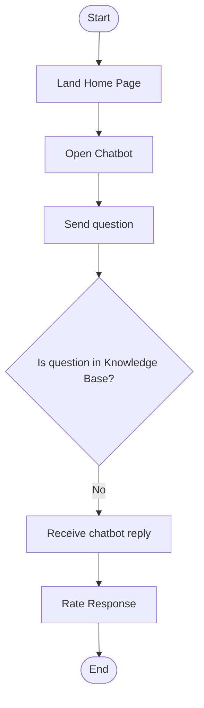
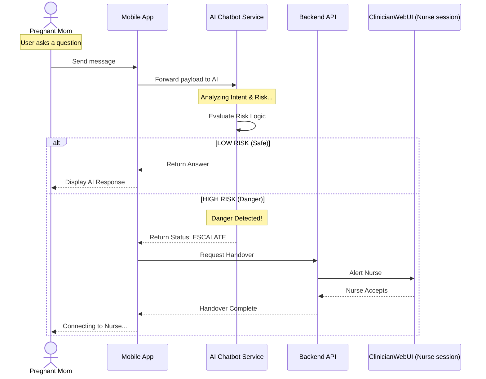
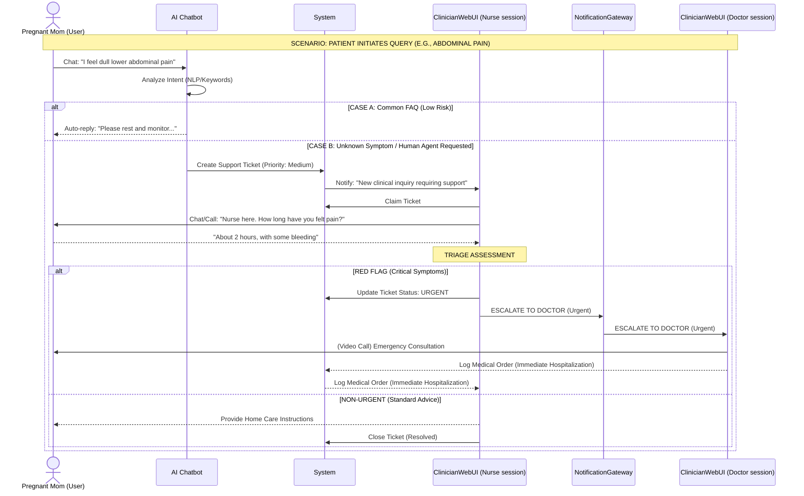

<!-- DBIZ3-SNAPSHOT source=specs/spec-BOT.md sha256=32a003de7aa256d4d0275bfaca99b52677af1e453d47d21fd9aa5f31ad4c8686 taken=2026-11-07T13:22Z -->
<!-- Read-only copy for Spec Kit. Do not edit here. Edit specs/spec-BOT.md, then run:
     uv run tools/start_feature.py --refresh -->

# Spec Document: AI Chatbot L1 Support

| Field | Value |
|---|---|
| Module ID | `BOT` |
| Module name | AI Chatbot L1 Support |
| Spec version | v1.9.0 (07/11/2026: v1.0.0 app and hosting — Session 11 EARS lines (§5.3), D-83/D-84 provider, Q10 and Q14 answered) — v1.8.0 (14/10/2026: PRD alignment — D-76 Google AI Studio, pregnancy-only scope with polite decline FR-010, danger-phrase notice FR-011, BR-005) — v1.7.2 (30/09/2026: data-model review decisions applied — DM-11, DM-36, DM-40; review 29/09/2026: BOT-01 – BOT-05, X-01, X-03, X-07 / DM-25 data types) |
| Author (team member) | Sang (drafted 16/09/2026) — diagrams checked node by node by Chi, 17/09/2026 (verifier ≠ converter) |
| Date | 07/11/2026 |
| Status | Draft |
| Approved by (Client role) | *pending* |
| DBIZ2 source | Function List rows `F-140`–`F-144` (5 rows); Screens `S-031`–`S-034`, `S-037` |

---

## 1. Purpose and scope (mandatory)

This module lets a mother ask common maternity questions and get an immediate, first-line answer, reducing her reliance on unverified online sources — and, when a question touches her personal health or matches a risk keyword, hands the conversation off to the same clinical queue used for record-based alerts rather than answering it directly.

**In scope**

- Receiving and processing the mother's **text** input (BOT-01: no voice input in the MVP).
- Generating and returning an AI-based response for general maternity questions.
- Maintaining conversation context across turns — limited to the earlier questions / answers of the conversation and the gestational week; **never** any medical-record data (BR-001, D-67).
- Logging AI-generated responses for monitoring/auditing.
- Showing a "typing" indicator while a response is generated.
- Recognizing when a question is tied to a personal health condition or a risk keyword (FR-006) and, in that case, not answering directly but offering to hand the question to a nurse (FR-007); a case is opened in the Nurse/Doctor queue only if the mother agrees ("Connect to nurse", FR-008 — shared mechanism with `ALR`/`CLI`; D-34); if she declines, the hotline number is shown (FR-009).
- Showing the disclaimer "The chatbot provides general reference information only and does not replace your doctor's advice" (BR-004).
- Keeping the chatbot to pregnancy, prenatal care, nutrition and postpartum wellness; any other question gets a polite decline and no case (FR-010, BR-005, D-76).
- For a question matching a danger phrase (D-47), stopping general advice and showing the notice "Signs that need medical attention" above the nurse hand-off offer and the hotline (FR-011, D-76).

**Out of scope**

- Voice input (BOT-01).
- Rating an answer ("Was this answer helpful? Yes / No", S-037) — **Could, not built in the MVP** (BOT-02): MVP v8 does not mention it and no FR or entity stores it.
- The Knowledge Library / Knowledge Base search and article catalog (`F-145`–`F-148`) — the Session 4 assignment document excludes this range from the specced modules (see `docs/decisions.md`, "Module scope and key corrections"); not this module's concern either way.
- The nurse/doctor-side handling of an escalated chatbot case once handed off — that is `CLI`'s responsibility.
- Any medical diagnosis or personalized clinical advice — MVP v8 states the chatbot's system prompt "restricts the chatbot to general maternity knowledge and blocks personal diagnosis."

**Depends on**

- `ALR`/`CLI` to receive and triage a chatbot-initiated escalation case (queue S-061, case source "Chatbot").
- `ACC` for the logged-in identity and light profile context (e.g., gestational week) passed to the chatbot.

## 2. Actors (mandatory)

| Actor | Role in this module | Where it comes from |
|---|---|---|
| User (Mom) | Primary | Function List `Actor` column (`F-140`) |
| System (AI Chatbot Service) | Secondary | Function List `Actor` column (`F-141`–`F-143`) |
| App | Secondary | Function List `Actor` column (`F-144`, typing indicator) |
| Nurse | Secondary (receives an escalated case) | DBIZ2 sequence diagrams Figure 6, Figure 18 |

## 3. User scenarios and acceptance criteria (mandatory)

### US-1 (P1): Ask a common maternity question

**Journey.** As a `Mom`, I want to `ask the chatbot a general question`, so that `I get a quick, trustworthy answer instead of searching the internet`.

**Acceptance scenarios**

1. **Given** the chatbot screen is open, **When** the mother sends a general maternity question, **Then** the system displays a typing indicator and then an AI-generated answer.
2. *(Removed — BOT-02: rating an answer is Could, not in the MVP. The "Was this answer helpful? Yes / No" buttons are not built.)*
3. **Given** the chatbot screen is open or an answer is shown, **When** the mother looks at it, **Then** the disclaimer "reference information, does not replace your doctor's advice" is always visible (BR-004).
4. **Given** the chatbot screen is open, **When** the mother asks a question outside pregnancy, prenatal care, nutrition and postpartum wellness (for example about a car or a tax form), **Then** the chatbot politely declines and invites a pregnancy question; no case and no hand-off offer (FR-010, BR-005). `[NEEDS CLARIFICATION: decline wording — §10 Q13]`

### US-2 (P1): Get routed to a human when it matters

**Journey.** As a `Mom`, I want to `have a personal-health or urgent-sounding question routed to a real person`, so that `I don't get an unsafe or generic answer to something that actually needs clinical judgment`.

**Acceptance scenarios**

1. **Given** the mother asks a question about her own health or one containing a risk keyword, **When** the chatbot evaluates the message (FR-006), **Then** the chatbot does not answer directly but says "This needs a proper consultation. It will be sent to a nurse if you agree", with the buttons "Connect to nurse" / "No, thanks" and the line "If you have any emergency signs, call 1900 xxxx."; **no case is created** at this step (FR-007, BR-002, D-34).
2. **Given** the nurse hand-off bubble is shown, **When** the mother taps "Connect to nurse", **Then** the system records the choice and creates a case in the S-061 queue (source "Chatbot", status "Not viewed" — FR-008, `spec-ALR.md` FR-021) and shows "Sent to a nurse"; the mother follows the case on S-029 "My reports" → S-026 (D-34).
3. **Given** the nurse hand-off bubble is shown, **When** the mother taps "No, thanks", **Then** the system records the choice, no case is created and the hotline number 1900 xxxx is shown (FR-009, D-34).
4. **Given** the mother's question matches a danger phrase (D-47, e.g. bleeding, severe abdominal pain, no fetal movement, waters breaking, blurred vision / dizziness), **When** the chatbot evaluates it, **Then** no general advice is given and the hand-off bubble starts with the notice "Signs that need medical attention", followed by "Connect to nurse" / "No, thanks" and the hotline line (FR-011, D-76). The notice never uses the word "Alert" (D-22).

### Edge cases

- What happens when the AI service is unavailable or times out? — The S-034 wireframe shows the shared error component + "Retry" (D-27). Error message text and timeout `[NEEDS CLARIFICATION]`.
- What happens when the mother asks a question that is ambiguous between "general" and "personal health" (borderline classification)? — `[NEEDS CLARIFICATION: the classification mechanism itself is not detailed beyond "risk keywords" in MVP v8 — §10 Q12]`.
- What happens when the same risk-keyword question is asked repeatedly? — `[NEEDS CLARIFICATION: not addressed]`.
- The mother taps "No, thanks" in the nurse hand-off bubble — no case is created; the hotline number is shown (D-34).

## 4. Flows (mandatory)

### 4.1 Usage flow

Textualized from DBIZ2's "Chat box" Mom usage flow (`docs/architecture/usage-flow.md`), covering only the chatbot-answer branch (the Knowledge Base branch belongs to the out-of-scope `KNOWLEDGE` module).

*The DBIZ2 node "Rate Response" is kept verbatim; in the MVP rating is not built (BOT-02).*

### 4.2 Sequence for the main flow

Textualized from DBIZ2 `Schematic2`, Figure 18 (image50.png, "Consult AI Chatbot") and Figure 6 (image44.png, "Triage Patient Request"). Both diagrams draw a version of the same chatbot-to-clinical escalation idea at different levels of detail; both are reproduced in full here rather than merged into one invented composite (see §10 Q1).

#### Figure 18 — Consult AI Chatbot

Matches the MVP v8 escalation mechanism ("Questions tied to a personal health condition, or matching risk keywords, are not answered directly - instead the chatbot offers to pass the question to a nurse and, only if the mother agrees ("Connect to nurse"), opens a case in the same Nurse/Doctor queue") only partially: this diagram shows a direct "Alert Nurse" push rather than visibly creating an alert-queue entry, and Figure 6 below draws a materially different, richer version of the same handoff idea. The wireframe (S-034, S-061) places the case in the S-061 queue (source "Chatbot", status "Not viewed") and adds a step where the mother chooses "Connect to nurse" before the hand-off — this step is not in Figure 18. Per D-34 and MVP v8, "Request Handover" happens only after the mother taps "Connect to nurse"; the DBIZ2 flow and message labels are reproduced unchanged (only the "Nurse" lifeline is replaced by `ClinicianWebUI (Nurse session)` — see the note after Figure 6).

#### Figure 6 — Triage Patient Request

The symptom example ("dull lower abdominal pain," "some bleeding") is sample/demo content, not a defined MVP symptom set.

**Participants (guide §5.4 "participants must be parts of the system, not job titles").** The DBIZ2 lifelines "Nurse" (Figure 18), "Nurse (Human Triage)" and "Doctor (Specialist)" (Figure 6) are people; here they are replaced by the software they use: `ClinicianWebUI (Nurse session)` and `ClinicianWebUI (Doctor session)`. The DBIZ2 message labels are kept word for word. Added by the team (not in DBIZ2), because a message cannot go directly from one person's screen to another's: "ESCALATE TO DOCTOR (Urgent)" passes through `NotificationGateway`, and "Log Medical Order" is written to `System` and then shown to the nurse (in DBIZ2 it goes directly Doctor → Nurse). These changes were made after the diagram check of 17/09/2026 and need to be re-checked (see the completion checklist).

Materially more detailed than Figure 18's version of the same idea: this one shows the nurse-triage inner loop and a doctor video-call step Figure 18 doesn't have. Whether these are the same underlying mechanism drawn at two levels of detail, or two different features, is not resolved by the source material — see §10 Q1.

## 5. Functional requirements (mandatory)

| FR ID | DBIZ2 Subfunction ID | Requirement (system MUST ...) | Actor | Priority |
|---|---|---|---|---|
| FR-001 | F-140 | The system MUST receive and process user input for chatbot interaction via text. (DBIZ2: "text or voice"; voice is not in the MVP — BOT-01.) | User | Must |
| FR-002 | F-141 | The system MUST generate and return an AI-based response to the user based on the processed intent. | System | Must |
| FR-003 | F-142 | The system MUST store conversation context to maintain continuity in the dialogue flow. The context sent to the LLM contains **only** the earlier questions / answers of the conversation and the gestational week — never any data from the medical record (BR-001, D-67). | System | Must |
| FR-004 | F-143 | The system MUST log AI-generated responses for system monitoring, improvement, and auditing. | System | Must |
| FR-005 | F-144 | The system MUST display a visual indicator (dots/wave) to show that the chatbot is generating a response. | App | Must |
| FR-006 | — (new) | The system MUST classify each question of the mother as **general** or **needs a nurse** — tied to her own health condition, or matching a risk keyword (D-47) — and record the result in `is_risk`. A "needs a nurse" question is not answered directly. | System | Must (BOT-03, X-01) |
| FR-007 | — (new) | For a "needs a nurse" question, the system MUST show the nurse hand-off offer: "This needs a proper consultation. It will be sent to a nurse if you agree", the buttons "Connect to nurse" / "No, thanks" and the line "If you have any emergency signs, call 1900 xxxx." No case is created at this step. | System | Must (BOT-03) |
| FR-008 | — (new) | When the mother taps "Connect to nurse", the system MUST record `handoff_choice` = Connect to nurse, create a Case with `case_source` = Chatbot and status "Not viewed" through `spec-ALR.md` FR-021, and show "Sent to a nurse". | System | Must (BOT-03, X-01) |
| FR-009 | — (new) | When the mother taps "No, thanks", the system MUST record `handoff_choice` = No thanks, create **no** case, and show the hotline number. | System | Must (BOT-03) |
| FR-010 | — (new) | The system MUST reply to a question outside pregnancy, prenatal care, nutrition and postpartum wellness with a polite decline, without a hand-off offer and without a case. The decline is stored as an ordinary Chatbot message; `is_risk` stays false. | System | Must (D-76) |
| FR-011 | — (new) | When a "needs a nurse" question matches a danger phrase (D-47), the system MUST stop general advice and show the notice "Signs that need medical attention" at the top of the FR-007 hand-off bubble. | System | Must (D-76) |

### 5.1 Input / Output contract

| FR ID | Input field | Type | Required | Output field | Type | Notes / validation |
|---|---|---|---|---|---|---|
| FR-001 | User Text | TEXT (≤ 500 characters — D-46) | Yes | Parsed Intent (NLP) |JSON (intent label + entities)| Receive user input: the text field "Type your question…" + "Send" button, and tappable suggested questions (S-031). No voice input (BOT-01). |
| FR-002 | User Intent / Context |JSON (parsed intent + session context)| Yes | AI Text Response | TEXT | Return chatbot answer; the answer bubble carries the disclaimer (BR-004) |
| FR-003 | Current Session Data |JSON (earlier questions / answers + gestational week only)| Yes | Context DB Updated |CONFIRMATION (write acknowledgement, no payload)| Save chat context; no medical-record data (BR-001, D-67) |
| FR-004 | AI Response Data |TEXT (AI-generated response, logged)| Yes | Audit Log Entry |JSON (log record, no fixed schema specified by DBIZ2)| Log AI response |
| FR-005 | Bot Processing Signal | EVENT (no payload) | Yes | *(UI navigation target)* | — | Display typing indicator — "•••" bubble (S-033, drawn within S-034) |
| FR-006 | Chat Message (the mother's question); Risk keyword list | UUID; LIST (D-47) | Yes | is_risk | BOOLEAN | Risk keywords Pending SME (D-47, §10 Q2); borderline questions §10 Q12 |
| FR-007 | Chat Message ID (is_risk = true) | UUID | Yes | *(UI: hand-off bubble on S-034)* | — | Hotline number is a placeholder (§10 Q8) |
| FR-008 | Chat Message ID; handoff_choice = Connect to nurse | UUID; ENUM | Yes | Case ID; "Sent to a nurse" | UUID; *(UI)* | Case created by `spec-ALR.md` FR-021 (`case_source` = Chatbot, `chat_message_id` set) |
| FR-009 | Chat Message ID; handoff_choice = No thanks | UUID; ENUM | Yes | Hotline number shown | *(UI)* | No case (D-34) |
| FR-010 | Chat Message (the mother's question) | UUID | Yes | Decline answer | TEXT (Chatbot message) | Scope of BR-005; wording §10 Q13; no new column |
| FR-011 | Chat Message ID (is_risk = true, danger phrase matched) | UUID | Yes | *(UI: notice "Signs that need medical attention" + hand-off bubble on S-034)* | — | Danger phrases = D-47 list, Pending SME; the notice is not stored separately |

### 5.2 Business rules

| Rule ID | Rule | Why it exists |
|---|---|---|
| BR-001 | The chatbot's input context is limited to the mother's question text, the earlier questions / answers of the same conversation, and light profile context (gestational week); the mother's medical record — visits, metrics, reports, clinical profile — must never be sent to the chatbot service. | MVP v8 §5, "AI Chatbot L1 Support" row, verbatim: "Input: the mother's question text plus light profile context... the full medical record is not sent." The earlier questions / answers of the same conversation are a team extension for dialogue continuity (D-67). |
| BR-002 | Questions about the mother's own health or containing a risk keyword are **not** answered directly by the chatbot. The chatbot says: "This needs a proper consultation. It will be sent to a nurse if you agree", with the buttons "Connect to nurse" / "No, thanks". **A case is created only when the mother taps "Connect to nurse"**: the case goes into the same Nurse/Doctor queue as reports (S-061), case source "Chatbot", initial status "Not viewed" (D-18); the mother follows the case on S-029 "My reports" → S-026. Tapping "No, thanks" → no case is created and the hotline number is shown. Implemented by FR-006 – FR-009. | MVP v8 §5 (the chatbot must not replace clinical screening); D-34 (mother's consent step). Wireframe S-034, S-061. |
| BR-003 | *(v1.9.0: the provider is chosen by the server's settings — Groq's free plan first (D-84), Google AI Studio second (D-83), local sample answers without a key; the reasons are in D-83/D-84, pending team review.)* The chatbot backend is a Python service calling the **Google AI Studio API (Gemini models)**; n8n is explicitly excluded as an implementation option. The API key is a secret kept outside the repository. | PRD M5 (14/10/2026), narrowing MVP v8 §5 "OpenAI or Gemini" (D-76) — a stated constraint, even though it borders on an implementation detail rather than a pure business rule. |
| BR-004 | The chatbot screen always shows a disclaimer: the chatbot provides general reference information only and **does not replace the doctor's advice** — on the welcome screen (S-031: "The chatbot provides general reference information only and does not replace your doctor's advice.") and below every general answer (S-034: "For reference only; does not replace your doctor's advice."). | Wireframe S-031, S-034; spec-BOT §1 out of scope (no personal diagnosis). |
| BR-005 | The chatbot answers only questions about pregnancy, prenatal care, nutrition and postpartum wellness; other questions are politely declined (FR-010). A question matching a danger phrase halts general advice and gets the medical-attention notice with the hand-off offer (FR-011). Few-shot clinical answers are not part of the prompt until reviewed by the SME. | PRD M5 (14/10/2026); D-76. |

### 5.3 Behaviour on the internet (EARS, Session 11)

Written from what failed when the hosted app was tried from outside the team (`docs/build/local-vs-internet.md`).

| ID | Requirement | Kind | Found |
|---|---|---|---|
| E-1 | IF the LLM service does not answer within 15 seconds, refuses the request (for example HTTP 403 "free tier not available" or 429 "quota") or returns an empty answer, THEN THE SYSTEM SHALL show "⚠ Could not get an answer. Retry", keep the mother's question in the text field, store no Chatbot message, and write the HTTP status and the provider's message to the server log without the question or the key. | failure | 07/11/2026, hosted app (Gemini 403) |
| E-2 | IF an LLM answer is longer than 500 characters, THEN THE SYSTEM SHALL shorten it at the end of its last whole sentence before it is saved and shown. | failure | 07/11/2026, hosted app (CHAT_MESSAGE length check, see DM-36) |
| E-3 | WHILE the chatbot calls an LLM service, THE SYSTEM SHALL send only the question, the earlier general turns and the gestational week (BR-001), and SHALL read the API key only from the server's environment, never from the repository or the page. | permission | 07/11/2026, before deploying |
| E-4 | IF a question matches a danger phrase or a personal-health or symptom word, THEN THE SYSTEM SHALL answer it without calling the LLM service, so the hand-off offer still works while the LLM service is down. | waiting | 07/11/2026, hosted app |

## 6. Key entities

| Entity | Attributes (from Input/Output fields) | Relationships |
|---|---|---|
| Chat Message | message_id (UUID; Required), conversation_id (UUID; Required), sender (ENUM: Mother / Chatbot; Required), text — the mother's question ≤ 500 characters, D-46 (TEXT; Required), parsed_intent (JSON; Optional — the mother's questions only), is_risk — matches a D-47 risk keyword or is a personal health question, FR-006 (BOOLEAN, default false; Required), handoff_choice (ENUM: Connect to nurse / No thanks; Optional — empty when no offer was made), sent_at (DATETIME, displayed `dd/mm/yyyy · HH:mm`; Required). No rating column (BOT-02) | belongs to Conversation; 0..1 Case (`spec-ALR.md` §6, D-41): when the mother taps "Connect to nurse" (D-34, FR-008), the system creates a **Case** with `case_source` = Chatbot, `chat_message_id` = the risk question, `metric_report_id` empty, status "Not viewed" (D-18); the mother follows it on S-029 "My reports" → S-026. 1 Case per Chat Message with handoff_choice = Connect to nurse |
| Conversation | conversation_id (UUID; Required), user_id (UUID; Required), current_session_data — earlier questions / answers + gestational week, no medical-record data (JSON; Optional) | belongs to Patient; has many Chat Messages |
| AI Response Log | log_id (UUID; Required), conversation_id (UUID; Required), ai_response_data (TEXT; Required), audit_log_entry (JSON; Optional) | belongs to Conversation |

*Types (X-07 / DM-25): every attribute is written `name (TYPE; Required/Optional)`.*

## 7. Screens involved

### 7.1 Screens with a mockup and a Screen Spec file

| Screen ID | Screen name | Priority | Screen Spec file |
|---|---|---|---|
| S-031 | Health chatbot — welcome screen, before the mother asks (D-09). Content: greeting "Hello, Mom! I can answer general questions about pregnancy and baby care."; disclaimer (BR-004); 4 suggested questions: "How can I eat beef safely during pregnancy?", "How can I produce more breast milk?", "What should I look for when choosing formula for my baby?", "How should Dad read to the baby during pregnancy?"; "Type your question…" field + "Send" button; Chatbot tab (D-30) | Must | `screens/screen-spec-S-031.md` |
| S-032 + S-033 + S-034 | Chatbot conversation — 3 Screen IDs drawn in one image (D-09): S-032 question input · S-033 processing ("•••" bubble) · S-034 answer. Content: question / answer bubbles with timestamps; general answers carry the disclaimer (no rating buttons — BOT-02); nurse hand-off bubble "This needs a proper consultation." + "If you agree, your question will be sent to a nurse." with the buttons "Connect to nurse" / "No, thanks" + "If you have any emergency signs, call 1900 xxxx." (D-34); tapping "Connect to nurse" → only then is a case created: shows "Sent to a nurse", the case enters the S-061 queue with source "Chatbot", status "Not viewed", and the mother follows it on S-029 "My reports"; tapping "No, thanks" → no case is created, the hotline number 1900 xxxx is shown; error: shared error component + "Retry" | Must | `screens/screen-spec-S-034.md` (covers S-032, S-033). Own own full specs: `screen-spec-S-032.md`, `screen-spec-S-033.md` (D-55) |

### 7.2 Screens without their own mockup

| Screen ID | Screen name | Priority | Note |
|---|---|---|---|
| S-037 | Response Rating | **Could — not built in the MVP (BOT-02)** | MVP v8 does not mention rating answers; no FR or entity stores a rating. The "Yes / No" buttons are removed from S-034 |

### 7.3 Differences in the v1.0.0 app (D-79 – D-85)

| Item | v1.0.0 app | Source |
|---|---|---|
| S-031 suggested questions | "Mất ngủ khi mang thai", "Có nên tập thể dục?", "Chuột rút chân" (Màn 11) instead of the 4 questions in §7.1 | D-81 |
| S-034 danger card | "Signs that need medical attention", "Mẹ cần được kiểm tra ngay", buttons Call emergency (hotline pending, Q8) · Connect to nurse · No, thanks; after connecting, no call-back promise | D-80, D-81 |
| DM-36 | The schema's column check keeps every CHAT_MESSAGE.text at 500 characters or less, so answers are kept at 500 characters (§5.3 E-2) although the 29/09/2026 review said "no limit" for answers | to settle with the data-model owner (Tâm) |

## 8. Success criteria (mandatory)

| SC ID | Criterion | How it is measured |
|---|---|---|
| SC-001 | A mother gets a useful answer to a common question without leaving the app or searching elsewhere. | Usability test comparing time-to-answer against a baseline of searching the web. |
| SC-002 | A mother asking a question about her own symptoms is connected to a real person rather than given a generic chatbot answer. | Scripted test conversation containing a risk keyword; confirm the hand-off occurs instead of a direct reply. |

## 9. Assumptions

- "Response Rating" (S-037) is the same interaction as the usage flow's "Rate Response" step; it is Could and not built in the MVP (BOT-02).
- Assumed the "risk keyword" list itself is a configuration detail owned by whoever implements the chatbot's prompt/classification logic, not a business rule to be enumerated in this spec, since neither DBIZ2 nor MVP v8 provides the actual keyword list.

## 10. Open questions

| # | Question | Blocking? | Owner | Status |
|---|---|---|---|---|
| 1 | [NEEDS CLARIFICATION: DBIZ2 has two different sequence diagrams for what MVP v8 describes as one escalation mechanism — Figure 18 (direct "Alert Nurse" push) and Figure 6 (a richer flow with a support-ticket, nurse-claim step, and a further Red-Flag/Non-Urgent split, plus a doctor video-call step). Are these the same underlying mechanism drawn at two levels of detail, or two different features? Not resolved by either source — see §4.2's Figure 18 and Figure 6 above.] The wireframe places the case in the S-061 queue (closer to Figure 6 "Create Support Ticket"), but this is not formally decided. | Yes | BA / Systems Analyst | Open |
| 2 | [NEEDS CLARIFICATION: what constitutes a "risk keyword" is not enumerated anywhere in DBIZ2 or MVP v8.] The team has drafted a list (D-47: bleeding / haemorrhage; severe abdominal pain / hard contractions; blurred vision / dizziness / fainting; no fetal movement / baby not kicking; waters breaking / leaking amniotic fluid), Pending SME; used provisionally for the demo. The PRD M5 danger-phrase examples ("chảy máu", "đau bụng quằn quại", "không thấy thai máy", "vỡ ối", "hoa mắt chóng mặt") fall in these groups (D-76). | Yes | Nurse-Clinical SME | Open |
| 3 | S-037 (Response Rating) has no DBIZ2 mockup and no separate mockup. **Resolved (BOT-02):** Could, not built in the MVP. | No | UX/UI | Resolved |
| 5 | [NEEDS CLARIFICATION: the DBIZ2 Usage Flow for Chat box (`docs/architecture/usage-flow.md` §MOM "Chat box") has only one decision ("Is question in Knowledge Base?") with no escalation branch to Nurse at all — a different, additional inconsistency from Q1 above (which is about the two Sequence Diagrams disagreeing with each other). Here the Usage Flow disagrees with *both* Sequence Diagrams (Figure 6 and Figure 18), which do draw an escalation branch, and with MVP v8's own requirement that risk-keyword questions route to Nurse. This spec was written following the Sequence Diagrams (the MVP-aligned version) rather than the Usage Flow. Does the Usage Flow reflect an outdated/incorrect design, or is there a legitimate case where no escalation applies?] | Yes | BA / Product-PM | Open |
| 8 | [NEEDS CLARIFICATION: the emergency hotline number in "If you have any emergency signs, call 1900 xxxx." (S-034) is a placeholder — the real number is needed from the hospital.] | No | Client | Open |
| 9 | Where is the "Yes / No" rating result stored? **Resolved (BOT-02):** not applicable — rating is not built in the MVP. | No | BA / Backend | Resolved |
| 10 | [NEEDS CLARIFICATION: Error message text and timeout when the AI service does not respond] | No | UX/UI / Backend | Resolved 07/11/2026 (v1.0.0 app): text "⚠ Could not get an answer. Retry", timeout 15 seconds (§5.3 E-1) |
| 13 | [NEEDS CLARIFICATION: wording of the polite decline for an out-of-scope question (FR-010); is "postpartum wellness" also open to baby-care questions like the S-031 suggestions on breast milk and formula?] | No | Product-PM / UX/UI | Open |
| 11 | [NEEDS CLARIFICATION: Same risk-keyword question asked repeatedly: one case or several?] | No | Team | Open |
| 12 | [NEEDS CLARIFICATION: How is a question that is borderline between "general" and "personal health" classified? MVP v8 describes only "risk keywords" (see Q2 for the keyword list).] | No | BA / Nurse-Clinical SME | Open |
| 14 | [NEEDS CLARIFICATION: (a) does each visit to S-031 start a new conversation, or does the chatbot continue the last one? The build (`specs/008-bot-chat/research.md`) starts a new one with the first question. (b) The build recognises a "personal health" question with a provisional list of first-person markers ("I have", "I feel", "tôi bị", "is that normal" …) and, with the fake LLM, "outside pregnancy topics" with a provisional topic word list — both in `app/mb360/bot/keywords.json`, to be replaced by the rule the SME / team decides (Q2, Q12).] | No | Team / Nurse-Clinical SME | Resolved 07/11/2026 (review of the v1.0.0 app, Chi): (a) the Chatbot tab reopens the latest conversation (D-81; `specs/008-bot-chat/research.md` to be updated); (b) classification in `app/mb360/bot/classify.py`: whole words, accent-free typing compared without accents, symptom and medicine words go to a nurse before the out-of-scope check; word lists still Pending SME (Q2, Q12) |
| DM-06 | [NEEDS CLARIFICATION: is the audit log a shared entity for BOT, APT and CLI?] | No | BOT / CLI (data model) | Open — default: AI_RESPONSE_LOG only; CASE_STATUS_HISTORY records case actions |
| DM-07 | Where is the Yes / No rating of a chatbot answer stored? | No | BOT (data model) | Resolved (BOT-02) — not stored; no `rating` column in the MVP |
| DM-09 | An FR is needed to store a report and an FR to create a case. | No | ALR / BOT (data model) | Resolved (X-01) — ALR FR-020 (store the report), FR-021 (create the case, also for chatbot cases via BOT FR-008) |
| DM-11 | [NEEDS CLARIFICATION: FRs are needed to read CONSENT_RECORD (decides whether S-001 state 2 is shown) and the earlier CHAT_MESSAGE rows (S-034)] | No | ACC / BOT (data model) | Resolved 29/09/2026 (data-model review, S2 — Tâm): the reads are part of ACC FR-015 / BOT FR-002 |
| DM-24 | Which function records `handoff_choice` when the mother taps "Connect to nurse" / "No, thanks"? | No | BOT (data model) | Resolved (X-01) — FR-008 (Connect to nurse), FR-009 (No thanks) |
| DM-25 | Columns without a declared type. | No | ACC / HLT / ALR / TML / BOT / APT / CLI (data model) | Resolved (X-07) — §6 declares `(TYPE; Required/Optional)` for every attribute; since 30/09/2026 this includes FAMILY_MESSAGE.`patient_id` (DM-33) |
| DM-29 | [NEEDS CLARIFICATION: when the chatbot service fails (S-033 Error state), is the mother's question kept as a Chat Message, and does "Retry" create a second row?] | No | BOT (data model) | Open — default: The question row is kept; "Retry" re-sends the same row; no Chatbot row exists until an answer arrives |
| DM-36 | [NEEDS CLARIFICATION: CHAT_MESSAGE.`text` is limited to 500 characters for the mother's question (D-46) — what is the limit for a chatbot answer (`sender` = Chatbot) stored in the same column?] | No | BOT (data model) | Resolved 29/09/2026 (data-model review, S4 — Trung): TEXT; the mother's question ≤ 500 characters, a chatbot answer has no limit |
| DM-37 | [NEEDS CLARIFICATION: AI_RESPONSE_LOG refers only to the Conversation — which Chat Message does a log row belong to?] | No | BOT (data model) | Open — default: No link; rows are matched by time within the conversation |
| DM-40 | [NEEDS CLARIFICATION: stored enum spellings — `handoff_choice` "No thanks" (BOT §6) vs the button "No, thanks"; `operator` "≥" and `blood_type` "A−" use non-ASCII signs; the metric value set differs in 5 tables — keep as declared or use codes?] | No | ALR / BOT / HLT (data model) | Resolved 29/09/2026 (data-model review, S1 / S4 — Tâm, Trung): stored values exactly as declared in §6 (UTF-8), e.g. `handoff_choice` = "No thanks"; the UI label reference maps them to the screen text |

*Missing numbers are closed questions; numbers are not reused so that references stay valid.*

## 11. Traceability to DBIZ2

| Spec section | DBIZ2 source | Location |
|---|---|---|
| 1. Purpose | MVP v8 §5 MoSCoW, "AI Chatbot L1 Support" row | `docs/prd.md` (MVP Scope v8) |
| 4.1 Usage flow | "Chat box" Mom usage flow (chatbot-answer branch) | sheet `Schematic2`, Figure 3 |
| 4.2 Sequence | Figure 18 (and, for the richer variant, Figure 6) | sheet `Schematic2`, Figure 18 (image50.png), Figure 6 (image44.png) |
| 5. Functional requirements | Function List (FR-001 – FR-005); FR-006 – FR-009 new (BOT-03, X-01; not in DBIZ2) | sheet `FL&Cost1`, rows 140–144 |
| 5.2 BR-004 | Disclaimer line on the wireframe (not in DBIZ2) | Wireframe S-031, S-034 |
| 7. Screens | Screen List; wireframe | sheet `ST`, rows 31–34, 37; `wireframes-v5.1.zip` (S-031, S-034) |

---

## Completion checklist

- [x] Every subfunction of this module in the DBIZ2 Function List appears as an FR row. (5/5; plus 6 new FRs FR-006 – FR-011, not in DBIZ2)
- [x] Every Input and Output field has a type and a required flag, or is marked `[NEEDS CLARIFICATION]`.
- [x] Every Mermaid block renders without an error.
- [ ] Every node and arrow in the Mermaid flow exists in the original DBIZ2 diagram. — checked by Chi The "Nurse" / "Doctor" lifelines in §4.2 were replaced by software components after the check of 17/09/2026 (message labels unchanged; added hops listed under Figure 6) — Chi to re-check.
- [x] At least one business rule is written that is not visible in any diagram. (BR-001–BR-004)
- [x] Every screen this module touches (that has a mockup) is listed (§7.1: S-031, S-032 + S-033 + S-034); S-037 is Could, not built (§7.2).
- [x] Success criteria contain no technology words.
- [x] Open questions carry forward the two-diagram ambiguity and the undefined risk-keyword list.
- [x] The traceability table points to real rows/sheets/figures.
