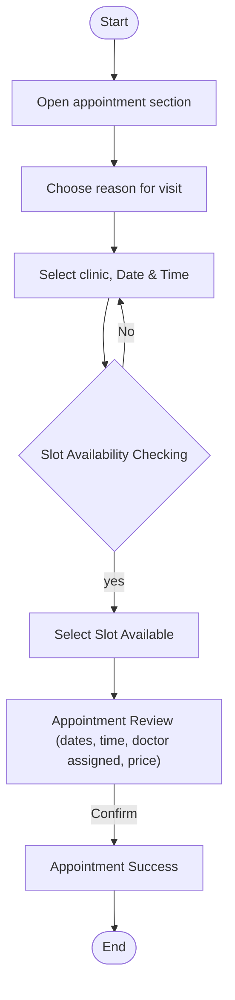
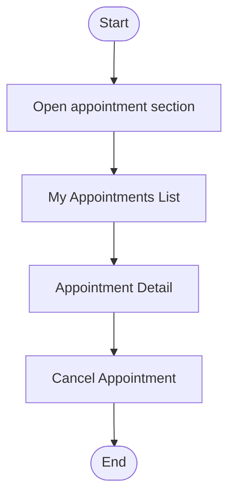
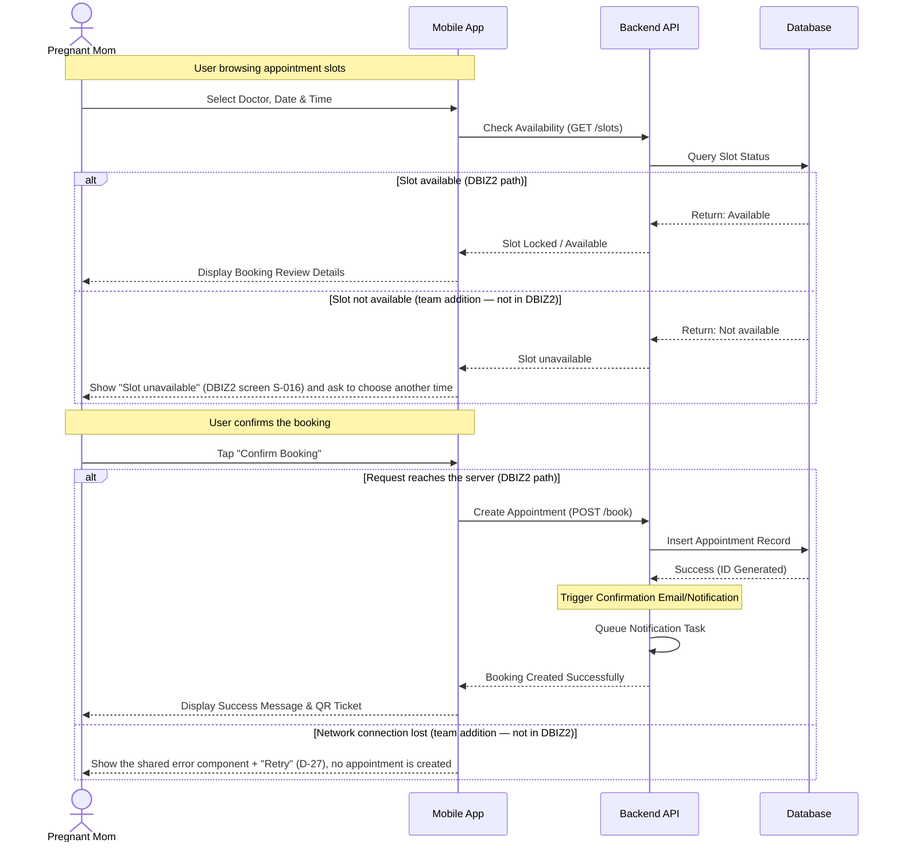

<!-- DBIZ3-SNAPSHOT source=specs/spec-APT.md sha256=0e111cc09b45122d2418af1f4a7b1dca579d28d4aad8c3e2b7677265152a5cbc taken=2026-11-15T02:15Z -->
<!-- Read-only copy for Spec Kit. Do not edit here. Edit specs/spec-APT.md, then run:
     uv run tools/start_feature.py --refresh -->

# Spec Document: Appointment (redirect to host app)

| Field | Value |
|---|---|
| Module ID | `APT` |
| Module name | Appointment Booking & Visit Management (TCI booking portal in a WebView — Could, D-77) |
| Spec version | v1.7.0 (11/11/2026: owner confirms D-80 navigation; no Home booking CTA, FR-001 host-only) — v1.6.1 (07/11/2026: v1.0.0 app differences §7.3) — v1.6.0 (14/10/2026: PRD C1 — priority Could, WebView, Q1 and Q11 answered, D-77) — v1.5.1 (review 29/09/2026: APT-01 – APT-04, X-05, X-07 / DM-25 data types) |
| Author (team member) | Hải Anh (drafted 15/09/2026) — diagrams checked node by node by Chi, 16/09/2026 (verifier ≠ converter) |
| Date | 11/11/2026 |
| Status | Draft |
| Approved by (Client role) | *pending* |
| DBIZ2 source | Function List rows `F-101`–`F-107`, `F-116`–`F-118` (10 rows); Screens `S-012`–`S-022` (reference only, see §1) |

---

## 1. Purpose and scope (mandatory)

This module connects the mother's digital journey to in-person hospital care when a consultation is appropriate. Per MVP v8's Product Context, equivalent booking functionality already exists in the host Thu Cuc app, so this module's job is to surface/redirect to that existing flow rather than rebuild a native booking experience.

**Priority and mechanism (PRD C1, D-77).** The module is **Could**. The booking flow is Thu Cuc's existing antenatal booking portal opened in a **WebView inside the TCI app**; the upcoming-appointment card reads the mother's appointments from the TCI app, and appointment reminders are kept. The card on S-008 and the "Appointment reminders" switch on S-010 are Could elements inside Must screens: if APT is not built, both are hidden and the Must screens still work.

**Current navigation (D-80; confirmed by Hải Anh on 11/11/2026, D-86).** The sub-app has Home · Timeline · Chatbot · From doctor · Profile on its five root screens. There is no Appointments tab and no "Book a visit ↗" button on S-008, including the empty state. Booking is accessed through the TCI host app itself. The sub-app retains the read-only next-appointment card and Appointment reminders (D-77 / D-81); opening an Appointment notice on S-009 still opens the host booking stand-in. S-012 – S-022 remain host-owned reference screens. `[PENDING CLIENT: D-01]` remains unchanged.

**In scope**

- The host app provides its own booking entry point; S-106 may hand off booking to TCI, with no CTA on Home or Appointments root tab (FR-001 host-only; BR-001, BR-003; D-80 / D-86).
- Displaying the next appointment on S-008 as a read-only card using the TCI host feed; if none exists, the current app omits the card and shows no booking CTA (FR-005, BR-002).
- Reminder notifications for upcoming appointments (FR-009) — the MVP notification type "Appointment reminders" (S-010), delivered via the TCI app (X-05).

**Out of scope**

- **Everything the TCI app already does (APT-01):** booking filters / doctor list, slot filtering, slot availability check, creating the appointment record, updating status from a reminder, logging schedule changes, booking and cancellation confirmations, the appointment list and cancellation. MVP v8: "only surface/redirect to the existing flow rather than rebuilding it"; backlog item 6: "rather than rebuilding slot selection, booking, or an appointments list". The corresponding FRs are **Won't / N/A (done by the TCI app)**.
- Rebuilding the host app's full native booking UI end-to-end. DBIZ2's own Figure 13 sequence and screens S-012 – S-022 describe exactly this full native flow and are kept as *reference material only* (see §7).
- Doctor-side appointment/schedule self-management — outside MVP function scope per the Session 4 assignment document.

**Depends on**

- `ACC` for the logged-in identity the appointment is booked under — per D-01, the signed-in TCI account.
- The host Thu Cuc app's existing booking system as the system of record (see BR-002).
- `ACC` S-008 (Home) for the read-only appointment card, S-009 for Appointment notices and S-010 for notification preferences.

## 2. Actors (mandatory)

| Actor | Role in this module | Where it comes from |
|---|---|---|
| Mom | Primary | Function List `Actor` column (`F-101`, `F-106`) |
| App | Secondary | Function List `Actor` column (`F-105`, reminder display) |
| System | Secondary | Function List `Actor` column (validation/notification rows) |

## 3. User scenarios and acceptance criteria (mandatory)

### US-1 (P2): Book a hospital visit when needed

**Journey.** As a `Mom`, I want to `find and book an available appointment slot`, so that `I can get an in-person consultation when my digital journey shows I need one`.

**Acceptance scenarios**

1. **Given** the mother is on Home (S-008), **When** the screen renders, **Then** no booking button or Appointments tab is shown; the root tab bar follows D-80 (BR-003).
2. **Given** the mother wants to book a visit, **When** she uses the TCI host app's own booking entry point, **Then** booking takes place in TCI; S-106 links to the host booking screen (FR-001 host-only).
3. Choosing a date / doctor / clinic, checking the slot, confirming the booking and the confirmation message all happen **inside the TCI app** and are not specified by this module (APT-01).

### US-2 (P3): Get reminded about an upcoming appointment

**Journey.** As a `Mom`, I want to `be reminded of an upcoming appointment`, so that `I don't miss it`.

**Acceptance scenarios**

1. **Given** an upcoming appointment exists and "Appointment reminders" is on (S-010), **When** the reminder time arrives, **Then** the system sends an "Appointment" notification via the TCI app (FR-009, X-05); tapping it on S-009 opens the read-only S-106 list.
2. **Given** the mother has an upcoming appointment, **When** she opens S-008, **Then** the read-only next-appointment card shows day, date/time (`dd/mm/yyyy · HH:mm`) and days left from the TCI host feed, as in the current app (FR-005, BR-002; D-81 / D-86).
3. **Given** the mother has no upcoming appointment, **When** she opens S-008, **Then** the current app omits the next-appointment card and shows no booking CTA (D-80 / D-86).

### Edge cases

- What happens when the redirect target (the host app's booking flow) is unavailable? — `[NEEDS CLARIFICATION: not addressed by any source document]`.
- What happens when a slot becomes unavailable between filtering and confirming? — handled inside the TCI app; not specified by this module (APT-01).
- What happens when an appointment is cancelled from inside the host app rather than from this module? — `[NEEDS CLARIFICATION: see §10 Q10]`.
- After the mother finishes booking in the TCI app, how does she return to the sub-app, and when is the "Upcoming appointments" card updated? — `[NEEDS CLARIFICATION: not drawn in the wireframe]`.

## 4. Flows (mandatory)

### 4.1 Usage flow

Textualized from DBIZ2's Mom "Appointment" usage flow (`docs/architecture/usage-flow.md`), kept as historical reference only. "Open appointment section" belongs to the TCI host app; it does not represent a Home button or tab in the current sub-app (D-80 / D-86). `[PENDING CLIENT: D-01]` remains open.

### 4.2 Sequence for the main flow

Textualized from DBIZ2 `Schematic2`, Figure 13 (image18.png) — DBIZ2's own native-booking sequence, kept as reference, not as this module's built implementation.

**Source caption note:** despite the DBIZ2 caption "Manage Schedule(Mom)," the diagram's actual content is a doctor-appointment-booking sequence (select doctor/date/time → check availability → confirm → success), not a schedule-viewing sequence. The original DBIZ2 caption is kept.

**Failure branches (team addition — not in DBIZ2).** The two `else` branches above ("Slot not available", "Network connection lost") are **not in DBIZ2 Figure 13**, which draws only the happy path; they were added by the team. "Slot unavailable" reuses the DBIZ2 screen S-016 (Slot Unavailable Screen); the error handling reuses the shared error component (D-27). **The whole Figure 13 flow runs in the TCI app in the MVP (APT-01);** the diagram is reference only, and the TCI app's own behaviour in these cases is `[NEEDS CLARIFICATION: §10 Q5]`.

## 5. Functional requirements (mandatory)

| FR ID | DBIZ2 Subfunction ID | Requirement (system MUST ...) | Actor | Priority |
|---|---|---|---|---|
| FR-001 | F-101 | The TCI host app provides booking filters, doctors and its own booking entry point. **Current sub-app scope (D-80 / D-86):** no booking button on S-008 and no Appointments tab. This original DBIZ2 requirement is retained for traceability only; no booking-session API or adapter is built. | Mom | **Won't / N/A — done by the TCI app (D-80 / D-86)** |
| FR-002 | F-102 | The system MUST filter available appointment slots based on selected criteria (date, doctor, clinic). | Mom | **Won't / N/A — done by the TCI app (APT-01)** |
| FR-003 | F-103 | The system MUST validate real-time availability of the selected appointment slot before booking. | System | **Won't / N/A — done by the TCI app (APT-01)** |
| FR-004 | F-104 | The system MUST create and store a new appointment record in the system. | System | **Won't / N/A — done by the TCI app (APT-01)** |
| FR-005 | F-105 | The system MUST display the next appointment as a read-only card on S-008 using the TCI host feed (BR-002). The current app shows day, date/time and days left; if no appointment exists the card is omitted, without a booking CTA. No separate appointment list is built (D-77 / D-81 / D-86). | App | Could (D-77) |
| FR-006 | F-106 | The system MUST update appointment or task status based on user interaction with reminders. | Mom | **Won't / N/A — done by the TCI app (APT-01)** |
| FR-007 | F-107 | The system MUST log appointment or schedule updates for audit and tracking purposes. | System | **Won't / N/A — done by the TCI app (APT-01)** |
| FR-008 | F-116 | The system MUST send booking confirmation notifications to the patient and relevant staff. | System | **Won't / N/A — done by the TCI app (APT-01)** |
| FR-009 | F-117 | The system MUST send reminder notifications for upcoming appointments or tasks. **MVP:** creates the mother's "Appointment" notification (`spec-ACC.md` entity Notification) when the "Appointment reminders" switch on S-010 is on; delivered via the TCI app (X-05); tapping it on S-009 opens the read-only S-106 list. | System | Could (D-77) |
| FR-010 | F-118 | The system MUST send confirmation notifications when an appointment is canceled. | System | **Won't / N/A — done by the TCI app (APT-01)** |

*FR-001 is host-only; FR-005 is the read-only S-008 card; FR-009 is the appointment reminder. The sub-app has no Home booking button or Appointments root tab (D-80 / D-86).*

### 5.1 Input / Output contract

| FR ID | Input field | Type | Required | Output field | Type | Notes / validation |
|---|---|---|---|---|---|---|
| FR-001 | — | — | — | — | — | **N/A in the sub-app (D-80 / D-86)**; booking navigation belongs to the TCI host. No Home action, payload or booking-session API is introduced. `[PENDING CLIENT: D-01]` remains open for host integration. |
| FR-002 | — | — | — | — | — | **Won't / N/A (TCI app)** |
| FR-003 | — | — | — | — | — | **Won't / N/A (TCI app)** |
| FR-004 | — | — | — | — | — | **Won't / N/A (TCI app)** |
| FR-005 | User ID | UUID | Yes | Upcoming Appointments (read from the TCI app) | LIST of OBJECT (appointment_ref, visit_name, appointment_at, facility, doctor_name) | External integration fields retained; the current demo renders day, date/time and days left from its simulated host feed (D-81). Read-only card on S-008; empty → read-only S-106 entry row, no booking CTA (proposed D-88). How the card is refreshed after booking: §10 Q9 |
| FR-006 | — | — | — | — | — | **Won't / N/A (TCI app)** |
| FR-007 | — | — | — | — | — | **Won't / N/A (TCI app)** |
| FR-008 | — | — | — | — | — | **Won't / N/A (TCI app)** |
| FR-009 | Reminder Trigger; Appointment Reference; User ID | EVENT (scheduled); VARCHAR(64); UUID | Yes | Notification created (type "Appointment") | UUID | Only when "Appointment reminders" is on (S-010); delivered via the TCI app (X-05). How far in advance: `[NEEDS CLARIFICATION: S-010 Q3]` |
| FR-010 | — | — | — | — | — | **Won't / N/A (TCI app)** |

### 5.2 Business rules

| Rule ID | Rule | Why it exists |
|---|---|---|
| BR-001 | This module MUST NOT create or manage a native appointment system. Booking and its entry point belong to the TCI host app; S-008 has no booking button. Opening an Appointment notice on S-009 marks it read and opens S-106 (D-88 proposed). | D-77 (host-owned records), D-80 / D-86 (current navigation); DM-04. |
| BR-002 | Any appointment record created through the host app's flow is the authoritative record; this module must not maintain a conflicting, duplicate schedule of its own. The "Upcoming appointments" card on S-008 only reads from this record. | Direct consequence of BR-001, stated explicitly here since neither DBIZ2 nor MVP v8 draws what happens if the two disagree — see the open question in §10. |
| BR-003 | The sub-app's five root tabs MUST be Home · Timeline · Chatbot · From doctor · Profile. It MUST NOT show an Appointments tab or a booking CTA on Home. Child screens retain their back navigation without a root tab bar. | D-80, confirmed by the APT owner on 11/11/2026 (D-86); `app/mb360/ui.py`, `templates/base.html`. |

## 6. Key entities

| Entity | Attributes (from Input/Output fields) | Relationships |
|---|---|---|
| Appointment Record *(external — the TCI app's record, read only; not stored in the sub-app — DM-04)* | appointment_ref — TCI appointment ID (VARCHAR(64); Required), visit_name (VARCHAR(100); Required), appointment_at (DATETIME; Required), facility (VARCHAR(100); Required), doctor_name (VARCHAR(100); Optional) — the fields shown on the S-008 card | belongs to Patient; authoritative copy lives in the host app per BR-002 |
| Reminder | Reminder trigger (scheduled EVENT — not stored), appointment_ref (VARCHAR(64); Required) | produces a Notification of type "Appointment" (`spec-ACC.md` §6) |

*Slot is not used by the sub-app (TCI-owned; APT-01). Types (X-07 / DM-25): every attribute is written `name (TYPE; Required/Optional)`.*

## 7. Screens involved

DBIZ2 has native-booking screens S-012 – S-022 (5 with a mockup). MVP v8 does not build a native booking UI, so **none of them is built in the sub-app** (APT-03).

### 7.0 Entry point in the MVP

| Screen ID | Element | Priority | Note |
|---|---|---|---|
| S-008 (belongs to `spec-ACC`) | Read-only next-appointment card; omitted when no appointment exists; no booking CTA | Could (D-77) | Data from TCI (BR-002), current implementation D-81 / D-86. |
| S-008 (belongs to `spec-ACC`) | No booking button | N/A | D-80 / D-86; booking remains in the host app. |
| 5-tab bar (root mother screens only) | Home · Timeline · Chatbot · From doctor · Profile | Shared shell | No Appointments tab (BR-003; D-80). |
| S-009 (belongs to `spec-ACC`) | Appointment notice; opening it marks it read and opens the read-only S-106 list | Could (D-77) | Proposed D-88; this is not a Home booking CTA. |
| S-010 (belongs to `spec-ACC`) | "Appointment reminders" switch | Could (D-77) | FR-009; hidden if APT is not built |

*Booking remains available through the TCI host app. No booking-session API, adapter or replacement booking UI is introduced by this alignment.*

### 7.1 DBIZ2 booking screens (not built)

| Screen ID | Screen name | Priority | Note |
|---|---|---|---|
| S-012 – S-022 | Appointment Home, Visit Reason, Clinic & Date Selection, Time Slot Selection, Slot Unavailable, Appointment Review, Appointment Success, Appointment Detail, Appointment List, Appointment Cancellation, Cancellation Success | **Handled by the TCI app — not built in the sub-app** (APT-03) | DBIZ2 mockups of S-012, S-014, S-015, S-017, S-018 are kept as reference only (Figure 13, §4.2). The S-017 mockup shows a price ("300.000 VND"), supporting evidence for In-App Payment = Won't. The module's only MVP touchpoints are the read-only card on S-008, notices on S-009 and switch on S-010 (§7.0); booking controls belong to TCI. |

### 7.3 Differences in the v1.0.0 app (D-79 – D-85)

**Owner confirmation, 11/11/2026 (Hải Anh; D-86):** follow D-80 and the current source. BR-001, BR-003 and FR-001 are aligned above; the sub-app has neither an Appointments tab nor a Home booking CTA. The previously proposed Part B is cancelled; no API is adopted.

| Item | v1.0.0 app | Source |
|---|---|---|
| Next appointment | S-008 shows "Lịch khám kế tiếp" (day, date, time, days left), read from the TCI host app; in the demo a simulated host table (`app/mb360/tci_feed.py`), no MB360 schema change, nothing stored by the sub-app | D-81 (U2) |
| Booking | S-106 links to TCI booking under proposed D-88. The booking form and writes remain host-only under FR-001. | D-80 / D-86 |
| Reminders | "Appointment reminders" switch on S-010 (ACC FR-027) | D-81 |

## 8. Success criteria (mandatory)

| SC ID | Criterion | How it is measured |
|---|---|---|
| SC-001 | Booking is accessed through the TCI host app; the sub-app exposes no Home booking button or Appointments tab. | Inspect S-008 and the root tab bar against D-80; check the host booking stand-in separately. |
| SC-002 | A mother with an upcoming appointment is reminded before it happens, without needing to check the hospital's system separately. | Manual test: schedule a reminder and confirm it appears at the expected time. |

## 9. Assumptions

- All 10 DBIZ2 FRs remain traceable. FR-005 and FR-009 are sub-app touchpoints; FR-001 and the remaining booking operations are host-owned / N/A in the current sub-app (D-80 / D-86).
- Assumed the data for the "Upcoming appointments" card on S-008 can be read from the TCI app (BR-002); how it is read has not been described.

## 10. Open questions

| # | Question | Blocking? | Owner | Status |
|---|---|---|---|---|
| 1 | The "Book a visit ↗" button on S-008 opens the booking flow inside the TCI app (D-01). [NEEDS CLARIFICATION: the specific technical mechanism (host internal navigation, deep link or webview) and how the mother returns to the sub-app are not described in any source.] **Mechanism answered by the PRD C1 (D-77):** a WebView embedded in the TCI app opens the existing antenatal booking portal. The return to the sub-app stays in Q9. **Current applicability (D-86):** historical Home entry superseded by D-80; host navigation/integration remains external. No marker is resolved by this alignment. | No | Backend / Systems Analyst | Resolved (mechanism, D-77) |
| 2 | If the redirect hands off entirely to the host app, do FR-003 / FR-004 still need to be built in this module? **Resolved (APT-01, APT-02):** no — they are done by the TCI app (Won't / N/A). | No | Backend | Resolved |
| 3 | Does the sub-app need dedicated booking screens? **Resolved (APT-02; D-80 / D-86):** no. Booking is opened from TCI itself, not from a sub-app Home CTA or tab. | No | UX/UI | Resolved |
| 5 | Figure 13's sequence (§4.2) and both usage-flow sub-flows (§4.1) draw only the happy path in DBIZ2. Two failure branches ("Slot not available", "Network connection lost") were added to §4.2 by the team and marked as not in DBIZ2; the usage flows (§4.1) are unchanged. Still open: does the TCI app (which actually handles booking — §1) behave the same way in these cases, and what happens on a redirect failure? | No | UX/UI / Backend | Open |
| 6 | FR-001 / FR-005 mapping. **Updated by owner (D-86):** FR-001 is host-only; FR-005 remains the read-only Home card. The historical Home CTA and Appointments tab are not current requirements. | No | BA | Resolved (D-86) |
| 7 | Historical Appointments tab target. **Superseded by D-80 / D-86:** the root bar contains Timeline instead; no Appointments tab exists in the current sub-app. | No | UX/UI | Superseded |
| 8 | [NEEDS CLARIFICATION: What happens when the TCI booking flow cannot be opened?] | No | Team / Client | Open |
| 9 | [NEEDS CLARIFICATION: How does the mother return to the sub-app after booking, and when is the read-only "Upcoming appointments" card updated from the TCI app?] (APT-04: open question with TCI) | No | Team / Client | Open |
| 10 | [NEEDS CLARIFICATION: What happens when an appointment is cancelled inside the TCI app rather than from this module — how and when does the "Upcoming appointments" card on S-008 reflect it? (BR-002: the TCI app record is authoritative)] | No | Team / Client | Open |
| 11 | [NEEDS CLARIFICATION: The read-only "Upcoming appointments" card (FR-005) needs the sub-app to read the mother's appointments from the TCI app. MVP v8 §2 lists only the reuse of the TCI identity, and backlog item 6 says the sub-app does not rebuild "an appointments list". Does the Client allow this read (same decision as D-01), or is the card dropped so that the sub-app only redirects?] **Answered by the PRD C1 (14/10/2026):** the card is kept and reads from the TCI app (D-77). | No | Client | Resolved (D-77) |
| DM-04 | Are appointments, slots and reminders stored in the sub-app database? | No | APT (data model) | Resolved (APT-01) — not stored (EXTERNAL); an Appointment notification keeps only `appointment_ref`; Slot is not used |
| DM-25 | Columns without a declared type. | No | ACC / HLT / ALR / TML / BOT / APT / CLI (data model) | Resolved (X-07) — §6 declares `(TYPE; Required/Optional)` for every attribute; since 30/09/2026 this includes FAMILY_MESSAGE.`patient_id` (DM-33) |

*Missing numbers are closed questions; numbers are not reused so that references stay valid.*

## 11. Traceability to DBIZ2

| Spec section | DBIZ2 source | Location |
|---|---|---|
| 1. Purpose | MVP v8 §5 MoSCoW, "Basic Appointment Booking" row; §6 Sprint Backlog item 6; D-01 | `docs/prd.md` (MVP Scope v8); `docs/decisions.md` (Decision log) |
| 4.1 Usage flow | "Appointment" Mom usage flow (both sub-flows, reference only) | sheet `Schematic2`, Figure 3 |
| 4.2 Sequence | Figure 13 (source caption "Manage Schedule(Mom)"), reference only | sheet `Schematic2`, Figure 13 (image18.png) |
| 5. Functional requirements | Function List | sheet `FL&Cost1`, rows 101–107, 116–118 |
| 7. Screens | Screen List; entry point on S-008 (not in DBIZ2) | sheet `ST`, rows 12–22; wireframe S-008 |

---

## Completion checklist

- [x] Every subfunction of this module in the DBIZ2 Function List appears as an FR row. (10/10; 7 are Won't / N/A — done by the TCI app, APT-01)
- [x] Every Input and Output field has a type and a required flag, or is marked `[NEEDS CLARIFICATION]`.
- [x] Every Mermaid block renders without an error.
- [ ] Every node and arrow in the Mermaid flow exists in the original DBIZ2 diagram — **checked by Chi**. Failure branches (marked "team addition — not in DBIZ2") were added to §4.2 after the check of 16/09/2026 — Chi to re-check.
- [x] At least one business rule is written that is not visible in any diagram. (BR-001 – BR-003)
- [x] Current touchpoints are listed (§7.0: S-008 read-only card, S-009 notices, S-010 switch; §7.1: S-012 – S-022 remain host-owned).
- [x] Success criteria contain no technology words.
- [x] Open questions carry forward the undefined redirect mechanism, the return to the sub-app and the card refresh.
- [x] The traceability table points to real rows/sheets/figures.

## Proposed D-88 requirements (S-106)

- **FR-011.** When the signed-in mother opens S-106, the sub-app shall read her host appointments and display Current appointments and Booking history, showing time, facility, clinician, specialty, status and a Today label where applicable. When a tab has no rows, the screen shall show its own empty state.
- **FR-012.** When an appointment has passed without a recorded visit, S-106 shall show it in history with an explanation. Where a completed appointment is linked to the mother's visit on that date, S-106 shall link to the timeline day without showing clinical results itself.
- **FR-013.** When the mother opens an Appointment notification, the system shall mark it read and open S-106 at the matching host appointment, or at the current list if its reference cannot be resolved. The system shall deny requests for other mothers' lists.
- **FR-014.** When Home or S-009 checks demo reminders, the system shall create at most one notice per host appointment and reminder time if both switches are on and the appointment is still current. The fixture uses the previous day as a demo default. Received notices remain visible when reminders stop. S-010 Q3/Q4 remain open. There is no background scheduler.
- Booking, scheduling preferences per appointment, and cancellation are owned by the TCI host. S-106 never writes appointment records. The return path is bound to the verified session. D-77 / DM-04 and the five D-80 root tabs are retained.
