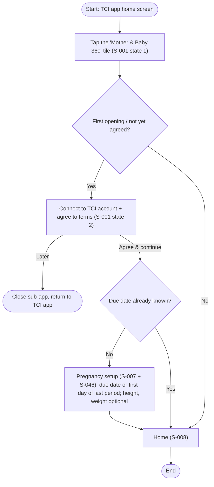
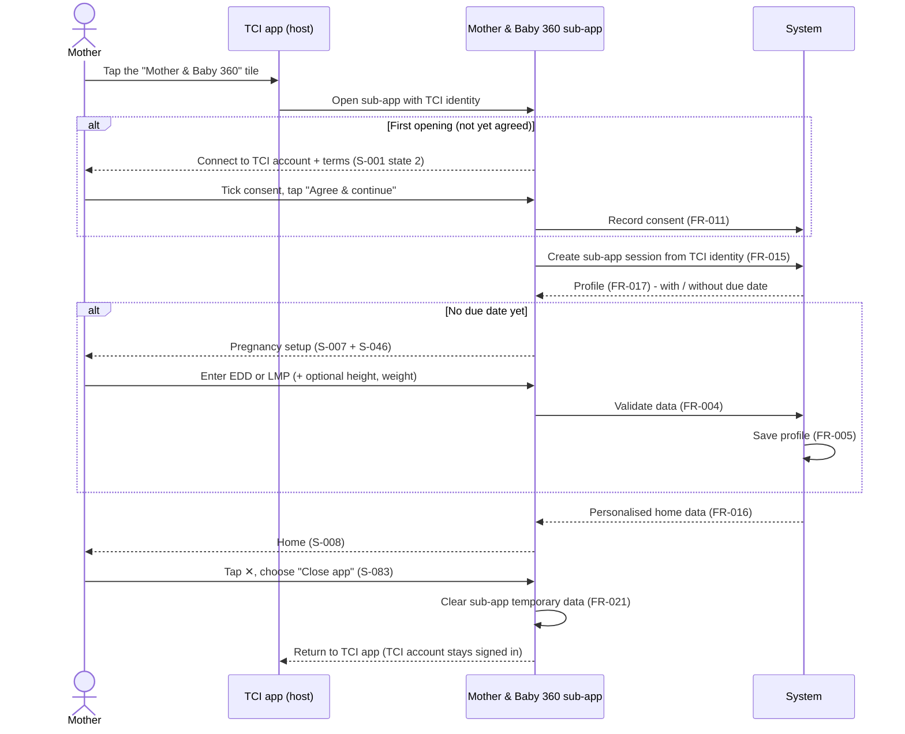

# Spec Document: Onboarding & Pregnancy Profile

| Field | Value |
|---|---|
| Module ID | `ACC` |
| Module name | Onboarding & Pregnancy Profile (sub-app within the TCI app) `[PENDING CLIENT: D-01]` |
| Spec version | v1.7.1 (30/09/2026: data-model review decisions applied — DM-01, DM-02, DM-08, DM-11, DM-31, DM-32, DM-41, DM-42; review 29/09/2026: ACC-01 – ACC-04, X-05, X-07 / DM-25 data types) |
| Author (team member) | Chi (drafted 16/09/2026) — diagrams checked node by node by Trung, 17/09/2026 (verifier ≠ converter) |
| Date | 30/09/2026 |
| Status | Draft |
| Approved by (Client role) | *pending* |
| DBIZ2 source | Function List rows `F-016`–`F-018`, `F-022`–`F-023`, `F-026`–`F-044` (24 rows); Screens `S-001`–`S-011`, `S-046`, `S-083`, `S-103` |

---

## 1. Purpose and scope (mandatory)

`[PENDING CLIENT: D-01]` Mother & Baby 360 is a **sub-app that runs inside the TCI app** (the app of the Thu Cuc Healthcare System). This module does not manage its own accounts. It takes the mother's identity from the TCI account that is signed in, asks for permission to use the TCI account information the first time the sub-app is opened, collects the minimum pregnancy information, and provides the profile that the other modules (health dashboard, alerts, timeline, chatbot) attach their data to. Without a minimum pregnancy profile (due date), the other modules cannot personalise content by gestational week.

**In scope**

- Entry to the sub-app from the "Mother & Baby 360" tile on the TCI app home screen (S-001 state 1), using the signed-in TCI account, with no password (D-01).
- First opening: the mother agrees to the Terms & Privacy Policy and allows the sub-app to use her TCI account information — full name, phone number; medical record number at Thu Cuc; results of her prenatal visits (S-001 state 2; FR-011).
- Creating the sub-app session from the TCI identity (FR-015, reinterpreted).
- First-time pregnancy setup when the system has no due date: the mother enters the due date (EDD) or the first day of her last menstrual period (LMP) → the system calculates the gestational week; height and weight are optional (S-007 + S-046; FR-004/FR-005).
- Viewing and editing the mother's profile (S-103 "Profile" and its child screens: S-011 Edit profile, S-010 Notification settings, and the "Hospital record link" bottom sheet on S-103 — D-39).
- Opening the personalised home screen (S-008) after agreeing / completing setup (FR-003, FR-016).
- Hospital record link (`F-016`/`F-017`): **in the MVP the link is simulated with seed data; no real EMR call is made** (MVP v8 §5: Deep Two-Way HIS/EMR Integration = Won't; "The MVP demo uses simulated hospital visit data"). The seed decides whether a mother is "Linked" or "Pending link"; the status is shown on S-103.
- Closing the sub-app with the ✕ button (S-083) and returning to the TCI app; the TCI account stays signed in (FR-019/FR-021, reinterpreted).

**Out of scope**

- Account registration, OTP / verification codes, password sign-in, change / forgotten password, account sign-out, account deletion — handled by the TCI app (host) (D-01). The corresponding FRs are kept with Priority **Won't (D-01)**.
- Any Admin-side account management (DBIZ2's native Admin module) — no admin actor is in the MVP (MVP v8 §3).
- Live, bidirectional EMR/HIS integration — MVP v8 explicitly marks "Deep Two-Way HIS/EMR Integration" as Won't. `F-016`/`F-017` are simulated with seed data in the MVP; link errors, "Retry" and the "no matching record / several matching records" cases apply only to a later version with a real EMR connection.
- Health data, alerts, timeline, diary, chatbot, and appointment functionality — these belong to `HLT`, `ALR`, `TML`, `BOT`, `APT` respectively.

**Depends on**

- The TCI app (host) provides the identity of the signed-in user. `[NEEDS CLARIFICATION: the mechanism by which the TCI app passes the identity to the sub-app (token, format, lifetime) is not in any source — see §10 Q9]`.
- `HLT`, `ALR`, `TML`, `BOT`, `APT` all need a valid sub-app session from this module before they run.

## 2. Actors (mandatory)

| Actor | Role in this module | Where it comes from |
|---|---|---|
| Guest (not-yet-registered mother) | Not applicable (D-01) — the mother always enters from a signed-in TCI account | Function List `Actor` column (`F-029`) |
| Mom (pregnant mother) | Primary | Function List `Actor` column (`F-026`, `F-043`, `F-044`); wireframe S-001, S-007, S-103 |
| TCI app (host app) | Secondary — provides the TCI account identity and contains the sub-app entry tile `[PENDING CLIENT: D-01]` | Wireframe S-001; D-01 (not in DBIZ2) |
| System | Secondary | Function List `Actor` column (validation, session, DB rows) |
| App (client device) | Secondary | Function List `Actor` column (`F-041`, local cache) |

## 3. User scenarios and acceptance criteria (mandatory)

### US-1 (P1): Open the sub-app from the TCI app for the first time and agree to the use of information `[PENDING CLIENT: D-01]`

**Journey.** As a `Mom` signed in to the TCI app, I want to `open Mother & Baby 360 from the TCI app home screen without creating a new account`, so that `I can start using it straight away with the records Thu Cuc already has`.

**Acceptance scenarios**

1. **Given** the mother is on the TCI app home screen (S-001 state 1), **When** she taps the "Mother & Baby 360" tile for the first time, **Then** the sub-app opens the "Connect to your TCI account" screen (S-001 state 2), which lists the information that will be used: full name, phone number; medical record number at Thu Cuc; results of prenatal visits — without asking for a password.
2. **Given** S-001 state 2, **When** the mother has not ticked "I agree to the Terms and the Privacy Policy", **Then** the system does not record consent and does not let her continue. `[NEEDS CLARIFICATION: the wireframe does not show the state of the "Agree & continue" button when the box is unticked (disabled or error message)]`
3. **Given** the mother has ticked the consent box, **When** she taps "Agree & continue", **Then** the system records the consent (FR-011), creates the sub-app session from the TCI identity (FR-015), and goes to S-007/S-046 if there is no due date yet, or to S-008 if there is one.
4. **Given** S-001 state 2, **When** the mother taps "Later", **Then** the sub-app closes and she returns to the TCI app; no consent is recorded.

### US-2 (P1): Set up the pregnancy and reach the personalised home screen

**Journey.** As a `Mom`, I want to `enter my due date (or the first day of my last period) once`, so that `the app knows which gestational week I am in and opens the home screen directly from then on`.

**Acceptance scenarios**

1. **Given** the system has no due date, **When** the mother selects "I know my due date" and enters a valid date, **Then** the system shows the "Calculated by the system" card (Week · day; Today dd/mm/yyyy · Due dd/mm/yyyy).
2. **Given** the mother selects "I know the first day of my last period", **When** she enters the date, **Then** the system calculates the due date and shows the "Calculated by the system" card. `[NEEDS CLARIFICATION: the rule for calculating the EDD / gestational week from the LMP is not in any source — see §10 Q10]`
3. **Given** the due date is in the past or the calculated gestational week is outside 0–42 weeks (per the S-007 wireframe annotation), **When** the mother taps "Confirm", **Then** the system shows a field error (shared error component) and does not save.
4. **Given** the information is valid (height and weight may be left empty), **When** the mother taps "Confirm", **Then** the system saves the profile (FR-004/FR-005) and opens S-008.
5. **Given** the mother has already agreed and a due date exists, **When** she opens the sub-app again from the TCI app, **Then** the system opens S-008 directly.

### US-3 (P2): View and edit my profile

**Journey.** As a `Mom`, I want to `view and update my profile information`, so that `my personalized experience stays accurate`.

**Acceptance scenarios**

1. **Given** a logged-in mother on her profile screen (S-103 "Profile"), **When** she opens the profile, **Then** the system displays her stored information in a read-only view (full name, medical record number, gestational week, partially masked phone number, due date, hospital record link status).
2. **Given** the read-only profile view, **When** she chooses to edit and submits valid changes, **Then** the system validates and stores the updated information.

### US-4 (P2): Change my password — **Won't (D-01)**

Not applicable: the password belongs to the TCI account, and password changes are made in the TCI app.

**Journey.** As a `Mom`, I want to `change my password from within the app`, so that `I can keep my account secure without contacting support`.

**Acceptance scenarios (not applicable)**

1. **Given** a logged-in mother, **When** she initiates a password change and correctly re-enters her current password, **Then** the system allows her to proceed to set a new password.
2. **Given** an incorrect current password, **When** she attempts to proceed, **Then** the system blocks the change.

### Edge cases

- What happens when the EMR linkage request (`F-017`) cannot find a matching patient record? — **Not applicable in the MVP:** the link is simulated with seed data (FR-001, FR-002), so there is no failure path; S-103 shows only "Linked" / "Pending link", as set by the seed. For a later version with a real EMR connection only.
- What happens when the TCI identity is invalid / expired — when the sub-app is opened, when the sub-app is opened outside the TCI app, or when it expires mid-session? — `[PENDING CLIENT: D-01]` S-043 "Session expired" (DBIZ2 SHARED ID) is shown, with an explanation and a "Back to TCI app" button; there is no sign-in screen in the sub-app (D-01, D-50). Whether data being entered is kept: `[NEEDS CLARIFICATION]`.
- What happens when the mother has already entered a due date and the hospital record is later linked with a different due date? — BR-003 applies (the hospital's due date takes priority); how the mother is informed `[NEEDS CLARIFICATION: not drawn in the wireframe]`.
- What happens when two devices are logged into the same account at once? — `[NEEDS CLARIFICATION: not addressed by any source document; this now depends on the TCI app session]`.

## 4. Flows (mandatory)

### 4.1 Usage flow

**Flow per D-01 `[PENDING CLIENT: D-01]`.** Reconstructed from the wireframe annotations (S-001 states 1 and 2, S-007, S-008) — **not from a DBIZ2 diagram**. DBIZ2 has no sub-app flow.

### 4.2 Sequence for the main flow

**No DBIZ2 sequence diagram exists for this module.** The sequence below is reconstructed from the wireframe (S-001, S-007, S-008, S-083) and the FR list, **not from a DBIZ2 diagram**. No endpoint or payload names are given. How the TCI app passes the identity (step "Open sub-app with TCI identity") is `[NEEDS CLARIFICATION]` (§10 Q9).

## 5. Functional requirements (mandatory)

| FR ID | DBIZ2 Subfunction ID | Requirement (system MUST ...) | Actor | Priority |
|---|---|---|---|---|
| FR-001 | F-016 | The system MUST validate patient or clinical staff identifiers against the external EMR system to ensure data consistency. **MVP: simulated with seed data — no real EMR call** (Won't: Deep Two-Way HIS/EMR Integration). The link status set by the seed is shown on S-103 ("Linked" / "Pending link"). | System | Must |
| FR-002 | F-017 | The system MUST create a request to link a user account with verified clinical or patient records. **MVP: the link request and its status (Pending → "Pending link"; Linked → "Linked") come from seed data; no link-error state.** | System | Must |
| FR-003 | F-018 | The system MUST redirect the user to the system home screen after completing the current process. (After agreeing on S-001 or confirming on S-007/S-046 → S-008.) | System | Must |
| FR-004 | F-022 | The system MUST validate clinical or profile information entered by the user before submission. Applies to pregnancy setup (S-007 + S-046): due date **or** first day of last menstrual period (one of the two is required) → the system calculates the gestational week; height and weight are optional. | System | Must |
| FR-005 | F-023 | The system MUST update validated clinical information in the system database. (Saves EDD / LMP / height from S-007 + S-046 to the Profile; the weight is saved as the first Health Metric Record, source "Self-entered"; the gestational week is calculated from the EDD and not stored — D-42, DM-42.) | System | Must |
| FR-006 | F-026 | The system MUST initiate the password change process for a user account. | User | **Won't (D-01)** — the password is managed by the TCI app |
| FR-007 | F-027 | The system MUST require the user to re-enter their current password to verify identity before changes. | System | **Won't (D-01)** |
| FR-008 | F-028 | The system MUST validate a verification code used during registration or password recovery. | System | **Won't (D-01)** — no OTP |
| FR-009 | F-029 | The system MUST display the user registration interface for entering required account information. | Guest | **Won't (D-01)** — no registration |
| FR-010 | F-030 | The system MUST validate user-provided registration data before account creation. | System | **Won't (D-01)** |
| FR-011 | F-031 | The system MUST record the user's acceptance of privacy policy and terms of service for legal compliance and auditing purposes. Recorded on S-001 state 2, together with the mother's permission to use her TCI account information. The same step creates the User Account (copy of the TCI identity) and the Notification Preference row with default values (DM-08, DM-41). | System | Must |
| FR-012 | F-032 | The system MUST create a new user account using validated registration information and initialize default settings. | System | **Won't (D-01)** — the account is the TCI account |
| FR-013 | F-033 | The system MUST activate the newly created user account after successful verification. | System | **Won't (D-01)** |
| FR-014 | F-034 | The system MUST validate user-provided login credentials against stored authentication data. | System | **Won't (D-01)** — sign-in is handled by the TCI app |
| FR-015 | F-035 | The system MUST create a secure user session after successful authentication. **Reinterpreted (D-01):** the sub-app session is created from the identity (identity token) of the signed-in TCI account, without a password. **Applies to the Mother only** — the sub-app is for mothers; the Nurse / Doctor web session belongs to `spec-CLI.md` (§10 Q11). | System | Must `[PENDING CLIENT: D-01]` |
| FR-016 | F-036 | The system MUST load a personalized dashboard based on the user's role and permissions. **In the sub-app the role is always Mother** (S-008); the clinical web dashboard (S-061) belongs to `spec-CLI.md` FR-001. | System | Must |
| FR-017 | F-037 | The system MUST retrieve user profile information from the system database. | System | Must |
| FR-018 | F-038 | The system MUST retrieve additional or updated profile data required for display or processing. | System | Must |
| FR-019 | F-039 | The system MUST terminate the active user session on the server to ensure secure logout. **Reinterpreted (D-01):** when the mother taps "Close app" on S-083, only the sub-app session ends; the TCI account (host) session is kept. | System | Must `[PENDING CLIENT: D-01]` |
| FR-020 | F-040 | The system MUST validate updated account or profile information before applying changes. | System | Must |
| FR-021 | F-041 | The system MUST clear locally stored session data or cache after logout or session termination. **Reinterpreted (D-01):** clears the sub-app's temporary data on the device when the sub-app is closed (S-083); does not sign out of the TCI account; reports already submitted are not affected. | App | Must `[PENDING CLIENT: D-01]` |
| FR-022 | F-042 | The system MUST update validated account or profile information in the system database. | System | Must |
| FR-023 | F-043 | The system MUST display the user profile information in a read-only view. | User | Must |
| FR-024 | F-044 | The system MUST display editable profile information based on user role or access level. | User | Must |
| FR-025 | — (new) | The system MUST load the mother's notification list (S-009), filter it by type (All / Report / Visit result / Appointment / Instruction reminder) and show the unread count. | Mom / System | Must (D-48, D-56) |
| FR-026 | — (new) | The system MUST mark a notification as read when opened, and mark all as read on "Mark all as read". | Mom / System | Must (D-48, D-56) |
| FR-027 | — (new) | The system MUST save the mother's notification settings (S-010) immediately when a toggle changes, and revert the toggle on error. | Mom / System | Must (D-48, D-56) |

*FR-025 – FR-027: no DBIZ2 FR describes the notification list. Notifications are created by `spec-ALR.md` FR-018 (reports), `spec-ALR.md` FR-019 (new visit results, BR-003), `spec-ALR.md` FR-022 (Doctor's-instruction reminders) and `spec-APT.md` FR-009 (appointment reminders). All notifications to the mother are delivered via the TCI app (S-010 "Notifications are sent via the TCI app."; X-05).*

### 5.1 Input / Output contract

| FR ID | Input field | Type | Required | Output field | Type | Notes / validation |
|---|---|---|---|---|---|---|
| FR-001 | Patient ID | UUID | Yes | Valid/Invalid | BOOLEAN | **MVP: simulated with seed data** — no EMR call, so the shape of real "EMR Data" is not needed in the MVP. The medical record number (e.g. `TC-00123` on S-103) comes from the TCI account. |
| FR-002 | User ID; EMR Record ID (medical record number) | UUID; VARCHAR(20) | Yes | Linkage Request |OBJECT (EMR Linkage Request, status = Pending / Linked)| **MVP: the request and its status are seed data.** Shown on S-103 (menu row and "Hospital record link" bottom sheet, D-39): Pending → "Pending link"; Linked → "Linked". No link-error state in the MVP. |
| FR-003 | Process Completion Signal | EVENT (no payload) | Yes | *(UI navigation target: S-008)* | — | Redirect to home screen |
| FR-004 | Date type (EDD / LMP); Due date **or** First day of last menstrual period; Height; Weight | ENUM; DATE (`dd/mm/yyyy`); DECIMAL(4,1) (cm); DECIMAL(4,1) (kg) | Date type + one date: Yes / Height, Weight: No | Validation Result; Calculated gestational week (week · day); EDD (if LMP entered) | BOOLEAN (+ optional error message); OBJECT; DATE | Error when the due date is in the past or the gestational week is outside 0–42 weeks (per the S-007 wireframe annotation). Calculation rule from LMP `[NEEDS CLARIFICATION: LMP → EDD rule — §10 Q10, owner Medical SME]` (§10 Q10 — team proposal: Naegele's rule, EDD = LMP + 280 days; pending SME). Valid range for height / weight `[NEEDS CLARIFICATION]` (D-16, §10 Q11). |
| FR-005 | Validated Data |OBJECT (EDD, LMP, gestational week, height, weight — validated)| Yes | DB Updated | CONFIRMATION (no payload) | Profile: EDD / LMP / height; weight → Health Metric Record (Self-entered); gestational week not stored (D-42, DM-42) |
| FR-006 | Click "Change Password" | EVENT (no payload) | Yes | *(UI navigation target)* | — | **Won't (D-01)** |
| FR-007 | Current Password | VARCHAR(255, hashed) | Yes | Verified/Failed |BOOLEAN| **Won't (D-01)** |
| FR-008 | Input Code | VARCHAR(10) | Yes | Valid/Invalid | BOOLEAN + optional error message | **Won't (D-01)** |
| FR-009 | Click "Sign Up" | EVENT (no payload) | Yes | *(UI navigation target)* | — | **Won't (D-01)** |
| FR-010 | Name; Phone; Password |VARCHAR(255); VARCHAR(20); VARCHAR(255, hashed)| Yes | Error Msg / Valid Data |BOOLEAN (+ optional error message or validated data)| **Won't (D-01)** |
| FR-011 | Checkbox=True; Timestamp; TCI data permission (full name + phone number, medical record number, prenatal visit results) | BOOLEAN; DATETIME; BOOLEAN | Yes | Consent Record in DB; User Account created; Notification Preference created (defaults) |CONFIRMATION (write acknowledgement, no payload)| Log consent on S-001 state 2; create the User Account and the Notification Preference row (DM-08, DM-41). The permission to use TCI information is recorded in the same consent record `[PENDING CLIENT: D-01]`; whether each type of information is recorded separately `[NEEDS CLARIFICATION: §10 Q18, owner Team / Client]` — the wireframe shows 3 lines with ✓ marks but a single agree button. |
| FR-012 | Registration Data |OBJECT (name/phone/password fields)| Yes | New User ID | UUID | **Won't (D-01)** |
| FR-013 | Verify Success Signal | EVENT (no payload) | Yes | Account Status='Active' | ENUM | **Won't (D-01)** |
| FR-014 | Username; Password |VARCHAR(255); VARCHAR(255, hashed)| Yes | Auth Token / Error |VARCHAR (session token) or error message (STRING)| **Won't (D-01)** |
| FR-015 | TCI identity token; User ID; Role | `[NEEDS CLARIFICATION: TCI token format]`; UUID; ENUM (Mother — the sub-app has no Nurse / Doctor session) | Yes | Session Cookie/Token (sub-app session) |VARCHAR(255) (session token string)| Create the sub-app session from the TCI identity (D-01). Nurse / Doctor sign in on the clinical web (`spec-CLI.md` §10 Q11) |
| FR-016 | User Role |ENUM (Mother)| Yes | Specific Dashboard Data |OBJECT (Mother dashboard payload)| Load personalized dashboard (S-008). Clinical web dashboard: `spec-CLI.md` FR-001 |
| FR-017 | User ID | UUID | Yes | User Profile Object |OBJECT (profile fields: name, phone, role, EDD, etc.)| Retrieve basic profile data; used to decide between S-007/S-046 and S-008 (whether an EDD exists) |
| FR-018 | User ID; Extra Params |UUID; OBJECT (additional query parameters)| User ID Yes / Extra Params No | Extended Profile Data |OBJECT (extended profile fields)| Retrieve extended profile data |
| FR-019 | Close Sub-app Request ("Close app" on S-083) |EVENT (no payload)| Yes | Sub-app Session Invalidated |CONFIRMATION (no payload)| Ends only the sub-app session; the TCI session is kept (D-01) |
| FR-020 | New Profile Info |OBJECT (updated profile fields)| Yes | Validation Result |BOOLEAN (+ optional error message)| Validate account update input |
| FR-021 | Close Sub-app Signal | EVENT (no payload) | Yes | Local Storage Cleared |CONFIRMATION (no payload)| Clear the sub-app's temporary data on the device (S-083) |
| FR-022 | Validated Profile Data |OBJECT (profile fields, pre-validated)| Yes | DB Updated | CONFIRMATION (no payload) | Update account info in DB |
| FR-023 | Navigation to Profile | EVENT (no payload) | Yes | *(UI navigation target: S-103)* | — | Display profile view (read-only) |
| FR-024 | Role Check |BOOLEAN| Yes | *(UI navigation target)* | — | Display profile view (editable) — opened from "Edit profile" / "Pregnancy information" on S-103; the edit screen is S-011 (D-39) |
| FR-025 | User ID; Type Filter | UUID; ENUM (All / Report / Visit result / Appointment / Instruction reminder) | Yes; No | Notification List; Unread Count | LIST of Notification; INTEGER | Whether the count follows the filter or covers all notifications `[NEEDS CLARIFICATION: S-009]` |
| FR-026 | Notification ID or "all" | UUID / EVENT | Yes | Read status updated | CONFIRMATION | — |
| FR-027 | Preference key; Enabled | ENUM (Report responses / New visit results / Appointment reminders / Doctor's-instruction reminders); BOOLEAN | Yes | Preference saved | CONFIRMATION | "Report responses" locked always on — team proposal `[NEEDS CLARIFICATION]` |

### 5.2 Business rules

| Rule ID | Rule | Why it exists |
|---|---|---|
| BR-002 | An app account's identity must be reconcilable with the identity already known to the host Thu Cuc app before any clinical/EMR linkage (`FR-001`/`FR-002`) is created. Under D-01, the sub-app identity **is** the TCI account. | MVP v8 §2 "reuse the host app's existing patient identity where feasible"; D-01. |
| BR-003 | Once the hospital record is linked (FR-002 succeeds), **the due date from the hospital record takes priority** over the due date the mother entered on S-007/S-046; the gestational week is recalculated from the hospital's date. **In the MVP the hospital record, its link status and the hospital's due date are seed data** (ACC-01). | Wireframe annotation on S-007: "If the hospital record is linked, the hospital's due date takes priority." (not in DBIZ2) |
| BR-004 | The mother cannot use the sub-app until she has agreed to the terms and allowed the use of her TCI account information; choosing "Later" closes the sub-app and no consent is saved. `[PENDING CLIENT: D-01]` | Wireframe annotation on S-001 state 2; FR-011. |
| BR-005 | Closing the sub-app (S-083) does not sign out of the TCI account and does not affect reports already submitted. `[PENDING CLIENT: D-01]` | Wireframe annotation on S-083; D-01. |
| BR-006 | The pregnancy setup screen (S-007 + S-046) is shown only when the system has no due date; later openings go straight to S-008. | Wireframe annotations on S-001, S-007. |

## 6. Key entities

| Entity | Attributes (from Input/Output fields) | Relationships |
|---|---|---|
| User Account | user_id (UUID; Required), tci_account_ref — TCI account reference, identity taken from the TCI app, D-01 (VARCHAR(64); Required — type decided in the data-model review, S4; how the TCI app passes the identity stays open, §10 Q9), full_name (VARCHAR(100); Required), phone (VARCHAR(20); Required), record_code — medical record number, e.g. `TC-00123`, a string, not a UUID (VARCHAR(20); Optional) — full name, phone number and medical record number are **copies taken from the TCI account**, which the mother edits in the TCI app (S-011); `role` (ENUM: Mother; Required — the sub-app holds mothers only; Nurse / Doctor are Staff, `spec-CLI.md` §6 — D-49, DM-02). *DBIZ2's Username/Password and Account Status (Active/Inactive) are not managed in the sub-app (D-01).* | has one Profile (Mother); has many Session; has many Consent Record; clinical staff: see Staff (`spec-CLI.md` §6) |
| Session | session_token — Session Cookie/Token, sub-app session created from the TCI identity, FR-015 (VARCHAR(255); Required), user_id (UUID; Required), role (ENUM: Mother; Required), created_at (DATETIME; Required), expires_at (DATETIME; Required) `[NEEDS CLARIFICATION: lifetime — §10 Q9]` | belongs to User Account |
| Profile (pregnancy profile) | user_id (UUID; Required), edd — **Due date** (DATE; Required), lmp — **First day of last menstrual period** (DATE; Optional), edd_source — Due-date source (ENUM: Self-entered / Hospital record — BR-003; Required), height_cm — **Height** (DECIMAL(4,1); Optional — D-13). Week Info is calculated from the EDD and **not stored**. *Full name: in User Account (D-42). Weight entered on S-007 is saved as a Health Metric Record with source "Self-entered" (`spec-HLT.md` §6, D-42). No BMI (D-13).* | belongs to User Account |
| Consent Record | user_id (UUID; Required), accepted (BOOLEAN; Required), accepted_at (DATETIME; Required), terms_version (VARCHAR(20); Optional) `[NEEDS CLARIFICATION: provisional type — are terms versions managed? §10 Q17]`, tci_data_permission — permission to use TCI information: full name + phone number, medical record number, prenatal visit results (BOOLEAN; Required) | belongs to User Account |
| EMR Linkage Request | user_id (UUID; Required), record_code — EMR record ID = medical record number (VARCHAR(20); Required), facility, e.g. "Thu Cuc Hospital" (VARCHAR(100); Required), status (ENUM: Pending / Linked; Required — Pending → "Pending link", Linked → "Linked"), requested_at — date the request was sent (DATETIME; Required), linked_at — date linked (DATETIME; Optional, empty while Pending) — per the S-103 bottom sheet. **MVP: every row is seed data** (DM-23); no error state | belongs to User Account; references the hospital record, simulated in the MVP (Won't: two-way EMR integration) |
| Notification (D-48) | notification_id (UUID; Required), user_id (UUID; Required), `type` (ENUM: Report / Visit result / Appointment / Instruction reminder; Required), title (VARCHAR(100); Required), subtitle (VARCHAR(200); Optional), created_at (DATETIME; Required), read_at (DATETIME; Optional — empty = unread), target: case_id (UUID; Optional), visit_id (UUID; Optional), watch_flag_id (UUID; Optional — Instruction reminder), appointment_ref — appointment reference in the TCI app, DM-04 (VARCHAR(64); Optional). Delivered via the TCI app (X-05). The word "Alert" is not used (D-22). *Note: the latest MVP Scope lists 3 types in the notification list (report responses, new visit results, appointment reminders); "Instruction reminder" is derived from the "doctor's-instruction reminders" switch the MVP Scope lists in the notification settings.* | belongs to User Account; created by `spec-ALR.md` FR-018 (Report), `spec-ALR.md` FR-019 (Visit result, BR-003), `spec-ALR.md` FR-022 (Instruction reminder), `spec-APT.md` FR-009 (Appointment) |
| Notification Preference (D-48) | user_id (UUID; Required), report_response (BOOLEAN; Required — always on, proposal), new_visit_result (BOOLEAN; Required), appointment_reminder (BOOLEAN; Required), watch_flag_reminder (BOOLEAN; Required), updated_at (DATETIME; Required) | 1 / User Account; S-010 |

*Types (X-07 / DM-25): every attribute is written `name (TYPE; Required/Optional)`. Types marked "provisional" depend on the open question named next to them.*

## 7. Screens involved

### 7.1 Screens with a mockup and a Screen Spec file

| Screen ID | Screen name | Priority | Screen Spec file |
|---|---|---|---|
| S-001 | Mother & Baby 360 entry point from the TCI app — 2 states: (1) the "Mother & Baby 360" tile on the TCI app home screen; (2) first opening: connect to the TCI account + agree to the terms (instead of a Login screen) `[PENDING CLIENT: D-01]` | Must | `screens/screen-spec-S-001.md` |
| S-007 + S-046 | Pregnancy setup — 2 Screen IDs drawn in one image: S-007 Onboarding Profile (height, weight) + S-046 Due Date Input (due date / LMP) | Must | `screens/screen-spec-S-007.md` (states that it covers S-046); S-046: `screens/screen-spec-S-046.md` (full spec, D-55) |
| S-008 | Home (Mother) | Must | `screens/screen-spec-S-008.md` |
| S-083 | Close Mother & Baby 360 confirmation (instead of "Log out"; opened by tapping ✕ on any screen) `[PENDING CLIENT: D-01]` | Must | `screens/screen-spec-S-083.md` |
| S-103 | Profile (Mother) — 2 states, one image `img/S-103.png` (D-39, D-40). **(1) Profile menu:** avatar, name, "Medical record no. TC-00123 • Week 28", phone number; rows "Edit profile" → S-011; "Pregnancy information" (Due date `dd/mm/yyyy`); "Hospital record link" ("Linked" / "Pending link") → state 2; "Notification settings" → S-010; "Support" (TCI app ↗) → **hands off to the TCI app's support page** (FAQ, Locations, Feedback, Terms) — handoff, no screen in the sub-app; "Version 1.1.0". No Log out / Change password / Delete account (exit via ✕ → S-083). **(2) "Hospital record link" bottom sheet** (a state of S-103, **no new Screen ID**): Status, Medical record number, Facility, Date linked; the sentence "Data used in Mother & Baby 360: results of prenatal visits, due date set by the hospital."; "Close" button. Shows the result of FR-001 / FR-002 (**seed data in the MVP**): Pending link → "Link request is waiting for hospital confirmation" + date the request was sent, medical record number not shown. No link-error / "Retry" state in the MVP (ACC-01) | Must | `screens/screen-spec-S-103.md` |
| S-009 | Notifications — Notification Center (Mother). **DBIZ2 SHARED ID** (SHARED module in the Screen List), listed here because it is opened from the "Notifications" button in the S-008 header (D-39). Content: filter "All / Report / Visit result / Appointment / Instruction reminder"; "`n` unread notifications" + "Mark all as read"; each notification has a title, a subtitle, a timestamp `dd/mm/yyyy · HH:mm`, and a dot = unread. Targets: report response / status → S-026; new visit result (ALR BR-003, not an alert) → S-023; appointment reminder (spec-APT FR-009) → the TCI app's appointment flow; Doctor's-instruction reminder (`spec-ALR.md` FR-022) → S-027 (proposed, team to confirm). The word "Alert" is not used (D-22). Empty state: "You have no notifications." | Must | `screens/screen-spec-S-009.md`; FR-025, FR-026 (D-48) |
| S-010 | Notification settings (Mother) — opened from "Notification settings" on S-103 (D-39). Toggles: "Report responses", "New visit results", "Appointment reminders", "Doctor's-instruction reminders"; the sentence "Notifications are sent via the TCI app."; saved as soon as a toggle is switched; error → shared error component, the toggle reverts to its previous state. `[Proposed: "Report responses" is always on and cannot be turned off]` (wireframe annotation) | Must | `screens/screen-spec-S-010.md`; FR-027 (D-48) |
| S-011 | Edit profile (Mother) — opened from "Edit profile" on S-103 (D-39); FR-024. Full name, Phone number: **read-only**, "From your TCI account – edit in the TCI app"; Due date: **read-only once the hospital record is linked** ("From visit – set by the hospital, cannot be edited", BR-003); when not linked, it is the date the mother entered (S-007/S-046) and can be edited; Height (cm): **editable** (D-13). Buttons "Cancel" / "Save changes"; after saving "Changes saved" → back to S-103; shared field error | Must | `screens/screen-spec-S-011.md` |
| S-043 | Session expired — no valid TCI identity (opened outside the TCI app, expired, invalid): explanation + "Back to TCI app". SHARED ID (D-50) `[PENDING CLIENT: D-01]` | Must | `screens/screen-spec-S-043.md` |

*S-046: in the Screen List it belongs to `TML` (Due Date Input — DBIZ2), but it is drawn in the same image as S-007 and described in `screen-spec-S-007.md` of this module; saving the due date uses FR-004 / FR-005 of `ACC`. S-046 stays under `TML` in the Screen List.*

### 7.2 Screens removed under D-01

| Screen ID | Screen name | Priority | Note |
|---|---|---|---|
| S-002 | Account registration Screen | **Removed (D-01)** | No registration in the sub-app. |
| S-003 | OTP Verification Screen | **Removed (D-01)** | No OTP. |
| S-004 | Success Verification Screen | **Removed (D-01)** | No verification. |
| S-005 | Forgot Password Screen | **Removed (D-01)** | The password is managed by the TCI app. |
| S-006 | Password Reset Success Screen | **Removed (D-01)** | As above. |

### 7.3 Screens this module needs that still have no mockup

None.

## 8. Success criteria (mandatory)

| SC ID | Criterion | How it is measured |
|---|---|---|
| SC-001 | A mother opening Mother & Baby 360 from the Thu Cuc app for the first time can agree to the terms, set up her pregnancy and reach the personalised home screen in one go, without creating an account or entering a new password. | Walk-through with a test account; count the steps / screens. |
| SC-002 | A returning mother reaches the personalised home screen directly when she opens it from the Thu Cuc app, without passing through any other screen. | Manual test; observe whether any screen appears in between. |
| SC-003 | A mother can find and correct one piece of her own profile information without asking anyone for help. | Usability walkthrough with a person unfamiliar with the app. |
| SC-004 | The mother can exit to the Thu Cuc app at any time and is still signed in to the Thu Cuc app. | Manual test from several different screens. |

## 9. Assumptions

- Assumed that "Manage profile" (v7 §4 Function Scope) maps to the read-only/editable profile views (`FR-023`/`FR-024`) plus the update flow (`FR-020`/`FR-022`), since v7 does not itself enumerate ACC's subfunctions at this granularity.
- Assumed the EMR linkage request (`FR-002`) can be *pending* rather than an immediate confirmed link, based on the literal Output field "Linkage Request Pending". In the MVP both states ("Pending link" / "Linked") are set by seed data (ACC-01); there is no real EMR call.
- Assumed (D-01) that the TCI app can pass the signed-in user's identity to the sub-app; the specific mechanism is not yet defined (§10 Q9).
- Assumed that the initial pregnancy setup falls under FR-004/FR-005 (the DBIZ2 input already includes Height / Weight / Week Info) rather than needing a new FR.

## 10. Open questions

| # | Question | Blocking? | Owner | Status |
|---|---|---|---|---|
| 2 | What happens when the EMR linkage request (`F-017`) finds no matching patient record, or finds more than one candidate? **Closed for the MVP (ACC-01):** the link is simulated with seed data, so these cases and the "Link error + Retry" state do not occur; they apply only to a later version with a real EMR connection. | No | Systems Analyst | Resolved (not applicable in the MVP) |
| 4 | DBIZ2 has no sequence diagram for this module — §4.1 and §4.2 are reconstructed from the wireframe annotations (not from DBIZ2) and needed team sign-off. | No | Whole team (verifier ≠ converter) | Resolved — checked by Trung, 17/09/2026 |
| 6 | [NEEDS CLARIFICATION: the TCI identity format in FR-015 (see Q9).] The shape of real "EMR Data" (FR-001) is not needed in the MVP (seed data, ACC-01). | No | Backend | Open |
| 9 | [NEEDS CLARIFICATION: by what mechanism does the TCI app pass the identity to the sub-app (token, format, lifetime)? Not in DBIZ2, the final MVP document or the wireframe.] `[PENDING CLIENT: D-01]` | Yes | Backend / Systems Analyst / Client | Open |
| 10 | [NEEDS CLARIFICATION: the rule for calculating the due date and gestational week from the first day of the last menstrual period; is the 0–42 week range in the S-007 error annotation confirmed by the SME?] Team proposal: Naegele's rule (EDD = LMP + 280 days; gestational week = (today − LMP) ÷ 7). Must be confirmed by the SME before the spec is final (ACC-04). Applies to S-007 and S-046 together. | Yes | Medical SME | Open |
| 11 | [NEEDS CLARIFICATION: valid value ranges to block typing errors for height and weight on S-007 (D-16, pending SME).] | No | Medical SME / Team | Open |
| 12 | [NEEDS CLARIFICATION: when the hospital's due date replaces the one the mother entered (BR-003), is the mother informed, and how is it shown? Not drawn in the wireframe.] | No | UX/UI | Open |
| 13 | Is "Report responses" locked always on (FR-027, S-010)? | No | Team | Open |
| 14 | [NEEDS CLARIFICATION: State of "Agree & continue" when the consent box is unticked (disabled or error)?] | No | UX/UI | Open |
| 15 | [NEEDS CLARIFICATION: Same TCI account open on two devices at once?] | No | Team / Client | Open |
| 16 | [NEEDS CLARIFICATION: Unread count on S-009: follows the type filter or counts all? (FR-025)] | No | UX/UI | Open |
| 17 | [NEEDS CLARIFICATION: Are terms versions managed (Consent Record `terms_version`)?] | No | Team / Client | Open |
| 18 | [NEEDS CLARIFICATION: Is the permission to use each type of TCI information (full name + phone number, medical record number, prenatal visit results) recorded separately in the Consent Record, or as one consent? (FR-011; the wireframe shows 3 lines with ✓ but a single agree button)] | No | Team / Client | Open |
| 19 | [NEEDS CLARIFICATION: When the TCI identity expires mid-session (S-043), is the data being entered kept?] | No | Team / Client | Open |
| DM-01 | [NEEDS CLARIFICATION: is "Patient" in HLT, ALR, TML, BOT, APT and CLI the mother's USER_ACCOUNT?] | No | ACC (data model) | Resolved 29/09/2026 (data-model review, S1 — Tâm): every "Patient" reference is the mother's USER_ACCOUNT |
| DM-02 | [NEEDS CLARIFICATION: is clinical staff a USER_ACCOUNT with a role, or a separate STAFF table? USER_ACCOUNT.`role` still lists Nurse / Doctor although §6 says "always Mother in the sub-app"] | Yes (resolved) | ACC / CLI (data model) | Resolved 29/09/2026 (data-model review, S1 / S4 — Tâm, Trung): separate STAFF table for Nurse / Doctor; USER_ACCOUNT holds mothers only and `role` = Mother (ACC §6 updated) |
| DM-08 | [NEEDS CLARIFICATION: which FR creates / updates USER_ACCOUNT from the TCI identity when the mother first agrees (S-001 state 2)? ACC FR-011 records consent and FR-015 only reads the User ID] | Yes (resolved) | ACC (data model) | Resolved 29/09/2026 (data-model review, S2 — Tâm): ACC FR-011 also creates USER_ACCOUNT, together with the consent record (ACC §5 FR-011 updated) |
| DM-11 | [NEEDS CLARIFICATION: FRs are needed to read CONSENT_RECORD (decides whether S-001 state 2 is shown) and the earlier CHAT_MESSAGE rows (S-034)] | No | ACC / BOT (data model) | Resolved 29/09/2026 (data-model review, S2 — Tâm): the reads are part of ACC FR-015 / BOT FR-002 |
| DM-18 | [NEEDS CLARIFICATION: when is the copy of full name / phone / medical record number from the TCI account refreshed?] | No | ACC (data model) | Open — default: Every time the sub-app is opened (FR-015) |
| DM-19 | [NEEDS CLARIFICATION: which column records that a session was ended (ACC FR-019)?] | No | ACC (data model) | Open — default: `expires_at` = time of closing |
| DM-23 | Which function sets `EMR_LINKAGE_REQUEST.status` = Linked and `edd_source` = Hospital record? | No | ACC (data model) | Resolved (ACC-01) — set directly in seed data (simulating the hospital side) |
| DM-25 | Columns without a declared type. | No | ACC / HLT / ALR / TML / BOT / APT / CLI (data model) | Resolved (X-07) — §6 declares `(TYPE; Required/Optional)` for every attribute; since 30/09/2026 this includes FAMILY_MESSAGE.`patient_id` (DM-33) |
| DM-31 | [NEEDS CLARIFICATION: the mother's key is called `user_id` in ACC §6 and BOT §6 but `patient_id` in HLT, ALR, TML and CLI §6 — use one name?] | No | ACC (data model) | Resolved 29/09/2026 (data-model review, S1 — Tâm): keep the name declared in each spec; the physical DDL will use one name, `user_id` |
| DM-32 | [NEEDS CLARIFICATION: DM-05 is recorded as Resolved ("NOTIFICATION with an extra `staff_id`") but ACC §6 Notification still declares only `user_id` (Required) — add `staff_id` to §6 and make `user_id` optional, or reopen DM-05? ALR FR-009 ("Notification to Doctor") has no table until then] | Yes (resolved) | ACC / ALR (data model) | Resolved 29/09/2026 (data-model review, S1 / S2 / S4 — Tâm, Trung): NOTIFICATION is for the mother only (`user_id`), no `staff_id`. The ALR FR-009 notification to the doctor is shown on the clinical web from the cases in "Escalated to doctor" assigned to that doctor; it is not stored (no read / unread state). DM-05 is superseded |
| DM-34 | [NEEDS CLARIFICATION: CONSENT_RECORD, EMR_LINKAGE_REQUEST, REPORT_SYMPTOM, CASE_STATUS_HISTORY, PATIENT_ASSIGNMENT and FAMILY_MESSAGE have no declared identifier — composite natural keys, or surrogate ids?] | No | ACC / ALR / CLI / TML (data model) | Open — default: Composite natural keys: (`user_id`, `accepted_at`), (`user_id`, `requested_at`), (`report_id`, `symptom`), (`case_id`, `status`), (`patient_id`, `valid_from`), (`patient_id`, `created_at`) |
| DM-41 | [NEEDS CLARIFICATION: no FR creates the NOTIFICATION_PREFERENCE row — ACC FR-027 only saves a changed toggle] | No | ACC (data model) | Resolved 29/09/2026 (data-model review, S2 — Tâm): created with default values together with USER_ACCOUNT in ACC FR-011 (ACC §5 FR-011 updated) |
| DM-42 | [NEEDS CLARIFICATION: ACC FR-005 says it saves "EDD / LMP / gestational week / height / weight" to the profile, while ACC §6 says the week is not stored and weight is a Health Metric Record (D-42)] | No | ACC (data model) | Resolved 29/09/2026 (data-model review, S1 — Tâm): PREGNANCY_PROFILE holds EDD / LMP / height only; the weight is a HEALTH_METRIC_RECORD (Self-entered); ACC §5 FR-005 updated |

*Missing numbers are closed questions; numbers are not reused so that references stay valid.*

## 11. Traceability to DBIZ2

| Spec section | DBIZ2 source | Location |
|---|---|---|
| 1. Purpose | MVP v8 §5 MoSCoW, "Patient Onboarding & Pregnancy Profile" row; D-01 | `docs/prd.md` (MVP Scope v8); `docs/decisions.md` (Decision log) |
| 4.1 Usage flow | Sub-app flow: *not in DBIZ2* — reconstructed from wireframe S-001, S-007, S-008 | Wireframe (`wireframes-v5.1.zip`) |
| 4.2 Sequence | *none exists in DBIZ2 — reconstructed from the wireframe + FR list* | Wireframe S-001, S-007, S-083; sheet `FL&Cost1` |
| 5. Functional requirements | Function List | sheet `FL&Cost1`, rows 16–18, 22–23, 26–44 |
| 5.2 BR-003 – BR-006 | Wireframe annotations (not in DBIZ2) | Wireframe S-001, S-007, S-083 |
| 7. Screens | Screen List; wireframe | sheet `ST`, rows 1–11, 46, 83, 103; `wireframes-v5.1.zip` |

---

## Completion checklist

- [x] Every subfunction of this module in the DBIZ2 Function List appears as an FR row. (24/24; 8 FRs are Won't (D-01))
- [x] Every Input and Output field has a type and a required flag — where the source gives no type, marked `[NEEDS CLARIFICATION]` rather than guessed.
- [x] Every Mermaid block renders without an error.
- [ ] Every node and arrow in the Mermaid flow exists in the original DBIZ2 diagram. — **N/A:** no DBIZ2 diagram exists for this module; §4.1 and §4.2 are reconstructed from the wireframe and were checked against the wireframe by Trung (§10 Q4).
- [x] At least one business rule is written that is not visible in any diagram. (BR-002 – BR-006)
- [x] Every screen this module touches (that has a mockup) is listed (§7.1); removed screens are marked Removed (§7.2); §7.3 has no screens without a mockup.
- [x] Success criteria contain no technology words.
- [x] Open questions carry forward the unresolved items (TCI identity mechanism; gestational-week calculation rule (Naegele proposal, pending SME); valid ranges; consent per information type; unsaved data on identity expiry; sequence sign-off recorded in Q4).
- [x] The traceability table points to real rows/sheets, not "see the report".
