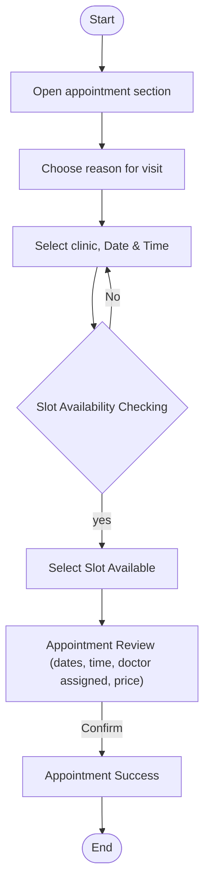
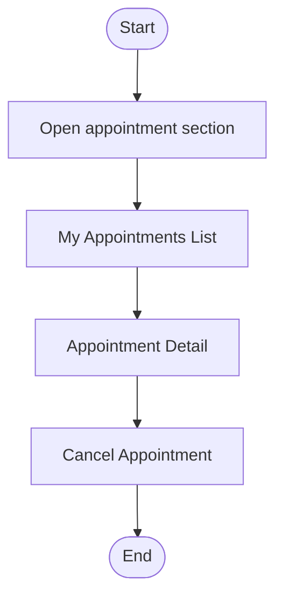
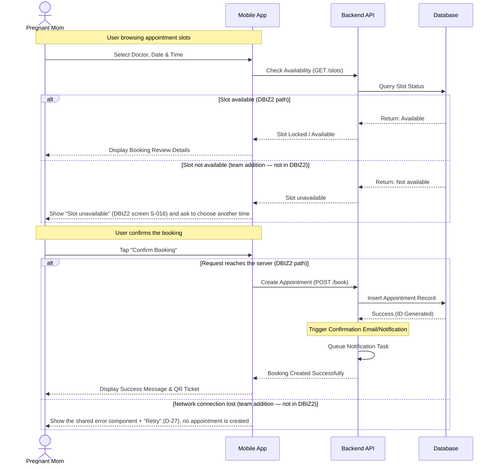

# Spec Document: Appointment (redirect to host app)

| Field | Value |
|---|---|
| Module ID | `APT` |
| Module name | Appointment Booking & Visit Management (TCI booking portal in a WebView — Could, D-77) |
| Spec version | v1.6.0 (14/10/2026: PRD C1 — priority Could, WebView, Q1 and Q11 answered, D-77) — v1.5.1 (review 29/09/2026: APT-01 – APT-04, X-05, X-07 / DM-25 data types) |
| Author (team member) | Hải Anh (drafted 15/09/2026) — diagrams checked node by node by Chi, 16/09/2026 (verifier ≠ converter) |
| Date | 14/10/2026 |
| Status | Draft |
| Approved by (Client role) | *pending* |
| DBIZ2 source | Function List rows `F-101`–`F-107`, `F-116`–`F-118` (10 rows); Screens `S-012`–`S-022` (reference only, see §1) |

---

## 1. Purpose and scope (mandatory)

This module connects the mother's digital journey to in-person hospital care when a consultation is appropriate. Per MVP v8's Product Context, equivalent booking functionality already exists in the host Thu Cuc app, so this module's job is to surface/redirect to that existing flow rather than rebuild a native booking experience.

**Priority and mechanism (PRD C1, D-77).** The module is **Could**. The booking flow is Thu Cuc's existing antenatal booking portal opened in a **WebView inside the TCI app**; the upcoming-appointment card reads the mother's appointments from the TCI app, and appointment reminders are kept. The card on S-008 and the "Appointment reminders" switch on S-010 are Could elements inside Must screens: if APT is not built, both are hidden and the Must screens still work.

**Entry point in the MVP (D-01 `[PENDING CLIENT: D-01]`).** Because Mother & Baby 360 is a sub-app running inside the TCI app (D-01), the booking entry point is the **"Book a visit ↗"** button on Home (S-008); tapping it opens the TCI app's (host's) existing booking flow. S-008 also shows the **"Upcoming appointments"** card (visit name, `dd/mm/yyyy · HH:mm`, facility · doctor) and the empty state "No upcoming appointments." with a "Book a visit ↗" button. **No intermediate screen (MVP scope, backlog item 6):** the "Book a visit ↗" button on Home and the "Appointments" tab open the TCI app's booking flow directly; the sub-app draws no appointment screen of its own (S-012 – S-022 are "Handled by Host App (Redirect only)").

**In scope**

- The "Book a visit ↗" button on S-008 and the "Appointments" tab take the mother **directly** to the TCI app's booking flow, with no intermediate screen (FR-001, BR-001, BR-003; D-01).
- Displaying upcoming appointments on S-008 as a **read-only** card (with an empty state), using data read from the TCI app's appointment records (FR-005, BR-002).
- Reminder notifications for upcoming appointments (FR-009) — the MVP notification type "Appointment reminders" (S-010), delivered via the TCI app (X-05).

**Out of scope**

- **Everything the TCI app already does (APT-01):** booking filters / doctor list, slot filtering, slot availability check, creating the appointment record, updating status from a reminder, logging schedule changes, booking and cancellation confirmations, the appointment list and cancellation. MVP v8: "only surface/redirect to the existing flow rather than rebuilding it"; backlog item 6: "rather than rebuilding slot selection, booking, or an appointments list". The corresponding FRs are **Won't / N/A (done by the TCI app)**.
- Rebuilding the host app's full native booking UI end-to-end. DBIZ2's own Figure 13 sequence and screens S-012 – S-022 describe exactly this full native flow and are kept as *reference material only* (see §7).
- Doctor-side appointment/schedule self-management — outside MVP function scope per the Session 4 assignment document.

**Depends on**

- `ACC` for the logged-in identity the appointment is booked under — per D-01, the signed-in TCI account.
- The host Thu Cuc app's existing booking system as the system of record (see BR-002).
- `ACC` S-008 (Home), the screen that holds this module's entry point and appointment card.

## 2. Actors (mandatory)

| Actor | Role in this module | Where it comes from |
|---|---|---|
| Mom | Primary | Function List `Actor` column (`F-101`, `F-106`) |
| App | Secondary | Function List `Actor` column (`F-105`, reminder display) |
| System | Secondary | Function List `Actor` column (validation/notification rows) |

## 3. User scenarios and acceptance criteria (mandatory)

### US-1 (P2): Book a hospital visit when needed

**Journey.** As a `Mom`, I want to `find and book an available appointment slot`, so that `I can get an in-person consultation when my digital journey shows I need one`.

**Acceptance scenarios**

1. **Given** the mother is on Home (S-008), **When** she taps "Book a visit ↗", **Then** the TCI app's booking flow opens directly, with no intermediate screen (FR-001). `[PENDING CLIENT: D-01]`
2. **Given** any screen of the sub-app, **When** the mother taps the "Appointments" tab, **Then** the TCI app's booking flow opens directly (BR-003).
3. Choosing a date / doctor / clinic, checking the slot, confirming the booking and the confirmation message all happen **inside the TCI app** and are not specified by this module (APT-01).

### US-2 (P3): Get reminded about an upcoming appointment

**Journey.** As a `Mom`, I want to `be reminded of an upcoming appointment`, so that `I don't miss it`.

**Acceptance scenarios**

1. **Given** an upcoming appointment exists and "Appointment reminders" is on (S-010), **When** the reminder time arrives, **Then** the system sends an "Appointment" notification via the TCI app (FR-009, X-05); tapping it on S-009 opens the TCI app's appointment flow.
2. **Given** the mother has an upcoming appointment, **When** she opens S-008, **Then** the read-only "Upcoming appointments" card shows the visit name, date and time (`dd/mm/yyyy · HH:mm`), facility and doctor, read from the TCI app (FR-005, BR-002).
3. **Given** the mother has no upcoming appointment, **When** she opens S-008, **Then** the card shows "No upcoming appointments." with a "Book a visit ↗" button.

### Edge cases

- What happens when the redirect target (the host app's booking flow) is unavailable? — `[NEEDS CLARIFICATION: not addressed by any source document]`.
- What happens when a slot becomes unavailable between filtering and confirming? — handled inside the TCI app; not specified by this module (APT-01).
- What happens when an appointment is cancelled from inside the host app rather than from this module? — `[NEEDS CLARIFICATION: see §10 Q10]`.
- After the mother finishes booking in the TCI app, how does she return to the sub-app, and when is the "Upcoming appointments" card updated? — `[NEEDS CLARIFICATION: not drawn in the wireframe]`.

## 4. Flows (mandatory)

### 4.1 Usage flow

Textualized from DBIZ2's Mom "Appointment" usage flow (`docs/architecture/usage-flow.md`), kept for reference since MVP v8 states the MVP does not rebuild this flow natively. In the MVP, the step "Open appointment section" corresponds to tapping "Book a visit ↗" on S-008, and the following steps take place in the TCI app `[PENDING CLIENT: D-01]`.

### 4.2 Sequence for the main flow

Textualized from DBIZ2 `Schematic2`, Figure 13 (image18.png) — DBIZ2's own native-booking sequence, kept as reference, not as this module's built implementation.

**Source caption note:** despite the DBIZ2 caption "Manage Schedule(Mom)," the diagram's actual content is a doctor-appointment-booking sequence (select doctor/date/time → check availability → confirm → success), not a schedule-viewing sequence. The original DBIZ2 caption is kept.

**Failure branches (team addition — not in DBIZ2).** The two `else` branches above ("Slot not available", "Network connection lost") are **not in DBIZ2 Figure 13**, which draws only the happy path; they were added by the team. "Slot unavailable" reuses the DBIZ2 screen S-016 (Slot Unavailable Screen); the error handling reuses the shared error component (D-27). **The whole Figure 13 flow runs in the TCI app in the MVP (APT-01);** the diagram is reference only, and the TCI app's own behaviour in these cases is `[NEEDS CLARIFICATION: §10 Q5]`.

## 5. Functional requirements (mandatory)

| FR ID | DBIZ2 Subfunction ID | Requirement (system MUST ...) | Actor | Priority |
|---|---|---|---|---|
| FR-001 | F-101 | The system MUST display booking filters and available doctors for appointment selection. **MVP — only meaning kept (APT-01):** the "Book a visit ↗" button on S-008 (and the "Appointments" tab, BR-003) opens the TCI app's booking flow directly; the filters and doctor list themselves are shown by the TCI app. The flow opens as a WebView of the TCI booking portal inside the TCI app (D-77). | Mom | Could (D-77) |
| FR-002 | F-102 | The system MUST filter available appointment slots based on selected criteria (date, doctor, clinic). | Mom | **Won't / N/A — done by the TCI app (APT-01)** |
| FR-003 | F-103 | The system MUST validate real-time availability of the selected appointment slot before booking. | System | **Won't / N/A — done by the TCI app (APT-01)** |
| FR-004 | F-104 | The system MUST create and store a new appointment record in the system. | System | **Won't / N/A — done by the TCI app (APT-01)** |
| FR-005 | F-105 | The system MUST display reminder details associated with upcoming appointments or tasks. **MVP:** the **read-only** "Upcoming appointments" card on S-008 (visit name, `dd/mm/yyyy · HH:mm`, facility · doctor; empty state "No upcoming appointments." + "Book a visit ↗"), with data read from the TCI app (BR-002) — not a separate appointment list (APT-04). Reading this data from the TCI app is part of the PRD C1 scope (D-77, §10 Q11 resolved). | App | Could (D-77) |
| FR-006 | F-106 | The system MUST update appointment or task status based on user interaction with reminders. | Mom | **Won't / N/A — done by the TCI app (APT-01)** |
| FR-007 | F-107 | The system MUST log appointment or schedule updates for audit and tracking purposes. | System | **Won't / N/A — done by the TCI app (APT-01)** |
| FR-008 | F-116 | The system MUST send booking confirmation notifications to the patient and relevant staff. | System | **Won't / N/A — done by the TCI app (APT-01)** |
| FR-009 | F-117 | The system MUST send reminder notifications for upcoming appointments or tasks. **MVP:** creates the mother's "Appointment" notification (`spec-ACC.md` entity Notification) when the "Appointment reminders" switch on S-010 is on; delivered via the TCI app (X-05); tapping it on S-009 opens the TCI app's appointment flow. | System | Could (D-77) |
| FR-010 | F-118 | The system MUST send confirmation notifications when an appointment is canceled. | System | **Won't / N/A — done by the TCI app (APT-01)** |

*FR-001 and FR-005 are the S-008 button and card; FR-009 is the appointment reminder (§10 Q6 resolved).*

### 5.1 Input / Output contract

| FR ID | Input field | Type | Required | Output field | Type | Notes / validation |
|---|---|---|---|---|---|---|
| FR-001 | Navigation Request (tap "Book a visit ↗" on S-008, or the "Appointments" tab) | EVENT (no payload) | Yes | *(UI navigation target: the TCI app's booking flow)* | — | Opens the TCI booking portal in a WebView inside the TCI app, no intermediate screen `[PENDING CLIENT: D-01]`; return path §10 Q9 |
| FR-002 | — | — | — | — | — | **Won't / N/A (TCI app)** |
| FR-003 | — | — | — | — | — | **Won't / N/A (TCI app)** |
| FR-004 | — | — | — | — | — | **Won't / N/A (TCI app)** |
| FR-005 | User ID | UUID | Yes | Upcoming Appointments (read from the TCI app) | LIST of OBJECT (appointment_ref, visit_name, appointment_at, facility, doctor_name) | Read-only card on S-008; empty → "No upcoming appointments." How the card is refreshed after booking: §10 Q9 |
| FR-006 | — | — | — | — | — | **Won't / N/A (TCI app)** |
| FR-007 | — | — | — | — | — | **Won't / N/A (TCI app)** |
| FR-008 | — | — | — | — | — | **Won't / N/A (TCI app)** |
| FR-009 | Reminder Trigger; Appointment Reference; User ID | EVENT (scheduled); VARCHAR(64); UUID | Yes | Notification created (type "Appointment") | UUID | Only when "Appointment reminders" is on (S-010); delivered via the TCI app (X-05). How far in advance: `[NEEDS CLARIFICATION: S-010 Q3]` |
| FR-010 | — | — | — | — | — | **Won't / N/A (TCI app)** |

### 5.2 Business rules

| Rule ID | Rule | Why it exists |
|---|---|---|
| BR-001 | This module does not create or manage a native, independently-scheduled appointment system; it surfaces and redirects to the host app's existing booking flow. In the MVP, the entry point is the "Book a visit ↗" button on S-008, which opens the TCI app's booking flow. | MVP v8 §5 verbatim: "Equivalent booking functionality already exists in the hospital's current app; the MVP will only surface/redirect to the existing flow rather than rebuilding it in full." Wireframe S-008; D-01. |
| BR-002 | Any appointment record created through the host app's flow is the authoritative record; this module must not maintain a conflicting, duplicate schedule of its own. The "Upcoming appointments" card on S-008 only reads from this record. | Direct consequence of BR-001, stated explicitly here since neither DBIZ2 nor MVP v8 draws what happens if the two disagree — see the open question in §10. |
| BR-003 | The "Appointments" tab of the 5-tab bar opens the TCI app's booking flow directly; the sub-app has no appointment screen of its own. | MVP v8 §6 backlog item 6; APT-02. |

## 6. Key entities

| Entity | Attributes (from Input/Output fields) | Relationships |
|---|---|---|
| Appointment Record *(external — the TCI app's record, read only; not stored in the sub-app — DM-04)* | appointment_ref — TCI appointment ID (VARCHAR(64); Required), visit_name (VARCHAR(100); Required), appointment_at (DATETIME; Required), facility (VARCHAR(100); Required), doctor_name (VARCHAR(100); Optional) — the fields shown on the S-008 card | belongs to Patient; authoritative copy lives in the host app per BR-002 |
| Reminder | Reminder trigger (scheduled EVENT — not stored), appointment_ref (VARCHAR(64); Required) | produces a Notification of type "Appointment" (`spec-ACC.md` §6) |

*Slot is not used by the sub-app (TCI-owned; APT-01). Types (X-07 / DM-25): every attribute is written `name (TYPE; Required/Optional)`.*

## 7. Screens involved

DBIZ2 has native-booking screens S-012 – S-022 (5 with a mockup). MVP v8 does not build a native booking UI, so **none of them is built in the sub-app** (APT-03).

### 7.0 Entry point in the MVP

| Screen ID | Element | Priority | Note |
|---|---|---|---|
| S-008 (belongs to `spec-ACC`) | "Upcoming appointments" card + empty state "No upcoming appointments." | Could (D-77) | Data from the TCI app (BR-002). Screen Spec: `screens/screen-spec-S-008.md`. |
| S-008 (belongs to `spec-ACC`) | "Book a visit ↗" button — "Opens the TCI app's booking flow" | Could (D-77) | `[PENDING CLIENT: D-01]`. WebView of the TCI booking portal (§10 Q1 resolved). |
| 5-tab bar (every mother screen) | "Appointments" tab — opens the TCI app's booking flow directly | Could (D-77) | BR-003 |
| S-010 (belongs to `spec-ACC`) | "Appointment reminders" switch | Could (D-77) | FR-009; hidden if APT is not built |

*The "Appointments" tab of the 5-tab bar (D-27) opens the TCI app's booking flow directly — no screen in the sub-app (BR-003; §10 Q7 resolved).*

### 7.1 DBIZ2 booking screens (not built)

| Screen ID | Screen name | Priority | Note |
|---|---|---|---|
| S-012 – S-022 | Appointment Home, Visit Reason, Clinic & Date Selection, Time Slot Selection, Slot Unavailable, Appointment Review, Appointment Success, Appointment Detail, Appointment List, Appointment Cancellation, Cancellation Success | **Handled by the TCI app — not built in the sub-app** (APT-03) | DBIZ2 mockups of S-012, S-014, S-015, S-017, S-018 are kept as reference only (Figure 13, §4.2). The S-017 mockup shows a price ("300.000 VND"), supporting evidence for In-App Payment = Won't. The module's only MVP touchpoints are the button and card on S-008 and the "Appointments" tab (§7.0). |

## 8. Success criteria (mandatory)

| SC ID | Criterion | How it is measured |
|---|---|---|
| SC-001 | A mother who needs an in-person visit reaches the hospital's existing booking flow without having to leave the app and search for it separately. | Usability walkthrough: count of steps/taps from the app's home screen to a completed handoff. |
| SC-002 | A mother with an upcoming appointment is reminded before it happens, without needing to check the hospital's system separately. | Manual test: schedule a reminder and confirm it appears at the expected time. |

## 9. Assumptions

- All 10 DBIZ2 FRs are kept as rows for traceability; only FR-001, FR-005 and FR-009 are built in the sub-app, the other 7 are Won't / N/A because the TCI app does them (APT-01).
- Assumed the data for the "Upcoming appointments" card on S-008 can be read from the TCI app (BR-002); how it is read has not been described.

## 10. Open questions

| # | Question | Blocking? | Owner | Status |
|---|---|---|---|---|
| 1 | The "Book a visit ↗" button on S-008 opens the booking flow inside the TCI app (D-01). [NEEDS CLARIFICATION: the specific technical mechanism (host internal navigation, deep link or webview) and how the mother returns to the sub-app are not described in any source.] **Mechanism answered by the PRD C1 (D-77):** a WebView embedded in the TCI app opens the existing antenatal booking portal. The return to the sub-app stays in Q9. | No | Backend / Systems Analyst | Resolved (mechanism, D-77) |
| 2 | If the redirect hands off entirely to the host app, do FR-003 / FR-004 still need to be built in this module? **Resolved (APT-01, APT-02):** no — they are done by the TCI app (Won't / N/A). | No | Backend | Resolved |
| 3 | Does the sub-app need any dedicated screen of its own for appointments? **Resolved (APT-02, MVP backlog item 6):** no — the button on Home and the "Appointments" tab open the TCI booking flow directly, no intermediate screen. | No | UX/UI | Resolved |
| 5 | Figure 13's sequence (§4.2) and both usage-flow sub-flows (§4.1) draw only the happy path in DBIZ2. Two failure branches ("Slot not available", "Network connection lost") were added to §4.2 by the team and marked as not in DBIZ2; the usage flows (§4.1) are unchanged. Still open: does the TCI app (which actually handles booking — §1) behave the same way in these cases, and what happens on a redirect failure? | No | UX/UI / Backend | Open |
| 6 | Do the "Book a visit ↗" button and the "Upcoming appointments" card on S-008 map to FR-001 / FR-005? **Resolved (APT-01):** yes — FR-001 = the button (and the tab), FR-005 = the read-only card. | No | BA | Resolved |
| 7 | Which screen does the "Appointments" tab open? **Resolved (APT-02):** the TCI app's booking flow directly (BR-003). | No | UX/UI | Resolved |
| 8 | [NEEDS CLARIFICATION: What happens when the TCI booking flow cannot be opened?] | No | Team / Client | Open |
| 9 | [NEEDS CLARIFICATION: How does the mother return to the sub-app after booking, and when is the read-only "Upcoming appointments" card updated from the TCI app?] (APT-04: open question with TCI) | No | Team / Client | Open |
| 10 | [NEEDS CLARIFICATION: What happens when an appointment is cancelled inside the TCI app rather than from this module — how and when does the "Upcoming appointments" card on S-008 reflect it? (BR-002: the TCI app record is authoritative)] | No | Team / Client | Open |
| 11 | [NEEDS CLARIFICATION: The read-only "Upcoming appointments" card (FR-005) needs the sub-app to read the mother's appointments from the TCI app. MVP v8 §2 lists only the reuse of the TCI identity, and backlog item 6 says the sub-app does not rebuild "an appointments list". Does the Client allow this read (same decision as D-01), or is the card dropped so that the sub-app only redirects?] **Answered by the PRD C1 (14/10/2026):** the card is kept and reads from the TCI app (D-77). | No | Client | Resolved (D-77) |
| DM-04 | Are appointments, slots and reminders stored in the sub-app database? | No | APT (data model) | Resolved (APT-01) — not stored (EXTERNAL); an Appointment notification keeps only `appointment_ref`; Slot is not used |
| DM-25 | Columns without a declared type. | No | ACC / HLT / ALR / TML / BOT / APT / CLI (data model) | Resolved (X-07) — §6 declares `(TYPE; Required/Optional)` for every attribute; since 30/09/2026 this includes FAMILY_MESSAGE.`patient_id` (DM-33) |

*Missing numbers are closed questions; numbers are not reused so that references stay valid.*

## 11. Traceability to DBIZ2

| Spec section | DBIZ2 source | Location |
|---|---|---|
| 1. Purpose | MVP v8 §5 MoSCoW, "Basic Appointment Booking" row; §6 Sprint Backlog item 6; D-01 | `docs/prd.md` (MVP Scope v8); `docs/decisions.md` (Decision log) |
| 4.1 Usage flow | "Appointment" Mom usage flow (both sub-flows, reference only) | sheet `Schematic2`, Figure 3 |
| 4.2 Sequence | Figure 13 (source caption "Manage Schedule(Mom)"), reference only | sheet `Schematic2`, Figure 13 (image18.png) |
| 5. Functional requirements | Function List | sheet `FL&Cost1`, rows 101–107, 116–118 |
| 7. Screens | Screen List; entry point on S-008 (not in DBIZ2) | sheet `ST`, rows 12–22; wireframe S-008 |

---

## Completion checklist

- [x] Every subfunction of this module in the DBIZ2 Function List appears as an FR row. (10/10; 7 are Won't / N/A — done by the TCI app, APT-01)
- [x] Every Input and Output field has a type and a required flag, or is marked `[NEEDS CLARIFICATION]`.
- [x] Every Mermaid block renders without an error.
- [ ] Every node and arrow in the Mermaid flow exists in the original DBIZ2 diagram — **checked by Chi**. Failure branches (marked "team addition — not in DBIZ2") were added to §4.2 after the check of 16/09/2026 — Chi to re-check.
- [x] At least one business rule is written that is not visible in any diagram. (BR-001 – BR-003)
- [x] Every screen this module touches is listed (§7.0 entry point on S-008 and the Appointments tab; §7.1 S-012 – S-022 handled by the TCI app).
- [x] Success criteria contain no technology words.
- [x] Open questions carry forward the undefined redirect mechanism, the return to the sub-app and the card refresh.
- [x] The traceability table points to real rows/sheets/figures.
