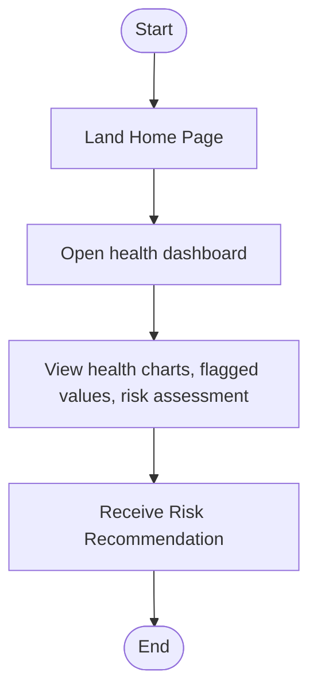
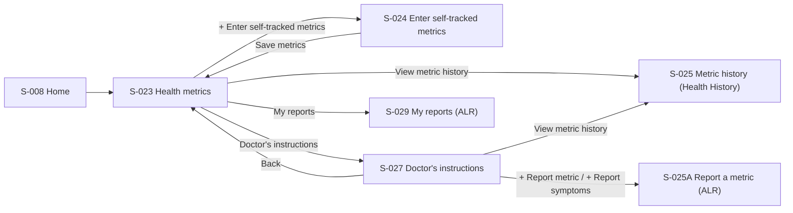
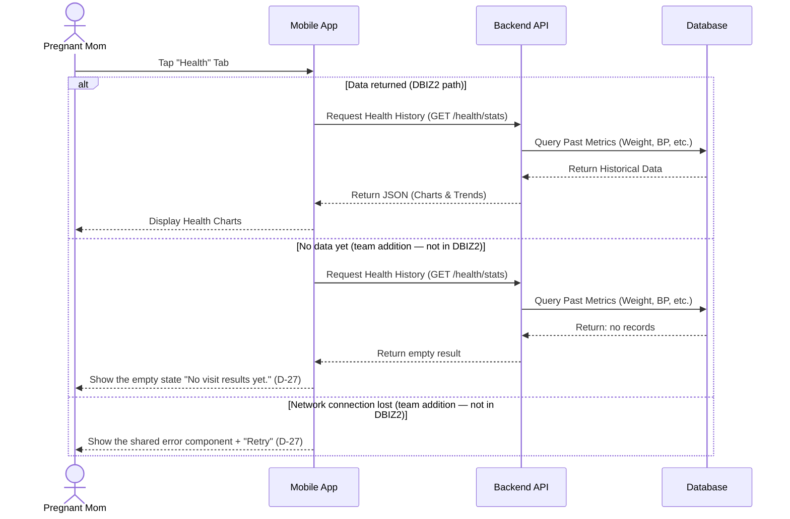

# Spec Document: Health Visibility (Dashboard)

| Field | Value |
|---|---|
| Module ID | `HLT` |
| Module name | Health Visibility (Clinical Data Review) — UI: "Health metrics" |
| Spec version | v1.7.3 (30/09/2026: data-model review decisions applied — DM-10, DM-22, DM-38, DM-40; gestational_week 0–42; fetal_length cm; review 29/09/2026: HLT-01 – HLT-06, X-04, X-07 / DM-25 data types; fetal heart rate = reference range only, per the latest MVP Scope) |
| Author (team member) | Ánh (drafted 15/09/2026) — diagrams checked node by node by Hải Anh, 16/09/2026 (verifier ≠ converter) |
| Date | 30/09/2026 |
| Status | Draft |
| Approved by (Client role) | *pending* |
| DBIZ2 source | Function List rows `F-051`–`F-054`, `F-078`–`F-079`, `F-083`–`F-084`, `F-090`–`F-091`, `F-095`–`F-096` (12 rows); Screens `S-023`, `S-024` (D-07), `S-027` (reused ID, see §7); `S-025` "Health History" = the "Metric history" screen (original DBIZ2 ID, D-38) |

---

## 1. Purpose and scope (mandatory)

This module lets the mother view the health information recorded at her hospital visits (vital signs, lab tests, ultrasound), the metrics her doctor has asked her to monitor at home ("Doctor's instructions"), and — if she wishes — the metrics she tracks herself, without having to phone the hospital.

**Terminology (X-04).** "Doctor's instructions" (UI; entity Watch-Flag) = the **watch-flag** of MVP v8 §5: an informational note the doctor attaches to an indicator for the mother to watch at home.

**Data sources (D-10).** Every health value belongs to exactly one of three sources and always shows its source label:

| Source label | Meaning |
|---|---|
| From visit | A value recorded by clinical staff during a visit. **MVP: simulated as seed data prepared by the clinical role; there is no visit entry screen** (D-59; no EMR integration — MVP v8, Won't). |
| Self-entered | A value the mother enters herself **outside the Doctor's instructions**: group 1 metrics entered on S-024 and weight declared on S-007 (D-42). (Since ALR-02 the mother cannot report a group 2 metric that has no instruction, so a group 2 value is never "Self-entered" — D-33 as revised.) |
| Doctor-assigned | A value the mother reports for a group 2 metric that the doctor has assigned for monitoring (entered on S-025A, owned by `ALR`). |

**Metric groups (D-11, D-12, D-13).**

| Group | Metrics | Characteristics | Module that owns the check |
|---|---|---|---|
| Group 1 — Self-tracked metrics | Weight, temperature, heart rate, sleep | **Optional**, no threshold, no threshold check. The mother is not required to measure / enter them daily (matches MVP v8: "Mothers are not required to self-measure or log vitals daily"). | None (display only) |
| Group 2 — With threshold | Blood pressure, blood glucose, urine protein | Assigned by the doctor; the mother reports only the metrics in her Doctor's instructions (ALR-02); thresholds and threshold checking belong to `ALR` (BR-004 of `spec-ALR.md`). | `ALR` |
| Fetal heart rate | Fetal heart rate | **Taken from visits only**; the mother does not enter or report it. The 110–160 bpm range is **shown for reference only** next to the "From visit" value: no threshold label, no check, never an alert (D-12; MVP Scope (latest) §5: the 110–160 bpm range is "shown for reference" / "for display only" and does not raise an alert). | — (display only) |
| Height | — | Belongs to the Profile (`ACC`); **no BMI** (D-13). | — |

**In scope**

- Load and display the "Health metrics" screen (S-023) with 3 sections: Latest visit results / "Doctor's instructions" card (names of the flagged metrics + count) + "My reports" card (highlighted) / Self-tracked metrics; "Refresh" button; "View metric history" link.
- Enter group 1 self-tracked metrics on S-024 ("Save metrics"), with no threshold check (D-07, D-11).
- Display the "Doctor's instructions" list (S-027) for the assigned group 2 metrics.
- Highlight abnormal values using the existing threshold label ("Normal / Above threshold / Not assessed", D-17) for group 2 values — this module does not compute thresholds itself. Fetal heart rate shows only its 110–160 bpm reference range, with no label (D-12).
- "Metric history" screen (S-025 "Health History", D-38): choose a metric, filter by from date – to date (`dd/mm/yyyy`), chart, average / lowest / highest, list of measurements with source labels.
- Store and aggregate metric records so the screens above have data.

**Out of scope**

- Threshold checking, creating reports / "Alert", the report status flow — owned by `ALR` (and, on the clinical staff side, by `CLI`). S-025A, S-026, S-028, S-029 belong to `ALR`; S-027 only links to S-025A.
- Real-time EMR / S-025 integration — Won't per MVP v8.
- Measuring-device sync (Hardware Device Auto-Sync) — Won't per MVP v8; S-024 is manual entry of group 1 metrics, not device sync (D-07, D-11).
- Creating / editing "Doctor's instructions" — done by the doctor on S-064 (`CLI`, D-29). This module only displays them.
- Height — belongs to the Profile (`ACC`, D-13).

**Depends on**

- `ACC` for user identity (TCI account `[PENDING CLIENT: D-01]`) and height in the Profile.
- `ALR` for group 2 thresholds, threshold labels, and the report flow from S-027 → S-025A.
- `CLI` for the doctor creating / editing "Doctor's instructions" (S-064).

## 2. Actors (mandatory)

| Actor | Role in this module | Where it comes from |
|---|---|---|
| Mom | Primary | Function List `Actor` column (`F-078`) |
| User (Mom, in context) | Primary | Function List `Actor` column (`F-052`, `F-090`, `F-091`) |
| System | Secondary | Function List `Actor` column (data storage/aggregation rows) |
| Doctor | Secondary (creates the "Doctor's instructions" this module displays; the action lives in `CLI`) | D-29; MVP v8 (watch-flag set by the doctor) |

## 3. User scenarios and acceptance criteria (mandatory)

### US-1 (P1): View the Health metrics screen

**Journey.** As a `Mom`, I want to `open the Health metrics screen`, so that `I know what my latest visit recorded and what my doctor asked me to monitor, without having to phone`.

**Acceptance scenarios**

1. **Given** the mother is logged in and has at least one visit, **When** she opens S-023, **Then** the system shows 3 sections: (1) "Latest visit results" with the label "From visit", the visit date `dd/mm/yyyy`, the note "read-only", and the fetal heart rate with its 110–160 bpm reference range (no label — D-12); (2) the "Doctor's instructions" card (the **names** of the flagged metrics + their number — the mother sees her watch-flags on the dashboard; details on S-027, HLT-03) and the "My reports" card (number of reports being handled + latest status — `spec-ALR.md` FR-002), both highlighted; (3) "Self-tracked metrics" with the label "Self-entered" and the measurement time `dd/mm/yyyy · HH:mm` for each metric.
2. **Given** S-023 is open, **When** the mother taps "Refresh", **Then** the system reloads the latest data and shows a confirmation message (FR-003, FR-004).
3. **Given** S-023, **When** the mother taps the "Doctor's instructions" card, **Then** S-027 opens; **When** she taps "My reports", **Then** S-029 "My reports" opens (`ALR`, D-26 as revised).
4. **Given** the mother has no visit yet, **When** she opens S-023, **Then** section 1 shows the empty state "No visit results yet." (shared pattern, D-27).

### US-2 (P1): Enter self-tracked metrics (optional)

**Journey.** As a `Mom`, I want to `record my weight, temperature, heart rate or sleep whenever I want`, so that `I can track them myself, without being forced to enter them every day`.

**Acceptance scenarios**

1. **Given** S-023, **When** the mother taps "+ Enter self-tracked metrics", **Then** S-024 opens with the 4 group 1 metrics, each with a "Measured at" field; sleep is entered as "Bedtime" and "Wake-up time"; every field may be left empty.
2. **Given** the mother enters at least one valid value, **When** she taps "Save metrics", **Then** the system stores the record with source "Self-entered", group 1 (FR-007), shows "Metrics saved" and returns to S-023. The system does **not** check thresholds and does **not** create a report (BR-003).
3. **Given** a value in the wrong format / outside the valid range, **When** she taps "Save metrics", **Then** a field error is shown using the shared pattern. Valid range: `[NEEDS CLARIFICATION: D-16 — no values yet]`.

### US-3 (P2): View Doctor's instructions

**Journey.** As a `Mom`, I want to `see the metrics my doctor asked me to monitor at home`, so that `I know what to measure and where to report it`.

**Acceptance scenarios**

1. **Given** the doctor has assigned at least one group 2 metric, **When** the mother opens S-027, **Then** each card shows the metric name, the label "Doctor-assigned", the latest report (or "none yet"), the threshold label, the doctor's note, the doctor's name and the assignment date `dd/mm/yyyy`, the "View metric history" link and the "+ Report metric" button (opens S-025A, owned by `ALR`).
2. **Given** there are no instructions yet, **When** she opens S-027, **Then** "Your doctor has not given you any instructions yet." is shown and the "+ Report symptoms" button is still available.
3. S-027 does **not** show group 1 metrics (e.g. temperature) (D-11).

### US-4 (P2): View a metric's history over time

**Journey.** As a `Mom`, I want to `see how a metric changes over time`, so that `I understand the trend, not just the latest value`.

**Acceptance scenarios**

1. **Given** S-023 or S-027, **When** the mother taps "View metric history", **Then** S-025 (D-38) opens with the chart of the selected metric (FR-009).
2. **Given** S-025, **When** the mother selects "From" – "To" (`dd/mm/yyyy`), **Then** the system filters the data in that range (FR-010), computes average / lowest / highest (FR-011) and redraws the chart (FR-012).
3. **Given** a group 2 metric, **Then** the chart has a threshold line and each measurement has a threshold label, per `spec-ALR.md` BR-004 (D-14, D-15): blood pressure systolic ≥ 140 or diastolic ≥ 90 mmHg; blood glucose according to the selected measurement context (fasting ≥ 5.3 / 1 h after meal ≥ 7.8 / 2 h after meal ≥ 6.7 mmol/L); urine protein ≥ 1+; **Given** fetal heart rate (in the selector, "From visit" values only), **Then** the chart shows the 110–160 bpm range as reference lines and the measurements have **no** threshold label (D-12); **Given** a group 1 metric, **Then** there is no threshold line and no threshold label. Every measurement always has a source label.
4. **Given** there is no data in the selected range, **Then** "No data for this period." is shown.

### Edge cases

- The mother has no visit yet — S-023 uses the empty state "No visit results yet." (D-27). The "Self-tracked metrics" section when nothing has been entered: `[NEEDS CLARIFICATION: the wireframe does not draw a separate empty state for section 3]`.
- Refresh fails (network/backend) — use the shared error-state pattern from the `00-QUY-UOC` conventions page (D-27); the exact error text follows that page.
- Two conflicting visit records (edited after entry) — `[NEEDS CLARIFICATION: not covered by any source]`.
- The mother enters a group 1 metric with a measurement time in the future — `[NEEDS CLARIFICATION: the wireframe states no rule]`.

## 4. Flows (mandatory)

### 4.1 Usage flow

**(a) DBIZ2 flow** — textualized from the "Health metric" Mom usage flow (`docs/architecture/usage-flow.md`), the viewing part that belongs to this module. No nodes added.

Mapping: the "Choose log in health metrics" / "Manual sync" branch of the full DBIZ2 diagram corresponds to S-024 (group 1 entry, this module, D-07) and S-025A (group 2 report, `ALR`) — see (b). The recommendation of the "Receive Risk Recommendation" node is shown on S-028 / S-026 (`ALR`, D-05). The words "risk assessment" in the DBIZ2 node are kept verbatim; the MVP has no risk assessment screen for the mother (ALR-01) — flagged values are the threshold labels on S-023 / S-025.

**(b) Wireframe flow** — **not a DBIZ2 diagram**; drawn from the wireframe navigation and decisions D-07, D-26, D-38.

### 4.2 Sequence for the main flow

Textualized from DBIZ2 `Schematic2`, Figure 15 (image40.png, "Track Health Status"), steps 1–6 (the viewing part; steps 7–17 belong to `spec-ALR.md` §4.2, which holds the full diagram).

**Failure branches (team addition — not in DBIZ2).** The two `else` branches ("No data yet", "Network connection lost") are **not in DBIZ2 Figure 15**, which draws only the happy path; they were added by the team from the states already written in this spec (§3 edge cases, S-023) and the shared patterns (D-27). Invalid input for self-tracked metrics (S-024) is not part of steps 1–6 of Figure 15; its validation rule is `[NEEDS CLARIFICATION: D-16 — §10 Q11]`.

The split after message 6 is the team's module boundary; it is not in DBIZ2.

Mapping: "Tap Health Tab" = opening the "Health" tab → S-023. Message 7 of Figure 15 ("Enter Weight/BP & Tap Save") is split in two: weight (group 1) → S-024 "Save metrics", no threshold check (this module); blood pressure (group 2) → S-025A "Submit report", threshold-checked (`ALR`). This split is a team decision (D-07, D-11), not part of Figure 15.

## 5. Functional requirements (mandatory)

| FR ID | DBIZ2 Subfunction ID | Requirement (system MUST ...) | Actor | Priority | Screen |
|---|---|---|---|---|---|
| FR-001 | F-051 | The system MUST highlight abnormal or out-of-range health metrics within alert details. — Displays the threshold label (Normal / Above threshold / Not assessed, D-17) computed by `ALR` for group 2 metrics; fetal heart rate has no label — only its 110–160 bpm reference range is shown (display only, D-12); group 1 has no threshold label. | System | Must | S-023 (section 1), S-027, S-025; in report details: S-026/S-028 (`ALR`) |
| FR-002 | F-052 | The system MUST load the health metrics dashboard module for real-time monitoring. | User | Must | S-023 |
| FR-003 | F-053 | The system MUST refresh health metric data on the dashboard and display a confirmation message. | System | Must | S-023 ("Refresh" button) |
| FR-004 | F-054 | The system MUST refresh dashboard data to reflect the most recent health metrics and alerts. | System | Must | S-023 ("Refresh" button; also updates the "My reports" card) |
| FR-005 | F-078 | The system MUST display summarized health metric cards highlighting key values and trends. | Mom | Must | S-023 (sections 1 and 3) |
| FR-006 | F-079 | The system MUST calculate and display weekly progress indicators based on recorded health data. Not built: weekly progress indicators are not a function in the MVP scope and no screen displays them (HLT-01). | System | **Won't (HLT-01)** | — |
| FR-007 | F-083 | The system MUST store validated health metric records in the system database. — Also used to store group 1 self-tracked metrics from S-024 (source "Self-entered"). | System | Must | S-024 (Save metrics) |
| FR-008 | F-084 | The system MUST aggregate and query health data to support analytics and dashboard visualization. | System | Must | S-023, S-027, S-025 |
| FR-009 | F-090 | The system MUST display a detailed chart for a selected health metric over time. | User | Must | S-025 (D-38) |
| FR-010 | F-091 | The system MUST filter health metrics based on a selected time range for focused analysis. — "From" – "To", format `dd/mm/yyyy`. | User | Must | S-025 (D-38) |
| FR-011 | F-095 | The system MUST compute summary statistics such as averages, minimums, and maximums for selected metrics. — "Average / Lowest / Highest". | System | Must | S-025 (D-38) |
| FR-012 | F-096 | The system MUST render an updated trend chart reflecting filtered or newly computed metric data. | System | Must | S-025 (D-38) |

No separate FRs are added for S-024 and S-027: group 1 entry uses FR-007 (store) + FR-005 (display); the "Doctor's instructions" list on S-027 uses FR-008 (query) + FR-001 (threshold label). This is the team's mapping; DBIZ2 has no separate F-xxx row for the group 1 entry form or for the watch-flag list in this module (rows F-072–F-076 belong to `ALR`).

### 5.1 Input / Output contract

| FR ID | Input field | Type | Required | Output field | Type | Notes / validation |
|---|---|---|---|---|---|---|
| FR-001 | Metric Value; Threshold Label | NUMBER / ENUM (metric-dependent); ENUM (Normal / Above threshold / Not assessed) | Yes | *(UI navigation target)* | — | Label computed by `ALR` (BR-004 `spec-ALR.md`); this module only displays it. Group 1: no label. |
| FR-002 | Navigation Request | EVENT (no payload) | Yes | *(UI navigation target)* | — | Opens S-023 |
| FR-003 | Click "Refresh" | EVENT (no payload) | Yes | Updated Data + Confirmation | OBJECT (updated fields) + CONFIRMATION | Refresh and confirm |
| FR-004 | Fetch Request | EVENT (no payload) | Yes | New JSON Data | OBJECT | Includes section 1, the section 2 summary, section 3 |
| FR-005 | Metric Data | OBJECT (Health Metric Record) | Yes | *(UI navigation target)* | — | Every value comes with its source label and time (`dd/mm/yyyy · HH:mm`) |
| FR-006 | — | — | — | — | — | **Won't (HLT-01)** |
| FR-007 | Validated Metric Data | OBJECT (Health Metric Record: metric, value, unit, measured_at, source, metric_group) | Yes | DB Insert ID | UUID | From S-024: source = "Self-entered", metric_group = 1; no threshold check. Valid range: `[NEEDS CLARIFICATION: D-16]` |
| FR-008 | Query Parameters | OBJECT (patient, metric, date range, source) | Yes | Aggregated Data Result | LIST / ARRAY | — |
| FR-009 | Metric ID; Time Range | ENUM (metric: group 1, group 2, fetal heart rate); DATE RANGE | Yes | *(UI navigation target)* | — | The metric is chosen with the "Metric: … ▾" dropdown on S-025; fetal heart rate is in the list ("From visit" values only) |
| FR-010 | Date Range Selection (From; To) | DATE; DATE (`dd/mm/yyyy`) | Yes | *(UI navigation target)* | — | `[NEEDS CLARIFICATION: default range when S-025 opens — the wireframe shows 01/09/2026–27/09/2026 as an example but states no rule]` |
| FR-011 | Filtered Data Set | LIST / ARRAY | Yes | Stats (Average, Lowest, Highest) | OBJECT (numeric summary) | Blood pressure: systolic and diastolic computed separately (per S-025). Urine protein (level values) and sleep: `[NEEDS CLARIFICATION: how to compute an average for non-numeric / duration values]` |
| FR-012 | Computed Statistics | OBJECT (numeric summary) | Yes | *(UI navigation target)* | — | Group 2: threshold line taken from `spec-ALR.md` BR-004 (D-15); for blood glucose, the threshold line follows the selected measurement context (`glucose_context`); fetal heart rate: 110–160 bpm reference lines (no label); group 1: none |

### 5.2 Business rules

| Rule ID | Rule | Why it exists |
|---|---|---|
| BR-001 | Records from visits (source "From visit") can never be edited by the mother. S-023 states "read-only". | Session 4 assignment document; MVP v8 (visit records are entered by clinical staff). |
| BR-002 | "Doctor's instructions" (watch-flag) shown to the mother are informational only — they are not an "Alert" in themselves and do not notify clinical staff on their own. | MVP v8 §5: "this is an informational note, not an alert"; D-22 ("Alert" is used only when a report is above threshold). |
| BR-003 | Group 1 metric values (weight, temperature, heart rate, sleep) are **never** threshold-checked and **never** create a report or a report status. Group 1 entry is optional; the system does not remind or require daily entry. | D-11; S-024 wireframe ("No threshold check, no report created"); MVP v8 ("Mothers are not required to self-measure or log vitals daily"). |
| BR-004 | Every health value shown on any screen (S-023, S-027, S-025, and the `ALR` screens) **must** carry a source label: "From visit" / "Self-entered" / "Doctor-assigned". | D-10. |
| BR-005 | Fetal heart rate only accepts values with source "From visit"; there is no fetal heart rate field on S-024 or S-025A. The 110–160 bpm range is **for display only**: shown as a reference next to the value (S-023, S-025, S-064), with no threshold label and no check; it never creates a report, a case or an "Alert". | D-12; MVP Scope (latest) §5: the 110–160 bpm range is "shown for reference" / "for display only" and does not raise an alert. |
| BR-006 | Height does not belong to this module (it is in the Profile, `ACC`); BMI is not displayed. | D-13. |
| BR-007 | S-027 lists only group 2 metrics assigned by the doctor. The mother reports those metrics (via "+ Report metric") and symptoms (via "+ Report symptoms"); she cannot report a group 2 metric that is not assigned (no "+ Report another metric"). Reporting belongs to `ALR`. | MVP v8 §4 "Report a Flagged Indicator"; D-11 as revised (ALR-02). |

## 6. Key entities

Health Metric Record is the single value table for all sources (D-41). Visit and Patient Clinical Profile are defined here and shared with `TML` and `CLI` (D-42).

| Entity | Attributes | Relationships |
|---|---|---|
| Health Metric Record | record_id (UUID; Required), patient_id (UUID; Required), `metric` (ENUM: Weight / Temperature / Heart rate / Sleep / Blood pressure / Blood glucose / Urine protein / Fetal heart rate; Required), `metric_group` (ENUM: **Group 1 / Group 2 / Visit** — fetal heart rate = Visit, D-11, D-51; Required), value — by metric type: number; systolic / diastolic pair; urine protein level Negative / Trace / 1+ / 2+ / 3+; bedtime / wake-up time for sleep (VARCHAR(20); Required — one formatted string for the MVP, e.g. "150/95", "1+", "22:30-06:00"; DM-22 resolved), `unit` — kg, °C, bpm, mmHg, mmol/L, — (VARCHAR(10); Optional), `glucose_context` (ENUM: fasting / post_1h / post_2h; Optional — blood glucose only, `spec-ALR.md` §6), `measured_at` (DATETIME, displayed `dd/mm/yyyy · HH:mm`; Required), `source` (ENUM: From visit / Self-entered / Doctor-assigned — D-10; Required; group 2 values reported by the mother are always "Doctor-assigned" — D-33 as revised), visit_id (UUID; Required when source = From visit, empty otherwise), gestational_week (INTEGER 0–42; Required), created_at (DATETIME; Required). `threshold_label` is not stored: it is computed from Threshold Rule (`spec-ALR.md` §6, D-52) for group 2 only (fetal heart rate has a display-only reference range, no label) | belongs to Patient; many records per mother; 0..1 Visit; referenced by 0..1 Metric Report (`ALR`) — the value the mother reports on S-025A is stored here, not stored again in Metric Report (D-41); group 1 values from S-024 and the weight declared at S-007 (D-42) are also stored here |
| Visit (D-42) | visit_id (UUID; Required), patient_id (UUID; Required), visit_date (DATE; Required), facility (VARCHAR(100); Required), visit_type, e.g. "Routine antenatal check-up", "Anomaly scan" (VARCHAR(100); Required), conclusion (TEXT; Optional), doctor_note (TEXT; Optional), ultrasound_image — file path (VARCHAR(255); Optional), fetal_length (DECIMAL(5,1), cm; Optional — unit cm confirmed in the data-model review, S4; matches S-048 #9 "xx cm"), estimated_fetal_weight (DECIMAL(6,1), gram; Optional), ultrasound_report_date (DATE; Optional), gestational_week (INTEGER 0–42; Required). **No** two-way EMR integration (Won't): **in the MVP, visit data is simulated as seed data prepared by the clinical role; there is no visit entry screen** (D-59, HLT-06) | belongs to Patient; has many Health Metric Records with source "From visit" (blood pressure, fetal heart rate, weight, blood glucose, urine protein…); shown on S-023 section 1, the S-048 visit card (`TML`), S-064 "Visit" + "Visit history" (`CLI`) |
| Patient Clinical Profile (D-42) | patient_id (UUID; Required), obstetric_history — PARA, e.g. "1001" (VARCHAR(10); Optional), blood_type (ENUM: A+ / A− / B+ / B− / AB+ / AB− / O+ / O−; Optional), allergies (TEXT; Optional), updated_at (DATETIME; Required); source "From visit" (seed data, D-59) | 1 per mother; visible only to clinical staff (S-064); not editable by the mother (BR-001) |
| Dashboard Summary | Latest visit results (most recent Visit), Doctor's instructions summary (names + number of flagged metrics), My reports summary (number of reports being handled, latest status — `spec-ALR.md` FR-002), latest Self-tracked metrics | **not stored**: derived from Visit, Health Metric Record, Watch-Flag and Case (`ALR`) — no types needed |
| Watch-Flag — UI: "Doctor's instructions" (= MVP "watch-flag", X-04) | flag_id (UUID; Required), patient_id (UUID; Required), visit_id — the visit after which the doctor placed the instruction (UUID; Optional — MVP v8 §5: "After a visit, the doctor may attach a watch-flag"; backlog item 3: "watch-flag on a visit record") `[NEEDS CLARIFICATION: how the visit is chosen on S-064 — §10 Q19]`, metric (ENUM: Blood pressure / Blood glucose / Urine protein — group 2 only; Required), `flagged_by` — Doctor, Staff (UUID; Required), `flagged_at` (DATE; Required), `note` — how to measure, how often (TEXT; Optional) `[NEEDS CLARIFICATION: maximum length — S-064 #9]`, `over_threshold_guidance` = { `template_id` (UUID → Guidance Template, `spec-ALR.md` §6; Optional), `custom_text` (TEXT, ≤ 1000 characters — D-46; Optional) } (D-24), active (BOOLEAN; Required) | belongs to Patient; 0..1 Visit (the visit it follows); created / edited by the Doctor via `spec-CLI.md` FR-025 (S-064, D-29); read by `ALR` when the mother reports the corresponding metric (S-025A shows the note; S-028 shows `over_threshold_guidance`) and by `spec-ALR.md` FR-022 (Doctor's-instruction reminders) |

*Types (X-07 / DM-25): every attribute is written `name (TYPE; Required/Optional)`. Types marked "provisional" depend on the open question named next to them.*

## 7. Screens involved

### 7.1 Screens with a mockup and a Screen Spec file

| Screen ID | Screen name | Priority | Screen Spec file |
|---|---|---|---|
| S-023 | Health metrics (Health Dashboard) | Must | `screens/screen-spec-S-023.md` — 3 sections; "Doctor's instructions" card with the names of the flagged metrics; "My reports" card; Refresh; View metric history; no height, BMI or "Overall" (D-13, D-26 as revised) |
| S-024 | Enter self-tracked metrics (DBIZ2: Manual Sync Screen) | Must — the screen belongs to the Must item "Health Visibility"; entering metrics is **optional for the mother** (HLT-05) | `screens/screen-spec-S-024.md` — owned by `HLT` (D-07); group 1 only; "Save metrics" button; no height |
| S-027 | Doctor's instructions | Must | `screens/screen-spec-S-027.md` — **not a DBIZ2 screen** (reused ID). A **separate** screen from S-023: S-023 is the overview, S-027 is the list of group 2 instructions. No temperature card. |

### 7.2 Screens this module needs that DBIZ2 never drew

| Screen ID | Screen name | Priority | Notes |
|---|---|---|---|
| S-025 | Metric history (DBIZ2: Health History) | Must | `screens/screen-spec-S-025.md` — original DBIZ2 ID (D-38). Has a wireframe. Serves FR-009–FR-012. Opened from S-023 and S-027 ("View metric history"). |

The "Metric history" screen uses the original DBIZ2 ID `S-025` "Health History" (D-38). The metric / symptom report screen is `S-025A` (owned by `ALR`). The DBIZ2 screens `S-026` "Sync Loading" and `S-027` "Sync Success Screen" are not used; their IDs are reused (S-026 in `ALR`; S-027 in §7.1).

## 8. Success criteria (mandatory)

| SC ID | Criterion | How it is measured |
|---|---|---|
| SC-001 | The mother knows what her latest visit recorded without phoning the hospital. | Usability walkthrough: time from Home until the latest visit results have been read. |
| SC-002 | The mother recognises the metrics her doctor asked her to monitor ("Doctor's instructions"). | Usability walkthrough: ask the tester to name the metrics assigned by the doctor, without prompting. |

## 9. Assumptions

- S-025 is assumed to be read-only, with no editing of records — consistent with BR-001 and the S-025 wireframe.
- The source label "Doctor-assigned" applies to values the mother reports on S-025A for an assigned group 2 metric (per the S-025 and S-029 wireframes). Since the mother can report only assigned group 2 metrics (ALR-02), every group 2 value she reports is "Doctor-assigned" (D-33 as revised).
- The DBIZ2 "Sync Loading" / "Sync Success" screens are not separate screens; after "Save metrics", S-024 shows "Metrics saved" and then returns to S-023 (S-024 wireframe).

## 10. Open questions

| # | Question | Blocking? | Owner | Status |
|---|---|---|---|---|
| 8 | FR-006 (F-079) "weekly progress indicators": no screen displays them. **Resolved (HLT-01):** not a function in the MVP scope → FR-006 is Won't and removed from the Dashboard Summary. | No | BA / UX/UI / Client | Resolved |
| 11 | Valid value ranges (to block typing mistakes) for each group 1 metric on S-024 (D-16, Pending SME). | Yes | Medical SME / Team | Open |
| 12 | How to compute average / lowest / highest (FR-011) for urine protein (level values) and sleep (bedtime / wake-up time); the default time range of S-025. | No | BA / UX/UI | Open |
| 13 | S-024 keeps the DBIZ2 Priority Must while the function is optional for the mother — keep Must (the screen must be built) or lower it? **Resolved (HLT-05):** keep Must — the screen belongs to the Must item "Health Visibility"; entry is optional for the mother. | No | Team | Resolved |
| 14 | How are Visit and Patient Clinical Profile data created in the MVP? **Resolved (D-59):** they are **simulated as seed data** loaded into the system for the demo (the team acts as the clinical role, per the MVP scope: "demo data … manually entered/simulated by the clinician role"). The MVP has **no visit entry screen** and no EMR integration (Won't). | No | Team | Resolved |
| 15 | [NEEDS CLARIFICATION: Empty state of the "Self-tracked metrics" section on S-023] | No | UX/UI | Open |
| 16 | [NEEDS CLARIFICATION: Two conflicting visit records (edited after entry)] | No | Team | Open |
| 17 | [NEEDS CLARIFICATION: Group 1 metric entered with a measurement time in the future] | No | UX/UI | Open |
| 18 | Which label does a fetal heart rate below 110 bpm get? | No | Team / UX/UI | Resolved — not applicable: fetal heart rate has no label; the 110–160 bpm range is display only (latest MVP Scope §5, D-12) |
| 19 | [NEEDS CLARIFICATION: Watch-Flag `visit_id` — how is the visit chosen when the doctor adds an instruction on S-064? Team proposal: the visit shown in the "Latest visit" card of S-064; a flag added without a visit stays allowed (Optional).] | No | Team / Doctor | Open |
| DM-10 | [NEEDS CLARIFICATION: how are STAFF, PATIENT_ASSIGNMENT and GUIDANCE_TEMPLATE created in the MVP — entry screen, import, or seed data? (VISIT and PATIENT_CLINICAL_PROFILE: seed data, D-59)] | Yes (resolved) | HLT / CLI (data model) | Resolved 29/09/2026 (data-model review, S2 — Tâm): STAFF, PATIENT_ASSIGNMENT and GUIDANCE_TEMPLATE are seed data in the MVP (VISIT, PATIENT_CLINICAL_PROFILE: D-59); no entry screen. Responsible doctor = hospital assignment, D-68 |
| DM-20 | [NEEDS CLARIFICATION: are two records of the same metric at the same measured time allowed?] | No | HLT (data model) | Open — default: Allowed |
| DM-21 | [NEEDS CLARIFICATION: can one metric have several active instructions, and which function removes an instruction?] | No | HLT / CLI (data model) | Open — default: At most 1 active instruction per metric per mother; removal = editing `active` in CLI FR-025 |
| DM-22 | [NEEDS CLARIFICATION: how is the metric-dependent `value` stored (blood pressure pair, urine protein level, sleep times)? §6 declares VARCHAR(20) as provisional while ACC FR-004 declares weight as DECIMAL(4,1) and HLT FR-001 / ALR FR-014 declare NUMBER / ENUM] | Yes (resolved) | HLT (data model) | Resolved 29/09/2026 (data-model review, S1 / S4 — Tâm, Trung): one VARCHAR(20) column holding the formatted string for the MVP ("150/95", "1+", "22:30-06:00") |
| DM-25 | Columns without a declared type. | No | ACC / HLT / ALR / TML / BOT / APT / CLI (data model) | Resolved (X-07) — §6 declares `(TYPE; Required/Optional)` for every attribute; since 30/09/2026 this includes FAMILY_MESSAGE.`patient_id` (DM-33) |
| DM-35 | [NEEDS CLARIFICATION: HLT §6 Watch-Flag declares `over_threshold_guidance` as a nested object {`template_id`, `custom_text`} — two columns, or a child table?] | No | HLT (data model) | Open — default: Two columns `template_id`, `custom_text` on WATCH_FLAG |
| DM-38 | [NEEDS CLARIFICATION: WATCH_FLAG.`flagged_at` is DATE, while every other `…_at` column is DATETIME — is the time of day needed (e.g. to order two instructions of the same day)?] | No | HLT (data model) | Resolved 29/09/2026 (data-model review, S4 — Trung): keep DATE as declared |
| DM-39 | [NEEDS CLARIFICATION: CARE_CASE.`patient_id`, STAFF_RESPONSE.`responder_role`, CASE_STATUS_HISTORY.`role` and HEALTH_METRIC_RECORD.`metric_group` repeat values that can be derived (the report / message owner, STAFF.`role`, the metric) — keep them with a consistency rule?] | No | ALR / CLI / HLT (data model) | Open — default: Keep them as declared; the seed checks that each equals its source |
| DM-40 | [NEEDS CLARIFICATION: stored enum spellings — `handoff_choice` "No thanks" (BOT §6) vs the button "No, thanks"; `operator` "≥" and `blood_type` "A−" use non-ASCII signs; the metric value set differs in 5 tables — keep as declared or use codes?] | No | ALR / BOT / HLT (data model) | Resolved 29/09/2026 (data-model review, S1 / S4 — Tâm, Trung): stored values exactly as declared in §6 (UTF-8), e.g. `handoff_choice` = "No thanks"; the UI label reference maps them to the screen text |

*Missing numbers are closed questions; numbers are not reused so that references stay valid.*

## 11. Traceability to DBIZ2

| Spec section | DBIZ2 source | Location |
|---|---|---|
| 1. Purpose | MVP v8 §5 MoSCoW, "Health Visibility (Clinical Data Review)" row; D-10–D-13 | `docs/prd.md` (MVP Scope v8); `docs/decisions.md` (Decision log) |
| 4.1 Usage flow | (a) "Health metric" Mom usage flow (viewing part); (b) wireframe — not DBIZ2 | sheet `Schematic2`, Figure 3; `wireframes-v5.1` |
| 4.2 Sequence | Figure 15 "Track Health Status," steps 1–6 | sheet `Schematic2`, Figure 15 (image40.png) |
| 5. Functional requirements | Function List | sheet `FL&Cost1`, rows 51–54, 78–79, 83–84, 90–91, 95–96 |
| 7. Screens | Screen List | sheet `ST`, rows 23, 24 (D-07), 27 (reused ID); S-025 Health History (D-38) |

---

## Completion checklist

- [x] Every subfunction of this module in the DBIZ2 Function List appears as an FR row. (12/12; FR-006 Won't — HLT-01)
- [x] Every Input and Output field has a type and a required flag, or is marked `[NEEDS CLARIFICATION]`.
- [x] Every Mermaid block renders without an error.
- [ ] Every node and arrow in the Mermaid flow exists in the original DBIZ2 diagram — §4.1(a) and §4.2 are taken from DBIZ2; §4.1(b) is drawn from the wireframe, not from DBIZ2. — checked by Hải Anh Failure branches (marked "team addition — not in DBIZ2") were added to §4.2 after the check of 16/09/2026 — Hải Anh to re-check.
- [x] At least one business rule is written that is not visible in any diagram. (BR-001–BR-007)
- [x] Every screen this module touches (that has a mockup) is listed with an existing Screen Spec file (§7.1); S-025 (Health History, D-38) has a mockup and a screen spec.
- [x] Success criteria contain no technology words.
- [x] Open questions carry forward every `[NEEDS CLARIFICATION]` (D-16, statistics calculation).
