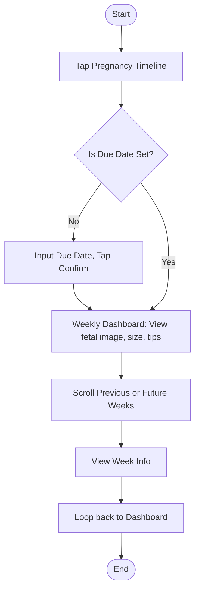
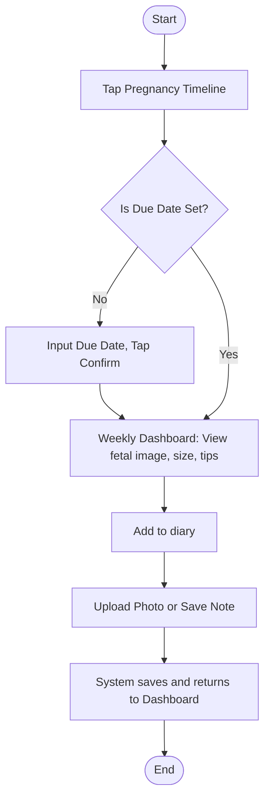
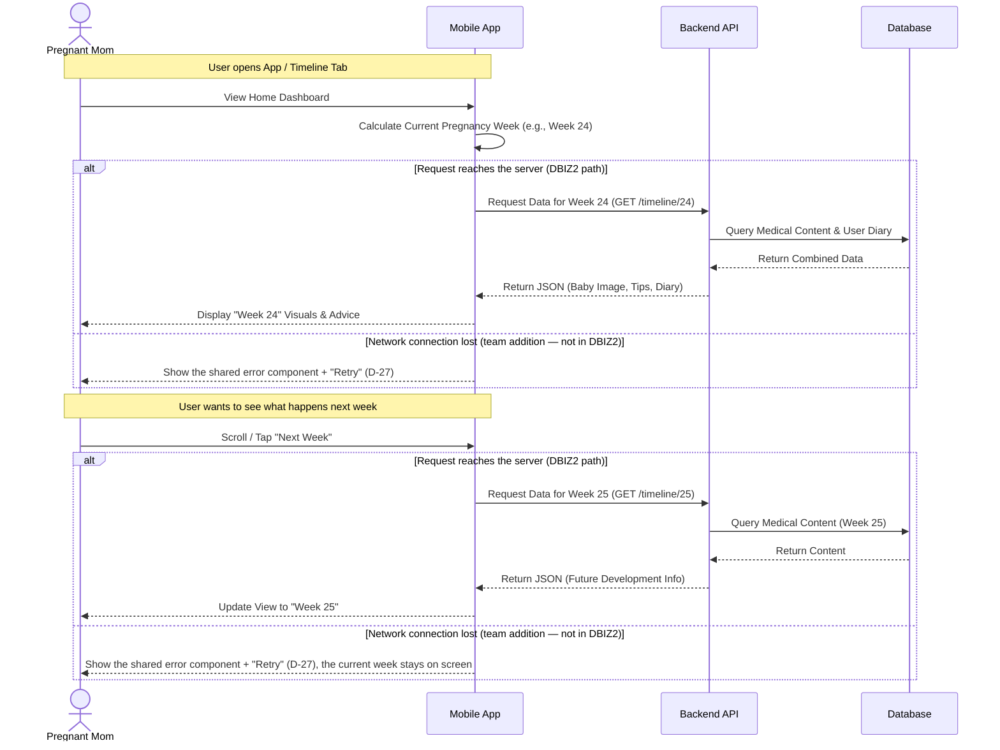
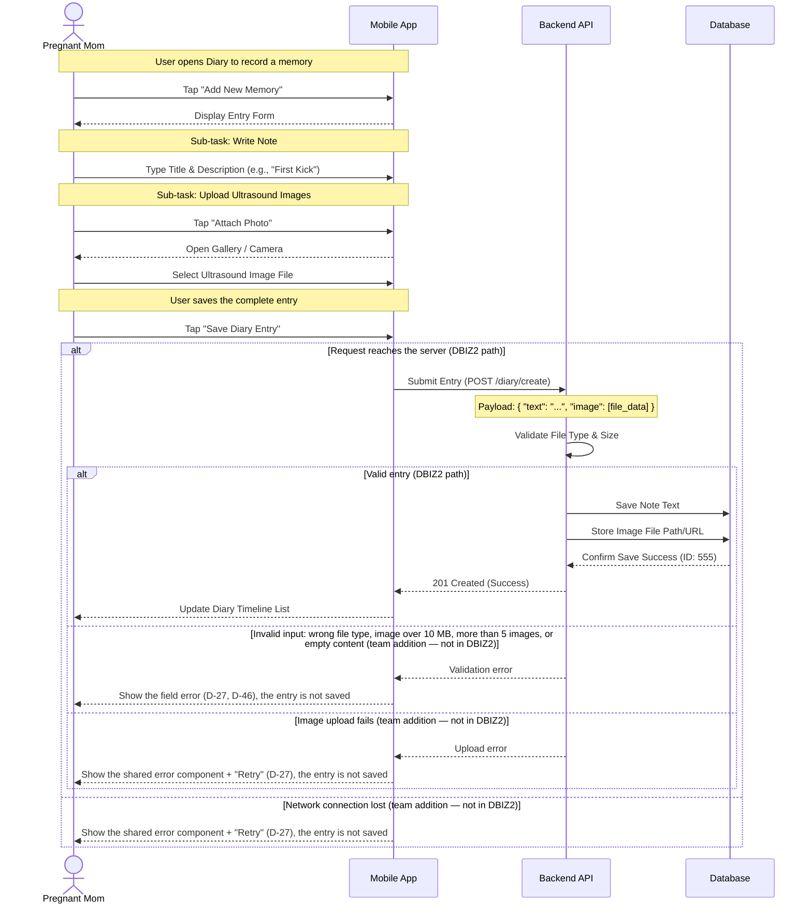
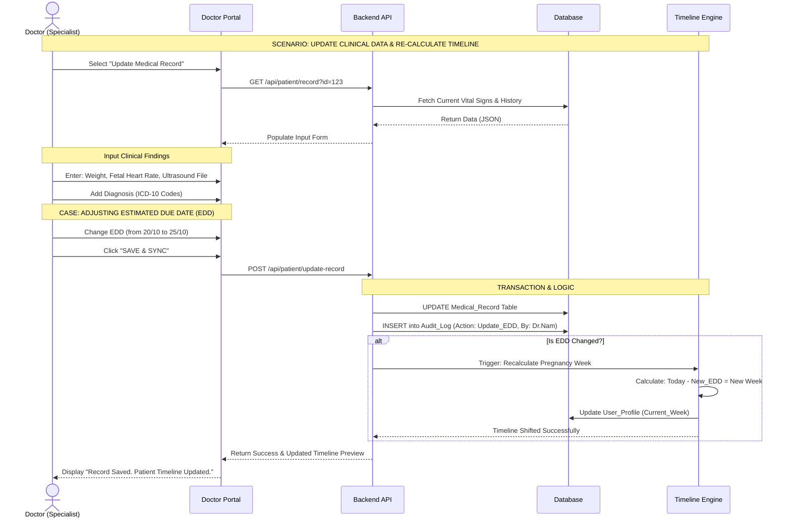

# Spec Document: Pregnancy Timeline & Diary

| Field | Value |
|---|---|
| Module ID | `TML` |
| Module name | Pregnancy Timeline & Baby Memory Journal |
| Spec version | v1.5.4 (30/09/2026: Family Message `patient_id` declared — DM-33; gestational_week 0–42 per the data-model review; review 29/09/2026: TML-01 – TML-05, HLT-06, X-07 / DM-25 data types; Messages to Baby = Must item, pending Client approval, per the latest MVP Scope) |
| Author (team member) | Tâm (drafted 16/09/2026) — diagrams checked node by node by Ánh, 17/09/2026 (verifier ≠ converter) |
| Date | 30/09/2026 |
| Status | Draft |
| Approved by (Client role) | *pending* |
| DBIZ2 source | Function List rows `F-077`, `F-080`, `F-085`–`F-089`, `F-092`–`F-094` (10 rows); Screens `S-044`–`S-053` |

---

## 1. Purpose and scope (mandatory)

This module lets the mother view her pregnancy week by week, with content **tied to actual visits** (ultrasound image, measurements from the ultrasound report with the visit date, doctor's note — D-04), a free-form **diary** she can write in at any time, and weekly **"Messages to Baby"** from the mother and father — part of the Must item "Pregnancy Timeline & Baby Memory Journal" in the latest MVP Scope, pending Client approval (D-03) `[PENDING CLIENT: D-03]`. It serves the objective "Daily Habit Formation" (MVP v8 §4; DBIZ2): making the app a companion rather than a one-off tool.

Per D-30, the pregnancy timeline screen (S-048) and the diary form (S-051) belong to the **Home** tab.

**In scope**

- Fetching and displaying the content of the current gestational week, and prefetching adjacent weeks for smooth navigation; navigation is by **week** using the ‹ / › arrows (D-04).
- Displaying **visit-linked** content for the week being viewed: ultrasound image, measurements from the ultrasound report (fetal length, estimated fetal weight) with the report date, doctor's note, and the source label "From visit" (D-04, D-10). A week with no visit shows "No visit this week." and does **not** show any system-generated measurements (D-04).
- Pregnancy diary: creating, entering (content required; mood and photos optional) and saving a diary entry linked to the current week; displaying the diary entries of the week being viewed on S-048.
- "Messages to Baby": the mother and father write messages per week, up to 200 characters each; the father writes on the mother's device and does not need his own account. Listed in the latest MVP Scope under the Must item "Pregnancy Timeline & Baby Memory Journal" — **pending Client approval** (D-03) `[PENDING CLIENT: D-03]`. If the Client does not approve, it is removed.

**Out of scope**

- **Weekly tips / reference educational content** (and the "Size of" card) — removed from S-048 and replaced by content tied to actual visits (D-02) `[PENDING CLIENT: D-02]`. As a consequence, the link to library content (FR-001) and detailed weekly educational content (FR-007) are not built in the MVP if the Client approves D-02.
- **System-generated weekly fetal measurements** (standard fetal size/weight by gestational week, not taken from a visit report) — not displayed (D-04).
- **Day-of-week selection** (the Monday–Friday selector in the DBIZ2 mockup) — removed; navigation is by week only (D-04).
- Uploading or editing visit-linked milestones (ultrasound images, doctor's notes) themselves — MVP v8 describes these as tied to actual hospital visits, i.e., clinician-authored, not something this module lets the mother create from scratch (see BR-001).
- Recalculating the pregnancy week from a changed estimated due date (EDD) — that logic exists in DBIZ2 (§4.2's Figure 10, background only) but sits entirely on the doctor-facing, out-of-MVP-scope side (`Deep Two-Way HIS/EMR Integration = Won't`).
- The Knowledge Library itself (browsing/searching a full article catalog, `F-145`–`F-148`) — the Session 4 assignment document excludes this range from the specced modules (see `docs/decisions.md`, "Module scope and key corrections").
- Separate accounts for the father or other family members (D-03) `[PENDING CLIENT: D-03]`.
- First-time due date entry: screen S-046 is drawn together with S-007 "Pregnancy setup", which belongs to the `ACC` onboarding flow; this module only uses the result (due date / gestational week).

**Depends on**

- `ACC` for the logged-in identity and the pregnancy context (due date / current week) the timeline is built from. The due date is declared on S-007 + S-046 ("Pregnancy setup"), shown once after the mother agrees to connect, when the system has no due date yet; if a hospital record is linked, the hospital's due date takes priority.
- Visit data (source "From visit", D-10) for the visit-linked content on S-048: **simulated as seed data prepared by the clinical role; there is no visit entry screen** (D-59, HLT-06). Ultrasound images and doctor's notes on S-048 come from these seed Visit records; photos the mother adds herself go through the diary (FR-009) (TML-03).

## 2. Actors (mandatory)

| Actor | Role in this module | Where it comes from |
|---|---|---|
| Mom | Primary | Function List `Actor` column (`F-087`, `F-089`, `F-092`, `F-093`) |
| App | Secondary | Function List `Actor` column (`F-080`, navigation gesture handling) |
| System | Secondary | Function List `Actor` column (fetch/prefetch/save rows) |
| Father (family member) | Secondary — only writes "Messages to Baby" on the mother's device; has no account of his own and is not a logged-in actor | D-03 `[PENDING CLIENT: D-03]`; not in the DBIZ2 Function List |

## 3. User scenarios and acceptance criteria (mandatory)

### US-1 (P1): View pregnancy content by week

**Journey.** As a `Mom`, I want to `see what's happening in my pregnancy this week`, so that `I feel informed and connected to what my body and baby are going through`.

**Acceptance scenarios**

1. **Given** the mother is logged in and has a due date, **When** she opens the Pregnancy timeline (S-048, from the gestational week card on S-008), **Then** the system shows the current week with its date range (`dd/mm/yyyy – dd/mm/yyyy`).
2. **Given** the week being viewed has a visit, **When** the screen is displayed, **Then** the system shows the "Visit `dd/mm/yyyy`" block with the label "From visit": ultrasound image, fetal length, estimated fetal weight, the line "Measurements per ultrasound report dated `dd/mm/yyyy`", and the doctor's note (D-04).
3. **Given** the week being viewed has no visit, **When** the screen is displayed, **Then** the system shows "No visit this week." and does not show any fetal measurements (D-04, BR-003).
4. **Given** S-048 is open, **When** the mother taps the ‹ (previous week) or › (next week) arrow, **Then** the system shows that week's content, using the prefetched data (FR-002, FR-004).
5. **Given** a week is being viewed, **When** the screen is displayed, **Then** the system shows that week's diary entries and "Messages to Baby" (FR-011 `[PENDING CLIENT: D-03]`).

### US-2 (P1): Add a diary entry

**Journey.** As a `Mom`, I want to `write down a note or memory and optionally attach a photo`, so that `I keep a personal record of my pregnancy journey`.

**Acceptance scenarios**

1. **Given** S-048, **When** the mother taps "+ Add diary entry", **Then** the system opens the "Add diary entry" popup (S-051 + S-052) over S-048, showing "Week N – current week" and "Date `dd/mm/yyyy` (automatic)".
2. **Given** the mother is viewing a week other than the current week, **When** she opens the form and saves, **Then** the diary entry is still linked to the **current week**, not to the week being viewed (FR-008, BR-005).
3. **Given** the popup is open, **When** the mother enters Content (required), optionally selects a Mood (Happy / Calm / Nervous / Tired / Worried) and optionally adds photos (Take photo / Library; JPG/PNG), then taps "Save diary entry", **Then** the system saves the diary entry, shows the message "Diary entry saved" (S-053) and returns to S-048 (FR-010).
4. **Given** the popup is open, **When** the mother leaves Content empty and taps "Save diary entry", **Then** the system does not save and shows a field error using the shared error component (D-27). `[NEEDS CLARIFICATION: the error message wording has not been drawn]`
5. **Given** the popup is open, **When** the mother taps "Cancel", **Then** the popup closes, nothing is saved, and the mother stays on S-048.
6. The entry date is set automatically by the system; the mother cannot edit it (BR-002).

### US-3 (P2): Write "Messages to Baby" `[PENDING CLIENT: D-03]`

**Journey.** As a `Mom` (or the father, using the mother's device), I want to `leave a message for the baby each week`, so that `the family has a shared keepsake of the pregnancy`.

**Acceptance scenarios**

1. **Given** S-048, **When** the mother taps "+ Message from Mom" or "+ Message from Dad", **Then** the system lets her enter a message with the corresponding author (Mother / Father). `[NEEDS CLARIFICATION: the input form (inline field or popup) has not been drawn]`
2. **Given** a message is being entered, **When** the content exceeds 200 characters, **Then** the system does not allow the excess to be saved (BR-004). `[NEEDS CLARIFICATION: block typing, or show an error on save]`
3. **Given** a message has been saved, **When** the mother views that week on S-048, **Then** the "Messages to Baby · Week N" block shows each message with the label "From Mom · `dd/mm/yyyy`" or "From Dad · `dd/mm/yyyy`" and its content.
4. The father writes on the mother's device, within the mother's logged-in session; there is no separate account or login for the father (D-03).

### Edge cases

- The mother has no due date yet (first use): handled in onboarding S-007 + S-046 "Pregnancy setup" (module `ACC`) — the mother enters her due date or the first day of her last menstrual period, and the system calculates the gestational week; after confirming → S-008. An error is shown when the due date is in the past or the gestational week is outside 0–42 weeks (per the text on wireframe S-007). DBIZ2's "Is Due Date Set?" flow (§4.1) therefore no longer runs in this module.
- The mother attaches a file that is not JPG/PNG, or exceeds the maximum number of images or the maximum size per image (5 images, ≤ 10 MB per image — D-46).
- The due date changes after a doctor update (§4.2 Figure 10, background only) — wireframe S-007 only states "If a hospital record is linked, the hospital's due date takes priority"; whether diary entries / messages already linked to an earlier week are shifted — `[NEEDS CLARIFICATION]`.
- A week with more than one visit — `[NEEDS CLARIFICATION: the wireframe draws only one "Visit" block]`.
- A visit without an ultrasound image or without measurements — `[NEEDS CLARIFICATION: not drawn]`.
- Opening weeks after the current week with the › arrow — `[NEEDS CLARIFICATION: is there a maximum week, and what does a future week show besides "No visit this week."]`.

## 4. Flows (mandatory)

### 4.1 Usage flow

Textualized from DBIZ2's "Pregnancy timeline" Mom usage flow (two sub-flows: browsing, and adding a diary entry — see `docs/architecture/usage-flow.md`).

> **Note (D-04):** the two diagrams below are DBIZ2 reference diagrams and do not reflect the current wireframe design. Differences:
> - Sub-flow 1: the content of the "Weekly Dashboard" is content **tied to actual visits** (ultrasound image, measurements from the report, doctor's note), not system-generated weekly "fetal image, size, tips" (D-04); "tips" are removed `[PENDING CLIENT: D-02]`. The "Scroll Previous or Future Weeks" step is tapping the ‹ / › week arrows; the day selector is removed (D-04).
> - The "Is Due Date Set? → No → Input Due Date" branch belongs to the `ACC` onboarding S-007 + S-046 (see §3 Edge cases).
> - Sub-flow 2: "Add to diary" opens popup S-051 + S-052 over S-048; after saving, "Diary entry saved" (S-053) is shown and the mother returns to S-048.
> - "Messages to Baby" (US-3) is not in DBIZ2 and has no diagram `[PENDING CLIENT: D-03]`.

### 4.2 Sequence for the main flow

Textualized from DBIZ2 `Schematic2`, Figure 14 (image9.png, "Pregnancy Timeline" — weekly view/navigation) and Figure 16 (image35.png, "Manage Pregnancy Diary" — diary entry). Both are this module's own primary flows and are reproduced in full below.

> **Note:** Figure 14 returns "Baby Image, Tips, Diary" and "Future Development Info" — in the current design, tips / system-generated development information are removed (D-02 `[PENDING CLIENT: D-02]`, D-04); the week data is the week's visit data + diary entries + Messages to Baby. Figure 16 has a "Type Title & Description" step; the current form has only "Content" (no title field) and adds "Mood (optional)". The diagrams are kept verbatim as DBIZ2 reference.

#### Figure 14 — Pregnancy Timeline

#### Figure 16 — Manage Pregnancy Diary

**Failure branches (team addition — not in DBIZ2).** In Figures 14 and 16 every `else` branch marked "team addition" is **not in DBIZ2**, which draws only the happy path; the branches were added by the team from the limits and patterns already decided (D-27 shared error / field error, D-46 photo limits: up to 5 JPG/PNG images, ≤ 10 MB each; S-051 "Content" required). Whether the mother's typed content and selected photos are kept on screen after an error is `[NEEDS CLARIFICATION: §10 Q5]`.

#### Figure 10 — Update Medical Record / Pregnancy Info (background only, not MVP-in-scope)

**Not an MVP-in-scope flow.** This is exactly the doctor-writes-into-EMR functionality MVP v8 places under "Deep Two-Way HIS/EMR Integration = Won't" — the MVP instead uses simulated/manually-entered demo visit data. Kept here as background because it shows the underlying logic (an EDD change re-derives the current pregnancy week) that this module's `current_week` field depends on conceptually, even though the MVP will not build this doctor-facing write path itself — see §10 Q3. A shorter cross-reference to this section is kept in `spec-CLI.md` §4.2.

## 5. Functional requirements (mandatory)

| FR ID | DBIZ2 Subfunction ID | Requirement (system MUST ...) | Actor | Priority |
|---|---|---|---|---|
| FR-001 | F-077 | The system MUST link weekly health details to relevant educational or medical library content. Not built: weekly tips / reference content are removed from S-048 (D-02). | System | **Won't (D-02)** `[PENDING CLIENT: D-02]` |
| FR-002 | F-080 | The system MUST handle user interactions for navigating between weekly health data views. Navigation is by week using the ‹ / › arrows on S-048; there is no day selection (D-04). | App | Must |
| FR-003 | F-085 | The system MUST retrieve detailed health and pregnancy information for the current week. Week data = the week's visit data (if any) + diary entries + Messages to Baby of that week; it does not include system-generated weekly content (D-04). | System | Must |
| FR-004 | F-086 | The system MUST prefetch health data for adjacent weeks to improve navigation performance. This applies to the previous/next week reached with the arrows. | System | Must |
| FR-005 | F-087 | The system MUST display a milestone card highlighting key pregnancy or health milestones for the week. The milestone card is the week's **visit card**: visit date, the label "From visit", ultrasound image, fetal length, estimated fetal weight, "Measurements per ultrasound report dated `dd/mm/yyyy`", and the doctor's note. A week with no visit shows "No visit this week." (D-04). There is no "Size of" card (D-02 `[PENDING CLIENT: D-02]`). | Mom | Must |
| FR-006 | F-088 | The system MUST customize the weekly timeline based on the patient's pregnancy stage and health data. Personalization on S-048 consists of showing only the mother's own visit data, diary entries and messages according to her gestational week (D-04). DBIZ2's "preferences" are dropped: the MVP has no personalization settings (TML-04). | System | Must |
| FR-007 | F-089 | The system MUST display detailed educational and health-related content for a specific pregnancy week. Not built: replaced by visit-linked content (FR-005), D-02. | Mom | **Won't (D-02)** `[PENDING CLIENT: D-02]` |
| FR-008 | F-092 | The system MUST, when the user taps "Add diary," create a new pregnancy diary entry for the current pregnancy week. The "+ Add diary entry" button on S-048 opens popup S-051; the diary entry is always linked to the **current week**, even if the mother opens the form while viewing another week — BR-005. | Mom | Must |
| FR-009 | F-093 | The system MUST allow the user to input diary notes and upload ultrasound images or photos for a specific pregnancy week. S-051 + S-052: Content (required), Mood (optional: Happy / Calm / Nervous / Tired / Worried — per the MVP v8 "mood tag (optional)"), Photo(s) (optional, Take photo / Library, JPG/PNG; up to 5 images, ≤ 10 MB per image — D-46). **Ultrasound images tied to a visit are not uploaded here:** they come with the seed Visit record (BR-001, D-59); any photo the mother adds herself — including her own copy of an ultrasound — is a diary photo (TML-03, MVP "Upload Ultrasound & Media"). MVP v8 says "attached photo (optional)"; allowing up to 5 is a superset of the MVP, kept pending the team lead's choice (TML-01, §10 Q15). | Mom | Must |
| FR-010 | F-094 | The system MUST save pregnancy diary data, link it to the correct pregnancy week, and return the user to the Weekly Dashboard after a successful save. After saving, the message "Diary entry saved" (S-053, toast) is shown, then the mother returns to S-048. | System | Must |
| FR-011 | — (new) | The system MUST save and display "Messages to Baby" by gestational week: each message has an author (Mother / Father), content of up to 200 characters, and an automatic creation time; the father writes on the mother's device and has no account of his own (D-03). In the latest MVP Scope it belongs to the Must item "Pregnancy Timeline & Baby Memory Journal", **pending Client approval**. If the Client does not approve D-03, FR-011, BR-004, the Family Message entity and S-048 #14 – #19 are removed. | Mom (father writes on the mother's device) | **Must — pending Client approval** `[PENDING CLIENT: D-03]` |

**Note on F-085/F-086:** the Session 4 assignment document's own module ranges assign these two rows to both `HLT` (83–86) and `TML` (85–89), an internal overlap. Both are assigned to `TML` only, since their content ("fetch current week details," "prefetch adjacent week data") matches §4.2's Figure 14 week-fetch logic, not a health-metric concern. This resolves an overlap in the assignment document's own module ranges, not a renumbering of DBIZ2.

**Note:** FR-001 and FR-007 are kept as rows so that every DBIZ2 ID is retained. If the Client does not approve D-02, these two FRs return to Must and S-048 needs a Tips area to be drawn.

### 5.1 Input / Output contract

| FR ID | Input field | Type | Required | Output field | Type | Notes / validation |
|---|---|---|---|---|---|---|
| FR-001 | Week Info; Content Tags | INTEGER; TEXT | Yes | Content Links Generated | LIST / ARRAY | Link weekly detail to library content. **Won't (D-02)** `[PENDING CLIENT: D-02]` |
| FR-002 | Tap on ‹ / › arrow | EVENT (no payload) | Yes | *(UI navigation target)* | — | Navigate to previous / next week (D-04) |
| FR-003 | Current Date; EDD | DATE; DATE | Yes | Week Data Object | OBJECT | Contains: week number, date range of the week, list of the week's Visits (`spec-HLT.md` §6, D-42) (may be empty), the week's Diary Entries, the week's Family Messages (D-04, D-03) |
| FR-004 | Current Week ± 1 | INTEGER | Yes | Cached Data in Background |CONFIRMATION (no payload, background cache write)| Prefetch adjacent week data |
| FR-005 | Week Data | INTEGER | Yes | *(UI navigation target)* | — | Show the week's visit card; empty → "No visit this week." (D-04, BR-003) |
| FR-006 | Pregnancy Stage |INTEGER (pregnancy week)| Yes | Personalized Timeline JSON |OBJECT| Personalize weekly timeline by gestational week; no user preferences (TML-04) |
| FR-007 | Content ID | UUID | Yes | *(UI navigation target)* | — | Display detailed weekly content. **Won't (D-02)** `[PENDING CLIENT: D-02]` |
| FR-008 | Tap on "+ Add diary entry" | EVENT (no payload) | Yes | *(UI navigation target)* | — | Opens popup S-051; linked week = current week (BR-005) |
| FR-009 | Text (Content); Mood; Image File(s) | TEXT; ENUM (Happy / Calm / Nervous / Tired / Worried); FILE (image/blob, JPG/PNG) | Text Yes / Mood No / Image No | *(UI navigation target)* | — | Text: `[NEEDS CLARIFICATION: maximum length]`. Mood: `[NEEDS CLARIFICATION: single or multiple selection]`. Image: JPG/PNG; up to 5 images, ≤ 10 MB per image, no video (D-46) |
| FR-010 | Diary Draft Data; Week Info | OBJECT (diary entry fields, unsaved); INTEGER | Yes | Saved Diary Entry + Redirect | OBJECT (diary entry) + navigation EVENT | Save, show "Diary entry saved" (S-053), return to S-048. Entry date is set automatically on save (BR-002) |
| FR-011 | Week; Author; Text; created_at | INTEGER 0–42; ENUM (Mother / Father); VARCHAR(200); DATETIME | Yes; Yes; Yes; Yes (automatic) | Saved Family Message; list of the week's messages | OBJECT; LIST / ARRAY | Text ≤ 200 characters (D-03, BR-004). created_at is set by the system and displayed as `dd/mm/yyyy`. Week: `[NEEDS CLARIFICATION: week being viewed or current week]` — see §10 Q8. `[PENDING CLIENT: D-03]` |

### 5.2 Business rules

| Rule ID | Rule | Why it exists |
|---|---|---|
| BR-001 | Visit-linked timeline milestones (ultrasound images, doctor's notes) are tied to actual hospital visit dates and cannot be created or edited by the mother; only free-form diary entries (`FR-008`–`FR-010`) and "Messages to Baby" (`FR-011`, written by the mother / father `[PENDING CLIENT: D-03]`) are family-authored. | MVP v8 §5, "Pregnancy Timeline & Baby Memory Journal" row: "two parts... (1) Visit-linked milestones... tied to each actual hospital visit; (2) Free-form diary."; D-04. |
| BR-002 | A diary entry's date field is always recorded automatically at the time of saving; the mother cannot set or backdate it. | MVP v8 §5 explicit field list: "entry date (automatic), free-text note, mood tag (optional), and attached photo (optional)." Wireframe S-051 shows "Date … (automatic)". |
| BR-003 | System-generated weekly fetal measurements are not displayed. Fetal measurements (fetal length, estimated fetal weight) are shown only when they come from the ultrasound report of a visit, always together with the report date; a week with no visit shows "No visit this week." | D-04. |
| BR-004 | Each "Message to Baby" is at most 200 characters; the author is Mother or Father; the father writes on the mother's device and has no account of his own. | D-03 `[PENDING CLIENT: D-03]`; text on wireframe S-048. |
| BR-005 | A diary entry is always linked to the current gestational week at the time of saving, even if the form was opened while the mother was viewing another week. | FR-008 ("for the current pregnancy week"); rule note on wireframe S-051 ("Diary entry is linked to the current week (TML FR-008)"). |
| BR-006 | A saved diary entry (text, mood, photos) cannot be edited or deleted by the mother in the MVP. | D-60 (team decision; MVP v8 does not describe editing or deleting). |

## 6. Key entities

| Entity | Attributes (from Input/Output fields) | Relationships |
|---|---|---|
| Pregnancy Week Content | Week Info, date range of the week, Milestone data (= the Visits in the week — `spec-HLT.md` §6, D-42), Personalized Timeline JSON. **Not stored**: derived when the week is loaded (FR-003) — no types needed. *(Content Links — used only by FR-001, Won't (D-02) `[PENDING CLIENT: D-02]`.)* | belongs to Patient; one per week |
| Diary Entry | diary_id (UUID; Required), patient_id (UUID; Required), text — Content (TEXT; Required) `[NEEDS CLARIFICATION: maximum length — §10 Q9]`, mood (ENUM: Happy / Calm / Nervous / Tired / Worried; Optional), gestational_week — Week Info = current week at save time (INTEGER 0–42; Required), entry_date — set automatically by the system (DATE; Required) | belongs to Patient; many per patient; has 0..5 Diary Image; read-only after saving (D-60) |
| Diary Image | image_id (UUID; Required), diary_id (UUID; Required), file — path of a JPG/PNG image ≤ 10 MB (VARCHAR(255); Required), sort_order (INTEGER 1–5, D-46; Required) | at most 5 per Diary Entry (D-46; TML-01 pending) |
| Visit (shared entity) | Uses the Visit entity (`spec-HLT.md` §6, D-42 — types declared there): visit_date, ultrasound_image, fetal_length, estimated_fetal_weight, ultrasound_report_date, doctor_note; label "From visit" (D-10). Seed data in the MVP (D-59) | belongs to Patient; clinician-authored, out of this module's write scope (BR-001) |
| Family Message *(new, Must item pending Client approval, `[PENDING CLIENT: D-03]`)* | patient_id — the mother's account (UUID; Required — DM-33), week — gestational week (INTEGER 0–42; Required), author (ENUM: Mother / Father; Required), text (VARCHAR(200); Required), created_at — automatic (DATETIME; Required) | belongs to Patient (the mother's account); many per week; the father has no account of his own |

*Types (X-07 / DM-25): every attribute is written `name (TYPE; Required/Optional)`.*

## 7. Screens involved

### 7.1 Screens with a mockup

| Screen ID | Screen name | Priority | Screen Spec file | Notes |
|---|---|---|---|---|
| S-048 | Weekly Pregnancy Dashboard Screen ("Pregnancy timeline") | Must | `screens/screen-spec-S-048.md` | Week navigation with arrows, visit card, empty state "No visit this week.", the week's diary entries + "+ Add diary entry". Home tab (D-30). The "Messages to Baby" area is part of the Must item, **pending Client approval** `[PENDING CLIENT: D-03]` |
| S-051 | Pregnancy Diary Addition Screen | Must | `screens/screen-spec-S-051.md` (covers S-051 + S-052) | Drawn together with S-052 in one image: the "Add diary entry" popup over S-048 |
| S-052 | Pregnancy Memory Upload Screen | Must | `screens/screen-spec-S-052.md` (full spec, D-55; same mockup as `screen-spec-S-051.md`) | The "Photos (optional)" area of popup S-051 — same mockup |
| S-053 | Pregnancy Memory Save Success Screen | Must | — | No separate mockup: it is the "Diary entry saved" message (toast) followed by a return to S-048, noted on the S-051 mockup |
| S-046 | Due Date Input Screen | Must | `screens/screen-spec-S-046.md` (full spec, D-55; same mockup as `screen-spec-S-007.md` of module `ACC`; TML part: due date / LMP, gestational week) | Drawn together with S-007 in the `ACC` onboarding screen "Pregnancy setup" |

### 7.2 Screens without a mockup

| Screen ID | Screen name | Priority | Note |
|---|---|---|---|
| S-044 | Pregnancy Timeline Entry | Must | No separate mockup. The entry point is the gestational week + due date card on S-008 (opens S-048). `[NEEDS CLARIFICATION: is S-044 still a separate screen]` |
| S-045 | Due Date Check Screen | Must | Non-UI — due date check logic; it is now the condition for showing onboarding S-007 + S-046 ("when the system has no due date yet"). |
| S-047 | Due Date Confirmation Screen | Must | No separate mockup. `[NEEDS CLARIFICATION: do the "Calculated by the system" card and the "Confirm" button on S-007 + S-046 replace S-047]` |
| S-049 | Pregnancy Week Scroll Screen | Must | No separate mockup; week navigation is now the arrows on S-048 (D-04). `[NEEDS CLARIFICATION: is it still a separate screen]` |
| S-050 | Pregnancy Week Detail Screen | Must | No separate mockup; week details are shown directly on S-048. `[NEEDS CLARIFICATION: is it still a separate screen]` |

## 8. Success criteria (mandatory)

| SC ID | Criterion | How it is measured |
|---|---|---|
| SC-001 | A mother can find out what is happening in her pregnancy this week within a couple of taps of opening the app. | Usability walkthrough: count taps from home screen to weekly content. |
| SC-002 | A mother can write and save a diary entry with a photo without needing help or instructions. | Usability walkthrough with a first-time user. |

## 9. Assumptions

- Assumed "Due Date Check Screen" (S-045) is non-interactive system logic rather than a visible screen, based on its own Screen List overview ("System check for existing due date (non-UI logic)") — kept in the screens table for completeness since the assignment document instructs listing every screen a module touches, not only UI ones.
- Assumed the "milestone card" (FR-005, F-087) is reinterpreted as the visit card per D-04, rather than creating a new FR — because D-04 replaces the content of the same screen S-048 that FR-005 serves.
- "Manage Pregnancy Diary" (MVP v8 §4) = **create and view** diary entries in the MVP. Editing or deleting a saved entry is not provided (BR-006, D-60); this is a scope decision, not a missing function (TML-02).

## 10. Open questions

| # | Question | Blocking? | Owner | Status |
|---|---|---|---|---|
| 2 | Screens S-044, S-047, S-049 and S-050 have no mockup (S-045 is non-UI). See §7.2. | No | UX/UI | Open |
| 3 | [NEEDS CLARIFICATION: how does a change to the estimated due date (EDD) — an out-of-MVP-scope, doctor-facing action per §4.2's Figure 10 — actually reach this module's `current_week` calculation, if the write path itself is Won't-scope? Wireframe S-007 only states that the hospital's due date takes priority when a record is linked; the update mechanism, and whether saved diary entries / messages are moved to a different week, are not answered.] | No | Systems Analyst | Open |
| 5 | In DBIZ2, both §4.1 usage-flow sub-flows and both §4.2 sequence diagrams (Figures 14 and 16) draw only the happy path. Failure branches (network lost, invalid input, image upload failure) were added to §4.2 by the team and marked as not in DBIZ2; §4.1 is unchanged. Still open: after an error on S-051, are the typed content and the selected photos kept on screen? | No | UX/UI / Backend | Open |
| 7 | Does the Client approve (a) removing weekly tips / reference content (FR-001, FR-007 → Won't) and (b) adding "Messages to Baby" (FR-011 Proposed)? If (a) is not approved, FR-001/FR-007 return to Must and S-048 must be redrawn; if (b) is not approved, remove FR-011, BR-004, the Family Message entity and the "Messages to Baby" area on S-048. | Yes | Client | Open `[PENDING CLIENT: D-02]` `[PENDING CLIENT: D-03]` |
| 8 | [NEEDS CLARIFICATION: is a "Message to Baby" linked to the week being viewed or to the current week? The S-048 mockup shows the "+ Message from Mom / + Message from Dad" buttons on Week 26 (13/09 – 19/09/2026), while S-051 and S-007 state that the current week is Week 28 (27/09/2026). Also: can messages be edited / deleted; is there a limit on the number of messages per week; the input form (inline field or popup) has not been drawn.] | No | Product/PM / UX/UI | Open `[PENDING CLIENT: D-03]` |
| 9 | [NEEDS CLARIFICATION: maximum length of Content; single or multiple Mood selection.] (FR-006 "preferences" are dropped — TML-04.) | No | Product/PM / Backend | Open — column type TEXT decided in the data-model review (S4); the limit is checked in the application, the number is still to be set |
| 10 | Source of visit data for S-048: **resolved (D-59)** — seed data, see `spec-HLT.md` Q14. [NEEDS CLARIFICATION: how a week with several visits is displayed; how a visit missing an image / measurements is displayed.] | No | Product/PM / Systems Analyst | Open |
| 11 | [NEEDS CLARIFICATION: Error message wording when diary Content is empty] | No | UX/UI | Open |
| 12 | [NEEDS CLARIFICATION: "Messages to Baby" input form: inline field or popup?] | No | UX/UI | Open |
| 13 | [NEEDS CLARIFICATION: Over 200 characters: block typing or error on save?] | No | UX/UI | Open |
| 14 | [NEEDS CLARIFICATION: Maximum week reachable with ›; what a future week shows besides "No visit this week."] | No | UX/UI | Open |
| 15 | Number of photos per diary entry: MVP v8 says "attached photo (optional)"; the spec allows up to 5 (D-46). Keep up to 5 (a superset of the MVP, wording "photo(s)") or reduce to 1? If reduced to 1, S-051, S-052, FR-009, D-46 and Diary Image `sort_order` change. | No | Team lead | Open (TML-01) |
| DM-13 | [NEEDS CLARIFICATION: no FR deletes (D) any entity — can Messages to Baby be deleted? (diary entries and photos: never, D-60)] | No | TML (data model) | Open — default: No deletion |
| DM-25 | Columns without a declared type. | No | ACC / HLT / ALR / TML / BOT / APT / CLI (data model) | Resolved (X-07) — §6 declares `(TYPE; Required/Optional)` for every attribute; since 30/09/2026 this includes FAMILY_MESSAGE.`patient_id` (DM-33) |
| DM-33 | [NEEDS CLARIFICATION: TML §6 Family Message declares no identifier and no reference to the mother, only "belongs to Patient (the mother's account)"] | No | TML (data model) | Partly resolved 30/09/2026 — `patient_id` (UUID; Required) declared in §6 above; the identifier of the row is part of DM-34 (open) |
| DM-34 | [NEEDS CLARIFICATION: CONSENT_RECORD, EMR_LINKAGE_REQUEST, REPORT_SYMPTOM, CASE_STATUS_HISTORY, PATIENT_ASSIGNMENT and FAMILY_MESSAGE have no declared identifier — composite natural keys, or surrogate ids?] | No | ACC / ALR / CLI / TML (data model) | Open — default: Composite natural keys: (`user_id`, `accepted_at`), (`user_id`, `requested_at`), (`report_id`, `symptom`), (`case_id`, `status`), (`patient_id`, `valid_from`), (`patient_id`, `created_at`) |

*Missing numbers are closed questions; numbers are not reused so that references stay valid.*

## Clarifications

### Q7: Weekly tips and Messages to Baby
- (a) Weekly tips / reference content are removed (FR-001 and FR-007 stay Won't).
- (b) "Messages to Baby" is kept; each message is text, at most 200 characters.

## 11. Traceability to DBIZ2

| Spec section | DBIZ2 source | Location |
|---|---|---|
| 1. Purpose | MVP v8 §5 MoSCoW, "Pregnancy Timeline & Baby Memory Journal" row | `docs/prd.md` (MVP Scope v8) |
| 4.1 Usage flow | "Pregnancy timeline" Mom usage flow (both sub-flows) | sheet `Schematic2`, Figure 3 |
| 4.2 Sequence | Figures 14 and 16 | sheet `Schematic2`, Figure 14 (image9.png), Figure 16 (image35.png) |
| 5. Functional requirements | Function List | sheet `FL&Cost1`, rows 77, 80, 85–89, 92–94 (FR-011: not in DBIZ2 — D-03) |
| 7. Screens | Screen List | sheet `ST`, rows 44–53 |

---

## Completion checklist

- [x] Every subfunction of this module in the DBIZ2 Function List appears as an FR row. (10/10; FR-011 is additional)
- [x] Every Input and Output field has a type and a required flag, or is marked `[NEEDS CLARIFICATION]`.
- [x] Every Mermaid block renders without an error.
- [ ] Every node and arrow in the Mermaid flow exists in the original DBIZ2 diagram. — checked by Ánh The §4.1 flowchart and the §4.2 failure branches (marked "team addition — not in DBIZ2") were changed after the check of 17/09/2026 — Ánh to re-check.
- [x] At least one business rule is written that is not visible in any diagram. (BR-001 – BR-005)
- [x] Every screen this module touches is listed; screens with a mockup in §7.1, screens without a mockup in §7.2.
- [x] Success criteria contain no technology words.
- [x] Open questions are recorded in §10.
- [x] The traceability table points to real rows/sheets/figures.
